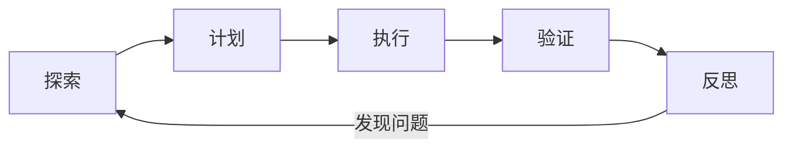

# Agent Workflow

> Agent 的效率来自自主循环，风险也来自自主循环。工程化的工作流就是把自主性装进边界。

一个编程 Agent 可以读文件、搜代码、改文件、跑命令、看测试结果，再根据结果继续。它看起来像一个会自动干活的同事，但如果没有工作流，很容易变成反复试错、修改无关文件、测试失败还宣称完成的循环。

Agent Workflow 要定义：什么时候读、什么时候改、什么时候运行命令、什么时候停止、什么时候找人确认。自主性不是问题，没有边界才是。

## 本章目标

学完本章，你应该能够：

- 设计探索、计划、执行、验证和反思的循环。
- 在沙箱和隔离分支中限制 Agent 权限。
- 设置检查点、回滚、预算和停止条件。
- 识别无限循环、无关修改和过早完成。

## 基本循环

探索阶段读 README/规则、找入口、跟踪调用链、读测试、确认影响范围。计划阶段列修改步骤、标风险、说明不做什么，复杂任务等确认。执行阶段小步修改，一次一个逻辑单元，不修改无关文件，每步看 diff。验证阶段编译、测试、lint、类型检查和手动检查。反思阶段判断失败原因，决定重试、换方案还是停止询问。

## 沙箱、权限与检查点

Agent 应该在隔离分支或 worktree 中工作，限制可修改路径、可执行命令和网络访问；危险命令需要确认；生产环境禁止直接操作。

每个阶段要有可回滚点：修改前提交或 stash，小步提交，保存 diff，记录测试结果，失败时能回到上一个可用状态。不要让 Agent 在一个不可回滚的工作区里连续大改。

::: warning 默认只读，写操作逐步授权
读取代码通常风险较低，写文件、执行 shell、访问网络风险更高。默认只读，写操作按需授权，危险命令必须确认。不要因为 Agent “通常很聪明”就给它生产环境权限。
:::

## 任务拆解与测试驱动

好的任务像“修复 OrderService 重复扣款，只改 OrderService 和测试”；坏的任务像“优化整个订单系统”。拆解可以按文件、按行为、按测试或按风险。

推荐测试驱动：人先写验收标准或失败测试，Agent 实现，运行测试，人 review 测试是否有效。防止 Agent 修改测试期望来通过、测试只验证实现细节、没有断言。

## 多 Agent 与失败模式

多 Agent 适合任务可清晰拆分、子任务独立、不同角色需要不同工具的场景。常见模式是探索 Agent、实现 Agent、审查 Agent。但通信成本高、状态不一致、错误级联、难以调试，也容易出现“Agent 之间互相客套，但没有进展”。

::: details 小问题：什么时候该用多 Agent？
当任务可以并行拆分，或者需要独立审查、不同工具权限、不同专业角色时。单 Agent + 好工具 + 好测试能解决时，不要引入多 Agent；它会把复杂度从代码扩散到协作。
:::

常见失败模式包括：无限循环、过早宣称完成、修改无关文件、不运行测试、测试失败后改测试、不理解代码就重写、上下文膨胀、危险命令、成本失控、没有回滚点。

## Agent Workflow Review 矩阵

| 维度 | 必须回答 | 不满足时怎么办 |
| --- | --- | --- |
| 任务 | 目标和范围是否明确？ | 拆成可验证的小任务 |
| 探索 | 是否先读代码和测试？ | 先解释调用链再修改 |
| 隔离 | 是否在沙箱/分支中工作？ | 用 worktree，限制权限 |
| 回滚 | 是否有检查点？ | 小步提交，保存 diff |
| 验证 | 是否运行测试和 lint？ | 每步验证，失败先分析 |
| 预算 | 是否有步骤和成本上限？ | 加停止条件和循环检测 |
| 责任 | 是否由人做最终 review？ | 不合并未审查的改动 |

## 总结

Agent Workflow 的核心，是把自主循环装进工程边界：

- 探索、计划、执行、验证、反思，每一步都要可检查。
- 沙箱、权限、检查点和预算，是 Agent 能安全工作的前提。
- 测试和人工 review，是 Agent 不能替代的最后一道门。

如果只能记住一件事：Agent 可以自主执行，但不能自主承担责任。

## 相关阅读

- [Context](/ai-coding/context)
- [Prompt](/ai-coding/prompt)
- [Agent](/ai-engineering/agent)
- [AI Coding 工程方法](/ai-engineering/ai-coding)
