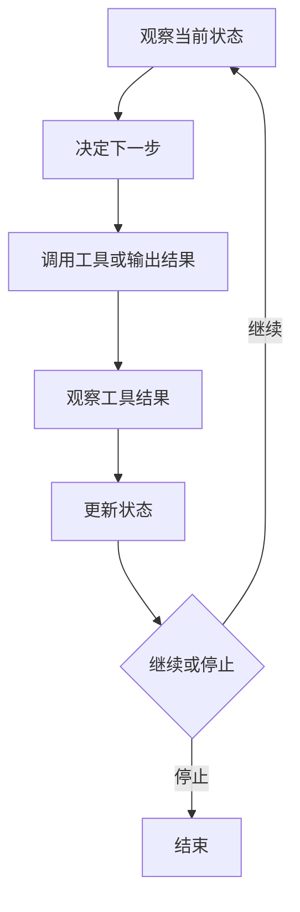

# Agent

> Agent 是“模型 + 工具 + 状态 + 循环 + 停止条件”的系统，不是一个更长的 Prompt。

Agent 最容易被做成一个会调用工具的聊天机器人：模型每轮都可以选工具，工具结果又回到上下文，看起来能一直做下去。但如果没有结构化状态、停止条件和权限边界，它很容易陷入重复调用、目标漂移和“看起来完成”的循环。真正的 Agent 工程，重点不在让模型更自由，而在让自由有边界。

## 本章目标

学完本章，你应该能够：

- 解释 Agent 循环与 Workflow 的区别。
- 设计状态、规划、停止条件和预算。
- 给工具和写操作设置权限与人工确认。
- 识别无限循环、目标漂移和过早停止。

## Agent 到底是什么

Agent 让模型在循环中完成多步任务：观察当前状态，决定下一步，调用工具或输出结果，观察工具结果，更新状态，然后继续或停止。



与 Workflow 的区别不在于“谁更智能”，而在于谁决定下一步。Workflow 由代码预先定义步骤，适合稳定、可验证的流程；Agent 由模型动态决定下一步，适合开放式、步骤不确定的任务。能画出流程图的任务，优先用 Workflow；只有下一步真的取决于中间结果时，才需要 Agent。

| 方式 | 谁决定下一步 | 适合场景 | 主要风险 |
| --- | --- | --- | --- |
| Workflow | 代码 | 步骤稳定、结果可验证 | 灵活性较低 |
| Agent | 模型 | 开放式、需要动态调整 | 成本、延迟和不可控性更高 |

## 循环：规划、行动、观察

常见规划方式是 Plan-and-Execute：先列出步骤，再逐步执行。计划应该可修改，而不是一旦生成就盲目执行。ReAct 则交替进行推理和行动，适合需要根据工具结果调整策略的任务；Reflection 在执行后检查结果是否满足目标、是否有错误、是否需要补充信息。

反思要有明确标准，否则容易变成自我肯定的循环。Agent 不应该只问“我做得怎么样”，而应该问“目标是否达成、证据是否充分、下一步是否需要换方法”。

## 状态与停止条件

不要把整个对话历史当成状态。更稳的做法是维护结构化状态：目标、计划、已完成步骤、观察、产物和未解决问题。结构化状态容易压缩、恢复、判断进度，也方便人工接管。

```json
{
  "goal": "修复订单结算的重复扣款问题",
  "plan": ["定位结算入口", "检查幂等逻辑", "补充测试", "运行验证"],
  "completed": ["已定位 OrderService.settle"],
  "observations": ["settle 没有幂等键"],
  "artifacts": ["src/main/java/.../OrderService.java"],
  "open_questions": ["重试由客户端还是网关发起？"]
}
```

停止条件必须显式定义：目标已达成、达到最大步骤数、达到 token/成本预算、连续多次没有进展、连续多次工具失败、需要人工确认、用户取消、检测到安全风险。没有停止条件的 Agent，本质上是一个可能无限花钱的循环。

::: tip 先设计停止条件，再设计 Agent
不要先写“让 Agent 自主完成任务”，再想怎么停下来。先定义什么算完成、最多花多少步、失败几次要退出、什么情况必须找人确认，Agent 的行为才会可控。
:::

## 工具、安全与多 Agent

Agent 的工具使用要遵循 Tool Calling 的规则：工具描述清晰、参数严格校验、权限最小化、写操作幂等、错误结构化、危险操作人工确认。额外要注意：不要让 Agent 自己发现并调用未授权工具，不要把所有工具一次性暴露给所有步骤，对工具结果做截断、摘要和脱敏。

安全边界包括权限、沙箱、输出校验和预算。默认只读，写操作按需授权，危险操作需要人工确认；限制文件系统、网络、可执行命令和资源使用；结构化输出做 schema 校验，SQL、shell、URL 不接受模型自由生成。

多 Agent 适合任务可以清晰拆分、子任务需要不同工具或角色、子任务之间大部分独立的场景。常见模式是 Orchestrator-Worker、Specialist 和 Reviewer。但多 Agent 的通信成本高、状态同步困难、错误会级联、难以调试和评估，也容易出现“Agent 之间互相客套，但没有进展”。

::: warning 多 Agent 不是默认答案
先尝试单 Agent + 好工具 + 好状态 + 好测试。只有当任务确实需要并行、分工或独立审查时，再引入多 Agent。否则你只是把复杂度从一个 Agent 扩散到了多个 Agent。
:::

## 评估与失败模式

Agent 评估不能只看最终答案，还要看任务成功率、平均步骤数、工具调用成功率、重试次数、延迟、单任务成本、人工接管率、危险操作拦截率、失败恢复能力和结果可复现性。

常见失败模式包括：无限循环、过早停止、目标漂移、工具幻觉、忽略错误、上下文膨胀、过度规划、危险操作、不可复现和评估偏差。评估集要覆盖简单任务、多步任务、工具失败、信息缺失、诱导越权和需要停止并询问用户的任务。

::: details 小问题：为什么 Agent 需要结构化状态？
因为对话历史不等于任务状态。历史里有寒暄、重复确认和已经废弃的计划，模型很难从中可靠判断“现在做到哪了”。结构化状态把目标、计划、观察和未解决问题分开，既能压缩上下文，也能在中断后恢复和人工接管。
:::

## Agent Review 矩阵

| 维度 | 必须回答 | 不满足时怎么办 |
| --- | --- | --- |
| 必要性 | 这个任务真的需要 Agent 吗？ | 能画流程图就先用 Workflow |
| 停止 | 是否有明确停止条件和预算？ | 加最大步骤、时间和成本上限 |
| 状态 | 状态是否结构化、可恢复？ | 用目标/计划/观察/产物分离状态 |
| 工具 | 权限是否最小化、写操作是否幂等？ | 加校验、确认和审计 |
| 安全 | 是否有沙箱和人工接管？ | 限制文件、网络和命令 |
| 评估 | 是否覆盖失败、越权和停止场景？ | 建任务集和回归用例 |
| 观测 | 是否记录完整执行轨迹？ | 记录模型、工具、参数和结果 |

## 总结

Agent 的能力来自循环，风险也来自循环：

- Workflow 优先，只有步骤真的不确定时才用 Agent。
- 状态要结构化，停止条件和预算要显式。
- 工具权限、人工确认和沙箱不是附属功能，而是 Agent 能上线的前提。

如果只能记住一件事：一个没有停止条件、没有状态、没有权限边界的 Agent，不是一个更聪明的系统，只是一个更贵的循环。

## 相关阅读

- [Workflow](/ai-engineering/workflow)
- [Tool Calling](/ai-engineering/tool-calling)
- [MCP](/ai-engineering/mcp)
- [Memory](/ai-engineering/memory)
- [Evaluation](/ai-engineering/evaluation)
