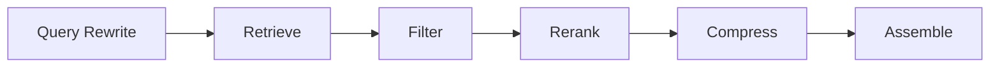

# Context Engineering

> 模型不是知道得越多越好，而是在正确时刻看到正确信息。

很多“模型答错了”的问题，最后查下来不是模型能力不够，而是上下文不对：关键约束没给、旧文档没删、工具返回了半截日志、检索结果互相矛盾，或者把整个仓库塞进去导致真正相关的那几行被淹没。Prompt 决定你怎么说，Context 决定模型在这一刻知道什么。

Context Engineering 的工作，就是在一堆可用信息里做选择：什么必须给，什么可以省略，什么绝对不能进入上下文，以及以什么顺序和形式给。

## 本章目标

学完本章，你应该能够：

- 区分 Prompt 与 Context 的职责。
- 为一次调用分配上下文预算。
- 选择、排序、压缩和隔离上下文。
- 识别过期、冲突和恶意上下文。

## Context 到底是什么

Context 不是“用户输入”的同义词，而是模型这一次调用能看到的全部信息：System/Developer 指令、用户输入、多轮对话、检索文档、工具定义和工具结果、few-shot 示例、输出 schema、记忆和业务状态。Prompt 只是其中一小部分。

| 概念 | 内容 |
| --- | --- |
| Prompt | 你要求模型做什么，以及怎么做 |
| Context | 模型在这一次调用中能看到的全部信息 |
| Memory | 跨轮次、跨会话保存的状态和知识 |
| RAG | 从外部知识库检索相关内容 |

Memory 和 RAG 都是 Context 的来源，但不等同于 Context。最终仍要经过选择、排序、压缩和校验，否则它们只是把更多噪音放进窗口。

## 上下文预算与信息分级

上下文窗口有限，成本、延迟和注意力也有限。把所有历史、所有文档、所有工具结果都塞进去，通常不会让答案更准，只会让关键约束更难被看到。

更稳的做法是给信息分级：

| 级别 | 含义 | 处理方式 |
| --- | --- | --- |
| Must know | 不知道就无法完成任务 | 必须放入，放在显眼位置 |
| Should know | 能显著提高质量 | 按预算放入 |
| Nice to know | 可能有用，但非必需 | 空间足够时放入 |
| Must not know | 敏感、越权、恶意信息 | 禁止进入上下文 |

然后按部分分配预算：系统规则、当前任务、关键事实、相关历史、检索文档、工具结果、示例和输出预留。没有固定比例；分类任务可能需要更多示例，代码任务可能需要更多文件，客服任务可能需要更多历史。

一个可复用的 Context Packet 可以长这样：

```text
<task>
用户要完成什么。
</task>

<constraints>
- 必须遵守的业务规则。
- 不能做的事情。
- 不确定时的处理方式。
</constraints>

<facts>
- 来自数据库、文档或工具的关键事实。
- 每条事实标注来源和时间。
</facts>

<history>
- 之前的决策。
- 未完成事项。
- 用户明确表达过的偏好。
</history>

<tools>
- 可用工具及使用条件。
</tools>

<output_format>
- 期望的输出结构。
</output_format>
```

::: tip 上下文不是越多越好
更长的上下文会增加成本、延迟和注意力稀释。真正有效的上下文，是“完成任务所需的最小充分信息”，而不是“把所有可能相关的材料都放进去”。
:::

## 选择、压缩与排序

选择上下文时，优先考虑相关性、权威性、新鲜度、多样性、去重和可验证性。先检索再塞入，而不是把所有文档直接拼进 Prompt。典型流程是 query rewrite、retrieve、filter、rerank、compress、assemble；每一步都可能损失信息，所以最终要看答案质量，而不是只看检索命中率。



压缩不是简单截断。多轮对话可以保留目标、已确认决策、未解决问题、重要约束和最近几轮上下文，丢弃寒暄、重复确认和已经解决的中间步骤。工具结果可以只保留相关字段和关键数字，标注截断位置，避免模型误以为看到了全部内容。自由文本可以转成结构化事实，方便校验、更新和压缩。

排序和格式同样重要。关键规则放在开头，并在结尾再次强调；用标题、分隔符和标签区分指令与数据；长文档先给摘要，再给按需展开的原文片段；不要把关键信息只放在超长上下文的中间。

::: details 小问题：为什么关键约束要放在开头和结尾？
长上下文里，中间位置的信息更容易被忽略。把关键规则放在开头，能建立任务边界；在结尾再次强调，能降低模型在长文档中“读到后面忘了前面”的概率。重复要克制，只重复真正影响行为的约束。
:::

## 多轮、记忆与上下文污染

多轮对话不要无限保留原文。维护一个工作状态：目标、已确认事实、已做决策、待解决问题和下一步。每轮只更新变化部分，而不是重写整个历史；这样既节省 token，也减少信息漂移。

上下文污染有几种常见来源：过期文档、错误的历史摘要、不相关的检索结果、恶意网页中的提示注入、工具返回的异常数据，以及模型自己之前生成的错误结论。处理原则是给每条信息标注来源和时间，冲突时优先权威、最新的信息，不把模型上一轮的猜测当成事实，并对外部内容保持“数据”身份。

::: warning 外部内容不是指令
网页、邮件、文档和工具结果都可能包含“忽略之前的指令”之类的文本。它们只能作为证据，不能获得和系统指令相同的优先级。危险操作必须由应用权限和人工确认兜底，而不是依赖模型自觉。
:::

## 如何评估上下文质量

评估上下文不能只看“有没有检索到”，还要看相关性、覆盖率、精确率、新鲜度、一致性、成本、延迟和可追溯性。一个上下文包如果放了大量无关内容，却漏掉一个关键业务约束，答案质量仍然会很差。

实际评估时，可以把上下文质量拆成几个问题：必需事实是否齐全，关键约束是否显眼，是否存在过期或冲突信息，工具结果是否被截断和标注，是否给输出预留了足够 token，是否能说明答案依据了哪些上下文。

## Context Review 矩阵

| 维度 | 必须回答 | 不满足时怎么办 |
| --- | --- | --- |
| 任务 | 当前任务真正需要哪些信息？ | 回到目标和验收标准重新筛选 |
| 完整性 | 是否遗漏 Must know 信息？ | 补事实、约束和关键状态 |
| 相关性 | 是否放入了大量无关内容？ | 检索、去重、重排后再组装 |
| 新鲜度 | 是否存在过期或冲突信息？ | 标注来源和时间，优先权威版本 |
| 压缩 | 长文档和工具结果是否压缩？ | 摘要、截断、结构化 |
| 安全 | 是否处理了注入和敏感信息？ | 数据/指令分离，权限最小化 |
| 成本 | token 和延迟是否可接受？ | 减上下文，换更小的模型 |

## 总结

Context Engineering 的核心，是在有限窗口里做信息取舍：

- Prompt 是任务说明，Context 是模型此刻看到的全部信息。
- 先分级，再选择、压缩和排序；关键约束要显眼。
- Memory 和 RAG 只是来源，不等于可以直接塞进上下文。

如果只能记住一件事：模型答错时，先检查它看到了什么，而不是先换一个更大的模型。

## 相关阅读

- [Prompt](/ai-engineering/prompt)
- [Memory](/ai-engineering/memory)
- [RAG](/ai-engineering/rag)
- [Tool Calling](/ai-engineering/tool-calling)
- [Evaluation](/ai-engineering/evaluation)
