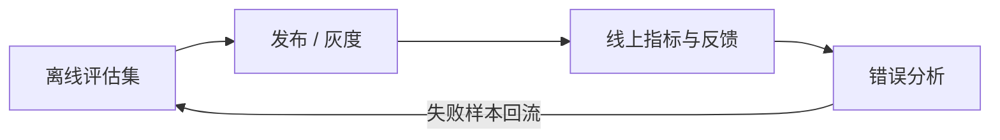

# Evaluation

> 没有评估集，Prompt 和模型的每次修改都只是在猜。

AI 应用最容易出现的一种错觉，是“这次改完感觉更好了”。换了一个模型、加了几条 Prompt、调了检索参数，演示案例确实变好了，但真实流量里的失败可能同时增加。没有评估集，你无法判断这是进步还是过拟合；有了评估集，至少可以把“感觉”变成一组可重复比较的数字。

评估不是一次性的验收，而是一个持续回路：离线评估决定能不能发布，线上评估决定要不要继续放量，错误分析决定下一轮该改什么。三者缺一，团队就会在“看起来变好”和“实际变差”之间反复摇摆。

## 本章目标

学完本章，你应该能够：

- 建立覆盖真实分布和失败场景的评估集。
- 选择与产品目标一致的质量、成本和延迟指标。
- 使用规则、Rubric、LLM Judge 和人工评估。
- 把线上失败回流成回归测试。

## 评估到底在回答什么

评估首先要回答的不是“模型有多强”，而是“这次变更是否让产品更好”。同一个 Prompt，换模型、换版本、换上下文，结果都会变化；同一个模型，在不同温度、不同工具配置下，表现也可能不同。评估要覆盖的不只是最终答案，还包括检索、工具调用、结构化输出、延迟、成本和安全。

| 层次 | 评什么 | 例子 |
| --- | --- | --- |
| 单元评估 | 单个能力 | 分类准确率、字段抽取准确率 |
| 组件评估 | 检索、重排、工具调用 | Recall@K、工具选择准确率 |
| 端到端评估 | 完整任务 | 用户问题是否被解决 |
| 线上评估 | 真实流量 | 满意度、任务完成率、投诉率 |
| 人工评估 | 质量、语气、风险 | 抽样 review |



## 建立评估集

评估集应该从真实输入分布开始，而不是只由团队拍脑袋编写。线上日志（脱敏后）、客服工单、用户反馈、失败案例和领域专家设计的问题，都是比“再想几个例子”更可靠的来源。

覆盖范围要刻意设计：常见问题、边界条件、信息缺失、多轮对话、模糊表达、需要拒答的问题、对抗性输入、工具失败、权限不足和提示注入。很多团队的第一版评估集只有 happy path，结果上线后才发现，真正拖垮体验的是“资料不足时胡编”和“工具失败后不停止”。

规模不必一开始就很大。20–50 条高质量样本足以启动，之后随着失败案例回流逐步增加到几百条。覆盖度和标注质量比数量更重要；每个样本都应该有明确的期望或评分标准，而不是一句“回答得不错”。

```json
{
  "id": "eval_001",
  "input": "订单 ORD-20261109-001 为什么还没退款？",
  "context": {
    "user_id": "u_123",
    "tenant_id": "t_001"
  },
  "expected": {
    "must_contain": ["退款状态", "预计到账时间"],
    "must_cite": true,
    "should_not_contain": ["其他用户信息"]
  },
  "tags": ["refund", "order", "multi-turn"]
}
```

## 指标与评分

指标要和产品目标一致。分类任务看准确率、精确率、召回率和 F1；抽取任务看结构化输出合法率；RAG 看忠实度、引用准确率和拒答正确率；Agent 还要看工具选择准确率、参数准确率和任务完成率。系统指标同样重要：平均延迟、P95、单次成本、token 使用量、工具调用次数、重试率和人工接管率。

安全指标不能等上线后再补。越权操作拦截率、敏感信息泄露率、提示注入成功率、有害内容拦截率和危险操作确认率，都应该进入评估集。一个模型在普通问题上答得再好，只要在权限或数据泄露上失守，就不能上线。

评分方法可以组合使用。规则匹配适合固定格式、枚举分类和必须包含/不能包含某些字段的场景，稳定且便宜，但无法评价语义质量。Rubric 适合需要分档判断的质量维度，分档要具体，避免“好 / 较好 / 一般”这类模糊描述。

```text
5 分：完全正确，引用充分，表达清晰
4 分：基本正确，有轻微遗漏
3 分：部分正确，缺少关键信息
2 分：有明显错误
1 分：答非所问或编造
```

LLM-as-Judge 适合语义相关性、忠实度、语气和成对比较，但它也会有偏差，例如偏好长答案、偏好某种风格，或者被无关信息带偏。Judge 需要人工标注样本校准，关键场景使用多个 Judge 或人工复核，并记录 Judge 的模型版本和 Prompt。人工评估则适合高风险场景、主观质量、新能力上线前，以及 Judge 结果异常时。

::: details 小问题：LLM Judge 能完全替代人工评估吗？
不能。Judge 适合大规模、低风险的初筛和回归，不适合替代高风险场景的最终判断。它本身也是一个模型，会受 Prompt、上下文和模型版本影响；没有人工校准的 Judge，只是把一种不确定性换成了另一种。
:::

::: warning 不要用评估集调参到过拟合
如果团队反复针对同一批样本改 Prompt，分数会越来越高，但真实流量未必变好。评估集要保留一部分不参与日常调参的 hold-out 样本，并持续从线上失败中补充新案例。
:::

## 回归、线上与错误分析

每次修改 Prompt、模型版本、上下文组装、检索策略、工具 schema、输出解析器或安全策略，都应该跑回归。记录评估集版本、Prompt 版本、模型版本、代码 commit、指标结果和失败样本；没有版本记录的评估结果，无法复现，也无法比较。

离线评估不能完全代表真实流量。线上要用 A/B 测试、灰度发布、用户反馈、任务完成率、人工抽检、投诉和工单、成本与延迟监控来验证。真正重要的不是“用户点了赞”，而是“用户是否完成任务、是否减少人工工作量、是否增加投诉、是否产生危险操作”。

错误分析不要只看总分。收集失败案例，按原因分类，统计每类占比，优先修复影响最大的类别，再把修复案例加入评估集。常见分类包括上下文缺失、检索错误、工具选择错误、参数错误、输出格式错误、模型能力不足、权限/安全问题和用户输入歧义。

## 成本与延迟

质量和成本要一起看。每次请求的 token、工具调用次数、平均延迟和 P95、每千次请求成本、缓存命中率、重试和失败成本，都会影响产品是否可持续。一个准确率高 2% 但成本翻倍的方案，未必值得；一个延迟从 2 秒降到 800 毫秒的方案，可能比多 1% 准确率更能提升完成率。

## Evaluation Review 矩阵

| 维度 | 必须回答 | 不满足时怎么办 |
| --- | --- | --- |
| 数据分布 | 评估集是否来自真实输入？ | 从线上日志和工单补充样本 |
| 覆盖度 | 是否覆盖边界、失败和安全场景？ | 增加拒答、工具失败、注入样本 |
| 指标 | 是否和产品目标一致？ | 重新定义成功标准，不只看向上指标 |
| 评分 | Judge 是否经过人工校准？ | 抽样复核，记录偏差和版本 |
| 回归 | 每次修改是否跑同一套评估？ | 把评估接入 CI 或发布流程 |
| 线上 | 是否有灰度、反馈和任务完成率？ | 先小流量验证，再放量 |
| 成本 | 质量提升是否值得成本和延迟？ | 做模型路由、缓存或降级 |
| 安全 | 越权、泄露和注入是否被评估？ | 加入安全用例和拦截指标 |

## 总结

评估的价值，是把“感觉变好了”变成“可以证明变好了”：

- 评估集要来自真实分布，覆盖失败、边界和安全场景。
- 指标要同时看质量、成本、延迟和安全，不只看准确率。
- 线上失败要回流成回归样本，评估才会越来越像真实世界。

如果只能记住一件事：每次改 Prompt 或换模型之前，先问“我用哪套样本、哪个指标证明它更好”。答不上来，这次修改就还没有准备好。

## 相关阅读

- [Prompt](/ai-engineering/prompt)
- [Context Engineering](/ai-engineering/context-engineering)
- [RAG](/ai-engineering/rag)
- [Agent](/ai-engineering/agent)
- [AI Coding](/ai-engineering/ai-coding)
