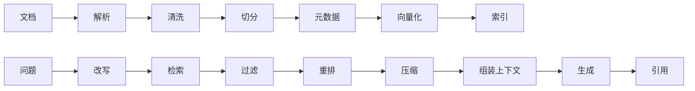

# RAG

> RAG 不是“接一个向量数据库”，而是一条从数据摄入到答案验证的完整链路。

RAG 最常见的失败，不是向量模型选错了，而是文档根本没解析好、chunk 切碎了上下文、检索结果没有重排、权限过滤放错了位置，或者模型在资料不足时仍然编造答案。单独看每一环都像“能用”，连起来却无法解释一次真实回答为什么是这样。

所以 RAG 要从链路看，而不是从组件看。离线侧决定知识能不能被找到，在线侧决定找到的知识能不能被正确使用；评估则决定这条链路是否真的在变好。

## 本章目标

学完本章，你应该能够：

- 设计文档解析、切分、索引和检索链路。
- 选择稠密、稀疏或混合检索并做重排。
- 让回答带引用，并在资料不足时拒答。
- 评估检索、生成和权限隔离。

## RAG 到底解决什么

RAG 让模型基于外部知识回答，适合模型训练数据里没有的私有文档、经常变化的知识，以及需要引用出处的问答。它不适合替代实时计算，也不适合直接操作外部系统；后者更接近 Tool Calling。

这条链路里任何一环出问题，最终答案都会变差。文档解析丢失结构，切分就会失去语义；切分不合理，检索就找不到完整概念；没有重排，前几条结果可能都不相关；上下文太长，关键信息又会被淹没。

## 从文档到索引

文档摄入的第一步是解析。PDF 要处理版面、表格、页眉页脚和扫描件 OCR；Word/Markdown 要保留标题层级、列表和代码块；HTML 要提取正文、去掉导航；数据库要做字段映射和增量同步。解析质量决定上限，如果原文结构在第一步就丢了，后面的切分和检索很难补救。

清洗要保留标题、章节、表格等结构，同时去掉重复页眉页脚、乱码、广告和无关内容。每个文档和 chunk 至少记录文档 ID、标题、来源、章节、更新时间、版本、权限/租户和语言。元数据不是附属品，它决定过滤、排序、引用和权限控制能不能做。

切分没有万能参数。固定长度简单可控，但容易切断语义；按段落/标题能保留结构，但长度不均匀；语义切分主题完整，但成本更高；父子块用小块检索、大块生成；滑动窗口保留上下文，但会产生重复。原则是让一个 chunk 尽量表达一个完整概念，保留标题路径，适当重叠，不要把表格和代码块切碎。

::: tip 切分参数要用评估集决定
`chunk size` 和 `overlap` 没有行业统一值。它们取决于文档类型、问题形态和检索模型。正确做法是准备一组真实问题，对几组切分参数跑检索评估，比较 Recall@K、引用准确率和答案质量，而不是照搬别人的配置。
:::

## 检索：先召回，再排序

稠密检索用 embedding 表示语义，适合同义表达和自然语言问题；稀疏检索（如 BM25）适合专有名词、错误码、API 名称和精确术语。实际系统通常使用混合检索，再融合结果；只做向量检索，很容易漏掉字面精确但语义不相似的关键内容。

查询改写可以扩展同义词、拆分复杂问题、生成多个查询、结合对话历史补全指代，或者提取过滤条件。过滤则按租户、权限、文档类型、时间范围、语言和版本缩小候选集。权限过滤必须在检索阶段完成，不能等生成后再删；否则无权限内容已经进入了模型上下文。

初步检索追求召回，重排追求精度。Cross-encoder、LLM 重排、规则重排和多样性重排都可以使用。重排后只保留最相关的一小部分，减少上下文浪费；如果结果全是同一篇文档的重复片段，还要做去重和多样性控制。

::: details 小问题：向量检索能替代关键词检索吗？
不能。向量检索擅长语义相似，但对错误码、函数名、产品型号、精确短语可能不如关键词检索。更稳的做法是混合检索：先用两种方式各自召回，再融合和重排。不要用单一检索方式赌所有问题。
:::

## 生成：让答案有依据

上下文组装要按相关性、时间、权威性排序，给每个片段标注来源，去除重复内容，控制总 token，保留关键表格和数字。对冲突信息要明确标注，而不是让模型自己猜哪条更可信。

提示模型时，要明确边界：只根据 `<context>` 中的内容回答；资料不足时明确说“资料中没有足够信息”；每个结论后标注来源编号。不要只要求“回答得详细”，否则模型可能用常识补全不存在的细节。

好的 RAG 回答应该基于检索内容，不编造；给出引用；区分事实和推断；信息不足时承认；对冲突信息说明差异。引用不是装饰，而是让用户和评估者能够追溯答案依据。

## 评估与权限

检索评估看 Recall@K、Precision@K、MRR/NDCG 和覆盖率：相关文档是否被召回，召回结果中有多少相关，排序质量如何。生成评估看忠实度、相关性、完整性、引用准确率和拒答正确率：答案是否忠于检索内容，是否回答了问题，是否遗漏关键点，引用是否对应正确来源。

系统评估还要看端到端成功率、平均延迟和 P95、单次查询成本、用户反馈和人工抽检通过率。RAG 的问题经常是“检索看起来命中了，但生成没有用上”，所以必须同时评估检索和生成两个阶段，不能只看最终答案。

权限与安全要贯穿整条链路：文档级权限、租户隔离、检索前过滤、引用中不暴露无权限内容、防止文档中的提示注入、记录谁在什么时候检索了什么、文档删除后同步删除索引。权限过滤如果在生成后才做，已经太晚了。

::: warning 权限过滤必须在检索阶段
如果先把所有候选文档放进上下文，再在输出阶段删掉无权限内容，模型可能已经在推理中使用了这些信息，甚至通过措辞泄露它们。正确做法是在检索查询里就带上租户和权限条件。
:::

## RAG Review 矩阵

| 维度 | 必须回答 | 不满足时怎么办 |
| --- | --- | --- |
| 解析 | 文档结构、表格和代码是否保留？ | 换解析器，补 OCR 或结构化清洗 |
| 切分 | chunk 是否表达完整概念？ | 用评估集比较不同切分策略 |
| 检索 | 是否使用混合检索和过滤？ | 加 BM25、元数据过滤或多查询 |
| 重排 | 前几条结果是否真的相关？ | 加 cross-encoder 或规则重排 |
| 生成 | 是否忠于上下文并给出引用？ | 收紧 Prompt，要求拒答和引用 |
| 评估 | 是否同时评估检索和生成？ | 分开建立检索集和答案集 |
| 权限 | 是否在检索阶段做租户/权限过滤？ | 把权限条件下推到查询层 |
| 运维 | 索引更新、删除和回滚是否可用？ | 建增量索引和重建流程 |

## 总结

RAG 的效果不是某一个模型决定的，而是整条链路的乘积：

- 文档解析和切分决定上限，检索和重排决定能不能找到，生成决定能不能用好。
- 权限过滤必须在检索阶段完成，引用和拒答是答案可信度的一部分。
- 评估要同时看检索和生成，否则很容易修好一环、弄坏另一环。

如果只能记住一件事：RAG 的问题通常不在“向量库够不够先进”，而在文档、切分、检索和评估这些看起来不性感的地方。

## 相关阅读

- [Context Engineering](/ai-engineering/context-engineering)
- [Memory](/ai-engineering/memory)
- [Evaluation](/ai-engineering/evaluation)
- [Tool Calling](/ai-engineering/tool-calling)
- [Agent](/ai-engineering/agent)
