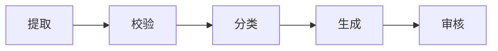

# Workflow

> 大多数 AI 任务不需要自主 Agent，只需要一条设计良好的流程。

很多团队一开始就想做“全自动 Agent”，最后却得到一个成本高、延迟大、难以调试的循环。真实业务里，大量任务其实步骤稳定：提取、校验、分类、生成、审核，每一步的输入输出都能定义。把它们做成 Workflow，往往比让模型自由决定下一步更可靠。

Workflow 的价值不是“更死板”，而是把不确定性限制在真正需要模型判断的步骤里。代码负责编排、权限、重试和状态，模型负责理解、生成和分类。

## 本章目标

学完本章，你应该能够：

- 判断一个任务该用 Workflow 还是 Agent。
- 使用链式、路由、并行和编排者-工作者模式。
- 设计状态、失败处理、预算和人工接管。
- 评估每一步的成本、延迟和成功率。

## Workflow 与 Agent 的边界

Workflow 由代码预先定义步骤，适合稳定、可验证的任务；Agent 由模型动态决定下一步，适合开放式、步骤不确定的任务。判断原则很简单：如果你能画出流程图，先用 Workflow；如果每一步的输入输出都能定义，先用 Workflow；只有当下一步真的取决于中间结果，且无法预先枚举时，才考虑 Agent。

| 方式 | 控制方式 | 适合场景 | 主要风险 |
| --- | --- | --- | --- |
| Workflow | 代码预先定义 | 步骤稳定、结果可验证 | 灵活性较低 |
| Agent | 模型动态决定 | 开放式、步骤不确定 | 成本、延迟和不可控性更高 |

::: tip 能画流程图就先别做 Agent
流程图能画出来，说明步骤和依赖已经比较清楚。先把它做成 Workflow，把模型放在需要判断的步骤里；等真的出现“无法预先定义的下一步”时，再局部引入 Agent。
:::

## 常见 Workflow 模式

链式是最简单的模式：步骤按固定顺序执行，例如提取 → 校验 → 分类 → 生成 → 审核。它适合文档处理、内容生成、数据清洗和多阶段审核。每一步的输入输出要明确，中间结果要可检查，失败时要知道是否可重试。

路由先判断任务类型，再走不同流程：退款、技术支持、人工客服。分类边界要清晰，低置信度要有兜底路径；路由错误比单步错误更昂贵，要重点评估。

并行把独立子任务同时执行，再汇总：提取要点、检查风险、生成摘要。子任务之间不能有强依赖，汇总步骤要处理冲突和缺失，并控制并发和成本。

编排者-工作者模式由一个编排步骤拆分任务，多个工作者执行，最后合并结果。它适合大型文档分析、多文件代码审查和多来源研究；难点在任务拆分可验证、工作者尽量独立，以及合并时处理重复、冲突和遗漏。

评估者-优化者模式先生成，再由评估步骤检查，不通过就修改，再评估。它适合代码生成、文案润色和结构化输出校验；评估标准必须明确，并设置最大迭代次数，避免无限循环。

人在回路适合高风险写操作、对外发布、金额、权限和合同等场景。确认界面要展示关键上下文和风险，人工修改要能记录和反馈，不要让人变成无脑点“通过”的橡皮图章。

## 状态、失败与预算

Workflow 应该当成状态机来设计：Pending、Running、WaitingForInput、Retrying、Succeeded、Failed、Cancelled。每个步骤记录输入、输出、模型和 Prompt 版本、工具调用、耗时、token、错误和重试次数。

失败处理要覆盖超时、重试、幂等、降级、人工接管和死信。只重试可恢复错误，使用退避策略；写操作必须有幂等键；模型失败时要有规则兜底；多次失败后要进入死信或人工处理，而不是无限重试。

预算控制同样重要：最大步骤数、最大 token、最大工具调用次数、最大重试次数、单次任务超时和单用户/单租户配额。Workflow 容易因为重试、循环和多步调用产生高成本，没有预算的系统迟早会遇到一次“跑飞”的任务。

::: warning 不要无限重试
无限重试会把一个坏消息变成一个持续故障。重试要有次数、退避和总预算；不可重试的业务拒绝应该直接终止，进入人工处理或死信队列。
:::

## 示例与评估

以合同审查为例：解析 PDF、按条款分段、并行检查风险条款/缺失条款/金额一致性、汇总问题、生成报告、人工确认高风险条款、输出最终报告。每一步都可以独立测试：解析是否正确，分段是否完整，风险检查是否漏报，汇总是否去重，报告格式是否稳定。

Workflow 的可观测性要记录步骤名称、输入/输出摘要、模型版本、Prompt 版本、工具调用、token、耗时、成本和错误。评估则看端到端成功率、每一步准确率、平均步骤数和重试次数、P95 延迟、单任务成本、人工接管率和失败原因分布。

::: details 小问题：什么时候应该在 Workflow 里放一个 Agent？
当某个步骤的下一步无法预先枚举，需要根据中间结果动态探索时，可以在这个步骤内部使用 Agent。外层仍然用 Workflow 管住权限、预算和产物，关键写操作回到固定流程并要求人工确认。好的系统通常是“确定性骨架 + 局部智能”。
:::

## Workflow Review 矩阵

| 维度 | 必须回答 | 不满足时怎么办 |
| --- | --- | --- |
| 必要性 | 这个任务真的需要 Agent 吗？ | 能画流程图就用 Workflow |
| 步骤 | 每一步的输入输出是否明确？ | 补契约和中间产物 |
| 失败 | 超时、重试、幂等是否处理？ | 加退避、幂等和死信 |
| 预算 | 是否有步骤、token 和时间上限？ | 加预算和循环检测 |
| 人工 | 关键节点是否需要确认？ | 加人工接管和回滚 |
| 观测 | 是否记录每步模型、Prompt 和工具？ | 接入 trace 和成本统计 |
| 评估 | 是否同时评端到端和分步？ | 建分步指标和回归集 |

## 总结

Workflow 的核心，是用确定性骨架包住局部智能：

- 能画流程图就先做 Workflow，只有必要时才局部引入 Agent。
- 每一步要有清晰契约、失败处理、预算和可观测性。
- 关键写操作回到固定流程，并要求人工确认。

如果只能记住一件事：多数 AI 产品不需要“全自动 Agent”，需要的是把模型放在正确步骤里的一条可靠流程。

## 相关阅读

- [Agent](/ai-engineering/agent)
- [Tool Calling](/ai-engineering/tool-calling)
- [Context Engineering](/ai-engineering/context-engineering)
- [Evaluation](/ai-engineering/evaluation)
