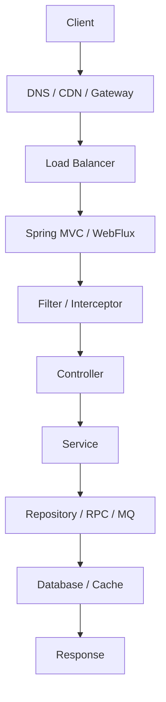

# 后端开发

> 后端工程师的核心不是会多少框架，而是能把业务、数据、并发和故障处理组织成可靠的系统。

后端工作看起来是写接口、连数据库、调用服务，真正决定质量的是边界：请求从哪里进来，业务规则放在哪一层，事务在哪里结束，失败如何重试，日志能不能定位问题。框架只是把这些能力组织起来的工具。

这份章节从 Spring 开始，经过 Spring Boot、MyBatis、RPC、Netty，最后到 Spring AI。学习时不要只记注解和 API，要理解每个框架解决什么问题、生命周期是什么、失败时会发生什么。

## 本章目标

学完本章，你应该能够：

- 画出 Java 后端的主要能力和请求生命周期。
- 理解分层、事务、配置、日志和测试的位置。
- 判断一个后端问题应该先查哪一层。
- 选择下一步要深入的框架或中间件。

## 后端工程师在做什么

后端要设计接口和数据模型，实现业务规则，保证事务边界和数据一致性，处理并发、缓存、消息和远程调用，做鉴权、限流、日志、监控和告警，排查线上问题，并控制成本、延迟和故障影响。

框架只是工具。真正决定质量的是边界是否清晰、失败是否可处理、数据是否一致、系统是否可观测、代码是否可维护。一个会背 Spring 注解但说不清事务边界的人，遇到线上问题仍然只能猜。

## 一个请求的生命周期

每一层都可能出问题：Gateway 负责鉴权和限流，Controller 负责参数校验和协议转换，Service 负责事务、业务规则和幂等，Repository 负责 SQL、索引和连接池，RPC 负责超时、重试和序列化，MQ 负责重复、顺序和积压，数据库负责锁、慢查询和连接数。

排查问题时，先判断问题在哪一层：是请求没进来、参数没校验、事务没提交、SQL 慢、缓存不一致，还是下游超时。不要一上来就重启或加机器。

## 分层、DTO 与事务边界

常见分层是 interfaces → application → domain → infrastructure。Controller 不写业务规则，Service 不直接拼 SQL，Repository 不返回 Web DTO，领域层不依赖框架。外部请求对象、领域对象和视图对象要分开，因为它们的变化原因不同。

| 类型 | 用途 |
| --- | --- |
| DTO | 接收外部请求或调用参数 |
| Entity | 持久化对象或领域对象 |
| VO | 返回给前端的视图对象 |

事务放在应用服务层，事务内不要做远程调用，事务尽量短，写操作考虑幂等。跨服务事务用 Saga/TCC/outbox，而不是硬套本地事务。事务边界不清，是后端最常见的隐性 bug 来源之一。

## 配置、日志与测试

配置与代码分离，不同环境独立配置，密钥放密钥管理服务，配置变更可审计、可回滚。日志记录关键业务 ID、traceId、用户/租户，异常分层为业务异常、系统异常和第三方异常；不要吞异常，也不要把堆栈直接返回给用户。

测试要分层：单元测试验证业务规则和边界；集成测试验证数据库、缓存、MQ、RPC；契约测试验证服务间接口；端到端测试覆盖关键用户路径。只测 happy path，等于没测。

::: tip 先查请求链路，再改代码
后端问题通常不是“某个类写错了”，而是请求在某一层丢了上下文、事务或错误处理。先沿请求链路定位，再决定改哪一层。
:::

## Backend Review 矩阵

| 维度 | 必须回答 | 不满足时怎么办 |
| --- | --- | --- |
| 分层 | Controller/Service/Repository 职责是否清晰？ | 把业务下沉到 Service |
| 事务 | 事务边界是否短、是否含远程调用？ | 拆事务，移出远程调用 |
| 数据 | 是否处理幂等、重复和一致性？ | 加唯一约束、状态机或补偿 |
| 失败 | 超时、重试、降级是否明确？ | 加超时、退避和熔断 |
| 观测 | 日志是否带 traceId 和业务 ID？ | 统一日志上下文 |
| 测试 | 是否覆盖边界和异常？ | 补单元/集成测试 |
| 配置 | 密钥是否外置、可回滚？ | 用配置中心和密钥管理 |

## 总结

后端开发的核心，是把业务和数据组织成可靠的请求链路：

- 框架只是工具，边界、事务、失败处理和可观测性才是质量来源。
- 分层是为了控制变化，不是为了多写几层类。
- 测试和日志，是上线后还能继续维护的前提。

如果只能记住一件事：先画清请求链路和事务边界，再选框架。

## 相关阅读

- [Spring](/backend/spring)
- [Spring Boot](/backend/spring-boot)
- [MyBatis](/backend/mybatis)
- [RPC](/backend/rpc)
- [Netty](/backend/netty)
- [Spring AI](/backend/spring-ai)
