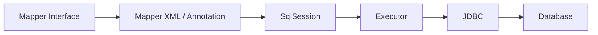

# MyBatis

> MyBatis 的核心不是“少写 JDBC”，而是把 SQL 和 Java 对象之间的映射关系显式管理起来。

MyBatis 让 SQL 留在 XML 或注解里，把结果集映射成对象，同时保留手写 SQL 的控制力。它适合 SQL 复杂、需要精细优化、遗留数据库或希望显式管理查询的项目；不适合希望完全屏蔽 SQL、或者简单 CRUD 占绝大多数的场景。

MyBatis 的问题通常不在“会不会写 Mapper”，而在参数绑定、动态 SQL、结果映射、分页、批量和缓存这些细节。一个 `${}` 就可能带来 SQL 注入，一个 N+1 就可能让列表接口拖垮数据库。

## 本章目标

学完本章，你应该能够：

- 设计 Mapper 接口、SQL 和结果映射。
- 区分 `#{}` 与 `${}` 并避免 SQL 注入。
- 处理分页、批量和 N+1 查询。
- 判断一级/二级缓存是否安全可用。

## Mapper 与 SQL 映射

Mapper 接口定义方法，XML 或注解提供 SQL，`SqlSession` 负责执行，Executor 调用 JDBC，最后映射成对象。



```java
@Mapper
public interface OrderMapper {
    Order findById(Long id);
    List<Order> findByUser(Long userId);
}
```

```xml
<select id="findById" resultType="Order">
  SELECT id, user_id, status, total, created_at
  FROM orders
  WHERE id = #{id}
</select>
```

原则是方法名和 SQL id 一致，参数用 `@Param` 明确命名，返回类型明确，Mapper 里不写业务逻辑。复杂关系用 `resultMap`，列名冲突用别名；一对多 join 会产生重复行，注意去重，不要在大结果集上做复杂嵌套映射。

## 参数绑定与动态 SQL

`#{}` 使用预编译参数，安全；`${}` 做字符串拼接，有 SQL 注入风险。用户输入永远不要用 `${}`。如果必须动态拼接列名或表名，用白名单，不要直接使用用户输入。

```xml
<!-- 安全 -->
WHERE id = #{id}

<!-- 危险：不要用于用户输入 -->
ORDER BY ${column}
```

动态 SQL 用 `<if>`、`<choose>`、`<where>`、`<set>`、`<foreach>`、`<trim>` 组合条件。动态条件要有索引支持，避免生成无法命中的 SQL；复杂 SQL 要写测试，不要只在脑子里验证。

```xml
<select id="search" resultType="Order">
  SELECT *
  FROM orders
  <where>
    <if test="userId != null">
      AND user_id = #{userId}
    </if>
    <if test="status != null">
      AND status = #{status}
    </if>
  </where>
  ORDER BY created_at DESC
</select>
```

::: danger 不要把 `${}` 用在用户输入上
`${}` 是字符串拼接，不是参数绑定。`ORDER BY ${column}` 看起来只是排序，实际可能被注入任意 SQL。必须动态列名时，用固定白名单映射，不要让用户直接决定 SQL 片段。
:::

## 分页、批量与 N+1

物理分页在 SQL 里加 `LIMIT/OFFSET` 或数据库对应语法；深分页性能差，大偏移量可以用游标分页；排序字段要有索引。逻辑分页先查全量再内存分页，通常不推荐用于大数据量。

批量插入用 `foreach` 或 JDBC batch，控制单批大小，注意事务和锁；大批量操作要分批提交。N+1 是“先查订单列表，再为每个订单查用户”，解决方式是批量查询、join、二次查询后内存组装或缓存。

```xml
<insert id="insertBatch">
  INSERT INTO orders (id, user_id, total)
  VALUES
  <foreach collection="orders" item="o" separator=",">
    (#{o.id}, #{o.userId}, #{o.total})
  </foreach>
</insert>
```

::: details 小问题：为什么 `foreach` 批量插入也不能一次塞太多？
单条 SQL 过大、参数过多、事务过长都会增加数据库压力，还可能超过 SQL 长度或参数限制。批量应该分批提交，既控制事务大小，也方便失败重试和定位。
:::

## 缓存与事务

一级缓存是 `SqlSession` 级别，默认开启；同一会话内重复查询可能命中。要注意会话边界、更新后是否清空，以及与 Spring 事务的关系。

二级缓存是 Mapper 级别，需要显式配置。多表关联时容易脏读，分布式环境下本地缓存不一致，更新策略要清晰。生产环境优先使用 Redis 等外部缓存，不要盲目依赖 MyBatis 二级缓存。

::: warning 二级缓存不是“免费加速”
二级缓存的生命周期和一致性边界很难管，尤其是多表更新、跨实例部署和事务回滚时。没有明确的失效策略，不要开启；需要共享缓存时，用外部缓存并自己控制 key 和失效。
:::

MyBatis 与 Spring 事务集成后，Mapper 参与 Spring 事务，`SqlSession` 生命周期由 Spring 管理。事务内不要手动提交，注意 `@Transactional` 自调用失效；复杂 SQL 要有测试覆盖。

## MyBatis Review 矩阵

| 维度 | 必须回答 | 不满足时怎么办 |
| --- | --- | --- |
| 参数 | 是否全部使用 `#{}`？ | 移除用户输入上的 `${}` |
| 动态 SQL | 条件是否能命中索引？ | 加索引，简化动态条件 |
| 映射 | 列名冲突和嵌套是否正确？ | 用别名和 resultMap，测试去重 |
| 分页 | 是否避免深分页？ | 改游标分页，限制最大深度 |
| 批量 | 是否控制批次和事务？ | 分批提交，限制单批大小 |
| N+1 | 是否存在循环查库？ | 批量查询、join 或缓存 |
| 缓存 | 二级缓存是否必要且安全？ | 关闭或改用 Redis |
| 事务 | 是否参与 Spring 事务？ | 检查自调用和提交方式 |

## 总结

MyBatis 的核心，是把 SQL 和对象映射显式管理好：

- 参数用 `#{}`，动态列名走白名单，杜绝 `${}` 注入。
- 分页、批量和 N+1 是列表接口最常见的性能坑。
- 二级缓存要谨慎，事务和自调用问题要提前检查。

如果只能记住一件事：MyBatis 给你 SQL 控制力，也把 SQL 正确性和性能责任交回给了你。

## 相关阅读

- [Spring](/backend/spring)
- [Spring Boot](/backend/spring-boot)
- [数据库设计](/system-design/database-design)
- [代码规范与工程实践](/software-engineering/code-quality)
