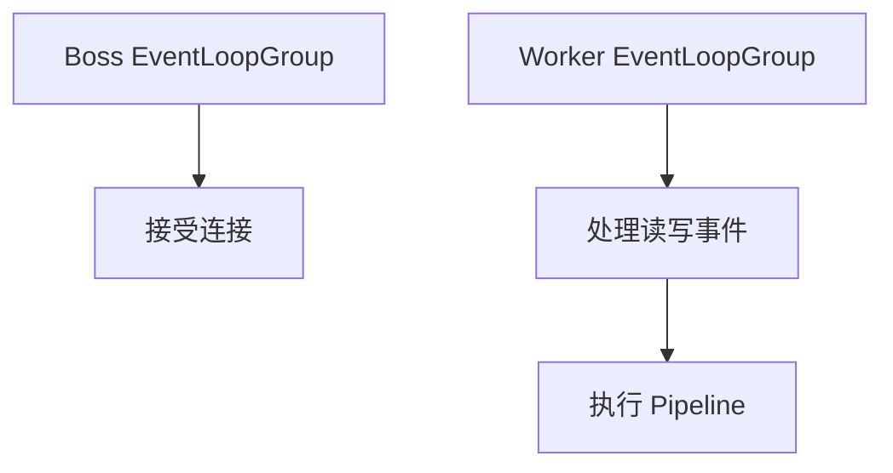
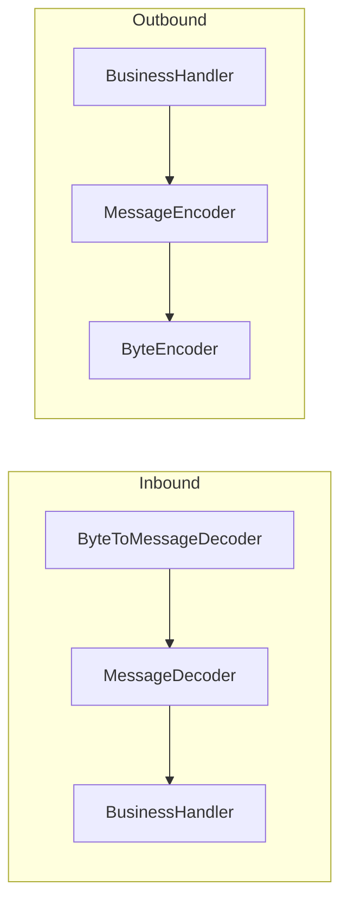

# Netty

> Netty 的价值不是“比 JDK NIO 简单”，而是把高性能网络编程中的线程模型、缓冲区和事件处理抽象成可组合的 Pipeline。

直接写 NIO 很痛苦：Selector、Channel、ByteBuffer、半包粘包、线程模型和资源释放都要自己处理。Netty 把这些复杂度收进 EventLoop、Pipeline 和 ByteBuf，让开发者可以专注于协议和业务 Handler。

但 Netty 不会自动帮你避免阻塞、内存泄漏和背压。它只是把工具做得更好；用错线程模型或忘记释放 ByteBuf，问题仍然会在高并发下出现。

## 本章目标

学完本章，你应该能够：

- 解释 EventLoop、Channel 和 Pipeline 的关系。
- 正确管理 ByteBuf 的引用计数。
- 处理粘包、拆包和自定义协议。
- 设计背压、心跳、空闲检测和重连。

## 核心模型

Netty 的核心组件包括 EventLoopGroup、EventLoop、Channel、ChannelPipeline、ChannelHandler 和 ByteBuf。Boss EventLoopGroup 接受连接，Worker EventLoopGroup 处理读写事件，Channel 绑定到一个 EventLoop，Pipeline 串联入站和出站 Handler。

原则是：一个 Channel 绑定到一个 EventLoop，同一个 EventLoop 的 Handler 不会并发执行；不要在 EventLoop 线程做阻塞操作，包括数据库查询、远程调用、文件 IO、长时间计算和 `Thread.sleep`。需要阻塞时交给业务线程池。

## 线程模型与 Pipeline

Handler 要单一职责，入站和出站分开，不要在 Handler 里保存共享可变状态。`@Sharable` Handler 必须线程安全；普通 Handler 通常每个 Channel 一个实例。

Pipeline 的顺序很重要：解码器要在业务 Handler 之前，编码器要在出站路径上。顺序错了，业务 Handler 可能收到半包或错误类型；排查时先看 Pipeline 结构，再看 Handler 逻辑。

## ByteBuf、粘包与编解码

ByteBuf 比 JDK ByteBuffer 灵活：读写指针分离、动态扩容、池化和引用计数。常用 API 有 `readIndex`、`writeIndex`、`readableBytes`、`retain()`、`release()`、`slice()`、`duplicate()`。

ByteBuf 使用引用计数管理内存，忘记 `release()` 会内存泄漏，重复释放会崩溃。谁最后持有，谁负责释放；传递给异步任务时，要确认生命周期；`SimpleChannelInboundHandler` 可以自动释放。

TCP 是字节流，没有消息边界，所以需要处理粘包/拆包。常见方案是固定长度、分隔符、长度字段 + 内容；Netty 提供 `FixedLengthFrameDecoder`、`DelimiterBasedFrameDecoder`、`LengthFieldBasedFrameDecoder`。二进制协议优先长度字段，文本协议可以用分隔符，并限制最大帧长度，防止内存攻击。

::: warning ByteBuf 泄漏通常不会立刻报错
泄漏会在流量上来后表现为内存持续增长，排查成本很高。开启 Netty 的泄漏检测，确保每个 ByteBuf 都有明确的释放责任，不要在异步回调里持有已释放的缓冲区。
:::

## 背压、心跳与重连

写入速度大于网络发送速度时，数据会堆在内存里。用 `Channel.isWritable()` 和高低水位线控制背压：不可写时暂停读取、拒绝新任务或降级，不要无限 `writeAndFlush`。关注 `channelWritabilityChanged`，大消息分片。

心跳用 `IdleStateHandler` 检测读/写空闲，定期发送心跳，超时断开；客户端重连要退避和抖动，避免重连风暴。零拷贝（`FileRegion`、`CompositeByteBuf`、`slice`、直接内存）能减少拷贝，但不是所有场景都更快，需要监控直接内存和释放。

::: details 小问题：为什么不能在 EventLoop 里做数据库查询？
EventLoop 线程负责处理多个 Channel 的 IO 事件。一次阻塞查询会卡住它负责的所有连接，表现为大量请求延迟、心跳超时甚至连接断开。阻塞操作应该交给业务线程池，处理完再切回 EventLoop 写回结果。
:::

## Netty Review 矩阵

| 维度 | 必须回答 | 不满足时怎么办 |
| --- | --- | --- |
| 线程 | 是否避免 EventLoop 阻塞？ | 移到业务线程池 |
| 内存 | ByteBuf 是否正确释放？ | 明确所有权，开泄漏检测 |
| Handler | 是否线程安全、职责单一？ | 避免共享可变状态 |
| 协议 | 是否处理粘包/拆包和最大帧？ | 加 FrameDecoder 和长度限制 |
| 背压 | 是否有写水位和限流？ | 监听可写性，拒绝或降级 |
| 心跳 | 是否检测空闲和断线？ | 加 IdleStateHandler 和重连 |
| 资源 | 是否监控直接内存和连接数？ | 加指标、告警和上限 |

## 总结

Netty 的核心，是把网络 IO 拆成可组合的线程、缓冲区和 Handler：

- 不要在 EventLoop 阻塞；一个阻塞会拖住多个连接。
- ByteBuf 有明确所有权；忘记释放就是内存泄漏。
- 协议要处理粘包/拆包，写入要有背压，连接要有心跳和重连。

如果只能记住一件事：Netty 让高性能网络编程更可组合，但不会替你管理阻塞、内存和背压。

## 相关阅读

- [RPC](/backend/rpc)
- [Spring Boot](/backend/spring-boot)
- [可观测性](/software-engineering/observability)
- [架构](/software-engineering/architecture)
