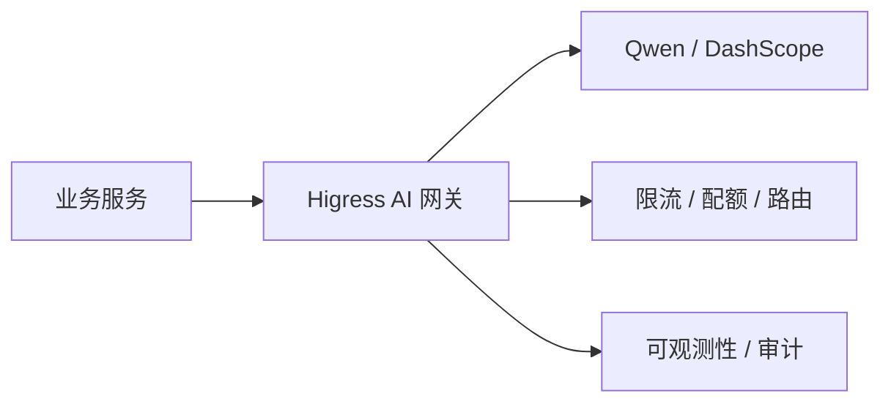

# Spring AI Alibaba

> Spring AI Alibaba 把 Spring AI 的模型抽象，与阿里云/阿里生态的模型、配置、治理和网关能力接起来。

具体模块名、版本和 API 以官方文档为准。本文重点讲集成思路和生产取舍，不把某个版本的类名当成永久事实。

在 Java/Spring 体系里做 AI 应用，通常会遇到几类问题：如何接入通义千问/DashScope，如何管理 Prompt 和模型配置，如何做 RAG，如何做工具调用，如何做限流、熔断和网关，如何接入 Nacos 配置和服务发现，以及如何做可观测性和成本控制。

Spring AI Alibaba 的目标，是把这些能力放进 Spring 的编程模型里。它不是“必须全部使用”的套装；先明确问题，再引入对应组件。

## 本章目标

学完本章，你应该能够：

- 接入 DashScope / Qwen 并管理模型配置。
- 用 Nacos、Sentinel 和 Higress 做配置、治理和网关。
- 设计 RAG、工具调用和多模型路由。
- 处理成本、限流、隐私和合规问题。

## 它解决什么问题

| 能力 | 常见组件 |
| --- | --- |
| 模型接入 | DashScope、通义千问 Qwen |
| 配置与服务发现 | Nacos |
| 流量治理 | Sentinel |
| AI 网关 | Higress |
| 可观测性 | ARMS、OpenTelemetry |
| 向量检索 | DashVector、OpenSearch、AnalyticDB 等 |
| 对象存储 | OSS |

不是每个项目都需要全部组件。一个内部小工具可能只需要模型接入；一个有多个团队共用的 AI 平台，才需要网关、配额、审计和统一可观测性。

## 模型接入与治理

典型配置是把 API key 放环境变量或密钥管理服务，把模型名、超时、开关放配置中心：

```yaml
spring:
  ai:
    dashscope:
      api-key: ${DASHSCOPE_API_KEY}
      chat:
        options:
          model: qwen-plus
```

```java
@Service
public class QwenService {
    private final ChatClient chatClient;

    public QwenService(ChatClient.Builder builder) {
        this.chatClient = builder
            .defaultSystem("你是一名 Java 后端助手。")
            .build();
    }

    public String ask(String question) {
        return chatClient.prompt().user(question).call().content();
    }
}
```

Nacos 可以用来管理模型名、超时、开关和服务发现；配置变更要灰度和回滚，敏感信息用密钥管理，不要直接写配置中心明文。Sentinel 用于限流、熔断、降级和系统保护；AI 场景要特别控制每用户/租户的请求配额、token 预算、工具调用次数和下游模型错误率。

Higress 适合做统一模型入口、API key 管理、多模型路由、限流配额、可观测性、内容安全和灰度。好处是把模型访问从业务服务中抽离，统一治理；代价是多一层网关运维和配置复杂度。



## RAG、工具与可观测性

RAG 的流程是文档解析 → 切分 → Embedding → 向量库，问题 Embedding → 检索 → 重排 → Prompt → 模型。可选向量存储包括 DashVector、OpenSearch、AnalyticDB 或自建 Milvus/Redis。关键不在“用哪个向量库”，而在文档权限、增量更新和删除、引用来源、资料不足时拒答，以及检索和生成的分阶段评估。

工具调用遵循 Tool Calling 的规则：参数校验、权限检查、幂等、写操作人工确认、结果脱敏、审计。不要把“模型说可以调用”当成授权。

可观测性要记录模型、版本、Prompt 版本、token 使用量、延迟、错误率、工具调用、检索结果、成本和 traceId。接入 ARMS/OpenTelemetry 后，可以把 AI 调用纳入现有监控体系，而不是单独建一套孤岛。

::: warning 网关不是万能治理
Higress 能做统一入口、限流和路由，但不能替代业务层的参数校验、权限和幂等。网关管流量，业务管语义；两者都要有。
:::

## 生产化与取舍

生产化要处理：API key 外置、模型和 Prompt 版本管理、超时/重试/限流/熔断、降级和兜底、内容安全、敏感信息脱敏、多租户隔离、成本预算、评估集和回归、审计。

取舍也很明确：云端模型能力强，但成本和隐私压力更大；本地/私有模型隐私好，但能力和运维成本不同；统一网关治理强，但增加一层依赖；多模型路由提高性价比，但增加评估复杂度。不要为了“架构完整”把所有组件都上齐。

::: details 小问题：什么时候需要 AI 网关？
当多个业务团队共用模型、需要统一 API key、配额、路由、审计和内容安全时，AI 网关有价值。只有一个应用、一个模型时，直接接入更简单；网关会多一层运维和故障点。
:::

## Spring AI Alibaba Review 矩阵

| 维度 | 必须回答 | 不满足时怎么办 |
| --- | --- | --- |
| 模型 | 接入是否可配置、可切换？ | 把模型名和参数外置 |
| 密钥 | API key 是否外置？ | 用密钥管理，禁止入库 |
| 治理 | 是否有限流、熔断和配额？ | 用 Sentinel/Higress 补治理 |
| 网关 | 是否真的需要统一入口？ | 单应用单模型先直接接入 |
| RAG | 是否做权限过滤和引用？ | 检索阶段过滤，要求引用 |
| 观测 | 是否记录模型、token、成本和 trace？ | 接入 ARMS/OpenTelemetry |
| 成本 | 是否有预算和多模型路由？ | 加配额、缓存和路由 |
| 合规 | 数据驻留、隐私和审计是否满足？ | 私有化或区域化部署 |

## 总结

Spring AI Alibaba 的价值，是把模型接入放进 Spring 和阿里生态的治理体系：

- DashScope/Qwen 负责模型，Nacos 负责配置，Sentinel/Higress 负责治理。
- RAG、工具和可观测性仍然要遵循 AI 工程的通用原则。
- 组件不是越多越好，按团队、规模和合规要求选择。

如果只能记住一件事：模型接入只是第一步，真正决定生产可用性的是配置、治理、评估和成本控制。

## 相关阅读

- [Spring AI](/backend/spring-ai)
- [Prompt](/ai-engineering/prompt)
- [RAG](/ai-engineering/rag)
- [Evaluation](/ai-engineering/evaluation)
- [工程实践](/software-engineering/engineering-practice)
