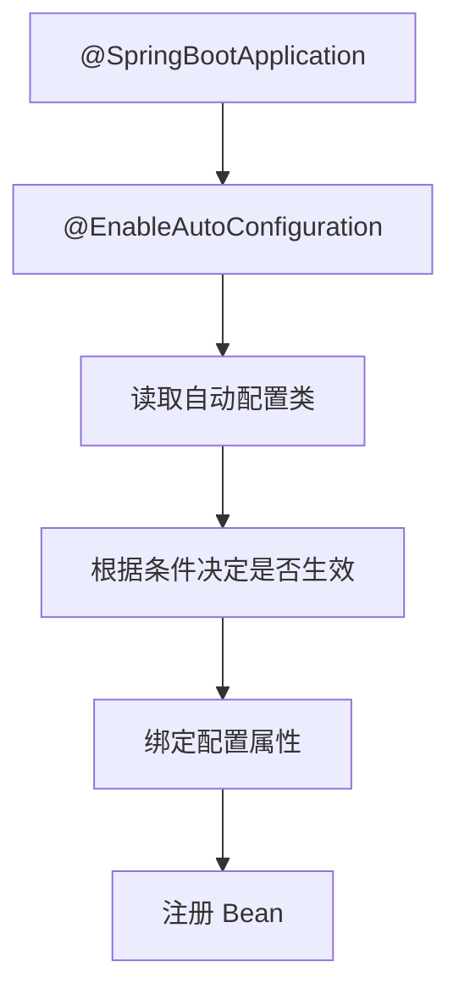

# Spring Boot

> Spring Boot 不是新框架，而是把 Spring 的配置、依赖和运行方式做成可开箱使用的约定。

Spring Boot 让“启动一个 Spring 应用”从大量 XML 和依赖配置，变成几个 Starter 加一个主类。但它没有消灭配置，只是把配置藏进了自动配置和约定里。出问题时，如果只会重启和加注解，很难知道哪个自动配置生效、哪个条件没满足、哪个配置源覆盖了预期值。

理解 Boot，要抓住自动配置、外部化配置、Actuator 和测试这几条主线。

## 本章目标

学完本章，你应该能够：

- 解释自动配置和 Starter 的工作方式。
- 管理配置、Profile 和敏感信息。
- 使用 Actuator 暴露健康检查和指标。
- 设计分层测试、优雅停机和部署方案。

## 自动配置与 Starter

`@SpringBootApplication` 包含 `@EnableAutoConfiguration`。Boot 读取自动配置类，根据条件决定是否生效，再绑定配置属性、注册 Bean。



常见条件注解有 `@ConditionalOnClass`、`@ConditionalOnMissingBean`、`@ConditionalOnProperty`、`@ConditionalOnBean`、`@ConditionalOnWebApplication`。自定义 Starter 通常包含 autoconfigure 模块、starter 模块、自动配置类和配置属性类；自动配置要可覆盖，使用 `@ConditionalOnMissingBean` 允许用户自定义，不要在自动配置里做耗时操作。

## 配置管理

配置可以有多个来源：命令行参数、环境变量、外部配置文件、jar 内配置文件和默认值。不要依赖记忆优先级，生产环境要明确配置来源。

```yaml
server:
  port: 8080

spring:
  datasource:
    url: jdbc:mysql://localhost:3306/app
    username: app
    password: ${DB_PASSWORD}
```

`@ConfigurationProperties` 适合一组配置，类型安全、可校验、集中管理。Profile 用来表达环境差异，不要把 `if (env.equals("prod"))` 写进业务代码；生产配置不要提交密钥，Profile 也不宜过多，避免组合爆炸。

::: tip 配置与代码分离
模型名、超时、开关、连接池参数应该放配置；密钥放密钥管理服务，不进入仓库。配置变更也要可审计、可回滚，不要把生产配置写死在代码里。
:::

## Web、Actuator 与日志

Spring MVC 适合大多数阻塞式业务；WebFlux 适合高并发 IO 和流式场景，但不要在 WebFlux 里调用阻塞 JDBC，否则会破坏响应式模型。

Actuator 提供健康检查、指标、环境、日志级别等端点。生产环境要限制访问，不要公开敏感端点，不要把密钥暴露在 `/env`，健康检查要区分 liveness 和 readiness。

::: warning Actuator 不是调试后门
`/actuator/env`、`/actuator/heapdump` 等端点可能泄露敏感信息。生产环境要按需开启、加鉴权、限制来源，并定期审查暴露面。
:::

日志使用 SLF4J，不直接依赖具体实现；格式结构化，包含 traceId、用户/租户和关键业务 ID；生产避免全量 DEBUG；日志要滚动和保留。日志不是越多越好，关键是出问题时能定位。

## 测试、打包与部署

测试要分层：单元测试不启动 Spring；Web 层用 `@WebMvcTest`；数据库用 Testcontainers；外部服务用 WireMock；关键路径做端到端测试。不要所有测试都 `@SpringBootTest`，否则启动慢、反馈差。

```java
@WebMvcTest(OrderController.class)
class OrderControllerTest {
    @Autowired
    private MockMvc mockMvc;
}
```

打包优先可执行 jar 或容器镜像；镜像用多阶段构建、非 root 用户、固定基础镜像版本；配置外置，日志输出到 stdout；配置优雅停机：

```yaml
server:
  shutdown: graceful
spring:
  lifecycle:
    timeout-per-shutdown-phase: 30s
```

::: details 小问题：为什么不要所有测试都用 `@SpringBootTest`？
它启动完整上下文，慢且脆弱，容易把配置、数据库和外部依赖都卷进来。单元测试不应该启动 Spring；Web 层用切片测试；只有需要验证完整装配和端到端行为时，才用完整上下文。
:::

## Spring Boot Review 矩阵

| 维度 | 必须回答 | 不满足时怎么办 |
| --- | --- | --- |
| 自动配置 | 哪些配置生效，是否被覆盖？ | 用条件报告和启动日志排查 |
| 配置 | 来源和优先级是否明确？ | 固定配置源，外置密钥 |
| Profile | 环境差异是否清晰？ | 减少 Profile，集中配置 |
| Actuator | 是否安全暴露？ | 限流、鉴权、关闭敏感端点 |
| 日志 | 是否结构化并带 traceId？ | 统一日志格式和上下文 |
| 测试 | 是否分层，避免全量上下文？ | 用切片测试和 Testcontainers |
| 部署 | 是否优雅停机、可回滚？ | 配置健康检查和回滚方案 |

## 总结

Spring Boot 的价值是约定和自动化，但前提是理解它在替你做什么：

- 自动配置有条件、有顺序、可覆盖；出问题要看生效条件。
- 配置要外置、分层、可审计；密钥不能进仓库。
- Actuator、日志、测试和优雅停机，是上线前的基本检查。

如果只能记住一件事：Boot 不是“零配置”，而是“默认配置 + 可覆盖的约定”；不理解约定，排查成本只会更高。

## 相关阅读

- [Spring](/backend/spring)
- [MyBatis](/backend/mybatis)
- [工程实践](/software-engineering/engineering-practice)
- [CI/CD](/software-engineering/ci-cd)
