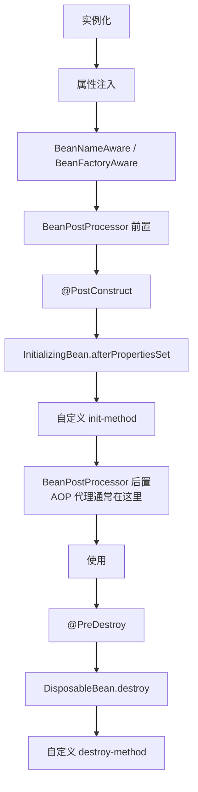

# Spring

> Spring 的核心不是注解，而是“用容器管理对象生命周期，用代理织入横切逻辑”。

很多人学 Spring 是从 `@Service`、`@Autowired`、`@Transactional` 开始的，于是把框架当成一组注解。真正出问题时才发现：为什么字段注入难以测试，为什么 `@Transactional` 在自调用时失效，为什么单例 Bean 里保存了请求状态，为什么异常被吞掉后事务没有回滚。这些问题都和注解无关，和 Spring 的容器、代理和事务模型有关。

理解 Spring，抓住三条主线就够了：IoC/DI 管理对象，AOP 织入横切逻辑，事务本质上是 AOP 加连接管理。

## 本章目标

学完本章，你应该能够：

- 解释 IoC / DI 和 Bean 生命周期。
- 判断 AOP 和事务什么时候会失效。
- 设计清晰的事务边界和异常处理。
- 写出可测试、职责清晰的 Spring 服务。

## IoC 与 DI

IoC 是控制反转：对象不再自己 `new` 依赖，而由容器创建和装配。DI 是它的实现方式，常见有构造器注入、Setter 注入和字段注入。

| 方式 | 推荐度 | 说明 |
| --- | --- | --- |
| 构造器注入 | 高 | 依赖明确、可测试、不可变 |
| Setter 注入 | 中 | 适合可选依赖 |
| 字段注入 | 低 | 隐藏依赖，难以测试 |

构造器注入的好处很直接：依赖不为空，对象创建后即完整，容易在单元测试中替换，循环依赖也更早暴露。字段注入看起来短，但把依赖藏在了反射里，测试和重构都更困难。

```java
public class OrderService {
    private final OrderRepository repository;

    public OrderService(OrderRepository repository) {
        this.repository = repository;
    }
}
```

## Bean 生命周期与作用域

Spring 创建 Bean 的过程大致是：实例化、属性注入、Aware 回调、BeanPostProcessor 前置、初始化方法、BeanPostProcessor 后置（AOP 代理通常在这里）、使用、销毁。



Bean 作用域默认是 singleton。单例 Bean 不要保存请求级可变状态，否则不同请求会互相污染。prototype 每次获取新实例，但销毁不由容器管理；request/session 只在 Web 环境有效。

## AOP 与事务

AOP 用来复用横切逻辑：事务、日志、权限、缓存、重试、监控。Spring AOP 主要基于方法调用代理，有接口时可用 JDK 动态代理，无接口或强制时用 CGLIB。

事务失效最常见的场景是自调用：`this.validate()` 不经过代理，`@Transactional` 不会生效。同类内部调用、非 public 方法、异常被吞掉、抛出受检异常但默认只回滚运行时异常，也会让事务看起来“没起作用”。

```java
@Service
public class OrderService {
    public void create() {
        this.validate(); // 不经过代理，事务不会生效
    }

    @Transactional
    public void validate() {}
}
```

事务传播行为决定方法如何加入或新建事务。`REQUIRED` 是默认值，有事务就加入，没有就新建；`REQUIRES_NEW` 总是新建并挂起当前事务；`NESTED` 依赖保存点。常见错误包括在事务里调用远程服务、事务方法里做耗时 IO、滥用 `REQUIRES_NEW` 导致连接耗尽、大事务锁表。

::: warning 自调用会绕过 AOP
`this.method()` 不经过 Spring 代理，所以事务、缓存、权限等基于 AOP 的注解都可能失效。解决方式是拆到另一个 Bean、通过代理调用、使用 `TransactionTemplate`，或者重新设计职责。
:::

::: details 小问题：`REQUIRES_NEW` 什么时候该用？
当内层操作必须独立提交或回滚，不受外层事务影响时，例如记录审计日志、发送独立通知。但它会占用额外连接，外层事务未提交时还可能出现锁竞争；不要因为“看起来更安全”就滥用。
:::

## Spring MVC 与异常处理

请求进入 Spring MVC 后，大致经过 Filter、DispatcherServlet、HandlerMapping、HandlerAdapter、Controller、Service、Repository，再由 HttpMessageConverter 转成响应。


参数校验放在 Controller 边界，业务规则校验放在领域层，不要只依赖前端。异常处理用 `@RestControllerAdvice` 统一响应，业务异常和系统异常分开，不把堆栈返回给用户，日志记录 traceId 和关键业务 ID。

## Spring Review 矩阵

| 维度 | 必须回答 | 不满足时怎么办 |
| --- | --- | --- |
| 注入 | 是否使用构造器注入？ | 改成构造器，移除字段注入 |
| 状态 | 单例 Bean 是否线程安全？ | 移除请求级可变字段 |
| AOP | 是否存在自调用绕过？ | 拆 Bean 或用代理调用 |
| 事务 | 事务范围是否尽量小？ | 移出远程调用和耗时 IO |
| 异常 | 回滚规则是否明确？ | 配置 `rollbackFor` 并统一处理 |
| MVC | Controller 是否只做协议转换？ | 业务逻辑下沉到 Service |
| 测试 | 是否容易替换依赖？ | 构造器注入 + 单元测试 |

## 总结

Spring 的核心可以压缩成三句话：

- 容器管理对象，代理织入横切逻辑，事务也是代理的一部分。
- 构造器注入、短事务、明确异常边界，比记住注解更重要。
- 自调用、单例可变状态和异常吞掉，是 Spring 项目最常见的事故源。

如果只能记住一件事：注解只是入口，真正决定行为的是代理、生命周期和事务边界。

## 相关阅读

- [Spring Boot](/backend/spring-boot)
- [MyBatis](/backend/mybatis)
- [事务与一致性](/system-design/consistency)
- [代码规范与工程实践](/software-engineering/code-quality)
