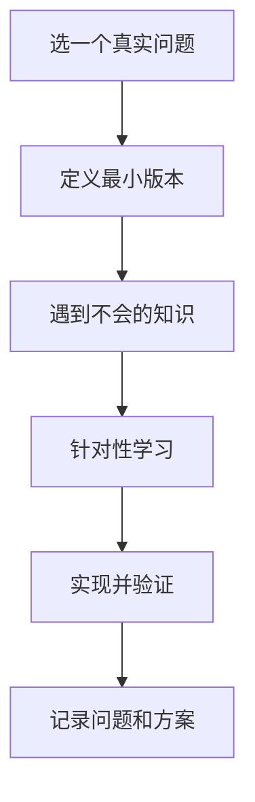

# 学习方法

> 学习效果不取决于看了多少，而取决于你能否独立复现、解释和应用。

## 本章目标

学完本章，你应该能够：

- 用刻意练习设计可验证的学习目标。
- 用项目驱动和费曼学习法加深理解。
- 安排主动回忆、间隔重复和反馈闭环。
- 把 AI 当作导师而不是答案机。

## 为什么学习方法是关键

常见低效学习：

- 收藏大量文章，从不回看。
- 看视频觉得懂了，动手就卡。
- 只读不写，只输入不输出。
- 学完一个框架，换一个项目又不会。
- 只做熟悉的事，不挑战薄弱点。

有效学习需要：

- 明确目标。
- 主动回忆。
- 及时反馈。
- 真实应用。
- 间隔复习。

## 刻意练习

刻意练习不是“多写代码”，而是：

1. 选择一个具体弱点。
2. 设定可衡量目标。
3. 在舒适区边缘练习。
4. 获取即时反馈。
5. 修正后再练。

示例：

| 模糊目标 | 刻意练习目标 |
| --- | --- |
| 学好 MySQL | 一周内用 `EXPLAIN` 优化 5 条慢查询 |
| 学好 Spring | 复现并修复 3 个事务失效场景 |
| 学好系统设计 | 独立设计一个短链系统并讲清取舍 |
| 学好 AI 工程 | 做一个带 RAG 和评估的问答应用 |

## 项目驱动学习

不要“学完再做”，而是“做一个需要学的项目”。

流程：



项目要：

- 有真实用户或真实约束。
- 有明确验收标准。
- 有可展示的产出。
- 有复盘。

## 费曼学习法

用自己的话解释一个概念，直到外行也能听懂。

步骤：

1. 选择一个概念。
2. 假设你要讲给一个不了解的人。
3. 用简单语言解释。
4. 卡住的地方就是理解缺口。
5. 回去补知识，再讲一遍。

适合：

- 面试准备。
- 写技术文章。
- 做分享。

## 主动回忆与间隔重复

### 主动回忆

不要反复阅读，而是合上资料回答：

- 这个机制解决什么问题？
- 关键步骤是什么？
- 失败模式是什么？
- 和替代方案有什么区别？

### 间隔重复

把复习分散到多天：

- 第 1 天学习。
- 第 2 天回忆。
- 第 4 天应用。
- 第 7 天总结。
- 第 30 天复盘。

适合记忆：

- 命令和 API。
- 设计模式和原则。
- 面试知识点。

## 读代码和文档

### 读代码

- 先看 README 和目录结构。
- 找到入口。
- 跟踪一条核心请求。
- 画调用链。
- 记录不理解的地方。
- 尝试改一个小功能。

### 读文档

- 先看 Quick Start。
- 再看核心概念。
- 然后看配置和扩展点。
- 最后看源码和 issue。

不要从第一页读到最后一页。

## 笔记与知识管理

好的笔记不是摘抄，而是：

- 用自己的话总结。
- 记录问题和上下文。
- 关联已有知识。
- 写下可复用的结论。
- 定期回顾。

建议结构：

```text
问题：
背景：
结论：
依据：
反例：
待验证：
```

## AI 辅助学习

AI 可以：

- 解释概念。
- 生成例子。
- 出练习题。
- 模拟面试。
- 审查你的理解。

但要注意：

- 不要让 AI 直接给答案。
- 要求它解释推理和依据。
- 对关键事实做验证。
- 用自己的话复述。
- 把 AI 当导师，不是答案机。

一个好的提问：

> 我正在学习 MySQL 的 MVCC。请先不要给结论，问我 5 个问题，判断我是否真正理解 Read View、undo log 和当前读。

## 反馈闭环

学习必须有反馈：

- 测试失败。
- Code Review。
- 面试官追问。
- 用户反馈。
- 文章评论。
- 性能指标。

没有反馈，容易在错误理解上重复练习。

## 30 天学习计划

| 周 | 目标 | 产出 |
| --- | --- | --- |
| 第 1 周 | 选定主题，建立最小知识框架 | 一页概念图 |
| 第 2 周 | 做一个小项目 | 可运行的原型 |
| 第 3 周 | 针对失败点补知识 | 修复记录 |
| 第 4 周 | 复盘并输出 | 文章/分享/README |

## 常见错误

- 只收藏不学习。
- 只输入不输出。
- 追求数量，不追求理解。
- 不做项目。
- 不复习。
- 不记录问题。
- 只学舒适区。
- 遇到难点就换方向。
- 把 AI 当答案机。

## 学习 Review 清单

- [ ] 这次学习的具体目标是什么？
- [ ] 有没有可验证的产出？
- [ ] 是否主动回忆过？
- [ ] 是否应用到真实问题？
- [ ] 是否获得反馈？
- [ ] 是否记录了理解缺口？
- [ ] 是否安排了复习？
- [ ] 是否用自己的话解释过？
- [ ] 是否验证了 AI 给出的内容？
- [ ] 下一步最小行动是什么？

## 相关阅读

## 学习 Review 矩阵

| 维度 | 必须回答 | 不满足时怎么办 |
| --- | --- | --- |
| 目标 | 学习目标是否可验证？ | 改成“能在项目里做什么” |
| 应用 | 是否用到真实问题？ | 找一个旧项目场景落地 |
| 回忆 | 是否主动回忆过？ | 合上资料做题、复述 |
| 反馈 | 是否有测试、review 或面试反馈？ | 找人 review，跑测试 |
| 记录 | 是否写下缺口和结论？ | 用“问题-结论-依据-反例”整理 |
| 复习 | 是否安排间隔复习？ | 第 2 / 4 / 7 / 30 天回顾 |

## 总结

学习方法的核心，是把输入变成可验证的输出：

- 刻意练习针对弱点，项目驱动提供真实约束。
- 费曼、主动回忆和间隔重复，用来对抗“看懂了”的错觉。
- 反馈闭环决定练习是否有效；AI 是导师，不是答案机。

如果只能记住一件事：每学一个主题，都问自己“我现在能独立用它解决什么问题”。

- [技术成长](/career/growth)
- [面试](/career/interview)
- [项目经验](/career/projects)
- [代码规范与工程实践](/software-engineering/code-quality)
