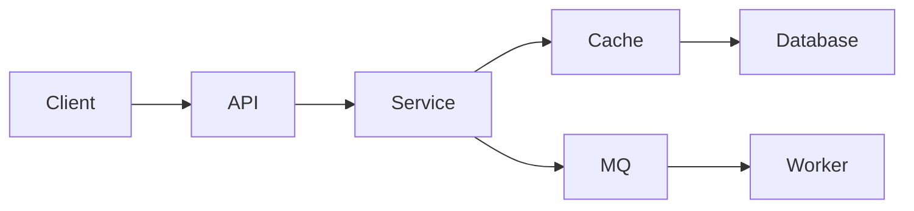

# 项目经验

> 项目不是“技术栈展示”，而是“你如何在约束下解决问题”的证据。

## 本章目标

学完本章，你应该能够：

- 选择有真实问题和技术深度的项目。
- 用背景、约束、取舍、指标和复盘组织项目。
- 把项目改写成可验证的简历 bullet。
- 准备 GitHub README、Demo 和项目讲解。

## 为什么项目经验重要

面试官想通过项目判断：

- 你是否真的做过。
- 你能否独立解决问题。
- 你是否理解取舍。
- 你能否把复杂问题讲清楚。
- 你的贡献是什么。

一个普通项目讲清楚，比三个堆技术栈的项目更有价值。

## 怎么选项目

好的项目：

- 解决真实问题。
- 有明确用户或使用场景。
- 有可验证的结果。
- 有一定技术深度。
- 能体现你的判断。
- 规模可控，能做完。

不建议：

- 纯 CRUD 商城。
- 跟着教程抄一遍。
- 只有前端页面，没有后端深度。
- 只有技术堆叠，没有业务问题。
- 没有指标和复盘。

## 项目结构

### 1. 背景

- 谁有痛点？
- 现在怎么做？
- 为什么不够好？

### 2. 目标

- 要达成什么？
- 成功标准是什么？
- 不做什么？

### 3. 约束

- 时间。
- 团队。
- 技术栈。
- 预算。
- 合规。

### 4. 架构



说明：

- 模块边界。
- 数据流。
- 关键组件。
- 为什么这样拆。

### 5. 关键决策

每个决策写：

- 问题。
- 选项。
- 选择。
- 理由。
- 代价。
- 结果。

### 6. 结果

用指标说话：

- 性能提升。
- 成本下降。
- 错误率下降。
- 人工工作量减少。
- 用户增长。
- 交付周期缩短。

### 7. 复盘

- 做对了什么？
- 做错了什么？
- 如果重来怎么改？
- 学到了什么？

## 简历中的项目写法

### 不推荐

> 使用 Spring Boot、Redis、MySQL、RabbitMQ 开发电商系统。

### 推荐

> 订单峰值 QPS 3000，支付回调重复投递导致重复扣款。通过幂等键、状态机和唯一约束将重复扣款降为 0，回调处理 P95 从 800ms 降到 200ms。

结构：

```text
背景/问题 + 你的动作 + 技术方案 + 可量化结果
```

### 动词

- 设计。
- 重构。
- 优化。
- 主导。
- 定位。
- 降低。
- 提升。
- 落地。

避免：

- 负责。
- 参与。
- 协助。
- 使用。

这些词无法说明你的具体贡献。

## 项目展示材料

### GitHub README

- 项目是什么。
- 解决什么问题。
- 架构图。
- 快速启动。
- 核心流程。
- 测试。
- 取舍。
- 后续计划。

### Demo

- 可运行。
- 有示例数据。
- 有截图或录屏。
- 有失败提示。

### 架构图

- 模块边界。
- 依赖方向。
- 数据流。
- 外部依赖。

### 测试

- 单元测试。
- 集成测试。
- 关键路径测试。

## 开源贡献

适合：

- 没有完整项目。
- 想展示协作能力。
- 想学习高质量代码。

方式：

- 修文档。
- 修小 bug。
- 补测试。
- 回答问题。
- 做代码 review。

重点不是数量，而是：

- 你理解了什么。
- 你改了什么。
- 你如何验证。
- 你如何与维护者沟通。

## AI 时代适合做的项目

- 带 RAG 的企业知识库。
- 带 Tool Calling 的研发助手。
- AI 代码审查工具。
- Prompt / 模型评估平台。
- 多 Agent 工作流。
- AI 编程助手的使用与评估。

项目要有：

- 真实数据。
- 评估集。
- 成本指标。
- 安全边界。
- 失败案例。

## 常见错误

- 项目没有真实问题。
- 只讲技术栈，不讲取舍。
- 没有指标。
- 把团队成果写成个人成果。
- README 只有启动命令。
- 没有测试。
- 项目太大，做不完。
- 项目太小，没有深度。
- 不能现场讲清架构。

## 项目 Review 清单

- [ ] 项目解决什么真实问题？
- [ ] 你的个人贡献是什么？
- [ ] 架构和核心流程能否讲清？
- [ ] 有哪些关键取舍？
- [ ] 有没有量化结果？
- [ ] 有没有失败和复盘？
- [ ] README 是否完整？
- [ ] 是否有测试和示例数据？
- [ ] 能否现场演示？
- [ ] 如果规模扩大 10 倍，哪里先坏？

## 相关阅读

## 项目 Review 矩阵

| 维度 | 必须回答 | 不满足时怎么办 |
| --- | --- | --- |
| 问题 | 项目解决什么真实问题？ | 回到用户/业务目标重述 |
| 贡献 | 个人贡献是否清楚？ | 区分“我做了”和“团队做了” |
| 架构 | 核心流程能否讲清？ | 补架构图和调用链 |
| 取舍 | 有哪些关键取舍？ | 补“考虑过什么、放弃了什么” |
| 指标 | 有没有量化结果？ | 补延迟、错误率、成本或业务指标 |
| 复盘 | 有没有失败和改进？ | 写根因和“如果重来” |
| 材料 | README、Demo、测试是否完整？ | 先补材料，再谈项目 |

## 总结

项目经验的核心，是用真实约束证明工程判断：

- 选有真实问题和可验证结果的项目，不堆技术栈。
- 按“背景-动作-结果”讲清楚个人贡献。
- 用指标、失败和复盘展示学习，而不是只讲成功。

如果只能记住一件事：面试官不是在问“你做过什么”，而是在问“你怎么把问题做对并讲清楚”。

- [简历](/career/resume)
- [面试](/career/interview)
- [项目深度解析](/projects/)
- [系统设计](/system-design/)
