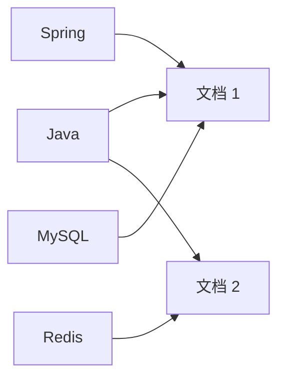
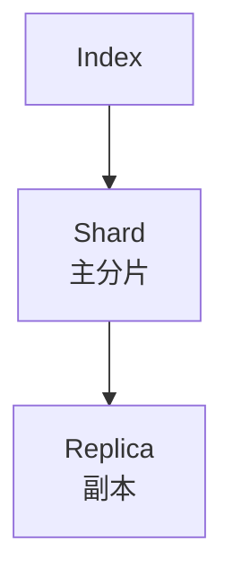

# Elasticsearch

> Elasticsearch 不是“数据库”，而是“搜索和分析引擎”。把它当主数据源，迟早会出问题。

Elasticsearch 很擅长全文检索、日志分析和聚合统计，但它不是事务型数据库：写入成功不等于立即可搜索，更新有 refresh 延迟，深分页成本高，mapping 一旦失控很难收拾。把它当主库，通常会在一致性、恢复和更新上付出代价。

正确的位置是：主数据仍在关系型或文档数据库里，Elasticsearch 作为搜索索引和分析副本，通过同步或异步管道更新。

## 本章目标

学完本章，你应该能够：

- 解释倒排索引、Mapping 和 Analyzer。
- 设计分片、副本和索引别名。
- 用 Query DSL 和聚合完成搜索与统计。
- 避免深分页、mapping explosion 和大聚合。

## 倒排索引与 Mapping

正排索引是“文档 -> 词”，倒排索引是“词 -> 文档”。查询时先找词，再找包含词的文档，这就是全文检索快的原因。



Mapping 定义字段类型：`text` 分词，用于全文搜索；`keyword` 不分词，用于精确匹配、聚合和排序；还有数值、日期、布尔、`nested`、`geo_point`。字符串要区分 `text` 和 `keyword`；不需要搜索的字段关闭索引；避免动态映射导致字段爆炸。

Analyzer 由 Character Filter、Tokenizer 和 Token Filter 组成；中文分词、同义词和停用词都会影响搜索效果。搜索时分析器和索引时分析器要匹配，否则同一个词可能索引进去却搜不出来。

::: details 小问题：`text` 和 `keyword` 到底怎么选？
需要分词搜索、相关性评分的字段用 `text`；需要精确匹配、排序、聚合、去重的字段用 `keyword`。一个字段可以同时建 `text` 和 `keyword` 两个子字段，分别服务搜索和聚合。
:::

## 集群、写入与查询

索引是逻辑概念，分片是物理存储单元，副本提供高可用和读扩展。主分片数创建后不能随意改；节点角色包括 master、data、ingest 和 coordinating。



写入先到 coordinating node，再路由到 primary shard，写入内存 buffer 和 translog；refresh 后对搜索可见，默认约 1 秒；flush 落盘，segment merge 合并小段。写入成功不等于立即可搜索；需要实时可见时显式 refresh，但不要滥用。

查询分 query context 和 filter context：query 计算相关性分数，filter 只判断是否匹配、可缓存、更快。`term` 精确匹配不分词，`match` 分词后匹配；`keyword` 字段用 `term`，`text` 字段用 `match`。bool 查询用 `must`、`filter`、`should`、`must_not` 组合。

聚合适合 terms、date_histogram、range、avg/sum/max/min、cardinality、nested；聚合字段尽量用 `keyword`，高基数字段成本高，控制桶数量，大聚合可能超时或占内存。

```json
{
  "size": 0,
  "aggs": {
    "by_status": {
      "terms": { "field": "status" }
    }
  }
}
```

## 性能与索引治理

深分页 `from + size` 成本高，替代方案是 `search_after`、scroll（导出场景）和限制最大结果窗口。批量写入用 `_bulk`，控制 refresh 频率，合理分片，避免大文档和 mapping explosion，使用 filter，只返回必要字段，监控 JVM、磁盘、segment 和 merge。

索引设计用别名切换、`_reindex` 重建、时间序列用 ILM 滚动索引；控制分片大小，避免过多小分片；副本数根据读和可用性设置。

::: warning 不要把 Elasticsearch 当主数据库
ES 的更新、事务、恢复和实时性都不适合承担核心数据。把它当搜索/分析副本，主数据放关系型或文档数据库，通过同步管道更新；索引损坏时可以重建。
:::

## Elasticsearch Review 矩阵

| 维度 | 必须回答 | 不满足时怎么办 |
| --- | --- | --- |
| 定位 | ES 是主库还是搜索副本？ | 主数据回数据库，ES 可重建 |
| Mapping | 字段类型是否明确？ | 关闭动态映射，区分 text/keyword |
| 分析器 | 是否匹配业务语言？ | 配置中文分词和同义词 |
| 查询 | 是否合理使用 filter？ | 减少评分范围，提升缓存 |
| 分页 | 是否避免深分页？ | 用 search_after，限制窗口 |
| 聚合 | 是否控制桶数量和高基数？ | 预聚合或缩小范围 |
| 索引 | 分片、副本、别名和 ILM 是否合理？ | 调整分片和滚动策略 |
| 运维 | 是否监控集群健康、JVM 和慢查询？ | 接入监控和告警 |

## 总结

Elasticsearch 的核心，是用倒排索引换搜索能力：

- 它不是主数据库；主数据在别处，ES 做搜索和分析副本。
- Mapping、Analyzer 和分片设计决定搜索效果和稳定性。
- 深分页、mapping explosion 和大聚合，是最常见的性能坑。

如果只能记住一件事：ES 适合“查得快”，不适合“存得准”；把它放在正确的位置，比调更多参数更重要。

## 相关阅读

- [数据库设计](/system-design/database-design)
- [MongoDB](/database/mongodb)
- [缓存](/system-design/cache)
- [可观测性](/software-engineering/observability)
