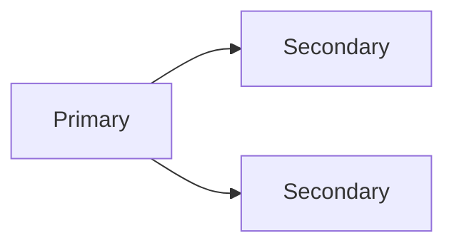

# MongoDB

> MongoDB 的优势是灵活文档模型和水平扩展，但灵活不等于不需要建模。

MongoDB 允许文档结构自由变化，很容易让人以为“先写进去，以后再想模型”。等数据量上来，才发现无界数组撑爆文档、引用查询变成 N+1、分片键选错导致热点、跨文档事务又慢又难用。

文档模型不是“没有 schema”，而是把 schema 放在应用和文档结构里。设计时仍然要回答：哪些数据一起读，哪些独立变化，哪些需要强一致，哪些会无限增长。

## 本章目标

学完本章，你应该能够：

- 判断何时嵌入、何时引用。
- 设计复合、多键、TTL 和文本索引。
- 使用聚合和读写关注满足业务需求。
- 评估复制集、分片和一致性取舍。

## 文档模型

嵌入把相关数据放在一个文档里，一次查询取全、原子更新，但文档会膨胀、数据会重复；引用避免重复、更灵活，但需要多次查询或聚合。原则是：一起读、数量有限、变化不频繁 -> 嵌入；独立变化、数量大、多对多 -> 引用。

| 方式 | 优点 | 代价 | 适用 |
| --- | --- | --- | --- |
| 嵌入 | 一次查询、原子更新 | 文档膨胀、重复数据 | 一对少、一起读取 |
| 引用 | 避免重复、灵活 | 多次查询/聚合 | 一对多、多对多、独立变化 |

文档可以带 `schemaVersion`，便于渐进迁移。避免无界数组，数组会随时间无限增长，最终超过文档大小限制并拖慢更新。可以接受适度冗余，但要有更新策略。

::: tip 先问“怎么读”，再决定嵌入还是引用
嵌入和引用不是风格问题，而是读写模式问题。经常一起读、数量有限的数据适合嵌入；独立变化、数量不可控的数据适合引用。不要为了“文档数据库”把所有关系都塞进一个文档。
:::

## 索引与聚合

MongoDB 支持单字段、复合、多键、文本、TTL、唯一和部分索引。复合索引遵循 ESR 原则：Equality 等值条件在前，Sort 排序字段其次，Range 范围条件在后。

```javascript
db.orders.createIndex({ userId: 1, status: 1, createdAt: -1 })
```

多键索引会对数组字段的每个元素建索引；低选择性索引可能没用；索引用 `explain("executionStats")` 检查。聚合管道要把 `$match` 前置、利用索引、控制内存，大聚合考虑 `allowDiskUse`。

```javascript
db.orders.aggregate([
  { $match: { status: "PAID" } },
  { $group: { _id: "$userId", total: { $sum: "$total" } } },
  { $sort: { total: -1 } },
  { $limit: 10 }
])
```

## 复制集、事务与一致性

复制集有一个 Primary 和多个 Secondary，主节点写，从节点复制，自动故障转移。读偏好决定读主、读从还是就近读；写关注决定主节点确认、多数节点确认还是写 journal。更高一致性通常意味着更高延迟，更低延迟可能读到旧数据或丢失未复制数据。

单文档操作是原子的；多文档事务需要复制集，有超时和大小限制，事务内不要做远程调用。尽量用嵌入和单文档设计减少事务需求，不要因为支持事务就把关系型建模原样搬过来。



::: details 小问题：MongoDB 支持事务，是否就能替代关系型数据库？
不一定。多文档事务有成本、限制和运维复杂度；复杂 join、强约束和报表查询仍然更适合关系型。MongoDB 的优势是文档模型和水平扩展，不是“有事务就万能”。
:::

## 分片与常见陷阱

分片键要基数高、分布均匀、大多数查询带这个键、避免单调递增导致热点。范围分片、哈希分片和区域分片各有取舍；分片后会遇到跨分片查询、跨分片事务、分片键不可变、扩容和均衡问题。

常见陷阱包括：无界数组导致文档膨胀、不建模把所有东西塞一个文档、缺少索引、索引过多、深分页、大聚合不限制内存、分片键选择导致热点、读写关注不符合业务、把 MongoDB 当关系型数据库用。

::: warning 无界数组是文档模型的定时炸弹
数组一旦随业务无限增长，文档会越来越大，更新、索引和传输都会变慢，最终可能触碰文档大小限制。需要无限增长的数据应该拆成独立集合，用引用和分页处理。
:::

## MongoDB Review 矩阵

| 维度 | 必须回答 | 不满足时怎么办 |
| --- | --- | --- |
| 模型 | 嵌入和引用是否符合读写模式？ | 按一起读/独立变化重新设计 |
| 数组 | 是否避免无界数组？ | 拆分集合，用引用和分页 |
| 索引 | 是否匹配查询、排序和聚合？ | 用 ESR 和 explain 验证 |
| 事务 | 多文档事务是否必要？ | 优先单文档/嵌入设计 |
| 读关注 | 是否能接受读到旧数据？ | 调整 read preference |
| 写关注 | 是否能接受未复制数据丢失？ | 提高 write concern |
| 分片 | 分片键是否均匀、查询友好？ | 重新选键或预分片 |
| 运维 | 是否监控慢查询和复制延迟？ | 接入指标和告警 |

## 总结

MongoDB 的核心，是用文档模型匹配读写模式：

- 嵌入和引用是设计决策，不是风格偏好。
- 索引、聚合和读写关注决定性能和一致性。
- 分片键、无界数组和跨文档事务，是最容易踩的坑。

如果只能记住一件事：MongoDB 的灵活是给模型设计的，不是给“先不设计”的。

## 相关阅读

- [数据库设计](/system-design/database-design)
- [MySQL](/database/mysql)
- [Elasticsearch](/database/elasticsearch)
- [一致性](/system-design/consistency)
