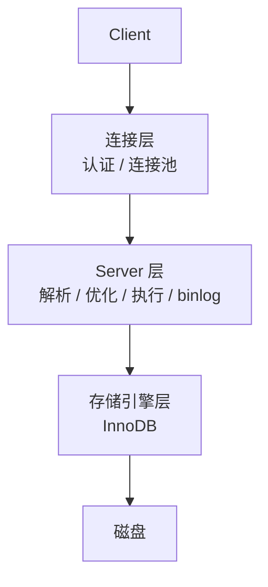

# MySQL

> MySQL 的性能问题，大多数不是“数据库不行”，而是索引、SQL、事务边界或连接池设计有问题。

慢查询、锁等待、复制延迟、连接池耗尽，这些问题通常不会在数据量小的时候暴露。等表涨到几千万行，才发现索引顺序不对、深分页扫了全表、事务里调了远程服务，修复成本已经很高。

MySQL 的学习重点不是背命令，而是理解 InnoDB 的索引、事务和锁，知道一条 SQL 为什么会慢、为什么会锁、为什么读到旧数据。

## 本章目标

学完本章，你应该能够：

- 解释 InnoDB 索引、MVCC 和锁的基本机制。
- 设计复合索引并判断索引失效。
- 用 `EXPLAIN` 优化慢查询和深分页。
- 处理复制延迟、分片和备份恢复。

## 整体架构与 InnoDB

MySQL 大致分为连接层、Server 层和存储引擎层。连接层负责认证和连接管理，Server 层负责解析、优化、执行和 binlog，InnoDB 负责聚簇索引、Buffer Pool、redo log、undo log、MVCC 和行锁。



InnoDB 的主键索引是聚簇索引，叶子节点存整行；二级索引叶子节点存主键值，查询可能需要回表。主键要短、最好有序，避免随机写入导致页分裂。B+ 树非叶子节点存索引键，叶子节点有序链表，适合范围查询。

## 索引与查询优化

复合索引遵循最左前缀。`(user_id, status, created_at)` 能支持 `user_id`、`user_id + status`、`user_id + status + created_at`，但只查 `status` 或跳过 `user_id` 通常用不上。覆盖索引让查询字段都在索引里，避免回表。

```sql
CREATE INDEX idx_user_status_time
ON orders (user_id, status, created_at);
```

索引失效常见于：对索引列使用函数、隐式类型转换、前导模糊匹配 `LIKE '%xx'`、`OR` 条件没有全部命中、复合索引不满足最左前缀，以及优化器判断全表扫描更便宜。用 `EXPLAIN` / `EXPLAIN ANALYZE` 看 `type`、`key`、`rows`、`filtered` 和 `Extra`，不要只看“有没有索引”。

深分页是另一个常见坑：`LIMIT 1000000, 20` 需要先扫描并丢弃前一百万行。更好的方式是游标分页，用上一页最后一个 ID/时间作为条件继续查，或者限制最大翻页深度。

::: tip 先看执行计划，再改 SQL
不要凭感觉加索引。先用 `EXPLAIN` 看优化器实际怎么执行，确认是全表扫描、回表、临时表还是排序，再决定加索引、改 SQL 还是改数据模型。
:::

## 事务、MVCC 与锁

ACID 在 InnoDB 里分别对应 undo log、约束和业务规则、MVCC + 锁、redo log。默认隔离级别是 REPEATABLE READ；普通 `SELECT` 是快照读，`SELECT ... FOR UPDATE`、`UPDATE`、`DELETE` 是当前读。

| 级别 | 脏读 | 不可重复读 | 幻读 |
| --- | --- | --- | --- |
| READ UNCOMMITTED | 可能 | 可能 | 可能 |
| READ COMMITTED | 否 | 可能 | 可能 |
| REPEATABLE READ | 否 | 否 | InnoDB 通过 next-key lock 降低 |
| SERIALIZABLE | 否 | 否 | 否 |

MVCC 通过隐藏事务 ID、undo log 版本链和 Read View 实现一致性读。锁包括记录锁、间隙锁、next-key lock、插入意向锁、表锁和元数据锁。死锁常见于不同顺序加锁、大事务、缺少索引导致锁范围扩大、并发更新同一批数据；处理方式是固定加锁顺序、缩短事务、优化索引、捕获死锁并重试。

::: warning 长事务会放大一切问题
长事务持有锁更久、undo log 更大、复制延迟更严重，也更容易死锁。事务内不要做远程调用、文件 IO 和大计算；能拆短就拆短。
:::

## 复制、分片与备份

主库写 binlog，从库 IO 线程拉取到 relay log，SQL 线程回放。binlog 常用 ROW 格式；复制延迟可能来自从库回放慢、大事务、无主键/无索引更新或从库负载高。解决方式包括并行复制、拆分大事务、优化 SQL、读己之写走主库和监控延迟。


不要过早分片。先考虑索引优化、归档冷数据、读写分离、分区表和缓存；这些不够时，再分库分表。分片键要分布均匀、大多数查询带这个键、避免热点；跨分片 join、事务、分页排序、全局 ID 和扩容迁移都要提前设计。

备份要区分逻辑备份（mysqldump）和物理备份（XtraBackup），结合 binlog 做增量恢复；定期恢复演练，备份加密和异地保存。没有恢复演练的备份，不能算备份。

::: details 小问题：为什么会死锁？
两个事务以不同顺序持有并等待对方需要的锁，就会死锁。常见于批量更新、不同业务入口加锁顺序不一致、缺少索引导致锁范围扩大。解决不是“加更多锁”，而是固定顺序、缩短事务、优化索引，并让应用能捕获死锁后重试。
:::

## MySQL Review 矩阵

| 维度 | 必须回答 | 不满足时怎么办 |
| --- | --- | --- |
| 索引 | 是否匹配查询和排序？ | 用 `EXPLAIN` 验证并调整 |
| 失效 | 是否有函数、隐式转换或前导模糊？ | 改写 SQL 或调整索引 |
| 分页 | 是否避免深分页？ | 改游标分页，限制深度 |
| 事务 | 是否短、是否含远程调用？ | 拆事务，移出远程调用 |
| 锁 | 是否有死锁和锁等待监控？ | 固定顺序，捕获重试 |
| 复制 | 延迟是否监控、读己之写？ | 关键读走主库 |
| 分片 | 是否真的需要？分片键合理吗？ | 先优化、归档、读写分离 |
| 备份 | 是否有恢复演练？ | 定期恢复，异地保存 |

## 总结

MySQL 的性能和正确性，主要取决于索引、事务和锁：

- 索引匹配查询，复合索引注意最左前缀，避免深分页。
- 事务要短，MVCC 和锁的边界要清楚。
- 复制延迟、分片和备份，是数据增长后的基本能力。

如果只能记住一件事：先看执行计划和事务边界，再考虑换数据库。

## 相关阅读

- [数据库设计](/system-design/database-design)
- [Redis](/database/redis)
- [一致性](/system-design/consistency)
