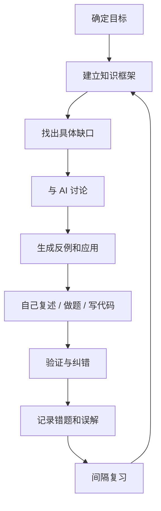
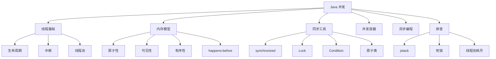
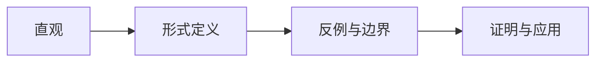
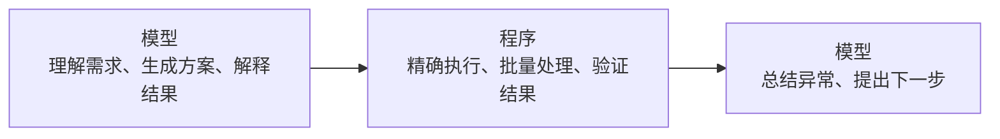
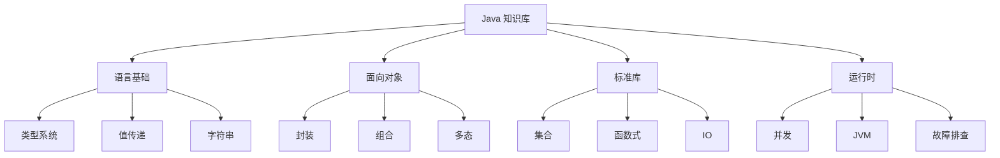

# 如何利用 AI 学习

> AI 最有价值的地方，不是替你给出答案，而是让你在任何时间、任何地点，都能找到一个愿意陪你把问题想清楚的人。

## 本章目标

学完本章，你应该能够：

- 判断哪些学习任务适合交给 AI。
- 用 AI 建立知识框架、找反例和做练习。
- 验证 AI 的解释，而不是直接接受结论。
- 避免把 AI 当成答案机或长期依赖。

## 先说清楚：不要神化 AI

视频里常见的“效率提升 3 倍”“一周学会 AI”“用了某个模型就领先别人”之类的表达，更多是个人体验或营销话术，不应该当成学习规律。

真正可复用的不是某个“最强模型”，而是一套学习方法：

- 先建立知识框架，再针对缺口提问。
- 用讨论代替单向听课。
- 让 AI 解释直觉、给出反例、设计练习。
- 用教材、文档、测试和真实运行结果验证。
- 把学到的内容用自己的话重新表达。

::: warning 合规与安全边界
本文不讨论共享账号、非官方中转站、绕过地区限制或其他规避规则的做法。这类渠道可能带来账号封禁、数据泄露、恶意内容和合规风险。请使用官方服务、组织批准的企业工具，或合规可用的替代方案。模型能力的差异，不应该用安全和隐私来交换。
:::

## 一、AI 在学习中的五种角色

很多人把 AI 当成“更快的搜索引擎”，只问“答案是什么”。这只用了它很小的一部分能力。

更有效的角色有五种：

| 角色 | 适合做什么 | 不适合做什么 |
| --- | --- | --- |
| 讲解者 | 解释概念、类比、背景和直觉 | 替代教材和系统课程 |
| 教练 | 拆解目标、制定计划、追问思路 | 替你完成全部练习 |
| 陪练 | 出题、模拟面试、角色扮演 | 保证题目和答案绝对正确 |
| 审稿人 | 检查代码、文章、证明和方案 | 替代真实测试和专家评审 |
| 资料整理员 | 总结、对比、生成提纲和卡片 | 替代原始阅读和事实核验 |

### 从“要答案”升级到“要训练”

同样是学 Java 集合，三种问法效果完全不同：

**低价值问法**

> 给我讲讲 HashMap。

**中等价值问法**

> 用初学者能理解的方式解释 HashMap 的底层结构，并给出一个哈希冲突的例子。

**高价值问法**

> 我正在学习 Java 集合。请你扮演面试官，先问我三个由浅入深的问题，再根据我的回答指出理解漏洞。不要直接给出答案；每次只问一个问题，等我回答后再继续。

第三种问法把 AI 从“答案生成器”变成了“训练器”。学习发生在你思考、回答和被纠正的过程中，而不是发生在你阅读答案的过程中。

## 二、AI 学习闭环

一个完整的学习闭环可以写成：



### 1. 确定目标

不要问：

> 教我 Java。

而要问：

> 我能在两周内读懂一个 Spring Boot 项目的请求处理流程，并独立定位一次接口报错。请帮我拆成每天 60 分钟的学习计划。

目标要包含：

- 你现在的水平。
- 你想完成的具体任务。
- 可投入的时间。
- 可验证的产出。
- 不能接受的限制。

### 2. 建立知识框架

学习最怕“知识网络全是洞，却不知道洞在哪里”。

先让 AI 帮你列框架，但不要直接接受：

> 我在学习 Java 并发。请列出这个主题的知识框架，按“基础概念、内存模型、同步工具、线程池、并发集合、故障排查”分组。每一项只写一句话，并标注哪些是初学者必须先掌握的。

拿到框架后，自己补充、删减和排序。框架不是抄给 AI 看的，而是你用来定位缺口的 map。

例如 Java 并发可以整理成：



### 3. 找出具体缺口

不要问“我并发哪里不会”，而要问自己：

- 我能不能用自己的话解释 `volatile` 的可见性？
- 我知道 `count++` 为什么不是原子操作吗？
- 我能说出线程池的四个拒绝策略吗？
- 我看到 `BLOCKED` 和 `WAITING` 能区分吗？
- 我能从线程转储里找到死锁吗？

把“不会”缩小成一个可讨论的问题，AI 的回答才会具体。

### 4. 与 AI 讨论

讨论不是让 AI 连续输出十分钟，而是：

1. 你先说出自己的理解。
2. AI 指出漏洞。
3. 你追问为什么。
4. AI 给出反例。
5. 你修正理解。
6. 你用自己的话复述。

可以这样开场：

> 我认为 `volatile` 可以保证线程安全，因为它会让所有线程看到最新值。请你不要直接否定我，而是先指出这个理解中正确的部分，再用一个具体例子说明它为什么不够。最后问我一个问题，确认我是否真的理解了。

这种问法比“讲讲 volatile”更接近真正的学习。

### 5. 生成反例和应用

理解一个概念，通常需要三样东西：

- **正例**：它是什么。
- **反例**：什么情况下它不成立。
- **应用**：它在真实问题中怎么用。

学习数学中的连续性，可以这样问：

> 请先用直观语言解释函数在某点连续的含义；再给出一个“看起来连续但实际不连续”的例子和一个“看起来不连续但实际连续”的例子；最后说明连续性的定义在证明中解决了什么问题。

学习 Java 的 `volatile`，可以这样问：

> 请给出一个使用 `volatile` 正确的例子和一个使用 `volatile` 仍然不安全的例子，并解释两者的关键差异。

反例能修正错误直觉，应用能检验理解是否真的可迁移。

### 6. 自己复述、做题、写代码

AI 讲得清楚，不等于你学会了。

每学完一个知识点，至少完成一种输出：

- 用自己的话写一段解释。
- 画一张结构图。
- 做一道题。
- 写一个最小可运行程序。
- 给别人讲一遍。
- 让 AI 扮演质疑者，接受追问。

例如学完 `HashMap` 后，不要只写“数组 + 链表 + 红黑树”。尝试回答：

- 为什么容量通常是 2 的幂？
- 扩容时元素如何重新分布？
- 为什么可变对象不适合做 key？
- `ConcurrentHashMap` 和 `HashMap` 的并发策略有什么不同？

### 7. 验证与纠错

AI 会犯错，而且经常错得很自信。验证方式包括：

- 查官方文档、教材和规范。
- 运行代码和测试。
- 用第二个来源交叉验证。
- 让 AI 给出反方观点。
- 要求 AI 标注不确定的地方。

可以让 AI 做“自我审查”：

> 请检查你刚才的回答。哪些是事实，哪些是推测？哪些结论需要官方文档或实验验证？如果有不确定的地方，请明确标出来，不要补全。

但不要把“AI 说它检查过了”当成验证。最终证据仍然是原始资料、实验和可复现结果。

### 8. 记录错题和误解

建立自己的错误日志：

```text
主题：Java volatile
错误理解：volatile 可以保证 count++ 线程安全
纠正：volatile 只保证可见性和有序性，不保证复合操作原子性
反例：两个线程同时读取、加一、写回
正确做法：AtomicInteger、锁或 LongAdder
复习日期：第 1 天、第 3 天、第 7 天
```

错题不是“丢人的记录”，而是最个性化的学习材料。AI 可以根据你的错误日志生成针对性练习：

> 根据下面这份错误日志，帮我设计 5 道由浅入深的复习题。不要重复原题，要变换场景，并在最后给出答案和考察点。

### 9. 间隔复习

AI 可以帮你生成复习计划，但不能替你完成记忆。

建议：

- 当天：用自己的话复述。
- 第 2—3 天：做一次无提示回忆。
- 第 7 天：做变式题。
- 第 30 天：把知识放回完整项目中应用。

每次复习都先不看答案。让 AI 只检查你的回答，而不是先给你答案。

## 三、讨论式学习：以数学为例

视频里最有价值的例子，是把“函数连续性”从一句定义变成了可以讨论的问题。

### 不要停在“定义是什么”

很多人的提问是：

> 函数连续的定义是什么？

这通常只会得到一段教材式回答。

更好的提问是：

> 我对函数连续的理解还停留在“图像是一条不断的线”。请解释为什么要用 ε-δ 语言重新定义连续性：这个定义想解决什么直觉上的模糊？它在哪些情况下比“图像不断”更准确？请给出反例。

### 概念理解的四个台阶



对应的问题：

1. **直观**：它大致在说什么？
2. **定义**：数学语言如何精确表达？
3. **反例**：哪些情况会破坏直觉？
4. **应用**：它如何用于证明、计算或建模？

### 让 AI 扮演苏格拉底式教练

::: details 展开：苏格拉底式提问模板
```text
你是一位数学教练。请用苏格拉底式提问帮助我理解“函数在某点连续”。

规则：
1. 先问我一个问题，了解我现在的理解。
2. 根据我的回答，只指出最关键的一个漏洞。
3. 每次只问一个问题，不要一次给出全部解释。
4. 如果连续两轮我都没有进展，再给出一个具体例子。
5. 最后让我用自己的话总结。
```
:::

这种对话比“把教材内容总结给我”更慢，但学习发生在你身上，而不是发生在 AI 的输出里。

### 数学学习中的 AI 使用边界

AI 适合：

- 解释概念和证明思路。
- 提供不同角度的类比。
- 生成反例和边界情况。
- 检查你的证明步骤是否有跳跃。
- 设计变式题。

AI 不适合：

- 替代大量基础计算。
- 保证每个数值结果正确。
- 替代严格证明训练。
- 在你不理解的情况下直接给最终答案。

涉及精确计算时，优先使用计算工具、程序或自己演算；AI 负责解释和检查思路。

## 四、用 AI 学编程

编程学习和数学学习很像：不能只看懂，必须自己写、运行、调试和重构。

### 不要让 AI 直接“写完整个项目”

更有效的顺序：

1. 让 AI 帮你澄清需求。
2. 自己写出接口和数据流。
3. 让 AI 提供最小示例。
4. 自己运行、修改、补测试。
5. 让 AI 审查你的代码，而不是替你写。
6. 用真实测试验证。

### 代码学习提问模板

**解释代码**

> 请逐行解释这段代码的执行流程，重点说明状态变化、异常路径和可能的并发问题。不要只说“这里调用了方法”。

**生成测试**

> 请为这个方法设计测试用例，覆盖正常路径、边界值、空值、异常路径和并发场景。先只给测试清单，不要给实现。

**代码审查**

> 请以严格的 Code Review 视角审查这段代码，优先指出正确性、安全性、可维护性和测试缺口。不要因为代码能运行就认为它没有问题。

**追问设计**

> 这段代码有哪些替代设计？请比较它们的可读性、性能、可测试性和扩展成本，并说明在什么场景下应该选择哪一种。

**定位错误**

> 我预期结果是 A，实际结果是 B。以下是最小复现代码和完整报错。请先提出三个可能的根因，再告诉我如何用最小实验逐个排除。不要直接猜最终答案。

### 必须亲自验证

AI 生成的代码常见问题：

- 编译不过。
- 依赖版本不匹配。
- API 不存在或已废弃。
- 边界条件遗漏。
- 异常路径没有处理。
- 并发场景不安全。
- 测试只验证了实现，没有验证行为。
- 代码看起来合理，但性能很差。

所以必须：

- 在本地运行。
- 写测试。
- 看日志和堆栈。
- 用 `git diff` 审查改动。
- 理解每一行代码为什么存在。

> 你可以让 AI 写代码，但你不能把理解代码的责任也交给它。

## 五、提示词：给 AI 一份清楚的工作说明

提示词不是咒语，而是任务说明。一个清楚的提示词通常包含：

1. **角色**：你希望 AI 以什么身份工作。
2. **目标**：你要完成什么。
3. **背景**：你的水平、环境、已有尝试。
4. **约束**：时间、格式、技术栈、不能做什么。
5. **输出格式**：表格、步骤、代码、题目还是检查清单。
6. **成功标准**：怎样才算好。

### 对比

模糊：

> 帮我学 Java。

清楚：

> 我是有 Python 基础的开发者，正在学 Java。请用 4 周时间帮我掌握集合、异常、泛型和并发基础。每周给出 3 个核心概念、2 个代码练习和 1 个自测题。不要直接给练习答案；先让我提交思路，再逐条点评。

### 用第二个对话改进提示词

这是一个很实用的技巧：

1. 对话 A：执行任务。
2. 对话 B：当提示词教练。
3. 当 A 理解错时，问 A：“你为什么会理解错？”
4. 把 A 的解释交给 B：“请根据这个失败原因，重写一版更严密的任务说明。”
5. 把新提示词带回 A 重新执行。

这比自己盯着提示词硬改更有效，因为 AI 往往能指出它需要哪些缺失信息。

## 六、模型、应用、Agent：不要混为一谈

学习 AI 时，很多人把几个概念混在一起：

- **模型**：经过训练的参数和推理能力，例如某个大语言模型。
- **应用**：你看到的聊天界面、IDE 插件、办公助手。
- **Agent**：在应用之上，能够读取文件、调用工具、执行多步任务的系统。

同一个模型可以出现在不同应用里；同一个应用也可以切换不同模型。你使用的效果，取决于：

- 模型能力。
- 系统提示词。
- 工具权限。
- 上下文组织。
- 应用的产品设计。

所以不要简单地问“哪个 AI 最强”，而要问：

- 我要完成什么任务？
- 这个工具能访问哪些材料？
- 它能否运行代码或调用外部工具？
- 它的上下文限制和成本如何？
- 我如何验证它的结果？

### 模型强不等于产品强

同一个模型，放在不同产品里，效果可能差很多：

- 有的产品能读取文件、运行代码、搜索网页。
- 有的产品只有聊天框。
- 有的产品会保留长期记忆，有的每次都要重新提供背景。
- 有的产品会把系统提示词、工具定义和历史消息组织得更好。

所以不要只看模型榜单，也不要因为某篇文章说“某个模型最强”就立刻迁移。更实际的问题是：

- 它能不能完成我的任务？
- 它能不能访问完成任务所需的材料和工具？
- 它的输出是否容易验证？
- 我使用起来是否顺畅？

### 任务完成优先于单项指标

上下文缓存命中率、模型单价、benchmark 分数都重要，但它们只是手段。

一个工具即使缓存命中率很高，如果任务没有完成，也没有意义；另一个工具可能因为拆分任务、调用子 Agent 或压缩上下文而导致缓存命中率低一些，但最终更快、更完整地解决了问题。

评估 AI 工具时，优先看：

1. 任务是否完成。
2. 结果是否正确、可验证。
3. 总耗时和总成本。
4. 过程是否可控、可回滚。
5. 使用体验是否稳定。

> 缓存应该服务于任务，而不是让任务服务于缓存。

### Agent 的任务拆分

Agent 可以把一个复杂任务拆给多个子任务：

- 一个子 Agent 查资料。
- 一个子 Agent 读代码。
- 一个子 Agent 跑测试。
- 主 Agent 汇总结果并做决策。

子 Agent 通常有独立上下文，这会降低缓存命中率，但可以避免主上下文被大量中间材料污染。是否拆分，取决于任务复杂度和上下文压力，而不是单纯追求某个缓存指标。

## 七、程序与模型：确定性交给程序，模糊判断交给模型

这是理解 AI 能力边界的关键。

### 程序适合确定性任务

例如：

- 批量重命名文件。
- 解析日志。
- 统计账单。
- 提取固定格式字段。
- 转换数据格式。
- 运行重复性检查。

这些任务规则明确、结果可验证，用程序更可靠、更便宜，也更容易重复执行。

### 模型适合模糊任务

例如：

- 解释概念。
- 总结一段文字。
- 生成初稿。
- 提供不同视角。
- 识别非结构化文本中的意图。
- 把需求翻译成候选方案。

这些任务没有唯一规则，程序难以直接写出精确逻辑，模型更擅长。

### 最强的方式通常是组合



例如处理会议录音：

1. 用语音模型转文字。
2. 用程序整理文件、去重、分段。
3. 用大模型提取待办事项。
4. 用人或规则检查关键字段。
5. 用程序输出表格。

不要用模型做“几千行数据的精确计算”，也不要让程序处理“需要理解自然语言意图”的任务。

## 八、Token、上下文与成本

### 上下文是什么

你发送一次消息时，模型看到的通常不只是这一句话，还包括：

- 系统提示词。
- 历史对话。
- 工具定义。
- 文件内容。
- 你之前设定的规则。
- 当前问题。

这些内容共同组成上下文。上下文越长，输入成本越高，模型也更容易忽略中间部分。

### 实践建议

- **一个主题一个对话**：切换任务时新开对话。
- **先总结再切换**：让 AI 整理“目标、已确定事项、未解决问题”，再带到新对话。
- **只贴必要材料**：不要整页粘贴日志，提取关键报错和相关代码。
- **重要约束重复一次**：长对话中，关键要求可能被稀释。
- **不要频繁重写早期上下文**：如果工具支持上下文缓存，频繁改动前面的系统提示词会让缓存失效。
- **控制上下文长度**：不要等到窗口快满了才处理，通常在接近上限前就应压缩或拆分。

### 成本意识

不同模型、不同应用的计费方式不同，但基本规律是：

- 输入越长，成本越高。
- 输出越多，成本越高。
- 长对话每一轮都会携带历史。
- 重复粘贴大段材料会持续产生成本。

学习时不必过度计算每一分钱，但应该有意识地避免：

- 在一个对话里混入多个无关任务。
- 反复粘贴同一份长文档。
- 让 AI 输出大量你根本不会读的内容。

### 上下文缓存

上下文缓存的基本思路是：前面已经计算过的内容，如果后续保持不变，就可以复用，不必每一轮都重新计算。

对使用者来说，最实用的原则是：

- 前面别频繁改，尽量只往后追加。
- 不要在一段长任务中反复重写系统提示词。
- 不要在长对话里频繁切换模型或思考强度。
- 需要改规则时，优先追加新的说明，而不是推翻前面的全部上下文。

缓存能省钱、降低延迟，但它不是学习目标，也不是评价工具好坏的唯一标准。如果一个 Agent 通过压缩上下文、拆分子任务或重新组织材料把任务完成得更好，即使缓存命中率低一些，也可能更值得使用。

## 九、验证：把 AI 当成同事，不是 oracle

### 必须验证的内容

- 版本、API、配置和命令。
- 数学计算和统计结果。
- 引用、论文、书名和链接。
- 法律、医疗、金融等高风险结论。
- 代码能否编译、运行和通过测试。
- 性能和安全结论。

### 验证方法

1. 查官方文档和原始资料。
2. 运行代码和测试。
3. 用第二个模型或第二个来源对比。
4. 让 AI 明确区分事实、推测和建议。
5. 要求它给出反例和失败条件。
6. 把结论写成可验证的断言。

可以让 AI 回答：

> 请把你刚才的回答分成三栏：确定的事实、基于经验的推测、需要进一步验证的内容。对每一条事实给出可查证的来源类型。

也可以问：

> 如果这个结论是错的，最可能错在哪里？需要什么实验或文档才能推翻它？

### 先判断错误的代价

不是所有问题都值得用同样的验证成本。

可以问自己一个简单的问题：

> 如果 AI 这一次答错了，我承受得起吗？

做一道番茄炒蛋、列一份旅行清单、解释一个概念，出错成本较低，可以边用边修正。

::: warning 高风险问题不能只问一次
以下问题不能只凭一次回答：

- 药物、农药、医疗建议。
- 法律、金融和合同判断。
- 生产环境命令和数据库操作。
- 安全配置和权限策略。
- 高风险设备、实验或工程操作。

错误代价越高，越需要：

- 查原始资料。
- 找第二个独立来源。
- 做实验或小规模验证。
- 请有经验的真人复核。
- 保留回滚方案。
:::

### 幻觉、随机性和迎合

AI 可能：

- 编造不存在的 API、论文、引用和事实。
- 用非常肯定的语气表达错误结论。
- 同一问题多次回答不一致。
- 顺着你的错误前提继续展开。
- 为了“友善”而减少必要的反驳。

同一道题多次尝试可能有一次成功，但这不代表你现实中第一次提问就会得到正确答案。现实没有自动重跑十次并挑选正确答案的裁判。

因此，重要问题要主动要求 AI 反驳你：

> 假设我现在的判断是错的。请给出最强的三个反驳，并说明什么证据出现后我应该改变结论。不要为了支持我而寻找理由。

### 会变化的信息要确认工具是否真的执行

对于最新版本、价格、天气、新闻、产品功能和论文状态，模型内部知识可能过期。

如果产品声称支持联网搜索，也要确认：

- 这一轮是否真的调用了搜索工具。
- 是否给出了可点击的来源。
- 来源是否是原始文档，而不是二手转述。
- 来源日期是否足够新。

不要看到“根据最新资料”就默认它真的查过。重要信息最终要回到原始来源。

## 十、AI 是能力放大器，不是判断替代品

同一个 Agent，在不同人手里会产生完全不同的结果：

- 不熟悉项目的人可能只看“改完了、测试过了”。
- 有经验的人会追问：为什么这样改？性能如何验证？测试覆盖了什么？有没有破坏兼容性？

AI 降低了“开始做”的门槛，但没有降低“判断做得好不好”的门槛。

它放大你的能力，也放大你的错误：

- 你有清晰目标，它能帮你更快推进。
- 你有模糊想法，它能帮你快速做出第一版。
- 你有错误前提，它可能帮你把错误论证得更完整。

所以使用 AI 时，要保留三个判断权：

1. **问题定义权**：到底要解决什么？
2. **证据判断权**：什么结果算正确？
3. **最终决策权**：是否采纳、发布或执行？

AI 可以参与判断，但不能替你承担后果。

### 还需要学什么

如果 AI 越来越会写代码、做总结、生成答案，人还需要学什么？

- 定义问题：到底什么值得解决。
- 判断价值：哪个方案更好，哪个结果可信。
- 验证证据：如何证明结论成立。
- 承担责任：谁为最终决策和后果负责。
- 建立联系：把不同领域的知识组合成新方案。
- 持续学习：面对新工具、新范式时快速判断和适应。

学习不是和 AI 比谁记得多、生成得快，而是提高自己定义问题、判断质量和更新认知的能力。

## 十一、常见误区

| 误区 | 问题 | 改进 |
| --- | --- | --- |
| 把 AI 当搜索引擎 | 只得到碎片答案 | 用它讨论、追问和练习 |
| 直接复制答案 | 产生“看懂了”的错觉 | 自己复述、做题、运行 |
| 一次问太大 | 回答空泛 | 拆成具体问题 |
| 不提供背景 | AI 不知道你的水平 | 说明目标、基础和限制 |
| 不验证事实 | 被幻觉误导 | 查原始资料和测试 |
| 长对话不清理 | 成本高、上下文污染 | 新主题开新对话 |
| 整段粘贴日志 | 噪音多、成本高 | 提供最小复现 |
| 让 AI 做精确计算 | 结果不可靠 | 用程序或计算工具 |
| 让 AI 替你理解代码 | 无法维护和调试 | 逐行解释并亲自修改 |
| 迷信“最强模型” | 忽略方法和验证 | 关注任务、流程和反馈 |

## 十二、如何学习 AI 本身

如果你刚开始学 AI，不建议先买一堆课、背一堆名词，或者一上来就研究本地部署。更有效的路径是：

### 1. 用一个真实任务开始

不要问“AI 是什么”，先问：

> 我今天有什么重复、耗时、需要理解材料的任务，可以交给 AI 试一次？

例如：

- 整理会议记录。
- 解释一段报错。
- 为一个功能写测试清单。
- 把一篇文章变成提纲。
- 对比两个技术方案。

### 2. 学会写清楚任务

先掌握提示词的基本结构：角色、目标、背景、约束、输出格式、成功标准。不要背“万能模板”，而是每次根据任务补充信息。

### 3. 区分模型、应用和 Agent

知道自己在用什么：

- 模型负责推理和生成。
- 应用提供界面、上下文和工具。
- Agent 能执行多步任务。

### 4. 理解程序与模型的边界

确定性任务交给程序，模糊判断交给模型，复杂任务用 Agent 组合两者。

### 5. 理解上下文和成本

知道对话历史、文件、工具定义都会进入上下文；知道长对话更贵、更容易丢信息；知道该什么时候开新对话。

### 6. 做一个小项目

比“看完十篇教程”更有效：

- 做一个个人知识库问答。
- 做一个自动整理文件的脚本。
- 做一个读取日志并生成摘要的工具。
- 做一个带测试的 CRUD 服务。

### 7. 用 AI 构建个人知识库

学习复杂领域时，AI 可以帮助你从“厚书”走向“可检索、可连接、可复习的知识网络”，但前提是你仍然亲自阅读、判断和写作。

基本流程：

1. **准备合法来源**：自己的笔记、公开文档、已授权的电子书或课程材料。
2. **提取结构**：让 AI 根据材料列出章节、概念、前置关系和关键问题。
3. **原子化笔记**：一个概念一个文件，避免把所有内容堆在一篇长文里。
4. **自己写正文**：AI 可以生成问题、反例、代码示例和检查清单，但核心解释要由自己组织。
5. **建立链接**：标出“前置知识”“相似概念”“对比概念”“实际应用”。
6. **可视化检查**：用关系图找出孤立节点、缺失连接和重复概念。
7. **用 AI 复习**：让它根据笔记出题、追问、找漏洞，而不是只做总结。

例如 Java 知识库可以按下面组织：



注意：

- 不要上传你没有权利使用的受版权保护材料。
- 不要把公司代码、密钥、客户数据粘贴到未经批准的工具。
- 不要让 AI 一次性生成整套笔记，然后把“收集”误认为“理解”。
- 知识库的价值在于连接和复习，不在于文件数量。

### 8. 不要追逐每一个新名词

AI 领域变化很快，今天流行 Agent，明天流行新的协议或工具。如果每看到一个热词就立刻改变学习方向，你会一直很忙，却很难积累真正的能力。

可以用“学习率”做个类比：

- 学习率太低：看到明显有用的新东西也不愿意尝试，进步很慢。
- 学习率太高：每条爆款视频都能让你彻底转向，在冷热之间来回横跳。
- 合适的学习率：先观察、亲手试、判断相关性，再决定是否更新自己的方向。

遇到新工具或新概念时，先问：

1. 它解决什么问题？
2. 它和我已经会的东西是什么关系？
3. 我能否用一个最小实验验证它？
4. 它对我的长期目标真的重要吗？
5. 如果现在不学，会有什么实际损失？

不是每个新名词都值得立刻投入。保持好奇，但用自己的判断决定学习优先级。

### 9. 再决定是否深入

当你真正遇到以下需求时，再考虑学习本地模型、GPU、微调或推理优化：

- 数据不能离开本地。
- API 成本过高。
- 需要定制模型行为。
- 需要离线运行。

对大多数初学者来说，先用现有设备和云端 API 完成真实任务，比一开始买昂贵硬件更有价值。

## 十三、30 天练习计划

::: details 展开：30 天练习计划
### 第 1 周：学会提问

- 每天选一个真实问题，按“目标、背景、约束、输出格式”写提示词。
- 对比模糊问法和具体问法的回答差异。
- 记录一次 AI 理解错误的案例，并分析缺失了哪些信息。

### 第 2 周：建立知识框架

- 选一个正在学习的主题，让 AI 生成框架。
- 自己删改框架，标出已掌握和未掌握的部分。
- 每天针对一个缺口进行 15 分钟讨论。

### 第 3 周：做项目

- 选一个能在一周内完成的小项目。
- 让 AI 帮你拆任务、写测试、审查代码。
- 所有代码必须自己运行、修改和解释。

### 第 4 周：验证与复盘

- 为前三周的知识做一次无提示自测。
- 让 AI 扮演面试官或审稿人。
- 整理错误日志。
- 写一篇自己的总结，不复制 AI 原文。
:::

## 十四、学习检查清单

### 提问前

- [ ] 我知道自己要完成什么。
- [ ] 我提供了必要的背景和限制。
- [ ] 我把大问题拆成了具体问题。
- [ ] 我说明了自己已经尝试过什么。

### 学习中

- [ ] 我先说自己的理解，再让 AI 纠正。
- [ ] 我要求了反例、边界和应用。
- [ ] 我没有直接接受第一个答案。
- [ ] 我在用自己的话复述。

### 学习后

- [ ] 我运行了代码或做了题。
- [ ] 我查了原始资料。
- [ ] 对高风险问题，我做了额外验证或请真人复核。
- [ ] 我检查了 AI 是否接受了我的错误前提。
- [ ] 我记录了错误和误解。
- [ ] 我安排了复习。
- [ ] 我能向别人解释这个知识点。

## 相关阅读

## 总结

AI 学习的核心，是用工程方法对待不确定性：

- AI 是导师、教练和陪练，不是答案机或 oracle。
- 学习闭环是“讨论 → 生成反例 → 自己复述/做题/写代码 → 验证”。
- 模糊判断交给模型，确定性交给程序；关键结论必须验证。

如果只能记住一件事：AI 放大的是你的学习能力，而不是替代你的判断。

- [如何提问](/getting-started/how-to-ask-questions)
- [推荐学习路线](/getting-started/recommended-learning-path)
- [Java 学习地图](/programming-language/java/)
- [AI 工程](/ai-engineering/)
- [AI Coding](/ai-coding/)
