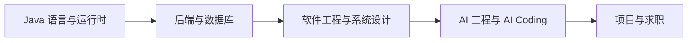

# 推荐学习路线

> 学习计算机不是百米冲刺，而是一场马拉松。

这份页面给出精简顺序。完整的阶段目标、项目阶梯和完成标准，见 [学习路线图](/learning-roadmap/)。

## 本章目标

学完本章，你应该能够：

- 根据自己的目标选择学习路径。
- 理解各阶段的核心任务和产出。
- 安排每周节奏和验证点。
- 根据实际情况调整路线，而不是照搬计划。

## 先选目标

| 目标 | 优先路线 | 周期 |
| --- | --- | --- |
| 系统打基础 | Java → 后端 → 软件工程 → 系统设计 → AI | 9—12 个月 |
| 求职冲刺 | Java 核心 → Spring Boot → 数据库 → 项目 → 面试 | 3—4 个月 |
| 在职提升 | 当前项目问题 → 工程化 → 架构 → AI 应用 | 6 个月左右 |

## 推荐顺序

### 第一阶段：Java

先建立语言、对象模型、集合、异常、并发和 JVM 的基础：

- [Java 学习地图](/programming-language/java/)
- [语言基础](/programming-language/java/basics)
- [面向对象](/programming-language/java/oop)
- [集合框架](/programming-language/java/collections)
- [并发编程](/programming-language/java/concurrency)
- [JVM](/programming-language/java/jvm)

### 第二阶段：后端与数据库

- HTTP 与 REST。
- Spring / Spring Boot。
- MyBatis 或 JPA。
- MySQL 索引、事务和慢查询。
- Redis 缓存和消息队列。

### 第三阶段：工程与架构

- 代码规范、重构和测试。
- Code Review 和 CI/CD。
- DDD、模块边界和依赖方向。
- 系统设计、可观测性和故障处理。

### 第四阶段：AI 工程

- Prompt 与 Context Engineering。
- Tool Calling、RAG 和 Memory。
- Agent、Workflow 和 Evaluation。
- AI Coding 工具与代码审查。

## 第一周怎么开始

如果不知道从哪里下手，先做这五件事：

1. 选一个能在一周内完成的小程序。
2. 用 Java 写出来，并补 3 个单元测试。
3. 用 Git 建分支、提交、合并。
4. 写一份 README，说明问题、运行方式和限制。
5. 记录 3 个没弄懂的问题，逐个查文档或问 AI。

::: tip 不要等“准备好”再开始
先做一个不完美但能运行的项目，再根据暴露出来的问题补知识。项目是最好的学习路线校准器。
:::

## 每周节奏

- 2 小时阅读。
- 4 小时写代码。
- 1 小时测试和重构。
- 1 小时写笔记和画图。
- 1 小时复盘与下周计划。

## 相关阅读

## 总结

推荐路线的核心，是用目标和节奏约束学习：

- 先选目标，再决定顺序；不同目标路线不同。
- 每周固定时间阅读、写码、测试、笔记和复盘。
- 完整的阶段目标、项目阶梯和完成标准见路线图。

如果只能记住一件事：不要照搬计划，要根据自己的目标调整节奏。

- [完整学习路线图](/learning-roadmap/)
- [如何利用 AI 学习](/getting-started/learning-with-ai)
- [如何提问](/getting-started/how-to-ask-questions)
