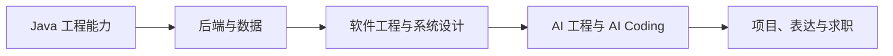
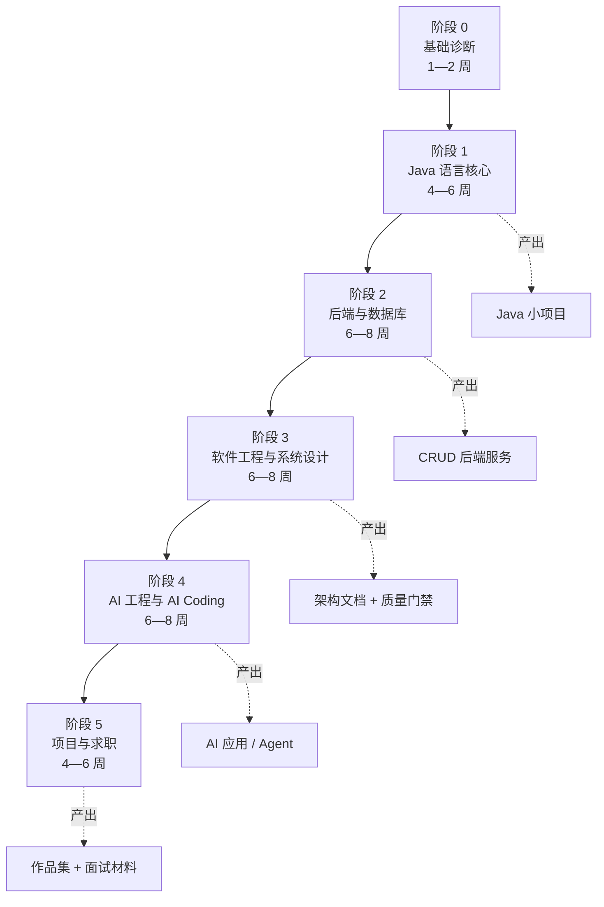
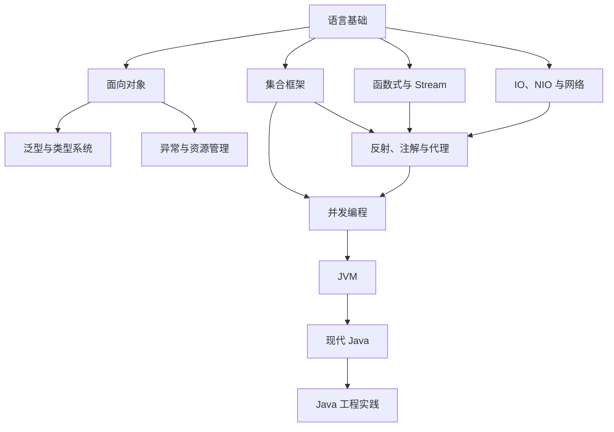
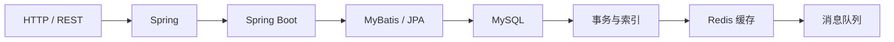
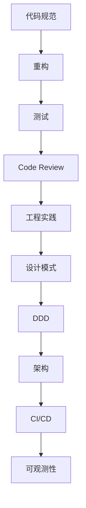
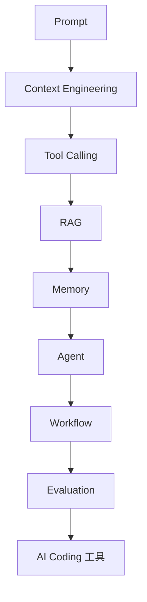
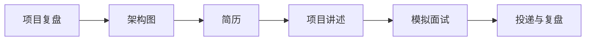
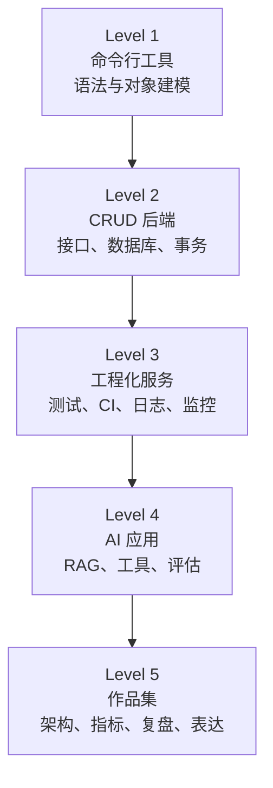

# 学习路线图

> 路线图不是把所有知识排成一条直线，而是帮你判断：现在在哪、下一步学什么、学到什么程度可以进入项目。

## 本章目标

学完本章，你应该能够：

- 判断这份路线图是否适合自己。
- 理解从 Java 到 AI Software Engineer 的阶段划分。
- 用里程碑和项目验证学习进度。
- 根据自己的基础调整节奏。

## 这份路线图适合谁

- 已经会一点 Java，但知识零散，遇到项目不知道从哪里下手。
- 想从传统 CRUD 后端转向 AI 应用开发。
- 准备求职，需要一条能产出项目和面试材料的路线。
- 已经在工作，希望用有限时间补齐工程、架构和 AI 能力。

默认投入：**每周 8—12 小时，持续 9—12 个月**。如果是全职学习，可以压缩到 4—6 个月；如果每周只能投入 4 小时，就把周期拉长到 18 个月左右。

::: tip 路线图的使用方式
不要把它当成必须全部完成的清单。先选一条主路线，每个阶段只保留 1 个核心项目和 2—3 个可验证产出。完成比“看完”重要。
:::

## 最终能力模型

目标不是“会调用 AI API”，而是具备下面五层能力：

| 能力层 | 你要能做什么 |
| --- | --- |
| Java 工程能力 | 写出可读、可测试、能定位问题的 Java 代码 |
| 后端与数据 | 设计接口、事务、缓存、数据库和消息流程 |
| 软件工程与系统设计 | 做重构、测试、Code Review、架构取舍和故障排查 |
| AI 工程与 AI Coding | 理解模型、上下文、RAG、工具调用、Agent 和评估 |
| 项目与表达 | 把技术工作讲成问题、方案、取舍、结果和复盘 |

## 总路线

## 阶段 0：基础诊断

### 目标

确认自己是否具备进入主线的先决条件，避免在 Java 语法还没过关时直接学 Spring 或 Agent。

### 自测问题

- 能解释基本类型、引用类型、值传递和对象生命周期吗？
- 能独立写出类、接口、异常处理和单元测试吗？
- 知道 Git 的提交、分支、合并和回滚吗？
- 能说清 HTTP 请求、响应、状态码和 JSON 吗？
- 知道数据库表、索引、事务的基本概念吗？

### 如果答不上来

先读：

1. [如何利用 AI 学习](/getting-started/learning-with-ai)
2. [Java 学习地图](/programming-language/java/)
3. [Java 语言基础](/programming-language/java/basics)
4. [Java 面向对象](/programming-language/java/oop)

### 完成标准

- 能用 Java 写一个包含输入、校验、异常处理和测试的小程序。
- 能用 Git 完成一次完整的功能分支、提交和合并。

## 阶段 1：Java 语言核心

### 目标

从“会写语法”过渡到“能写出可维护的 Java 代码”，并建立运行时意识。

### 学习顺序

### 重点章节

- [语言基础](/programming-language/java/basics)
- [面向对象](/programming-language/java/oop)
- [泛型与类型系统](/programming-language/java/generics)
- [异常与资源管理](/programming-language/java/exceptions)
- [集合框架](/programming-language/java/collections)
- [函数式与 Stream](/programming-language/java/functional)
- [IO、NIO 与网络](/programming-language/java/io)
- [反射、注解与代理](/programming-language/java/reflection)
- [并发编程](/programming-language/java/concurrency)
- [JVM](/programming-language/java/jvm)
- [现代 Java](/programming-language/java/new-features)
- [Java 工程实践](/programming-language/java/engineering)

### 阶段项目

**项目 A：命令行订单管理工具**

- 使用面向对象建模订单、商品和状态。
- 使用集合和 Stream 做查询、排序和聚合。
- 使用自定义异常处理非法状态。
- 使用 JUnit 5 写单元测试。
- 使用 Maven 或 Gradle 构建。

### 完成标准

- 能解释 `equals` / `hashCode`、泛型擦除、值传递和不可变对象。
- 能说出 `HashMap`、`ArrayList`、`ConcurrentHashMap` 的适用场景。
- 能解释 `volatile` 为什么不能保证 `count++` 原子性。
- 能用 `jstack` 和 `jcmd` 做一次基本的线程/堆观察。

## 阶段 2：后端与数据库

### 目标

把 Java 语言能力放进真实后端场景：HTTP、Spring、数据库、事务、缓存和消息。

### 学习顺序

### 重点内容

- HTTP、REST、参数校验、统一异常处理和分页。
- Spring 容器、依赖注入、AOP 和事务。
- Spring Boot 配置、日志、过滤器、拦截器。
- MyBatis 或 JPA、连接池、SQL 和索引。
- MySQL 事务、隔离级别、锁和慢查询。
- Redis 缓存、过期、穿透、击穿和一致性。
- 消息队列、幂等、重试和死信队列。

对应章节：

- [后端开发](/backend/)
- [数据库](/database/)
- [系统设计：缓存](/system-design/cache)
- [系统设计：消息队列](/system-design/message-queue)

### 阶段项目

**项目 B：带权限的订单服务**

- 用户、角色、权限和登录。
- 订单创建、支付、取消和查询。
- 数据库事务和幂等键。
- Redis 缓存和缓存失效策略。
- 统一错误码、日志和接口文档。

### 完成标准

- 能独立设计一组 REST 接口。
- 能解释事务边界、索引失效和缓存一致性。
- 能定位一次慢 SQL 或接口超时。
- 能说清为什么某个操作需要幂等。

## 阶段 3：软件工程与系统设计

### 目标

从“功能能跑”进入“系统能维护、能演进、能排障”。

### 学习顺序

### 重点内容

- 代码规范、重构、测试金字塔和可维护测试。
- Code Review、质量门禁和技术债。
- 设计模式、DDD、模块边界和依赖方向。
- 单体、模块化单体、微服务和分布式复杂度。
- CI/CD、灰度发布、回滚和数据库迁移。
- 日志、指标、追踪、告警和事故复盘。

对应章节：

- [软件工程](/software-engineering/)
- [架构](/software-engineering/architecture)
- [测试](/software-engineering/testing)
- [CI/CD](/software-engineering/ci-cd)
- [可观测性](/software-engineering/observability)
- [系统设计](/system-design/)

### 阶段项目

**项目 C：给订单服务补工程质量**

- 补核心单元测试和集成测试。
- 加 CI 质量门禁。
- 做一次重构并保留行为不变。
- 增加日志、指标和 traceId。
- 写一份架构说明和 ADR。
- 做一次故障演练：数据库超时、缓存失效或消息重复。

### 完成标准

- 能画出模块边界和依赖方向。
- 能解释一次架构取舍的收益、成本和风险。
- 能设计测试策略，而不是只追求覆盖率。
- 能根据日志、指标和追踪定位问题。

## 阶段 4：AI 工程与 AI Coding

### 目标

理解 AI 应用的能力边界，能构建带上下文、工具、评估和失败处理的 AI 功能，而不是只会调用一次 API。

### 学习顺序

### 重点内容

- 提示词结构、上下文组织、输出约束和失败重试。
- 工具调用、RAG、记忆、Agent 和 Workflow 的边界。
- 评估集、离线评测、线上指标和回归测试。
- AI Coding：代码生成、审查、测试、调试和上下文管理。
- 成本、延迟、token、上下文窗口和缓存。
- 幻觉、安全、隐私和人工确认边界。

对应章节：

- [AI 工程](/ai-engineering/)
- [AI Coding](/ai-coding/)
- [如何利用 AI 学习](/getting-started/learning-with-ai)

### 阶段项目

**项目 D：个人知识库问答或研发助手**

任选一个：

- 基于文档的 RAG 问答，带引用、拒答和评估集。
- 读取项目日志并生成故障摘要的 Agent。
- 读取需求文档并生成测试清单的 Workflow。
- 带工具调用的代码审查助手。

### 完成标准

- 能说明为什么用 RAG、Workflow 或 Agent，而不是只因为流行。
- 能处理工具失败、超时、空检索和模型幻觉。
- 有一组可重复运行的评估用例。
- 能解释 token、延迟和成本的主要来源。
- 能判断哪些步骤必须由人确认。

## 阶段 5：项目与求职

### 目标

把学习成果变成可展示、可追问、可验证的项目和表达材料。

### 学习顺序

### 需要准备的材料

- 1 个主项目：能讲清问题、方案、取舍、指标和复盘。
- 1 个辅助项目：证明另一项能力，例如 AI 应用或工程化改造。
- 1 份架构图：模块、依赖、数据流和失败路径。
- 1 份 ADR：记录一次重要技术决策。
- 1 份性能或故障报告：有基线、实验和结论。
- 1 份 3 分钟项目介绍和 10 分钟深入版本。

### 面试重点

| 方向 | 需要准备的问题 |
| --- | --- |
| Java | 集合、泛型、异常、并发、JVM、版本特性 |
| 数据库 | 索引、事务、隔离级别、慢查询、缓存一致性 |
| 后端 | Spring、事务、幂等、限流、消息队列 |
| 系统设计 | 边界、容量、一致性、失败处理、演进 |
| AI 工程 | RAG、工具调用、Agent、评估、幻觉和成本 |
| 项目 | 为什么这样做、替代方案、指标、踩坑和复盘 |

## 三条学习路线

| 路线 | 适合人群 | 周期 | 重点 |
| --- | --- | --- | --- |
| 系统学习 | 基础薄弱、想完整转型 | 9—12 个月 | 五层能力全部覆盖 |
| 求职冲刺 | 已有 Java 基础、需要尽快面试 | 3—4 个月 | Java + 后端 + 项目 + 面试 |
| 在职提升 | 工作忙、需要解决当前问题 | 6 个月 | 工程化、架构、AI 应用 |

### 求职冲刺版

如果时间只有 3—4 个月，优先顺序是：

1. Java 核心：集合、异常、泛型、并发。
2. 后端：Spring Boot、MySQL、Redis、接口设计。
3. 软件工程：测试、Code Review、基本架构。
4. 项目：做一个能演示、能讲透的后端项目。
5. AI：理解 RAG、工具调用和评估，不追求训练模型。

## 每周学习模板

以每周 10 小时为例：

| 时间 | 内容 |
| --- | --- |
| 2 小时 | 阅读章节和官方文档 |
| 4 小时 | 写代码、做项目 |
| 1 小时 | 补测试、重构和 Code Review |
| 1 小时 | 写笔记、画图和复盘 |
| 1 小时 | 自测、面试题或项目讲述 |
| 1 小时 | 处理本周遗留问题 |

::: warning 不要用“看完课程”代替“完成项目”
视频和文章只能建立地图。真正进入能力层的是：自己写、运行、测试、排错、重构和讲给别人听。
:::

## 项目阶梯

每个项目至少保留：

- README：问题、运行方式、架构和限制。
- 测试：如何证明核心行为正确。
- 架构图：模块、依赖和数据流。
- 复盘：遇到的问题、替代方案和下一步。

## 常见误区

| 误区 | 后果 | 改进 |
| --- | --- | --- |
| 只收藏教程，不写项目 | 面试时无法深入 | 每阶段至少一个可运行产出 |
| 直接上微服务 | 分布式复杂度压垮进度 | 先做模块化单体 |
| 只学框架，不学 Java | 遇到底层问题无法排查 | 先补语言、集合、并发和 JVM |
| 只追求覆盖率 | 测试很多但抓不住风险 | 覆盖核心路径、边界和失败场景 |
| AI 生成代码直接上线 | 不理解、不可维护 | 自己运行、测试、审查和解释 |
| 项目没有指标 | 无法证明效果 | 记录延迟、错误率、吞吐或成本 |
| 频繁换方向 | 每件事都停在入门 | 一条主线至少坚持 8—12 周 |

## 路线图检查清单

- [ ] 我能说清自己当前处于哪个阶段。
- [ ] 我有一个正在进行的主项目。
- [ ] 我知道下一周要学什么、产出什么。
- [ ] 我的项目有测试、README 和架构图。
- [ ] 我能解释一个技术取舍的收益和代价。
- [ ] 我有一个可以演练的项目讲述版本。
- [ ] 我知道哪些 AI 结论必须验证。

## 相关阅读

## 总结

路线图的核心，是帮你判断“现在在哪、下一步学什么、何时进入项目”：

- 五个阶段：诊断 → Java 核心 → 后端与数据库 → 工程与系统设计 → AI 工程与求职。
- 用项目和里程碑验证进度，而不是只记录学习时间。
- 不同目标可以走不同路线，但每个阶段都要有可演示产出。

如果只能记住一件事：路线图不是课程表，而是根据项目缺口调整的学习地图。

- [第一周怎么开始](/getting-started/recommended-learning-path)
- [如何利用 AI 学习](/getting-started/learning-with-ai)
- [Java 学习地图](/programming-language/java/)
- [软件工程](/software-engineering/)
- [系统设计](/system-design/)
- [AI 工程](/ai-engineering/)
- [项目深度解析](/projects/)
- [职业成长](/career/)
