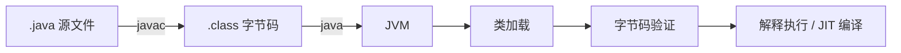
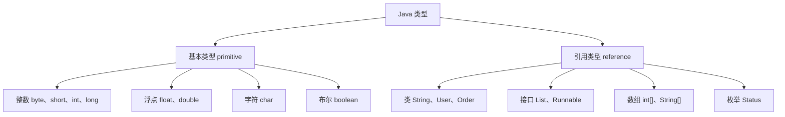

# Java 语言基础

> 基础不是“简单”，而是后续所有设计的根。很多高级问题，最后都会回到类型、作用域、值传递和对象生命周期。

## 本章目标

学完本章，你应该能够：

- 解释 Java 源文件从编译到执行的基本过程。
- 正确使用基本类型、引用类型、包装类型和字符串。
- 理解值传递、作用域、初始化和对象引用。
- 写出边界清晰、可读性好的控制流和方法。
- 正确使用数组，并理解数组协变带来的风险。
- 避免整数溢出、浮点精度、装箱缓存和字符串比较等常见陷阱。

## 一、Java 程序的基本结构

一个最小的 Java 程序：

```java
package com.example.demo;

public final class Hello {
    public static void main(String[] args) {
        System.out.println("Hello, Java");
    }
}
```

它包含几个重要部分：

- `package`：命名空间，避免类名冲突。
- `import`：引入其他包中的类型。
- `class`：Java 程序的基本组织单位。
- `main`：JVM 启动应用时寻找的入口方法。
- `public`、`static`、`void`：分别表示访问级别、静态方法和无返回值。

### 编译与运行

```bash
javac src/main/java/com/example/demo/Hello.java
java -cp src/main/java com.example.demo.Hello
```

Java 源代码首先编译成字节码，而不是直接编译成某个操作系统的机器码：



这就是 Java 跨平台的基础。字节码本身不绑定操作系统，具体平台差异由 JVM 处理。

### 包与命名

包名通常使用公司域名的倒序：

```text
com.example.order
com.example.order.domain
com.example.order.application
com.example.order.infrastructure
```

包不仅是目录结构，也是访问控制和模块边界的一部分。不要把大量无关类堆在同一个包中，也不要让包名只反映技术分层而完全脱离业务语义。

## 二、Java 的类型系统

Java 的类型分为两大类：



### 基本类型

| 类型 | 位数 | 范围/说明 | 默认值 |
| --- | --- | --- | --- |
| `byte` | 8 | -128 ～ 127 | `0` |
| `short` | 16 | -32768 ～ 32767 | `0` |
| `int` | 32 | 约 -21 亿 ～ 21 亿 | `0` |
| `long` | 64 | 更大的整数 | `0L` |
| `float` | 32 | 单精度浮点数 | `0.0f` |
| `double` | 64 | 双精度浮点数 | `0.0d` |
| `char` | 16 | UTF-16 代码单元 | `'\u0000'` |
| `boolean` | 未规定 | `true` / `false` | `false` |

Java 的基本类型大小是固定的，不依赖具体平台。这是 Java 跨平台语义的一部分。

### 字面量

```java
int decimal = 100;
int hex = 0xFF;
int binary = 0b1010;
long large = 10_000_000_000L;
double price = 19.99;
float rate = 0.75f;
char letter = 'A';
boolean enabled = true;
```

下划线只是提高可读性，不改变数值。`long` 字面量建议使用大写 `L`，小写 `l` 容易与数字 `1` 混淆。

### 类型转换

小范围类型可以自动转换为大范围类型：

```java
int number = 100;
long larger = number;      // 自动拓宽
double decimal = number;   // 自动拓宽
```

反过来需要显式强制转换，并可能丢失精度：

```java
long value = 10_000_000_000L;
int narrowed = (int) value; // 只保留低 32 位

double price = 19.99;
int yuan = (int) price;     // 19，小数部分被截断
```

强制转换不是四舍五入，也不会自动检查范围。需要取整时使用 `Math.round`、`BigDecimal` 或明确的业务规则。

### 整数溢出

Java 的整数运算不会自动抛出溢出异常：

```java
int max = Integer.MAX_VALUE;
int overflow = max + 1; // -2147483648
```

需要安全计算时使用：

```java
int result = Math.addExact(max, 1); // ArithmeticException
```

金额、库存、计数等业务字段要考虑范围。普通 `int` 不适合表示不可控的累计值。

### 浮点数

`float` 和 `double` 使用二进制浮点表示，不能精确表示很多十进制小数：

```java
System.out.println(0.1 + 0.2); // 0.30000000000000004
```

不要在金额计算中使用 `double`：

```java
// 不推荐
double total = 0.1 + 0.2;

// 推荐
BigDecimal total = new BigDecimal("0.1")
    .add(new BigDecimal("0.2"));
```

`BigDecimal` 的构造应优先使用字符串，避免用 `double` 构造时把已经存在的精度误差带进去。

特殊值：

```java
Double.NaN == Double.NaN;              // false
Double.isNaN(Double.NaN);              // true
Double.POSITIVE_INFINITY;
Double.NEGATIVE_INFINITY;
```

### `char` 与 Unicode

`char` 是 16 位 UTF-16 代码单元，不总能表示一个完整的 Unicode 码点：

```java
char letter = '中';
int codePoint = letter;
```

处理 emoji 等辅助平面字符时，应使用 `codePointAt`、`offsetByCodePoints` 或按 `String` 处理，而不是假设一个 `char` 等于一个用户可见字符。

## 三、引用类型与对象

引用类型的变量保存的是对象引用，而不是对象本身：

```java
StringBuilder builder = new StringBuilder("hello");
StringBuilder another = builder;

another.append(" world");
System.out.println(builder); // hello world
```

`builder` 和 `another` 指向同一个对象，因此通过任一引用修改对象，另一方都能看到。

### `null`

`null` 表示引用不指向任何对象：

```java
String name = null;
System.out.println(name.length()); // NullPointerException
```

减少 `null` 问题的方式：

- 方法返回值明确是否可能为空。
- 集合返回空集合，而不是 `null`。
- 对必须存在的参数做前置校验。
- 在边界层使用 `Optional` 表达“可能没有值”。
- 不要用 `null` 表示多种不同语义。

### 对象身份与相等性

```java
String left = new String("java");
String right = new String("java");

System.out.println(left == right);      // false，比较引用
System.out.println(left.equals(right)); // true，比较内容
```

`==` 比较基本类型的值，或比较引用是否指向同一对象；`equals` 的语义由类决定。

## 四、包装类型与自动装箱

每个基本类型都有对应的包装类：

| 基本类型 | 包装类型 |
| --- | --- |
| `int` | `Integer` |
| `long` | `Long` |
| `double` | `Double` |
| `boolean` | `Boolean` |
| `char` | `Character` |

自动装箱和拆箱让二者可以互相转换：

```java
Integer count = 10; // 自动装箱
int value = count;  // 自动拆箱
```

### 缓存陷阱

`Integer` 默认缓存 -128 到 127：

```java
Integer a = 127;
Integer b = 127;
System.out.println(a == b); // true

Integer c = 128;
Integer d = 128;
System.out.println(c == d); // false
```

包装类型应使用 `equals` 比较值，不要用 `==`。

### 空指针陷阱

```java
Integer count = null;
int value = count; // NullPointerException
```

自动拆箱会在 `null` 时抛出异常。DTO、数据库字段和外部接口返回值要特别小心。

### 包装类型的使用边界

- 集合泛型不能使用基本类型，必须使用包装类型。
- 大量数值计算优先使用基本类型，避免装箱开销。
- 可能缺失的数值使用包装类型或 `OptionalInt` 等类型表达。
- 不要为了“统一”把所有字段都改成包装类型。

## 五、变量、作用域与初始化

### 局部变量

```java
public int calculate(int price, int quantity) {
    int total = price * quantity;
    return total;
}
```

局部变量必须在使用前显式初始化。它们存放在栈帧的局部变量表中，生命周期随方法调用结束。

### 实例变量

```java
public final class Order {
    private final long id;
    private String remark = "";

    public Order(long id) {
        this.id = id;
    }
}
```

实例变量属于对象，具有默认值。`final` 字段必须在构造器结束前完成赋值。

### 静态变量

```java
public final class IdGenerator {
    private static final AtomicLong SEQUENCE = new AtomicLong();

    public static long next() {
        return SEQUENCE.incrementAndGet();
    }
}
```

静态变量属于类，被所有实例共享。它适合常量、无状态工具和不依赖请求上下文的基础设施，不适合保存请求级状态。

### `final` 与有效 final

```java
final int maxRetry = 3;
final List<String> names = new ArrayList<>();
names.add("alice"); // 可以修改对象内容
// names = new ArrayList<>(); // 不能重新赋值
```

`final` 保证引用不再改变，不保证引用对象不可变。需要不可变集合时使用 `List.copyOf` 或 `List.of`。

Lambda 捕获的局部变量必须是有效 final：

```java
String prefix = "user-";
Runnable task = () -> System.out.println(prefix + "created");
```

### 变量遮蔽

```java
public final class User {
    private String name;

    public void setName(String name) {
        this.name = name; // this.name 区分字段和参数
    }
}
```

不要用遮蔽制造歧义。参数名和字段名相近时，`this` 是必要的，但更好的做法是让命名本身足够清晰。

## 六、运算符与表达式

### 算术运算

```java
int a = 7;
int b = 2;

System.out.println(a / b); // 3，整数除法
System.out.println(a % b); // 1
System.out.println(a / 2.0); // 3.5
```

整数相除会截断小数部分。需要小数结果时，至少有一个操作数必须是浮点类型，或使用 `BigDecimal`。

### 逻辑短路

```java
if (user != null && user.isActive()) {
    // 只有 user 非 null 时才会调用 isActive
}
```

`&&` 和 `||` 具有短路行为；`&` 和 `|` 对布尔值也会计算两边。不要把按位运算符和逻辑运算符混用。

### 位运算

::: details 展开：位运算常用操作
```java
int flags = 0b1010;
int read = flags & 0b0010;
int write = flags | 0b0001;
int toggle = flags ^ 0b1111;
int shiftLeft = 1 << 4;
```
:::

位运算适合权限位、协议字段和底层优化。普通业务代码中，可读性通常比位技巧更重要。

### 三元表达式

```java
String level = score >= 60 ? "pass" : "fail";
```

不要嵌套多层三元表达式。需要复杂判断时，使用方法或 `switch` 表达式。

## 七、控制流

### `if`

```java
if (amount.compareTo(BigDecimal.ZERO) < 0) {
    throw new IllegalArgumentException("amount must not be negative");
}
```

尽早处理异常和边界条件，可以减少嵌套层级。这种写法通常称为卫语句。

### `switch`

传统 `switch`：

```java
switch (status) {
    case NEW:
        handleNew();
        break;
    case PAID:
        handlePaid();
        break;
    default:
        throw new IllegalArgumentException("unknown status: " + status);
}
```

现代 switch 表达式：

```java
String label = switch (status) {
    case NEW -> "待处理";
    case PAID -> "已支付";
    case CANCELLED -> "已取消";
};
```

`switch` 表达式不会隐式贯穿，且编译器可以检查枚举分支是否完整。对于有限状态集合，这比长串 `if/else` 更安全。

### 循环

```java
for (int i = 0; i < orders.size(); i++) {
    process(orders.get(i));
}

for (Order order : orders) {
    process(order);
}

while (hasNext()) {
    consumeNext();
}
```

增强 `for` 适合遍历集合，但不要在遍历中直接修改集合结构。需要删除元素时使用 `removeIf` 或显式迭代器。

### 标签与嵌套循环

```java
outer:
for (int i = 0; i < rows; i++) {
    for (int j = 0; j < columns; j++) {
        if (shouldStop(i, j)) {
            break outer;
        }
    }
}
```

标签可以简化深层嵌套的退出逻辑，但过度使用会降低可读性。能拆成方法时优先拆分。

## 八、方法

### 方法签名

```java
public BigDecimal calculateTotal(
    List<OrderItem> items,
    BigDecimal discountRate
) {
    // ...
}
```

方法名应表达动作，参数应尽量少，返回值应表达结果。一个方法如果参数超过四五个，通常说明它承担了过多职责，或者需要引入参数对象。

### 值传递

Java 只有值传递：

::: details 展开：值传递示例
```java
public static void main(String[] args) {
    StringBuilder builder = new StringBuilder("hello");
    String text = "hello";

    modify(builder, text);

    System.out.println(builder); // hello world
    System.out.println(text);    // hello
}

static void modify(StringBuilder builder, String text) {
    builder.append(" world");
    text = "changed";
}
```
:::

- 传入对象时，传递的是引用的副本。方法可以通过这个引用修改对象内容。
- 但方法不能通过重新赋值让调用方的引用指向新对象。
- 传入基本类型时，传递的是值的副本，方法内修改不影响调用方。

### 重载与重写

```java
public void send(String message) {
}

public void send(String message, int retry) {
}
```

重载根据编译期类型选择方法，重写根据运行时类型动态分派。不要设计参数类型过于接近的重载，否则调用方很容易误选。

### 可变参数

```java
public void log(String level, String... messages) {
    for (String message : messages) {
        System.out.println(level + ": " + message);
    }
}
```

可变参数本质上是数组。调用时传入 `null` 可能导致歧义，生产 API 中应谨慎使用。

## 九、数组

### 创建与初始化

```java
int[] numbers = new int[5];
int[] values = {1, 2, 3};
int[][] matrix = new int[3][4];
```

基本类型数组元素默认是对应零值，引用类型数组元素默认是 `null`。

### 长度与越界

```java
int[] values = {1, 2, 3};
System.out.println(values.length);
System.out.println(values[3]); // ArrayIndexOutOfBoundsException
```

数组长度在创建后固定。需要动态扩容时使用集合，或显式复制：

```java
int[] expanded = Arrays.copyOf(values, values.length + 1);
```

### 数组协变

Java 数组是协变的：

```java
Object[] objects = new String[1];
objects[0] = 123; // ArrayStoreException
```

编译期允许赋值，运行时才检查实际数组类型。泛型集合通过类型擦除避免了这种数组协变问题，但也带来了其他限制。

### 常用工具

```java
Arrays.sort(values);
Arrays.fill(values, 0);
Arrays.toString(values);
Arrays.equals(left, right);
Arrays.asList("a", "b");
```

`Arrays.asList` 返回固定长度列表，不支持 `add` 和 `remove`。需要可变列表时复制到 `ArrayList`。

## 十、字符串

### 不可变性

`String` 是不可变对象：

```java
String name = "alice";
String upper = name.toUpperCase();

System.out.println(name);  // alice
System.out.println(upper); // ALICE
```

每次修改都会产生新字符串。不可变性带来线程安全、缓存哈希和可安全共享等好处，也意味着频繁拼接会产生大量临时对象。

### 字符串常量池

```java
String a = "java";
String b = "java";
String c = new String("java");

System.out.println(a == b);      // true，指向常量池同一对象
System.out.println(a == c);      // false
System.out.println(a.equals(c)); // true
```

不要依赖 `==` 比较字符串内容。只有明确需要驻留字符串时才使用 `intern()`，并注意其内存影响。

### 拼接

```java
// 循环中不推荐
String result = "";
for (String item : items) {
    result += item;
}

// 推荐
StringBuilder builder = new StringBuilder();
for (String item : items) {
    builder.append(item);
}
String result = builder.toString();
```

编译器会优化简单的常量拼接，但循环中的 `+=` 仍可能产生大量临时对象。

### 文本块

```java
String sql = """
    SELECT id, name
    FROM users
    WHERE status = ?
    """;
```

文本块适合多行模板。不要用文本块拼接不可信输入，也不要把敏感信息硬编码在源码中。

### 编码与字符集

字符串本身是 Unicode 序列，但写入文件或网络时涉及字节编码：

```java
byte[] bytes = text.getBytes(StandardCharsets.UTF_8);
String decoded = new String(bytes, StandardCharsets.UTF_8);
```

读写两边必须使用一致的字符集。不要依赖平台默认编码，显式指定 `UTF-8` 通常更可靠。

## 十一、常见陷阱

::: tip 先记住三个高频坑
金额不要用 `double`；包装类型比较用 `equals`；循环拼接字符串用 `StringBuilder`。
:::

| 陷阱 | 后果 | 建议 |
| --- | --- | --- |
| 使用 `double` 计算金额 | 精度误差 | 使用 `BigDecimal` |
| 整数溢出 | 结果变成负数或错误值 | 使用 `Math.addExact` 或更大类型 |
| 用 `==` 比较包装类型 | 比较引用而非值 | 使用 `equals` |
| 自动拆箱空值 | `NullPointerException` | 检查 `null` 或避免包装类型 |
| 循环中 `String +=` | 大量临时对象 | 使用 `StringBuilder` |
| 忘记 `switch` 的 `break` | 意外贯穿 | 使用 switch 表达式 |
| 遍历中修改集合 | `ConcurrentModificationException` | 使用 `removeIf` 或迭代器 |
| 数组越界 | `ArrayIndexOutOfBoundsException` | 使用 `length` 和边界检查 |
| 使用默认字符集 | 跨平台乱码 | 显式使用 `StandardCharsets` |
| 把可变对象作为常量共享 | 状态被意外修改 | 使用不可变对象或防御性复制 |

## 十二、练习

1. 写一个方法，接收 `int` 数组并返回最大值、最小值和平均值，处理空数组。
2. 用 `BigDecimal` 实现一个购物车总价计算，包含数量、折扣和四舍五入规则。
3. 解释下面代码的输出，并说明为什么：

```java
Integer a = 127;
Integer b = 127;
Integer c = 128;
Integer d = 128;
System.out.println(a == b);
System.out.println(c == d);
```

4. 写一个方法交换两个对象的引用，验证调用方是否能看到交换结果。
5. 使用 `StringBuilder` 拼接 10 万个字符串，并与循环 `+=` 做性能对比。
6. 构造一个数组协变导致的 `ArrayStoreException`，并说明编译期和运行时的检查差异。
7. 用 switch 表达式重写一段包含多个 `if/else` 的枚举判断。
8. 写一个递归方法计算阶乘，加入参数校验和溢出保护。
## 总结
学完本章，你应该已经掌握：
.
- 解释编译到执行的过程，区分基本类型、引用类型、包装类型和字符串。
- 理解值传递、作用域、初始化和对象引用。
- 写出边界清晰、可读性好的控制流和方法。
- 避免整数溢出、浮点精度、装箱缓存和字符串比较陷阱。
如果只能记住一件事：先搞清引用和字符串比较，这两类问题最常见。

## 相关阅读

- [面向对象](/programming-language/java/oop)
- [泛型与类型系统](/programming-language/java/generics)
- [异常与资源管理](/programming-language/java/exceptions)
- [集合框架](/programming-language/java/collections)
- [代码规范与工程实践](/software-engineering/code-quality)
