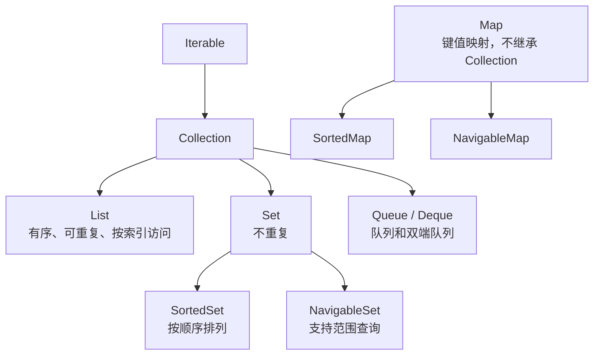
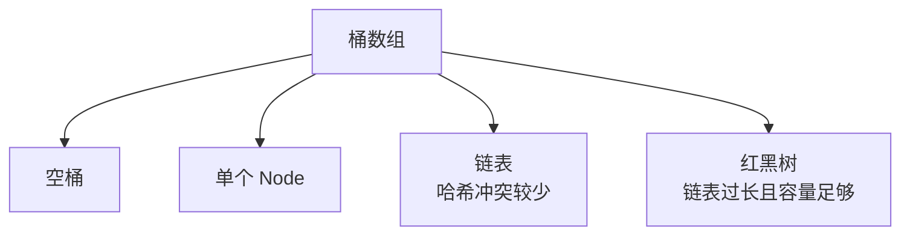

# Java 集合

> 集合选型不是背 API，而是回答：数据如何访问、是否允许重复、是否需要排序、是否会并发修改。

## 本章目标

学完本章，你应该能够：

- 根据访问、去重和排序需求选择集合。
- 理解 List、Set、Map 的底层结构和复杂度。
- 解释 HashMap 的哈希、扩容和树化。
- 避免并发修改、可变 key 和错误选型。

## 为什么集合如此重要

几乎每个 Java 程序都在处理一组数据：用户列表、订单详情、缓存映射、任务队列、去重集合。集合的选择会直接影响：

- **正确性**：是否允许重复元素、是否允许 `null`、并发访问是否安全。
- **性能**：查找、插入、删除的时间复杂度。
- **内存**：底层数组、链表节点、哈希表和树节点带来的额外开销。
- **可维护性**：代码是否表达了正确的数据语义。

很多线上问题不是“集合 API 不会用”，而是选错了结构。例如：

- 用 `List` 做高频成员判断，导致 O(n) 扫描。
- 用 `HashMap` 存可变对象作为 key，修改 key 后无法查回。
- 在并发场景直接使用 `ArrayList` 或 `HashMap`。
- 用 `LinkedList` 实现栈，却没有获得预期的性能优势。

## 集合框架总览

Java 集合主要分为两大体系：



常用实现：

| 接口 | 常用实现 | 底层结构 | 典型场景 |
| --- | --- | --- | --- |
| `List` | `ArrayList` | 动态数组 | 随机访问、遍历、追加 |
| `List` | `LinkedList` | 双向链表 | 频繁头尾插入删除，但通常可用 `ArrayDeque` 替代 |
| `Set` | `HashSet` | `HashMap` | 去重、快速成员判断 |
| `Set` | `LinkedHashSet` | 哈希表 + 链表 | 去重且保留插入顺序 |
| `Set` | `TreeSet` | 红黑树 | 去重且需要排序或范围查询 |
| `Map` | `HashMap` | 数组 + 链表 + 红黑树 | 通用键值查询 |
| `Map` | `LinkedHashMap` | 哈希表 + 双向链表 | 保留插入顺序或实现 LRU |
| `Map` | `TreeMap` | 红黑树 | 按 key 排序、范围查询 |
| `Queue` | `ArrayDeque` | 循环数组 | 栈、双端队列、普通队列 |
| `Queue` | `PriorityQueue` | 二叉堆 | 按优先级取元素 |
| `BlockingQueue` | `ArrayBlockingQueue` | 有界数组 | 生产者-消费者 |
| `BlockingQueue` | `LinkedBlockingQueue` | 链表 | 可设置有界性的阻塞队列 |
| 并发 Map | `ConcurrentHashMap` | 分段/桶级并发控制 | 高并发键值访问 |
| 并发 List | `CopyOnWriteArrayList` | 写时复制 | 读多写极少 |

> `Vector`、`Hashtable`、`Stack` 属于历史集合类，通常不建议在新代码中使用。需要线程安全时优先选择 `java.util.concurrent` 下的集合。

## 集合框架的设计思想

Java 集合框架不是一组互不相关的类，而是一套围绕接口设计的抽象：

- `Collection` 定义“一组元素”的通用行为。
- `List`、`Set`、`Queue` 分别表达不同的顺序和重复语义。
- `Map` 单独表达键值映射，不继承 `Collection`。
- `AbstractList`、`AbstractMap` 等抽象类提供部分默认实现。
- `Collections` 提供排序、查找、包装等通用算法。

### 接口优先

方法参数尽量依赖接口：

```java
// 不推荐：限制调用方只能传 ArrayList
public void process(ArrayList<Order> orders) {
}

// 推荐：只需要遍历能力
public void process(Iterable<Order> orders) {
}
```

如果只需要读取元素，使用 `Iterable` 或 `Collection` 可以降低耦合；如果需要索引访问，再使用 `List`。

### 可选操作

集合接口中的某些方法可能抛出 `UnsupportedOperationException`：

```java
List<String> names = List.of("alice", "bob");
names.add("carol"); // UnsupportedOperationException
```

这不是 API 设计缺陷，而是为了让不可变集合、固定长度列表和只读视图共享同一套接口。调用方需要知道集合是否可变。

### 算法与数据结构分离

`Collections` 工具类把排序、查找、反转等算法从具体集合中抽离：

```java
Collections.sort(numbers);
Collections.reverse(numbers);
Collections.shuffle(numbers);
int index = Collections.binarySearch(sortedNumbers, target);
```

二分查找要求列表已经按相同比较规则排序，否则结果未定义。

## 迭代器与视图

### `Iterator`

```java
Iterator<Order> iterator = orders.iterator();
while (iterator.hasNext()) {
    Order order = iterator.next();
    if (order.isCancelled()) {
        iterator.remove();
    }
}
```

迭代器把“遍历位置”和“集合结构”分开。`for-each` 本质上是迭代器的语法糖。

### `ListIterator`

`ListIterator` 支持双向遍历和修改：

```java
ListIterator<String> iterator = names.listIterator();
while (iterator.hasNext()) {
    String name = iterator.next();
    if (name.isBlank()) {
        iterator.set("unknown");
    }
}
```

### 集合视图

很多集合方法返回的是视图，而不是独立副本：

```java
Map<Long, User> users = new HashMap<>();
Set<Long> ids = users.keySet();
Collection<User> values = users.values();
Set<Map.Entry<Long, User>> entries = users.entrySet();
```

对视图的修改会反映到底层 Map：

```java
ids.remove(1L);
System.out.println(users.containsKey(1L)); // false
```

常见视图：

- `subList`：List 的一段视图。
- `keySet`、`values`、`entrySet`：Map 的键、值和条目视图。
- `Arrays.asList`：固定长度列表。
- `Collections.unmodifiableList`：只读包装。

视图适合避免复制，但也意味着生命周期和结构修改需要格外小心。

## 复杂度与内存成本

大 O 表示增长趋势，不表示绝对性能。集合选型至少要区分：

- 平均复杂度与最坏复杂度。
- 单次操作与批量操作。
- CPU 成本与内存成本。
- 是否产生额外对象。

| 操作 | `ArrayList` | `LinkedList` | `HashMap` | `TreeMap` |
| --- | --- | --- | --- | --- |
| 随机访问 | O(1) | O(n) | 按 key O(1) 平均 | 按 key O(log n) |
| 尾部插入 | 均摊 O(1) | O(1) | O(1) 平均 | O(log n) |
| 中间插入 | O(n) | 定位 O(n) + 插入 O(1) | 不适用 | 不适用 |
| 删除 | O(n) | 定位 O(n) + 删除 O(1) | O(1) 平均 | O(log n) |
| 有序遍历 | 需排序 | 需排序 | 无顺序保证 | 有序 |

内存方面：

- `ArrayList` 需要连续数组和扩容余量。
- `LinkedList` 每个元素都有节点对象和前后指针。
- `HashMap` 有桶数组、节点对象和可能的树节点。
- `TreeMap` 的红黑树节点额外保存颜色和父子引用。

因此，“O(1)”不代表一定更快。小集合、缓存局部性和对象分配成本都可能让简单数组更合适。

## 源码阅读路线

集合是学习 Java 源码的好入口。建议按下面顺序阅读 OpenJDK：

1. `ArrayList`：数组扩容、`modCount`、迭代器 fail-fast。
2. `HashMap`：哈希扰动、桶定位、链表转红黑树、扩容拆分。
3. `LinkedHashMap`：双向链表与访问顺序。
4. `ArrayDeque`：循环数组和头尾指针。
5. `ConcurrentHashMap`：CAS、桶级同步、扩容协助。

阅读时不要从第一行开始逐行看。先带着问题：

- 数据结构是什么？
- 插入、查找、删除分别在哪里发生？
- 扩容或树化触发条件是什么？
- 并发集合如何减少锁竞争？
- 哪些地方为了性能牺牲了可读性？

## List：有序、可重复

### ArrayList

`ArrayList` 基于动态数组，是最常用的集合实现。

特点：

- 支持 O(1) 随机访问。
- 尾部追加平均 O(1)，扩容时可能 O(n)。
- 中间插入和删除需要移动元素，复杂度 O(n)。
- 允许 `null`。
- 非线程安全。

扩容规则（以常见 OpenJDK 实现为例）：

```java
int newCapacity = oldCapacity + (oldCapacity >> 1); // 约 1.5 倍
```

扩容会创建新数组并复制元素，因此如果能预估数据量，可以在创建时指定初始容量：

```java
List<Order> orders = new ArrayList<>(10_000);
```

但不要盲目设置过大容量。容量预估错误会浪费内存，尤其是大量小集合时。

### ArrayList 的常见陷阱

#### 1. `Arrays.asList` 返回的是固定长度列表

```java
List<String> names = Arrays.asList("alice", "bob");
names.set(0, "carol");       // 可以
names.add("dave");           // UnsupportedOperationException
```

需要可变列表时：

```java
List<String> names = new ArrayList<>(Arrays.asList("alice", "bob"));
```

需要不可变列表时：

```java
List<String> names = List.of("alice", "bob");
```

`List.of` 返回不可变集合，并且不允许 `null`。

#### 2. `subList` 是视图，不是拷贝

```java
List<Integer> numbers = new ArrayList<>(List.of(1, 2, 3, 4, 5));
List<Integer> sub = numbers.subList(1, 4); // [2, 3, 4]

numbers.add(6);
System.out.println(sub); // 可能抛出 ConcurrentModificationException
```

如果希望得到独立集合：

```java
List<Integer> copy = new ArrayList<>(numbers.subList(1, 4));
```

#### 3. `remove` 有重载歧义

```java
List<Integer> numbers = new ArrayList<>(List.of(1, 2, 3));
numbers.remove(1);              // 删除索引 1
numbers.remove(Integer.valueOf(1)); // 删除元素 1
```

当集合元素是 `Integer` 时尤其容易写错。优先使用清晰变量或 `removeIf`：

```java
numbers.removeIf(value -> value == 1);
```

### LinkedList

`LinkedList` 是双向链表：

- 头尾插入删除 O(1)。
- 按下标访问需要从头或尾遍历，O(n)。
- 每个节点都有前后指针，内存开销高于 `ArrayList`。
- 实现了 `Deque`，可以作为队列或栈。

但在大多数场景下：

- 随机访问和遍历：`ArrayList` 更好。
- 栈和队列：`ArrayDeque` 通常更好。

因此不要因为“插入删除是 O(1)”就默认选择 `LinkedList`。定位插入位置的遍历成本往往才是主要开销。

## Set：去重与成员判断

### HashSet

`HashSet` 内部基于 `HashMap`，元素作为 key，value 使用一个固定的占位对象。

特点：

- 平均 O(1) 添加、删除、查询。
- 不保证顺序。
- 允许一个 `null`。
- 依赖元素的 `hashCode` 和 `equals`。

```java
Set<String> usernames = new HashSet<>();
usernames.add("alice");
usernames.add("alice");

System.out.println(usernames.size()); // 1
```

### LinkedHashSet

`LinkedHashSet` 在哈希表基础上额外维护链表，保留插入顺序：

```java
Set<String> visited = new LinkedHashSet<>();
visited.add("home");
visited.add("detail");
visited.add("home");

System.out.println(visited); // [home, detail]
```

适合既要去重又要稳定遍历顺序的场景。它的查询性能与 `HashSet` 同阶，但需要额外链表指针。

### TreeSet

`TreeSet` 基于红黑树：

- 元素有序。
- 添加、删除、查询 O(log n)。
- 支持范围查询：`headSet`、`tailSet`、`subSet`。
- 元素必须可比较，或者创建时提供 `Comparator`。

```java
TreeSet<Integer> scores = new TreeSet<>(Set.of(90, 70, 85));
System.out.println(scores); // [70, 85, 90]
System.out.println(scores.ceiling(80)); // 85
```

如果只需要去重和快速查询，不需要排序，优先使用 `HashSet`。

## Map：键值映射

### HashMap 的核心结构

Java 8 之后，`HashMap` 的底层结构是：



核心参数：

| 参数 | 默认值 | 含义 |
| --- | --- | --- |
| 初始容量 | 16 | 桶数组长度 |
| 负载因子 | 0.75 | 元素数量达到容量 × 负载因子时扩容 |
| 树化阈值 | 8 | 链表长度达到该值时可能转为红黑树 |
| 退化阈值 | 6 | 树节点减少到该值时可能退回链表 |
| 最小树化容量 | 64 | 容量不足 64 时优先扩容，而不是树化 |

哈希定位的逻辑可以简化为：

```java
int hash = key.hashCode();
hash = hash ^ (hash >>> 16);       // 扰动，让高位参与索引计算
int index = (table.length - 1) & hash;
```

容量通常是 2 的幂，因此 `(n - 1) & hash` 等价于对容量取模，但更快。

### HashMap 扩容

当元素数量超过阈值时，容量通常会翻倍，并重新分配节点。扩容是 O(n) 操作，但均摊到多次插入后，平均插入仍接近 O(1)。

这也是为什么预估容量有意义：

```java
Map<Long, Order> orders = new HashMap<>(16_384);
```

不过，容量越大，内存占用越高。不要为了一次性小数据创建巨大的 Map。

### `hashCode` 与 `equals` 契约

作为 key 的对象必须满足：

1. 如果 `a.equals(b)` 为 `true`，则 `a.hashCode() == b.hashCode()`。
2. `equals` 应满足自反、对称、传递和一致性。
3. 对象作为 key 后，不要修改参与 `hashCode` 计算的字段。

错误示例：

```java
public final class UserKey {
    private String username;

    // 省略 equals/hashCode，默认使用对象身份
}

Map<UserKey, User> users = new HashMap<>();
users.put(new UserKey("alice"), alice);

User found = users.get(new UserKey("alice")); // 通常是 null
```

两个 `new UserKey("alice")` 如果没有重写 `equals` 和 `hashCode`，会被认为是不同 key。

正确示例：

```java
public record UserKey(String username) {
}
```

`record` 会自动生成基于组件的 `equals`、`hashCode` 和 `toString`，适合作为不可变 key。

> 不要把可变对象用作 `HashMap` 的 key。修改 key 后，它的哈希值可能变化，导致无法定位到原来的桶。

### LinkedHashMap

`LinkedHashMap` 保留插入顺序，也可以配置为访问顺序：

::: details 展开：用 LinkedHashMap 实现简化 LRU
```java
public final class LruCache<K, V> extends LinkedHashMap<K, V> {
    private final int capacity;

    public LruCache(int capacity) {
        super(capacity, 0.75f, true); // accessOrder = true
        this.capacity = capacity;
    }

    @Override
    protected boolean removeEldestEntry(Map.Entry<K, V> eldest) {
        return size() > capacity;
    }
}
```

使用：

```java
LruCache<String, String> cache = new LruCache<>(2);
cache.put("a", "1");
cache.put("b", "2");
cache.get("a");       // 访问 a，使其变为最近使用
cache.put("c", "3");  // 淘汰 b
```
:::

这只是简化示例。生产环境中的缓存还要考虑并发、过期、容量统计、缓存穿透和一致性。

### TreeMap

`TreeMap` 基于红黑树，按 key 排序：

- 查询、插入、删除 O(log n)。
- 支持 `firstKey`、`lastKey`、`ceilingKey`、`floorKey`、`subMap` 等范围操作。
- key 必须实现 `Comparable`，或提供 `Comparator`。
- 非线程安全。

```java
TreeMap<Integer, String> levels = new TreeMap<>();
levels.put(10, "bronze");
levels.put(30, "silver");
levels.put(50, "gold");

System.out.println(levels.ceilingEntry(25)); // 30=silver
```

`TreeSet` 和 `TreeMap` 的比较器最好与 `equals` 保持一致，否则集合的“重复”判断可能与直觉不同。

## Queue 与 Deque

### ArrayDeque

`ArrayDeque` 是基于循环数组的双端队列：

- 头尾插入删除平均 O(1)。
- 不允许 `null`。
- 通常比 `LinkedList` 更适合栈和队列。

```java
Deque<String> stack = new ArrayDeque<>();
stack.push("a");
stack.push("b");
System.out.println(stack.pop()); // b

Deque<String> queue = new ArrayDeque<>();
queue.offer("a");
queue.offer("b");
System.out.println(queue.poll()); // a
```

注意：作为栈使用时，`push/pop` 操作队头；作为队列使用时，`offer` 添加到队尾、`poll` 从队头取出。为了表达更清晰，队列场景也可以显式使用 `offerLast/pollFirst`。

### PriorityQueue

`PriorityQueue` 是基于二叉堆的优先队列：

- 取最小/最大元素 O(1) 查看，O(log n) 取出。
- 插入 O(log n)。
- 遍历顺序不保证有序。
- 非线程安全。

```java
PriorityQueue<Task> tasks = new PriorityQueue<>(
    Comparator.comparingInt(Task::priority).reversed()
);
tasks.offer(new Task("low", 1));
tasks.offer(new Task("high", 10));

System.out.println(tasks.poll().name()); // high
```

## 并发集合

### ConcurrentHashMap

`ConcurrentHashMap` 是并发场景下常用的 Map：

- 读操作通常不需要全局锁。
- 更新操作具有更好的并发性。
- 不允许 `null` key 或 `null` value。
- 复合操作需要原子 API。

错误示例：

```java
// 先查再放，两个线程之间可能插入其他值
if (!cache.containsKey(key)) {
    cache.put(key, load(key));
}
```

推荐：

```java
Value value = cache.computeIfAbsent(key, this::load);
```

计数场景：

```java
map.merge(key, 1, Integer::sum);
```

不要用 `size()` 做精确并发控制。`ConcurrentHashMap` 的 `size()` 在高并发下是一个近似值，不应作为业务判断的唯一依据。

### CopyOnWriteArrayList

`CopyOnWriteArrayList` 在写操作时复制整个数组：

- 读操作无锁。
- 写操作成本高。
- 迭代器基于快照，不会抛出 `ConcurrentModificationException`。
- 适合读多写极少、数据量不大的场景，例如监听器列表。

不建议用于频繁写入的列表。

## fail-fast 与弱一致性

普通集合的迭代器通常是 fail-fast 的：

```java
List<String> names = new ArrayList<>(List.of("a", "b"));
for (String name : names) {
    if (name.equals("a")) {
        names.remove(name); // ConcurrentModificationException
    }
}
```

正确方式：

```java
names.removeIf(name -> name.equals("a"));
```

并发集合通常提供弱一致性迭代器，遍历时不保证看到遍历开始后的所有修改，但通常不会直接抛出并发修改异常。弱一致性不是“强一致快照”，业务不能依赖遍历期间数据不变。

## 如何选择集合

### 按操作选

| 需求 | 首选 | 说明 |
| --- | --- | --- |
| 按索引随机访问 | `ArrayList` | O(1) 访问 |
| 频繁去重 | `HashSet` | 平均 O(1) |
| 去重且保持插入顺序 | `LinkedHashSet` | 额外链表开销 |
| 去重且排序 | `TreeSet` | O(log n) |
| 通用键值查询 | `HashMap` | 平均 O(1) |
| 键值按 key 排序 | `TreeMap` | O(log n) |
| 实现 LRU | `LinkedHashMap` | 访问顺序模式 |
| 栈或双端队列 | `ArrayDeque` | 优于 `Stack` 和多数 `LinkedList` 场景 |
| 优先级任务 | `PriorityQueue` | 二叉堆 |
| 高并发键值访问 | `ConcurrentHashMap` | 使用原子复合操作 |
| 读多写极少的列表 | `CopyOnWriteArrayList` | 写时复制 |
| 生产者-消费者 | `BlockingQueue` | 阻塞和背压 |

### 按语义选

优先让类型表达意图：

```java
// 表达“只读列表”
List<Order> orders = List.copyOf(rawOrders);

// 表达“去重”
Set<String> usernames = new HashSet<>(rawNames);

// 表达“键值索引”
Map<Long, User> usersById = users.stream()
    .collect(Collectors.toMap(User::id, user -> user));
```

如果方法只需要遍历，不要声明成 `ArrayList`；参数使用 `Iterable` 或 `Collection` 能降低耦合。

## 常见陷阱

::: tip 选型先问四个问题
需要索引访问吗？需要去重吗？需要排序吗？会被多个线程同时修改吗？四个答案通常就能排除大部分错误选项。
:::

| 陷阱 | 后果 | 处理方式 |
| --- | --- | --- |
| 修改 HashMap 的 key | 无法查回元素 | 使用不可变 key |
| `equals` 与 `hashCode` 不一致 | 去重和查询异常 | 同时重写，优先用 `record` |
| 并发使用 `HashMap` | 数据损坏或异常 | 使用 `ConcurrentHashMap` |
| 用 `List` 做高频 `contains` | O(n) 性能问题 | 改用 `Set` 或 `Map` |
| 使用 `Arrays.asList` 后 `add` | `UnsupportedOperationException` | 复制到 `ArrayList` |
| 修改 `subList` 的底层列表 | 视图失效 | 需要独立副本时显式复制 |
| `remove(int)` 与 `remove(Object)` 混用 | 删除错误元素 | 使用 `removeIf` 或明确类型 |
| 依赖 `PriorityQueue` 遍历顺序 | 得到无序结果 | 循环 `poll` 获取有序元素 |
| 使用无界队列 | 内存持续增长 | 设置有界容量和拒绝策略 |
| 认为 `ConcurrentHashMap` 所有复合操作都原子 | 竞态条件 | 使用 `compute`、`merge` 等原子 API |

## 练习

1. 实现一个 `LruCache`，要求支持泛型、容量限制和访问顺序更新。
2. 写一个自定义对象作为 `HashMap` 的 key，先不重写 `equals/hashCode`，观察查询结果；再修正并测试。
3. 比较 `ArrayList`、`LinkedList` 和 `ArrayDeque` 在头部插入、尾部插入和遍历时的性能。
4. 使用 `ConcurrentHashMap` 实现一个线程安全的访问计数器，避免 `get` + `put` 的竞态。
5. 用 `PriorityQueue` 实现一个任务调度器，支持按优先级取出任务。
6. 复现一次 fail-fast 异常，并用 `removeIf` 或迭代器 `remove` 修复。
## 总结
学完本章，你应该已经掌握：
.
- 根据访问、去重、排序和并发需求选择集合。
- 理解 ArrayList/HashMap 的底层结构和复杂度。
- 避免可变 key、并发修改和错误选型。
如果只能记住一件事：高频成员判断用 Set/Map，顺序和重复需求用 List。

## 相关阅读

- [Java 总览](/programming-language/java/)
- [Java 并发](/programming-language/java/concurrency)
- [JVM](/programming-language/java/jvm)
- [代码规范与工程实践](/software-engineering/code-quality)
