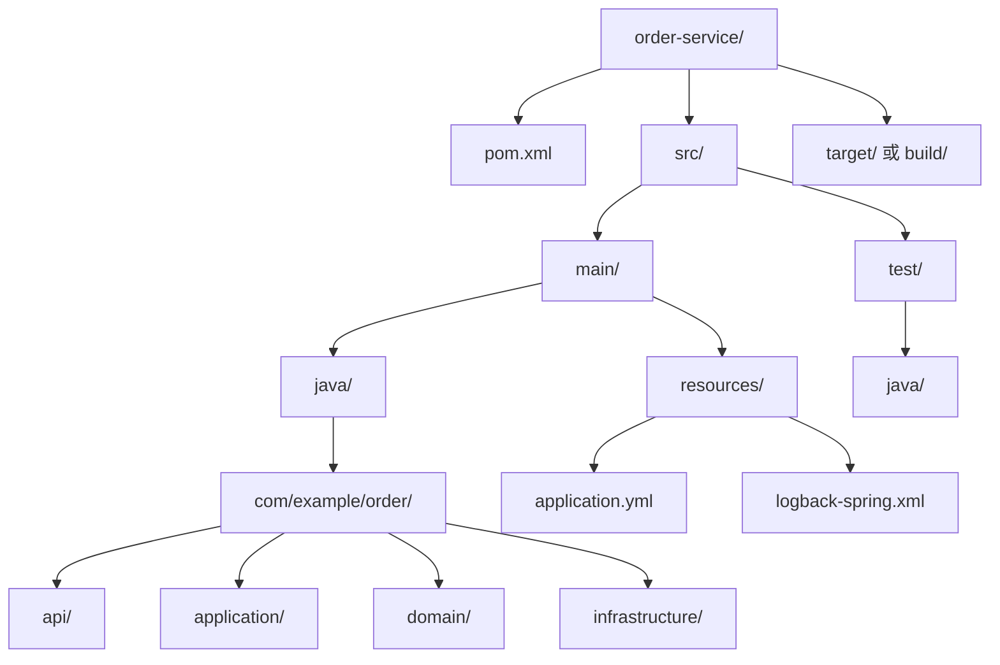

# Java 工程实践

> 会写 Java 代码只是开始；能把它构建、测试、观测、发布并长期维护，才叫 Java 工程能力。

## 本章目标

学完本章，你应该能够：

- 设计清晰的 Java 项目结构。
- 使用 Maven 或 Gradle 管理依赖和构建。
- 建立单元测试、集成测试和测试替身策略。
- 使用日志和配置排查真实问题。
- 用 JMH 做可信的性能测试。
- 打包、容器化并安全发布 Java 应用。
- 建立一套可持续执行的工程检查清单。

## 一、项目结构

一个常见的 Maven/Gradle 项目：



目录结构应表达边界，而不是只按技术类型堆放：

- `api`：HTTP/RPC 接口和请求响应对象。
- `application`：用例编排、事务边界。
- `domain`：实体、值对象、领域服务。
- `infrastructure`：数据库、缓存、消息和外部服务适配。

如果是小型项目，不必机械套用 DDD 分层；但至少要保证包名能说明职责。

## 二、构建工具

### Maven

::: details 展开：Maven 配置示例
```xml
<project>
    <modelVersion>4.0.0</modelVersion>
    <groupId>com.example</groupId>
    <artifactId>order-service</artifactId>
    <version>1.0.0-SNAPSHOT</version>

    <properties>
        <java.version>21</java.version>
        <maven.compiler.release>${java.version}</maven.compiler.release>
    </properties>
</project>
```
:::

常用命令：

```bash
mvn clean verify
mvn test
mvn dependency:tree
mvn -DskipTests package
```

### Gradle

::: details 展开：Gradle 配置示例
```kotlin
plugins {
    java
}

java {
    toolchain {
        languageVersion.set(JavaLanguageVersion.of(21))
    }
}

dependencies {
    implementation("org.springframework.boot:spring-boot-starter-web")
    testImplementation("org.junit.jupiter:junit-jupiter")
}
```
:::

常用命令：

```bash
./gradlew clean build
./gradlew test
./gradlew dependencies
```

### 选择建议

- 团队已经使用 Maven，且项目不复杂：继续 Maven。
- 需要灵活构建逻辑、增量构建和多模块：Gradle 更合适。
- 不要仅因为“更新”就迁移构建工具。迁移成本和团队熟悉度更重要。

## 三、依赖管理

### 依赖坐标

一个依赖通常包含：

```text
groupId:artifactId:version
```

例如：

```xml
<dependency>
    <groupId>org.springframework.boot</groupId>
    <artifactId>spring-boot-starter-web</artifactId>
    <version>3.5.0</version>
</dependency>
```

### Maven 作用域

| Scope | 作用 |
| --- | --- |
| `compile` | 编译、测试、运行都需要 |
| `provided` | 编译需要，运行时由容器提供 |
| `runtime` | 编译不需要，运行需要 |
| `test` | 仅测试 |
| `system` | 本地路径依赖，通常避免 |

### 依赖冲突

Maven 和 Gradle 都会处理传递依赖。冲突时常见现象：

- 同一个类出现多个版本。
- 运行时 `NoSuchMethodError`。
- 启动时 `ClassNotFoundException`。
- 不同库依赖不同版本的 Jackson、Netty 或日志实现。

排查：

```bash
mvn dependency:tree
./gradlew dependencyInsight --dependency jackson-databind
```

处理方式：

- 使用 BOM 统一版本。
- 排除不需要的传递依赖。
- 明确直接依赖版本。
- 避免引入功能重叠的多个库。

### BOM

BOM（Bill of Materials）用于统一一组依赖的版本：

```xml
<dependencyManagement>
    <dependencies>
        <dependency>
            <groupId>org.springframework.boot</groupId>
            <artifactId>spring-boot-dependencies</artifactId>
            <version>3.5.0</version>
            <type>pom</type>
            <scope>import</scope>
        </dependency>
    </dependencies>
</dependencyManagement>
```

使用 BOM 后，具体依赖通常不需要重复写版本。

## 四、测试

### 测试分层

| 类型 | 验证内容 | 速度 |
| --- | --- | --- |
| 单元测试 | 纯逻辑、状态转换、边界条件 | 毫秒级 |
| 集成测试 | 数据库、消息、HTTP、序列化 | 秒级 |
| 端到端测试 | 用户流程 | 秒到分钟级 |

测试应该覆盖风险，而不是追求一个漂亮的覆盖率数字。

### JUnit 5

```java
class PriceCalculatorTest {
    private final PriceCalculator calculator = new PriceCalculator();

    @Test
    void shouldApplyDiscount() {
        BigDecimal result = calculator.calculate(
            new BigDecimal("100.00"),
            new BigDecimal("0.10")
        );

        assertEquals(new BigDecimal("90.00"), result);
    }

    @Test
    void shouldRejectNegativeDiscount() {
        assertThrows(
            IllegalArgumentException.class,
            () -> calculator.calculate(
                new BigDecimal("100.00"),
                new BigDecimal("-0.10")
            )
        );
    }
}
```

常用能力：

- `@BeforeEach` / `@AfterEach`：每个测试前后执行。
- `@ParameterizedTest`：参数化测试。
- `@Nested`：组织相关测试。
- `@DisplayName`：可读的测试名称。
- `assertAll`：一次报告多个断言失败。

### Mockito

```java
UserRepository repository = mock(UserRepository.class);
when(repository.findById(1L)).thenReturn(Optional.of(user));

UserService service = new UserService(repository);
User result = service.load(1L);

verify(repository).findById(1L);
```

Mock 的边界：

- 优先 mock 外部依赖，不要 mock 被测对象。
- 一个测试 mock 太多依赖，通常说明设计耦合过高。
- 不要验证所有内部调用；验证可观察行为更重要。
- 对数据库、序列化和 HTTP 优先使用真实轻量替代（如 Testcontainers）。

### 集成测试

Spring Boot 示例：

```java
@SpringBootTest
class OrderApiTest {
    @Autowired
    private TestRestTemplate restTemplate;

    @Test
    void shouldCreateOrder() {
        // ...
    }
}
```

数据库集成测试可以使用 Testcontainers：

```java
@Testcontainers
class OrderRepositoryTest {
    @Container
    static PostgreSQLContainer<?> postgres =
        new PostgreSQLContainer<>("postgres:16");
}
```

集成测试比纯单元测试慢，但能发现配置、SQL、事务和序列化问题。

## 五、日志

### 使用门面

优先使用 SLF4J：

```java
private static final Logger log = LoggerFactory.getLogger(OrderService.class);
```

不要在业务代码中直接绑定某个日志实现（如 Log4j、Logback）。门面让依赖和实现解耦。

### 参数化日志

```java
// 不推荐：即使日志级别关闭也会拼接字符串
log.debug("order=" + order);

// 推荐
log.debug("orderId={}, status={}", orderId, status);
```

### 日志级别

| 级别 | 用途 |
| --- | --- |
| `ERROR` | 需要人工处理的失败 |
| `WARN` | 可恢复但值得关注的问题 |
| `INFO` | 关键业务事件和启动信息 |
| `DEBUG` | 开发排查细节 |
| `TRACE` | 极细粒度追踪 |

不要把所有异常都打成 `ERROR`，否则真正的错误会被噪音淹没。

### 结构化日志与 MDC

```java
MDC.put("traceId", traceId);
try {
    log.info("order created, orderId={}", orderId);
} finally {
    MDC.clear();
}
```

在线程池中使用 MDC 必须在任务结束后清理，否则上下文会串到下一个任务。

### 不要记录敏感信息

- 密码和密钥。
- 完整身份证号。
- 银行卡号。
- 访问令牌。
- 未脱敏的用户数据。

## 六、配置与密钥

::: warning 不要把密钥提交到仓库
数据库密码、API Key、令牌和证书都不应出现在 Git 历史中。使用环境变量、密钥管理服务或 CI/CD 的加密变量，并确保日志不会打印密钥。
:::

配置应从环境或配置中心读取：

```yaml
spring:
  datasource:
    url: ${DB_URL}
    username: ${DB_USERNAME}
    password: ${DB_PASSWORD}
```

原则：

- 配置与代码分离。
- 不把生产密钥提交到 Git。
- 不同环境使用不同配置。
- 对配置做校验，启动时快速失败。
- 记录配置来源，但不要记录密钥值。

Spring Boot 可以使用 `@ConfigurationProperties` 做类型安全绑定和校验。

## 七、代码质量

### 格式化

统一格式减少无意义 diff：

- Java：Spotless、google-java-format。
- 其他语言：对应 formatter。

格式问题不应在 Code Review 中反复讨论，交给工具。

### 静态分析

常见工具：

- Checkstyle：风格和命名。
- SpotBugs：潜在缺陷。
- PMD：代码坏味道。
- Error Prone：编译期检查。
- SonarQube：综合质量平台。

规则不要一次开太多。先选择高价值规则，再逐步提高门槛。

### CI 质量门禁

典型流水线：


质量门禁必须快速、稳定、可复现。频繁失败的 CI 会迅速失去可信度。

## 八、JMH 基准测试

### 为什么不能只用 `System.currentTimeMillis`

简单计时容易受到：

- JVM 预热和 JIT 编译影响。
- 死代码消除。
- 垃圾回收。
- CPU 频率和线程调度。
- 测量代码本身的开销。

JMH 是 OpenJDK 提供的基准测试工具：

::: details 展开：JMH 基准测试示例
```java
@Benchmark
@BenchmarkMode(Mode.AverageTime)
@OutputTimeUnit(TimeUnit.NANOSECONDS)
@Warmup(iterations = 3, time = 1)
@Measurement(iterations = 5, time = 1)
@Fork(1)
public String stringBuilder() {
    return new StringBuilder()
        .append("order-")
        .append(42)
        .toString();
}
```
:::

基准测试原则：

- 明确测量目标。
- 使用真实数据和负载。
- 分别测试冷启动和预热后性能。
- 一次只改变一个变量。
- 关注 P95、P99 和内存分配，不只关注平均值。
- 不要用基准测试替代线上监控。

## 九、打包与发布

### Fat Jar

Spring Boot 可以构建可执行 Jar：

```bash
./mvnw clean package
java -jar target/order-service.jar
```

Fat Jar 简单直接，但体积较大，依赖升级和分层缓存不如容器镜像友好。

### 容器化

```dockerfile
FROM eclipse-temurin:21-jre
WORKDIR /app
COPY target/order-service.jar app.jar
ENTRYPOINT ["java", "-XX:MaxRAMPercentage=75", "-jar", "app.jar"]
```

容器中要关注：

- JVM 是否感知容器内存限制。
- 堆外内存和元空间是否计入总内存。
- 基础镜像的安全更新。
- 是否使用非 root 用户运行。
- 优雅停机时间是否足够。

### 发布策略

| 策略 | 特点 |
| --- | --- |
| 滚动发布 | 逐批替换实例 |
| 蓝绿发布 | 两套环境切换 |
| 金丝雀发布 | 小流量验证 |
| 灰度发布 | 按用户/地域/比例放量 |

无论哪种策略，都需要：

- 健康检查。
- 优雅停机。
- 回滚方案。
- 指标和日志。
- 数据库迁移兼容性。

## 十、依赖与安全

- 定期升级依赖。
- 关注 CVE 和安全公告。
- 使用依赖锁定或 BOM。
- 扫描容器镜像。
- 不引入来源不明的库。
- 审查传递依赖。
- 对反序列化、反射和表达式执行保持警惕。

安全不是上线前的一次检查，而是持续过程。

## 十一、工程检查清单

::: tip 先保证发布安全
编码规范、测试和性能优化都重要，但上线前最先确认的是：能否回滚、数据库迁移是否兼容、是否有健康检查和发布后观察窗口。
:::

### 项目结构

- [ ] 包结构能表达业务边界。
- [ ] 配置与代码分离。
- [ ] 构建可复现。
- [ ] 版本号和环境信息可追踪。

### 测试

- [ ] 核心业务有单元测试。
- [ ] 数据库和外部接口有集成测试。
- [ ] 测试命名说明场景和预期。
- [ ] CI 能在合并前运行测试。

### 日志与观测

- [ ] 使用统一日志门面。
- [ ] 关键链路有 traceId。
- [ ] 错误日志保留堆栈。
- [ ] 不记录敏感信息。
- [ ] 有健康检查和关键指标。

### 发布

- [ ] 有优雅停机。
- [ ] 有回滚方案。
- [ ] 有数据库迁移策略。
- [ ] 有灰度或金丝雀验证。
- [ ] 有发布后观察窗口。

## 十二、练习

1. 用 Maven 或 Gradle 创建一个多模块 Java 项目，包含 `domain`、`application` 和 `infrastructure`。
2. 使用 `dependency:tree` 找出一个重复依赖，并用 BOM 或 exclusion 解决。
3. 为一个金额计算类编写参数化单元测试。
4. 用 Testcontainers 为 Repository 编写集成测试。
5. 配置 SLF4J + Logback，输出带 traceId 的结构化日志。
6. 用 JMH 比较 `String` 拼接和 `StringBuilder` 的性能。
7. 编写一个多阶段 Dockerfile，构建并运行 Java 服务。
8. 为一个发布流程列出健康检查、回滚和数据库迁移步骤。
## 总结
学完本章，你应该已经掌握：
.
- 组织包结构、模块边界和依赖方向。
- 用 Maven/Gradle 管理构建、测试和发布。
- 配置 CI 流水线：测试、静态检查、构建、扫描。
如果只能记住一件事：工程结构应该表达职责，而不是只堆技术类型。

## 相关阅读

- [测试](/software-engineering/testing)
- [CI/CD](/software-engineering/ci-cd)
- [可观测性](/software-engineering/observability)
- [代码规范与工程实践](/software-engineering/code-quality)
- [Docker](/tools/docker)
