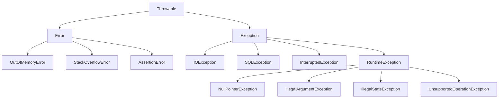
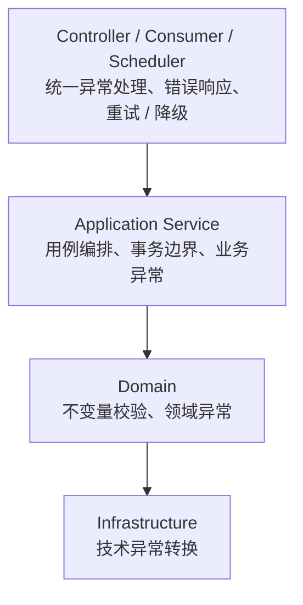

# 异常与资源管理

> 异常不是“出错了随便 catch 一下”，而是方法契约的一部分：调用方需要知道失败意味着什么，以及是否应该恢复。

## 本章目标

学完本章，你应该能够：

- 区分 `Error`、受检异常和运行时异常。
- 设计清晰的自定义异常和异常转换边界。
- 正确使用 `try-catch-finally` 和 `try-with-resources`。
- 保留原始异常和上下文，不吞掉失败。
- 处理中断、超时、重试和降级。
- 避免用异常做普通控制流。

## 一、为什么需要异常

方法失败时，不能总靠返回特殊值表达错误：

```java
public User findUser(String username) {
    // 找不到时返回 null？还是返回一个空对象？
}
```

返回值可能无法同时表达：

- 成功结果。
- 业务失败原因。
- 系统错误。
- 调用方是否需要重试。
- 失败发生在哪一层。

异常把“正常返回值”和“失败路径”分开，允许错误沿调用栈传播，直到有能力的层处理它。

## 二、`Throwable` 体系



### `Error`

`Error` 通常表示 JVM 或运行环境层面的严重问题：

- 内存耗尽。
- 栈溢出。
- 类加载失败。
- 虚拟机内部错误。

应用代码通常不应捕获 `Error`。如果确实需要做最后的资源清理，必须非常谨慎地重新抛出。

### 受检异常

继承 `Exception` 但不继承 `RuntimeException` 的异常是受检异常：

```java
public String read(Path path) throws IOException {
    return Files.readString(path);
}
```

调用方必须处理或继续声明抛出。受检异常适合表达“调用方应该考虑并能恢复的外部失败”。

### 运行时异常

继承 `RuntimeException` 的异常不需要显式声明：

```java
public void withdraw(BigDecimal amount) {
    if (amount.signum() <= 0) {
        throw new IllegalArgumentException("amount must be positive");
    }
}
```

运行时异常通常表示：

- 编程错误。
- 非法参数。
- 对象状态不允许当前操作。
- 不可恢复的契约违反。

### 受检异常还是运行时异常

| 场景 | 更适合的异常 |
| --- | --- |
| 文件不存在、网络超时 | 受检异常或专门的领域异常 |
| 参数为 `null` | `IllegalArgumentException` |
| 对象状态不允许操作 | `IllegalStateException` |
| 业务规则拒绝 | 领域异常（通常运行时） |
| 外部系统不可用 | 基础设施异常，边界层转换 |
| JVM 内存耗尽 | `Error`，通常不捕获 |

现代 Java 工程更倾向于：

- 业务异常使用运行时异常，避免污染每个方法签名。
- 在应用边界统一转换为错误响应。
- 对可恢复的外部故障保留明确类型和上下文。

## 三、`try-catch-finally`

```java
try {
    process(order);
} catch (ValidationException ex) {
    log.warn("order validation failed: {}", ex.getMessage());
    throw ex;
} finally {
    metrics.increment("order.processed");
}
```

### 捕获具体异常

```java
// 不推荐
try {
    process(order);
} catch (Exception ex) {
    log.error("failed", ex);
}

// 更推荐
try {
    process(order);
} catch (ValidationException ex) {
    // 处理业务校验失败
} catch (ExternalServiceException ex) {
    // 处理外部服务失败
}
```

捕获越具体，越能表达你真正理解失败原因。宽泛捕获通常只适合最外层边界。

### 多重捕获

```java
try {
    load(path);
} catch (IOException | SQLException ex) {
    throw new DataLoadException("load failed: " + path, ex);
}
```

多重捕获中的变量隐式为 `final`，不能重新赋值。

### `finally`

`finally` 通常用于释放资源：

```java
Lock lock = new ReentrantLock();
lock.lock();
try {
    update();
} finally {
    lock.unlock();
}
```

不要在 `finally` 中写 `return` 或抛出异常，否则可能覆盖原始异常和返回值：

```java
try {
    return 1;
} finally {
    return 2; // 返回 2，原始结果被覆盖
}
```

### 中断异常

```java
try {
    Thread.sleep(1000);
} catch (InterruptedException ex) {
    Thread.currentThread().interrupt();
    throw new TaskCancelledException("task interrupted", ex);
}
```

捕获 `InterruptedException` 后如果不继续抛出，应恢复中断标志。否则上层无法知道线程被要求停止。

## 四、`try-with-resources`

任何实现 `AutoCloseable` 或 `Closeable` 的资源都可以使用：

```java
try (BufferedReader reader = Files.newBufferedReader(path)) {
    return reader.readLine();
}
```

多个资源按声明逆序关闭：

```java
try (
    InputStream input = Files.newInputStream(source);
    OutputStream output = Files.newOutputStream(target)
) {
    input.transferTo(output);
}
```

关闭顺序是 `output` 先关闭，`input` 后关闭。

### 抑制异常

如果 `try` 块和 `close()` 都抛出异常，`close()` 的异常会作为 suppressed exception 附加到主异常上：

::: details 展开：抑制异常示例
```java
try (Resource resource = new Resource()) {
    throw new IllegalStateException("business failure");
}
```

可以通过 `Throwable.getSuppressed()` 查看：

```java
catch (Exception ex) {
    for (Throwable suppressed : ex.getSuppressed()) {
        log.warn("close failed", suppressed);
    }
}
```
:::

这也是优先使用 `try-with-resources` 而不是手写 `finally` 的原因之一。

### 自定义资源

::: details 展开：实现 AutoCloseable
```java
public final class Connection implements AutoCloseable {
    private boolean closed;

    public void execute(String sql) {
        if (closed) {
            throw new IllegalStateException("connection is closed");
        }
        // ...
    }

    @Override
    public void close() {
        if (!closed) {
            closed = true;
            // 释放底层资源
        }
    }
}
```
:::

`close()` 应尽量幂等：重复关闭不应造成额外错误。

## 五、自定义异常

### 业务异常

```java
public final class OrderNotFoundException extends RuntimeException {
    private final long orderId;

    public OrderNotFoundException(long orderId) {
        super("order not found: " + orderId);
        this.orderId = orderId;
    }

    public long orderId() {
        return orderId;
    }
}
```

好的自定义异常包含：

- 稳定的异常类型。
- 可读的消息。
- 必要的业务上下文。
- 原始 cause（如果由其他异常转换而来）。

### 异常层次

```java
public abstract class OrderException extends RuntimeException {
    protected OrderException(String message, Throwable cause) {
        super(message, cause);
    }
}

public final class OrderNotFoundException extends OrderException {
    public OrderNotFoundException(long orderId, Throwable cause) {
        super("order not found: " + orderId, cause);
    }
}
```

异常层次不宜过深。调用方通常只需要区分少数几类失败。

### 错误码还是异常类型

| 方式 | 优点 | 缺点 |
| --- | --- | --- |
| 异常类型 | 类型安全、可读性好 | 类型数量可能膨胀 |
| 错误码 | 适合协议和国际化 | 容易丢失类型语义 |
| 异常 + 错误码 | 兼顾内部处理和外部协议 | 需要明确映射规则 |

不要让异常消息承担程序判断职责。消息是给人看的，类型和字段才是给程序用的。

## 六、异常转换

底层异常不应直接泄漏到业务层：

```java
public final class JdbcOrderRepository implements OrderRepository {
    @Override
    public Order load(long id) {
        try {
            return jdbc.query(id);
        } catch (SQLException ex) {
            throw new OrderPersistenceException("load order failed: " + id, ex);
        }
    }
}
```

异常转换的好处：

- 上层不需要依赖 JDBC。
- 保留原始异常链。
- 提供业务上下文。
- 统一错误处理策略。

注意不要丢失 cause：

```java
// 不推荐
throw new OrderPersistenceException("load failed");

// 推荐
throw new OrderPersistenceException("load failed: " + id, ex);
```

## 七、错误处理边界

异常应该在合适的层处理：



常见策略：

- **Controller**：把业务异常转换成 HTTP 状态码和错误响应。
- **消息消费者**：决定重试、死信队列或丢弃。
- **定时任务**：记录失败、告警并继续下一批。
- **基础设施**：把技术异常转换成应用能理解的异常。

不要在每一层都捕获并记录一次异常，否则日志会重复，调用链也会被破坏。

## 八、日志与异常

### 记录一次，而不是每层都记录

```java
// 业务层
throw new PaymentFailedException("payment failed: " + orderId, ex);

// 最外层
log.error("request failed, orderId={}", orderId, ex);
```

### 保留堆栈

```java
// 不推荐：丢失堆栈
log.error("failed: " + ex.getMessage());

// 推荐：把异常作为最后一个参数
log.error("failed, orderId={}", orderId, ex);
```

### 不要记录敏感信息

- 密码。
- 完整身份证号。
- 银行卡号。
- 访问令牌。
- 完整请求体中的隐私数据。

## 九、重试、超时与降级

### 只重试可重试的失败

适合重试：

- 网络抖动。
- 临时限流。
- 可恢复的远程服务 5xx。

不适合重试：

- 参数校验失败。
- 权限不足。
- 业务规则拒绝。
- 非幂等操作未做幂等保护。

### 重试要有上限和退避

```java
for (int attempt = 1; attempt <= maxAttempts; attempt++) {
    try {
        return remote.call();
    } catch (RetryableException ex) {
        if (attempt == maxAttempts) {
            throw ex;
        }
        sleepWithBackoff(attempt);
    }
}
```

没有上限、没有退避、没有超时的重试，会把局部故障放大成系统雪崩。

### 超时

任何远程调用都应该有超时。没有超时的调用可能永久占用线程和连接。

### 降级

降级不是“吞掉异常”，而是明确返回一个可接受的替代结果：

```java
try {
    return recommendationClient.load(userId);
} catch (RecommendationUnavailableException ex) {
    metrics.increment("recommendation.fallback");
    return List.of();
}
```

降级必须可观测，否则系统会静默退化。

## 十、断言

`assert` 适合开发期检查内部不变量：

```java
assert order.total().signum() >= 0 : "total must not be negative";
```

默认情况下断言是关闭的，需要通过 `-ea` 开启。不要用断言做参数校验或业务规则，因为它不会在生产环境可靠执行。

## 十一、常见反模式

::: warning 先检查三个最危险的错误
空 `catch` 会吞掉失败；丢失 cause 会让根因消失；对非幂等操作盲目重试会造成重复副作用。
:::

| 反模式 | 问题 | 改进 |
| --- | --- | --- |
| 空 `catch` | 失败被完全吞掉 | 至少记录、转换或重新抛出 |
| 捕获 `Exception` 后不处理 | 掩盖不同类型错误 | 捕获具体异常 |
| 每层都 log 一次 | 日志重复、噪音大 | 在边界记录一次 |
| 用异常做循环控制 | 性能差、语义混乱 | 使用条件判断 |
| 丢失 cause | 无法定位根因 | 构造异常时传入 cause |
| `finally` 中 return | 覆盖原始异常 | 避免 |
| 重试非幂等操作 | 重复扣款、重复下单 | 幂等键 + 重试策略 |
| 捕获 `InterruptedException` 不恢复中断 | 线程无法正确停止 | 恢复中断标志 |
| 对外暴露底层异常 | 泄漏实现细节 | 边界转换 |
| 异常消息包含敏感信息 | 安全风险 | 脱敏 |

## 十二、练习

1. 设计一个 `OrderException` 层次，区分订单不存在、状态非法和支付失败。
2. 用 `try-with-resources` 实现一个文件复制方法，确保输入输出都能关闭。
3. 写一个方法，把 `SQLException` 转换为业务层异常，并保留 cause。
4. 构造一个 `try` 块和 `close()` 同时失败的例子，打印 suppressed exception。
5. 实现带最大重试次数和指数退避的远程调用。
6. 检查一段代码中是否存在重复日志、空 catch 或丢失堆栈的问题。
7. 解释为什么捕获 `InterruptedException` 后应恢复中断标志。
## 总结
学完本章，你应该已经掌握：
.
- 区分 Error、Checked Exception 和 Runtime Exception。
- 设计业务异常、系统异常和异常边界。
- 避免 try-with-resources 误用和异常吞掉。
如果只能记住一件事：异常是用来表达失败的，不是流程控制工具。

## 相关阅读

- [面向对象](/programming-language/java/oop)
- [IO、NIO 与网络](/programming-language/java/io)
- [并发编程](/programming-language/java/concurrency)
- [代码规范与工程实践](/software-engineering/code-quality)
- [可观测性](/software-engineering/observability)
