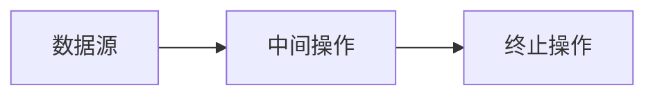

# 函数式与 Stream

> 函数式编程在 Java 中不是“消灭对象”，而是把行为变成可组合的值，让数据处理从“怎么做”转向“做什么”。

## 本章目标

学完本章，你应该能够：

- 理解行为参数化和函数式接口。
- 正确使用 Lambda、方法引用和闭包。
- 组合 `Predicate`、`Function`、`Comparator` 等函数式接口。
- 使用 `Optional` 表达可能缺失的值。
- 设计清晰的 Stream 管线。
- 使用 Collector 完成分组、聚合和转换。
- 避免并行流、副作用和 `toMap` 等常见陷阱。

## 一、从匿名类到 Lambda

Java 8 之前，传递一段行为通常需要匿名内部类：

```java
List<String> names = List.of("alice", "bob");
names.sort(new Comparator<String>() {
    @Override
    public int compare(String left, String right) {
        return left.compareTo(right);
    }
});
```

使用 Lambda：

```java
names.sort((left, right) -> left.compareTo(right));
```

Lambda 让“行为”像值一样被传递。它适合只有一个抽象方法的接口，这类接口称为函数式接口。

## 二、函数式接口

### 定义

```java
@FunctionalInterface
public interface PriceRule {
    BigDecimal apply(Order order);
}
```

`@FunctionalInterface` 不是必须的，但它会让编译器检查接口是否只有一个抽象方法。

### 常见内置接口

| 接口 | 输入 | 输出 | 典型用途 |
| --- | --- | --- | --- |
| `Function<T, R>` | `T` | `R` | 转换 |
| `BiFunction<T, U, R>` | `T, U` | `R` | 双参数转换 |
| `Consumer<T>` | `T` | 无 | 消费、打印、写入 |
| `BiConsumer<T, U>` | `T, U` | 无 | 双参数消费 |
| `Supplier<T>` | 无 | `T` | 延迟创建、工厂 |
| `Predicate<T>` | `T` | `boolean` | 判断 |
| `UnaryOperator<T>` | `T` | `T` | 同类型转换 |
| `BinaryOperator<T>` | `T, T` | `T` | 合并 |

基本类型有专门接口，避免装箱：

- `IntFunction<R>`、`ToIntFunction<T>`。
- `IntPredicate`、`LongPredicate`。
- `IntSupplier`、`IntConsumer`。
- `IntUnaryOperator`、`IntBinaryOperator`。

### 方法引用

```java
Function<String, Integer> length = String::length;
Supplier<ArrayList<String>> factory = ArrayList::new;
Consumer<String> printer = System.out::println;
BiFunction<String, String, Boolean> equals = String::equals;
```

方法引用通常比 Lambda 更简洁，但前提是语义清楚。不要为了短而把可读性更强的 Lambda 改成晦涩的方法引用。

### 构造器引用

```java
Supplier<Order> orderFactory = Order::new;
Function<Long, User> userFactory = User::new;
```

## 三、Lambda 与闭包

Lambda 可以捕获方法中的局部变量：

```java
String prefix = "user-";
Function<String, String> formatter = name -> prefix + name;
```

被捕获的局部变量必须是有效 final（effectively final）：

```java
String prefix = "user-";
// prefix = "account-"; // 编译错误
```

原因不是 Java 想限制你，而是局部变量在栈上，Lambda 可能在方法返回后执行。Java 通过复制值来保证安全。

### `this` 的含义

Lambda 中的 `this` 指向外部实例，而不是 Lambda 自己：

```java
public final class OrderService {
    private String prefix = "order-";

    public Supplier<String> supplier() {
        return () -> prefix + "created";
    }
}
```

匿名内部类中的 `this` 指向匿名类实例，这是二者的重要区别。

## 四、函数组合

### `Predicate`

```java
Predicate<Order> paid = Order::isPaid;
Predicate<Order> highValue = order -> order.total().compareTo(new BigDecimal("1000")) > 0;

Predicate<Order> target = paid.and(highValue);
Predicate<Order> either = paid.or(highValue);
Predicate<Order> unpaid = paid.negate();
```

### `Function`

```java
Function<Order, String> customerName = Order::customerName;
Function<String, String> upper = String::toUpperCase;

Function<Order, String> display = customerName.andThen(upper);
Function<Order, String> normalized = upper.compose(customerName);
```

`andThen` 先执行当前函数，再执行参数；`compose` 先执行参数，再执行当前函数。

### `Comparator`

```java
Comparator<Order> byCreatedAt = Comparator.comparing(Order::createdAt);
Comparator<Order> byAmountDesc = Comparator.comparing(Order::total).reversed();
Comparator<Order> byStatusThenAmount = Comparator
    .comparing(Order::status)
    .thenComparing(Order::total);
```

处理 `null`：

```java
Comparator<Order> byRemark = Comparator.comparing(
    Order::remark,
    Comparator.nullsLast(String::compareTo)
);
```

## 五、`Optional`

`Optional` 用来表达“可能有值，也可能没有值”。

```java
Optional<User> user = userRepository.findByUsername(username);

String displayName = user
    .map(User::displayName)
    .filter(name -> !name.isBlank())
    .orElse("unknown");
```

### 常用方法

| 方法 | 作用 |
| --- | --- |
| `map` | 有值时转换 |
| `flatMap` | 有值时转换并展开另一个 Optional |
| `filter` | 满足条件才保留 |
| `orElse` | 无值时返回默认值 |
| `orElseGet` | 无值时延迟创建默认值 |
| `orElseThrow` | 无值时抛异常 |
| `ifPresent` | 有值时执行副作用 |
| `ifPresentOrElse` | 有值/无值分别处理 |

### `orElse` 与 `orElseGet`

```java
// 无论有没有值，createDefault() 都会执行
User user = optional.orElse(createDefault());

// 只有无值时才执行
User user = optional.orElseGet(this::createDefault);
```

如果默认值创建成本高，优先使用 `orElseGet`。

### 不应滥用 Optional

不建议：

```java
public class User {
    private Optional<String> nickname; // 字段
}

public void update(Optional<String> nickname) { // 参数
}
```

`Optional` 更适合方法返回值。字段可以用可空引用或专门的缺失值对象，参数通常用重载或明确校验。

### 不要用 `Optional` 包装集合

```java
// 不推荐
Optional<List<Order>> findOrders(long userId);

// 更推荐：空集合表达没有元素
List<Order> findOrders(long userId);
```

## 六、Stream 的基本模型

Stream 管线由三部分组成：



```java
List<String> names = users.stream()          // 数据源
    .filter(User::isActive)                  // 中间操作
    .map(User::name)                         // 中间操作
    .sorted()                                // 中间操作
    .toList();                               // 终止操作
```

### 惰性求值

中间操作不会立即执行，只有终止操作触发时才执行：

```java
Stream<String> stream = names.stream()
    .filter(name -> {
        System.out.println("filter: " + name);
        return name.startsWith("a");
    });

System.out.println("before terminal");
List<String> result = stream.toList();
```

输出会先打印 `before terminal`，然后才执行过滤。

### 流只能消费一次

```java
Stream<String> stream = names.stream();
stream.forEach(System.out::println);
stream.forEach(System.out::println); // IllegalStateException
```

需要多次处理时，重新创建 Stream 或先收集成集合。

### 短路操作

```java
Optional<String> first = names.stream()
    .filter(name -> name.startsWith("a"))
    .findFirst();
```

`findFirst`、`findAny`、`anyMatch`、`allMatch`、`noneMatch` 可以在满足条件后提前结束。

## 七、常用中间操作

### `filter`

```java
List<Order> paidOrders = orders.stream()
    .filter(Order::isPaid)
    .toList();
```

### `map`

```java
List<String> names = users.stream()
    .map(User::name)
    .toList();
```

### `flatMap`

把一对多关系展开：

```java
List<OrderItem> items = orders.stream()
    .flatMap(order -> order.items().stream())
    .toList();
```

### `distinct`

```java
List<String> uniqueNames = names.stream()
    .distinct()
    .toList();
```

`distinct` 依赖元素的 `equals` 和 `hashCode`。

### `sorted`

```java
List<Order> sorted = orders.stream()
    .sorted(Comparator.comparing(Order::createdAt).reversed())
    .toList();
```

`sorted` 是有状态操作，会缓冲所有元素，不适合无限流。

### `limit` 与 `skip`

```java
List<Order> page = orders.stream()
    .skip(20)
    .limit(10)
    .toList();
```

### `peek`

`peek` 主要用于调试，不应依赖它执行核心副作用：

```java
List<String> result = names.stream()
    .peek(name -> System.out.println("processing: " + name))
    .map(String::toUpperCase)
    .toList();
```

## 八、常用终止操作

### 收集

```java
List<String> names = stream.toList();
Set<String> unique = stream.collect(Collectors.toSet());
```

### 匹配

```java
boolean hasPaid = orders.stream().anyMatch(Order::isPaid);
boolean allPaid = orders.stream().allMatch(Order::isPaid);
boolean noneCancelled = orders.stream().noneMatch(Order::isCancelled);
```

### 查找

```java
Optional<Order> first = orders.stream()
    .filter(Order::isPaid)
    .findFirst();
```

并行流中 `findAny` 可能比 `findFirst` 更灵活，但结果不保证是第一个。

### 聚合

```java
long count = orders.stream().count();
BigDecimal total = orders.stream()
    .map(Order::total)
    .reduce(BigDecimal.ZERO, BigDecimal::add);
```

`reduce` 的 identity 必须是单位元，操作应满足结合律。否则并行执行可能得到错误结果。

### 数值流

```java
int total = orders.stream()
    .mapToInt(Order::quantity)
    .sum();

OptionalDouble average = orders.stream()
    .mapToDouble(order -> order.total().doubleValue())
    .average();
```

`IntStream`、`LongStream`、`DoubleStream` 避免装箱，并提供 `sum`、`average`、`max`、`min` 等操作。

## 九、Collector

### `toMap`

```java
Map<Long, User> usersById = users.stream()
    .collect(Collectors.toMap(User::id, user -> user));
```

如果 key 重复，`toMap` 会抛出 `IllegalStateException`：

```java
Map<String, Integer> scores = users.stream()
    .collect(Collectors.toMap(
        User::username,
        User::score,
        Integer::max
    ));
```

第三个参数用于解决重复 key。

### `groupingBy`

```java
Map<OrderStatus, List<Order>> ordersByStatus = orders.stream()
    .collect(Collectors.groupingBy(Order::status));
```

带下游收集器：

```java
Map<OrderStatus, Long> countByStatus = orders.stream()
    .collect(Collectors.groupingBy(
        Order::status,
        Collectors.counting()
    ));
```

分组后的顺序取决于 Map 实现和并行流，不要依赖未定义的顺序。

### `partitioningBy`

```java
Map<Boolean, List<Order>> partition = orders.stream()
    .collect(Collectors.partitioningBy(Order::isPaid));
```

`partitioningBy` 总是返回两个键：`true` 和 `false`。

### `joining`

```java
String names = users.stream()
    .map(User::name)
    .collect(Collectors.joining(", ", "[", "]"));
```

### `mapping`

```java
Map<OrderStatus, Set<String>> customerNamesByStatus = orders.stream()
    .collect(Collectors.groupingBy(
        Order::status,
        Collectors.mapping(Order::customerName, Collectors.toSet())
    ));
```

## 十、副作用与纯函数

Stream 最适合无副作用的转换：

```java
// 推荐：返回新结果
List<String> names = users.stream()
    .map(User::name)
    .toList();
```

不推荐在 Stream 中修改外部集合：

```java
List<String> result = new ArrayList<>();
users.stream()
    .map(User::name)
    .forEach(result::add); // 依赖副作用，且并发时不安全
```

需要收集时使用 `toList` 或 `collect`。需要副作用时，先明确是否真的适合 Stream。

## 十一、受检异常

Stream 的 Lambda 不能直接抛出受检异常：

```java
// 编译错误
List<String> lines = paths.stream()
    .map(path -> Files.readString(path))
    .toList();
```

可以封装：

::: details 展开：受检异常包装示例
```java
@FunctionalInterface
interface ThrowingFunction<T, R> {
    R apply(T value) throws Exception;
}

static <T, R> Function<T, R> unchecked(ThrowingFunction<T, R> function) {
    return value -> {
        try {
            return function.apply(value);
        } catch (Exception ex) {
            throw new RuntimeException(ex);
        }
    };
}
```
:::

也可以显式循环处理。不要为了保持链式写法而把受检异常悄悄吞掉。

## 十二、并行流

::: warning 并行流不是默认选项
并行流只适合可分割、无共享副作用、CPU 密集且已经验证过收益的任务。阻塞 I/O、共享可变状态和小数据集通常不适合。
:::

```java
long count = orders.parallelStream()
    .filter(Order::isPaid)
    .count();
```

并行流并不总是更快：

- 数据量小，线程调度成本可能超过收益。
- 依赖共享可变状态会产生竞态。
- 有序操作和 `limit` 可能限制并行度。
- 默认使用 `ForkJoinPool.commonPool()`，不适合阻塞 I/O。
- 下游服务可能无法承受突然增加的并发。

适合并行流的场景：

- 大量 CPU 密集型、无共享状态的计算。
- 数据可分割。
- 操作满足结合律。
- 已经通过基准测试验证收益。

## 十三、常见陷阱

::: tip 三个最常见的 Stream 错误
复用同一个 Stream、在 `forEach` 中修改外部集合、用 `toMap` 却不处理重复 key。
:::

| 陷阱 | 后果 | 建议 |
| --- | --- | --- |
| 复用 Stream | `IllegalStateException` | 每次重新创建 |
| 在 `forEach` 中修改外部集合 | 并发问题、可读性差 | 使用 `collect` |
| `toMap` 忽略重复 key | 抛异常 | 提供 merge 函数 |
| 在 Stream 中做阻塞 I/O | 线程池耗尽 | 使用显式循环或异步线程池 |
| 并行流访问共享可变状态 | 数据竞争 | 保持无副作用 |
| 依赖 `peek` 执行核心逻辑 | 优化后可能不执行 | 只用于调试 |
| 过度链式调用 | 难以调试和维护 | 拆成有名字的方法 |
| `Optional` 用作字段/参数 | API 复杂 | 只用于返回值 |
| `orElse` 创建昂贵默认值 | 无谓开销 | 使用 `orElseGet` |
| `reduce` 的 identity 不合法 | 并行结果错误 | 确保单位元和结合律 |

## 十四、练习

1. 把一段匿名内部类改写成 Lambda 和方法引用，并比较可读性。
2. 使用 `Predicate` 组合实现订单筛选：已支付、金额大于 100、未取消。
3. 用 `Optional` 实现一个用户查询方法，返回昵称或默认值。
4. 从订单列表提取商品、去重并统计每种商品数量。
5. 使用 `groupingBy` 按状态分组，并统计每组订单金额。
6. 用 `flatMap` 展开订单明细。
7. 构造一个 `toMap` 重复 key 的异常，并用 merge 函数修复。
8. 比较普通循环和并行流在 CPU 密集型任务上的性能，使用 JMH 验证。
9. 把一段包含受检异常的 Stream 代码改写成显式循环，比较两种写法。
## 总结
学完本章，你应该已经掌握：
.
- 使用 Lambda、函数式接口和 Optional。
- 理解 Stream 的中间/终止操作和惰性求值。
- 避免 Side Effect、重复消费和性能误用。
如果只能记住一件事：Stream 让集合处理更声明式，但复杂业务逻辑仍然要可读。

## 相关阅读

- [泛型与类型系统](/programming-language/java/generics)
- [集合框架](/programming-language/java/collections)
- [并发编程](/programming-language/java/concurrency)
- [Java 工程实践](/programming-language/java/engineering)
