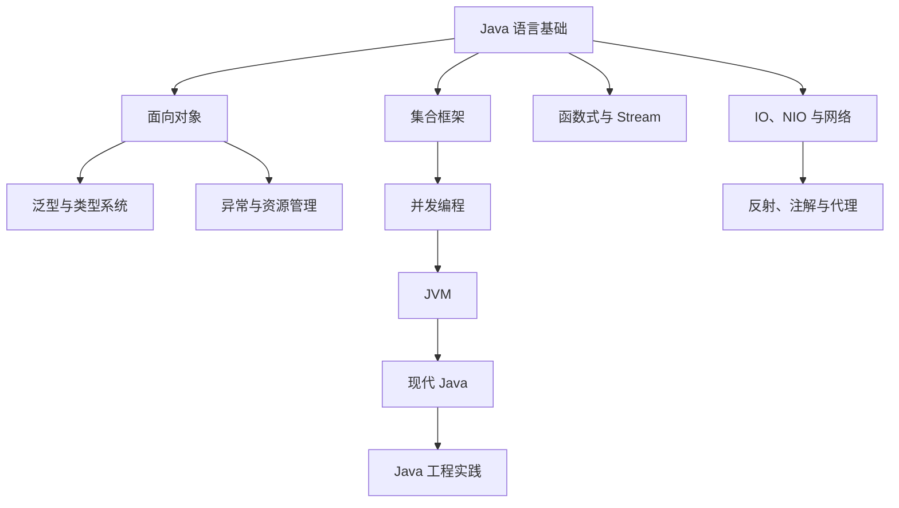

# Java

> Java 的价值不只在语法，而在于“语言 + JVM + 标准库 + 生态”共同构成的稳定工程平台。

## 本章目标

学完本章，你应该能够：

- 理解 Java 语言、JVM 和生态的关系。
- 判断 Java 适合的业务场景和不适合的场景。
- 比较 Java 与其他常见后端语言的取舍。
- 在常见 JDK 发行版和版本之间做工程选型。
- 画出 Java 学习的核心知识地图。
- 判断语法、集合、并发、JVM 的优先级。
- 选择下一步要深入的主题。

## Java 是什么

Java 是一门面向对象的通用编程语言，通常运行在 Java 虚拟机（JVM）上。它的核心特点是：

- **跨平台**：源代码编译成字节码，由不同平台的 JVM 执行。
- **自动内存管理**：通过垃圾回收器回收不再使用的对象，减少手动释放内存的负担。
- **成熟的并发支持**：从 `synchronized`、线程池到虚拟线程，覆盖多种并发模型。
- **向后兼容**：新版本通常尽量保持已有代码可运行，但升级仍需关注废弃 API 和行为变化。
- **生态完整**：Spring、MyBatis、Kafka、Elasticsearch、大数据工具等都有成熟的 Java 客户端。

Java 的代价也很明确：语法相对冗长，启动和内存占用通常高于一些轻量级语言；泛型存在类型擦除；部分历史 API 设计已经过时。理解这些边界，比把 Java 当成“万能语言”更重要。

## Java 用在哪里

Java 最强的场景不是所有程序，而是需要长期维护、团队协作和稳定运行的服务端系统。金融交易、支付清结算、电信计费、电商订单、供应链、风控、广告投放和大型企业内部平台经常选择 Java，因为类型系统能约束接口契约，JVM 便于长期观测和调优，生态已经覆盖消息队列、数据库访问、搜索、批处理和分布式协调。

Java 也常见于大数据和高吞吐中间件生态。Hadoop、Kafka、Elasticsearch、Flink、Spark、Cassandra、Solr 等项目要么用 Java 实现，要么提供成熟的 JVM 客户端。这类系统重视并发模型、网络 I/O、序列化和可诊断性，Java 的线程模型、NIO、JFR 和线程转储能直接支撑这些需求。

桌面客户端和移动端曾经是 Java 的重要场景：Swing/JavaFX 仍用于部分企业工具，Android 的主语言早已转向 Kotlin。脚本、CLI、数据科学和 Serverless 冷启动敏感的服务通常不是 Java 的最佳位置；虽然 GraalVM Native Image 和 AOT 编译在持续改善启动时间和内存占用，但反射、动态代理和部分 Java 生态仍然要按原生镜像的约束重新适配。选择 Java 前，应先看团队经验、现有系统、运维能力和依赖生态，而不是只比较语言语法。

## Java 生态地图

Java 的工程生态可以按“运行时、构建、应用框架、数据、可观测性”看。下面是常见选择，不是推荐所有项目都引入：

| 层次 | 典型项目 | 解决的问题 |
| --- | --- | --- |
| 运行时与诊断 | JFR、JMC、async-profiler、Arthas | 采集性能事件、火焰图、线程和线上方法状态 |
| 构建与依赖 | Maven、Gradle | 依赖解析、生命周期、多模块构建和发布 |
| 应用框架 | Spring Boot、Quarkus、Micronaut、Helidon | HTTP、依赖注入、配置、健康检查和集成 |
| RPC 与通信 | gRPC-Java、Dubbo、Netty | 服务调用、序列化和高性能网络 I/O |
| 数据访问 | JDBC、HikariCP、Hibernate、MyBatis、jOOQ | 连接池、SQL、ORM 和事务 |
| 批处理与流 | Kafka、Flink、Spark、Spring Batch | 消息流、实时计算、离线分析和批处理 |
| 测试与质量 | JUnit 5、Mockito、AssertJ、Testcontainers | 单元测试、集成测试和真实依赖验证 |
| 可观测性 | Micrometer、OpenTelemetry、Prometheus、Grafana | 指标、链路、日志和告警 |

框架选择通常由团队约定和现有系统决定。Spring Boot 生态最大、资料最全；Quarkus、Micronaut 更强调启动时间、内存占用和原生镜像；Netty 常藏在网关、RPC 和消息中间件底层，而不是每个业务项目都必须直接使用。理解“Java 语言 + JVM + 框架 + 中间件”的关系，比记住框架名更重要。

## 常见 JDK 发行版

Java 规范由 JCP 维护，JDK 则有多个发行版。OpenJDK 是开源参考实现，其他常见发行版大多基于 OpenJDK 源码构建，再叠加商业支持、更新周期、认证或诊断工具：

| 发行版 | 维护方 | 特点 | 适合场景 |
| --- | --- | --- | --- |
| Oracle JDK | Oracle | Oracle 许可，部分版本提供商业支持 | 已有 Oracle 支持策略或合规要求 |
| Eclipse Temurin | Eclipse Adoptium | 社区构建，覆盖平台广，更新稳定 | 常见 Linux、Windows、macOS 与 CI |
| Amazon Corretto | AWS | AWS 平台集成好，长期支持 | AWS、ECS、EKS 或已有 AWS 支持 |
| Azul Zulu | Azul | 平台覆盖广，可选商业支持和专用构建 | 需要更长的支持周期或特定平台 |
| Microsoft OpenJDK | Microsoft | 面向 Azure 和 Windows 场景 | Azure、Windows Server 或 Microsoft 生态 |
| GraalVM JDK | Oracle | 包含 Native Image、性能工具和 Polyglot 能力 | 追求快速启动、低内存或原生可执行文件 |

不同发行版不一定支持所有 Java 版本，商业支持、漏洞修复周期和许可条款也会变化。团队应固定一个发行版和版本号，并在 CI 镜像、容器镜像和本地开发中使用同一套运行时，避免“本机能跑，生产不同”的问题。

## 版本怎么选

新项目优先选择仍在维护期内的 LTS 版本。Java 8 还存在于大量旧系统，但对新服务来说缺少现代语法和 GC 改进；Java 11 是过渡基线；Java 17 已经被主流框架广泛支持；Java 21 提供正式虚拟线程和更完整的模式匹配；Java 25 是较新的 LTS，采用前应确认框架、工具和运行环境已经跟上。

| 场景 | 建议 |
| --- | --- |
| 新微服务或后端服务 | 从 Java 17 或 Java 21 开始；确认 Spring Boot、构建插件和容器镜像支持后再考虑 Java 25 |
| 长期运行的企业系统 | 以 LTS 为基线，建立依赖兼容性报告和升级分支 |
| 冷启动敏感的 Serverless | 评估 GraalVM Native Image 或 Quarkus/Micronaut，先验证反射和动态代理 |
| 老系统维护 | 先补测试、依赖关系和运行时观测，再升级 JDK 和框架 |

升级时不要把 JDK、框架和依赖升级压成一次发布。先在 CI 中用目标 JDK 编译和跑测试，再处理废弃 API、反射限制和依赖冲突，最后对比 GC 日志、P99 延迟、吞吐和内存曲线。能回滚的灰度发布比一次性全量升级更安全。

## Java 与其他语言的对比

Java 不是唯一的后端选择。JVM 上有 Kotlin、Scala、Groovy，后端领域还有 Go、Python、Node.js 等。选型时，语言本身只是一半，另一半是生态、部署方式、团队经验和长期维护成本。

| 语言/平台 | 更适合的场景 | 主要优势 | 主要代价 |
| --- | --- | --- | --- |
| Java | 大型企业系统、长期维护的后端服务、复杂业务域 | 生态完整、工具链成熟、运行时可观测性强 | 启动和内存占用相对高，样板代码较多 |
| Kotlin | Android、与 Java 共存的 JVM 项目 | 更简洁、空安全、函数式支持好 | 团队需要学习新语言，Java 库兼容性仍需验证 |
| Scala | 复杂数据处理、高并发和函数式建模 | 表达力强、类型系统高级 | 学习曲线陡，团队成熟度决定落地成本 |
| Go | 云原生服务、CLI、高并发网络服务 | 编译快、部署简单、并发模型清晰 | 生态相对小，复杂业务建模不如 Java 灵活 |
| Python | 数据分析、AI、脚本、原型 | 表达力强、算法和数据生态集中 | 大规模后端服务和静态约束较弱 |
| Node.js | I/O 密集型 Web 服务、前端同构 | 前后端统一、异步模型自然 | CPU 密集型任务和大规模复杂业务域不占优 |

这些比较不是绝对结论。同一个团队可以在不同系统里混用语言，但混用会增加运维、招聘和知识沉淀成本。大多数团队更现实的做法是：在 Java 已经成熟的地方继续使用 Java，在新的、更轻量的场景里评估 Go 或 Node.js，在数据和算法侧用 Python。JVM 上的 Kotlin 和 Scala 可以直接调用 Java 类库，但团队成熟度和工具链仍然决定落地成本。

## 这本 Java 教程怎么读

这一部分不是零散的语法笔记，而是一条从“会写 Java”到“理解 Java 程序如何运行”的完整路线。每一章都回答三个问题：

- 这项能力解决什么问题？
- Java 是如何设计和实现的？
- 在真实工程中应该如何取舍？

### 全书结构

| 阶段 | 章节 | 核心问题 | 学完后的产出 |
| --- | --- | --- | --- |
| 语言核心 | [语言基础](/programming-language/java/basics) | Java 程序由哪些基本元素组成？ | 能写出结构清晰、边界正确的 Java 程序 |
| 语言核心 | [面向对象](/programming-language/java/oop) | 如何用对象组织复杂业务？ | 能设计职责清晰、可测试的类 |
| 语言核心 | [泛型与类型系统](/programming-language/java/generics) | 如何在编译期表达类型约束？ | 能读懂并设计常见泛型 API |
| 语言核心 | [异常与资源管理](/programming-language/java/exceptions) | 错误如何表达、传播和恢复？ | 能写出可靠的异常处理和资源释放逻辑 |
| 标准库 | [集合框架](/programming-language/java/collections) | 数据应该如何组织和访问？ | 能根据复杂度、语义和并发要求选型 |
| 标准库 | [函数式与 Stream](/programming-language/java/functional) | 如何把行为作为数据组合？ | 能写出清晰的数据处理管线 |
| 标准库 | [IO、NIO 与网络](/programming-language/java/io) | 数据如何跨文件和网络流动？ | 能处理编码、流、文件和 HTTP |
| 运行时 | [反射、注解与代理](/programming-language/java/reflection) | 框架如何在运行时理解和增强代码？ | 能读懂 Spring、Jackson、MyBatis 的底层套路 |
| 运行时 | [SPI 与服务发现](/programming-language/java/spi) | 如何在运行时发现接口实现？ | 能设计可插拔的扩展点 |
| 运行时 | [并发编程](/programming-language/java/concurrency) | 多线程如何正确共享状态？ | 能判断线程安全并排查并发问题 |
| 运行时 | [JVM](/programming-language/java/jvm) | 字节码如何变成可运行的系统？ | 能分析内存、GC、JIT 和线上故障 |
| 版本演进 | [现代 Java](/programming-language/java/new-features) | 新版本解决了哪些旧问题？ | 能制定版本升级和技术选型方案 |
| 工程落地 | [Java 工程实践](/programming-language/java/engineering) | 如何把语言能力变成可交付系统？ | 能构建、测试、观测和发布 Java 服务 |

### 哪些章节必须先读

语言核心和标准库有明确的依赖关系：



不建议在没掌握对象、接口和异常之前直接学 JVM 调优；也不建议在没理解线程安全和内存模型之前直接使用虚拟线程。底层知识需要上层语义作为锚点。

### 三条阅读路线

**路线一：系统学习**

按章节顺序阅读，每章完成一个可运行的小项目。适合刚开始系统学习 Java，或者准备从其他语言转向 Java 的开发者。

**路线二：后端求职**

重点阅读：

1. 语言基础、面向对象、泛型、异常。
2. 集合、函数式、IO/NIO。
3. 并发、JVM、现代 Java。
4. 工程实践中的测试、日志和构建。

面试中的很多问题并不是要你背结论，而是要求你解释设计取舍。例如“为什么 `HashMap` 线程不安全”“为什么 `volatile` 不能保证原子性”“为什么 G1 适合服务端”。

**路线三：已有 Java 经验，查漏补缺**

可以先做每章末尾的练习，再根据错误回到正文。重点检查：

- 是否真正理解值传递、对象引用和不可变性。
- 是否能解释 `equals` / `hashCode` 契约。
- 是否知道泛型擦除对 API 设计的影响。
- 是否能写出可恢复的异常处理。
- 是否理解线程池参数和拒绝策略。
- 是否能从 GC 日志和线程转储定位问题。

## Java 的设计哲学

理解 Java 的很多细节，可以回到几条设计取向：

### 稳定优先于激进

Java 非常重视向后兼容。新特性通常经过预览、孵化或多轮迭代才正式成为标准。这带来稳定性，也意味着语言演进相对保守。

### 显式优先于隐式

Java 倾向于把类型、异常和访问控制写清楚。`var`、模式匹配和记录类降低了样板代码，但并没有改变 Java 静态类型语言的根本定位。

### 运行时能力优先于语法技巧

反射、注解、动态代理、类加载和 JVM 工具构成了 Java 生态的基础。很多框架的“魔法”都可以还原为这些机制。

### 工程性优先于语言纯粹性

Java 的设计经常考虑大型团队、长期维护和跨平台部署，因此会保留一些看起来不够优雅、但在工程上稳定的约束。

## JDK、JRE 与 JVM

初学者最容易混淆的三个概念：

| 概念 | 包含内容 | 主要用途 |
| --- | --- | --- |
| JVM | 字节码执行引擎、运行时内存、GC、JIT 等 | 执行 Java 字节码 |
| JRE | JVM + Java 核心类库 | 运行 Java 程序 |
| JDK | JRE + 编译器、调试器、诊断工具等 | 开发 Java 程序 |

现代 JDK 通常已经不再单独分发 JRE，很多部署场景会直接使用 JDK 或使用 `jlink` 生成裁剪后的运行时镜像。

### 从源码到运行


JVM 让 Java 不必为每个操作系统重新编译。字节码是中间表示，真正的机器码由 JVM 在运行时解释执行或即时编译生成。

## Java 语言的核心组成

### 面向对象

Java 通过类、接口、继承、组合和多态组织代码。实际工程中应优先使用组合，而不是滥用继承：

```java
public interface PaymentGateway {
    PaymentResult pay(PaymentCommand command);
}

public final class OrderService {
    private final PaymentGateway paymentGateway;

    public OrderService(PaymentGateway paymentGateway) {
        this.paymentGateway = paymentGateway;
    }

    public PaymentResult pay(Order order) {
        return paymentGateway.pay(PaymentCommand.from(order));
    }
}
```

`OrderService` 依赖 `PaymentGateway` 这个稳定抽象，而不是支付宝、微信或某个具体 SDK。这样业务逻辑更容易测试，也更容易替换实现。

### 泛型

泛型用于在编译期提供类型安全，但 Java 使用类型擦除：

```java
List<String> names = new ArrayList<>();
names.add("alice");

// 编译期检查，运行时泛型参数被擦除
String first = names.get(0);
```

理解类型擦除后，就能解释为什么不能 `new T()`、为什么 `List<Integer>` 不能赋值给 `List<Number>`，以及为什么有时需要使用通配符：

```java
void printNumbers(List<? extends Number> numbers) {
    numbers.forEach(System.out::println);
}

void addNumbers(List<? super Integer> numbers) {
    numbers.add(1);
}
```

### 异常

Java 将异常分为：

- **受检异常**：编译器要求处理，通常表示可恢复的外部问题，例如 `IOException`。
- **非受检异常**：`RuntimeException` 及其子类，通常表示编程错误或无法安全恢复的状态。

不要把异常当成普通控制流，也不要吞掉异常：

```java
// 不推荐：丢失原始异常
try {
    repository.save(order);
} catch (Exception ignored) {
}

// 推荐：保留上下文并重新抛出
try {
    repository.save(order);
} catch (DataAccessException ex) {
    throw new OrderPersistenceException("保存订单失败: " + order.id(), ex);
}
```

### 集合与 Stream

集合负责存储和访问数据，Stream 负责对数据做声明式处理。两者不是替代关系：

```java
List<Order> paidOrders = orders.stream()
    .filter(Order::isPaid)
    .sorted(Comparator.comparing(Order::createdAt).reversed())
    .toList();
```

Stream 适合表达“做什么”，但不应为了链式写法牺牲可读性。复杂的副作用、异常处理和调试场景，用普通循环可能更清晰。

### 现代 Java 特性

从 Java 8 到 Java 25，语言逐步加入：

- Lambda 与 Stream API。
- `Optional`、新的日期时间 API。
- `var` 局部变量类型推断。
- `switch` 表达式与文本块。
- `record`、密封类、模式匹配。
- 虚拟线程、结构化并发和作用域值。

这些特性不是孤立语法，而是在解决不同层面的表达问题。后续页面会分别展开。

## Java 工程能力地图

只会语言语法，通常还不足以完成后端工程任务。一个 Java 开发者至少需要理解：

| 能力 | 典型内容 |
| --- | --- |
| 语言基础 | 类型、对象、泛型、异常、Lambda、Stream |
| 标准库 | 集合、IO/NIO、时间、网络、并发 |
| 运行时 | 类加载、内存结构、GC、JIT、诊断工具 |
| 构建 | Maven、Gradle、依赖管理、多模块项目 |
| 测试 | JUnit 5、Mockito、Testcontainers、集成测试 |
| 数据访问 | JDBC、连接池、ORM、事务 |
| Web 后端 | HTTP、Spring MVC、参数校验、统一异常处理 |
| 工程化 | 日志、配置、CI/CD、监控、容器化 |

本手册的 Java 主线先覆盖语言和运行时基础，后端框架、数据库和系统设计会在后续章节展开。

## 推荐学习路线

### 第一阶段：语言基础

目标：能独立写出结构清晰、可测试的 Java 代码。

- 基本类型、引用类型、自动装箱与拆箱。
- 类、接口、继承、组合、多态。
- 泛型、异常、Lambda、Stream、`Optional`。
- 常用集合和日期时间 API。
- 使用 JUnit 5 编写单元测试。

完成标准：

- 能解释值传递和引用传递的区别。
- 能正确重写 `equals` 和 `hashCode`。
- 能根据场景选择 `List`、`Set`、`Map` 或 `Queue`。
- 能写出没有重复逻辑、异常处理清晰的小模块。

### 第二阶段：并发的正确性

目标：理解线程安全，而不是只会创建线程。

- 线程生命周期和 `Runnable` / `Callable`。
- `synchronized`、`volatile`、`Lock`、原子类。
- Java 内存模型和 `happens-before`。
- 线程池、阻塞队列、`CompletableFuture`。
- 死锁、竞态条件、可见性问题。
- 虚拟线程的适用边界。

完成标准：

- 能判断一段代码是否线程安全。
- 能解释 `volatile` 为什么不能保证 `count++` 的原子性。
- 能配置有界队列和合理的拒绝策略。
- 能使用 `jstack`、线程转储和日志定位并发问题。

### 第三阶段：JVM 与性能

目标：知道代码在运行时发生了什么，并具备基本的线上排查能力。

- 类加载和双亲委派。
- 堆、栈、方法区/元空间、直接内存。
- 对象创建、逃逸分析和 JIT。
- 分代回收、G1、ZGC。
- `jcmd`、`jstack`、`jmap`、JFR、堆转储。

完成标准：

- 能区分堆 OOM、元空间 OOM 和直接内存 OOM。
- 能看懂一次 GC 日志的基本指标。
- 能通过线程转储判断死锁或线程池耗尽。
- 能给出“先测量、再假设、最后验证”的调优流程。

### 第四阶段：版本演进与工程实践

目标：能在真实项目中安全使用现代 Java。

- Java 8、11、17、21、25 的关键差异。
- LTS 版本和升级策略。
- 预览特性的使用边界。
- `record`、密封类、模式匹配、虚拟线程的适用场景。
- 依赖兼容性、测试覆盖和灰度发布。

完成标准：

- 能制定一个从 Java 8 或 11 升级到 17/21 的计划。
- 能判断某个新特性是否适合当前项目。
- 能识别升级中的 API 移除、反射限制和 GC 行为变化。

## 一个完整的 Java 学习闭环

不要只读文章。每学一个知识点，按下面闭环练习：

1. **写最小示例**：先让代码跑起来。
2. **加一个失败用例**：测试边界、异常或并发场景。
3. **观察运行时行为**：用日志、调试器、`jstack` 或基准测试验证。
4. **解释设计取舍**：为什么用这个结构，替代方案是什么。
5. **回到项目重构**：把学到的内容应用到真实代码。

例如学习 `HashMap` 时，不要只记“数组 + 链表 + 红黑树”，而要：

- 写一个自定义 `Key`，验证 `equals` / `hashCode` 不一致时的后果。
- 观察扩容前后的容量变化。
- 比较 `HashMap`、`ConcurrentHashMap` 和 `TreeMap` 的适用场景。
- 思考为什么高并发场景不能直接用 `HashMap`。

## 常见学习误区

| 误区 | 后果 | 更好的做法 |
| --- | --- | --- |
| 只看语法，不写项目 | 遇到真实需求时不会拆分问题 | 每学一块内容都做一个可运行的小功能 |
| 背面试题，不理解运行时 | 换个场景就不会分析 | 用调试器、日志和工具验证结论 |
| 过早追求框架 | 框架一换就失去基础 | 先掌握语言、集合、并发和 JVM |
| 认为新版本一定更好 | 忽略兼容性和团队成本 | 以 LTS 为基线，评估迁移收益 |
| 把所有问题都归因于 JVM | 忽略业务代码和数据库 | 先建立完整调用链，再定位瓶颈 |

## 相关阅读

## 总结

Java 学习的主线，是从语言到运行时，再到工程能力：

- 语法/面向对象 → 集合 → 函数式 → IO/NIO → 并发 → JVM → 工程。
- 重点是理解机制，而不是记忆 API。
- 用项目和测试把知识固定下来。

如果只能记住一件事：先搞懂 JVM 和集合，这两个决定了大多数 Java 工程问题的根因。

- [Java 集合](/programming-language/java/collections)
- [Java 并发](/programming-language/java/concurrency)
- [JVM](/programming-language/java/jvm)
- [Java 新特性](/programming-language/java/new-features)
- [代码规范与工程实践](/software-engineering/code-quality)
- [测试](/software-engineering/testing)
