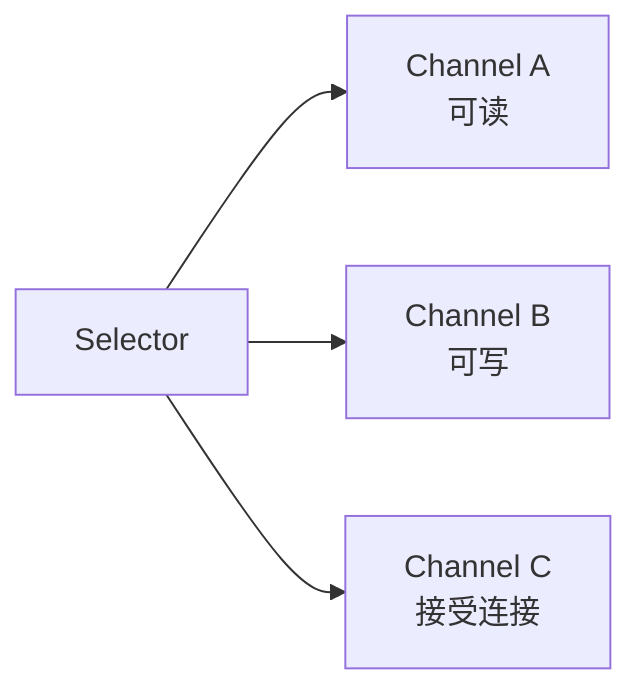

# IO、NIO 与网络

> I/O 的本质是数据在内存、文件、网络和设备之间移动；真正的难点是编码、缓冲、资源释放和阻塞模型。

## 本章目标

学完本章，你应该能够：

- 区分字节流和字符流，正确处理字符编码。
- 使用缓冲、装饰器和 `try-with-resources` 读写文件。
- 使用 `Path` / `Files` 完成常见文件操作。
- 理解 NIO 的 Buffer、Channel、Selector 模型。
- 使用 `HttpClient` 发起带超时的网络请求。
- 识别序列化、资源泄漏、阻塞 I/O 和大文件读取风险。

## 一、字节与字符

I/O 的第一层区分是“字节”还是“字符”。

### 字节

字节流处理原始二进制数据：

- 图片、音频、压缩包。
- 网络协议。
- 加密后的数据。
- 序列化后的字节。

核心抽象：

```text
InputStream / OutputStream
```

### 字符

字符流处理文本，并在字节和字符之间进行编码转换：

```text
Reader / Writer
```

核心问题是字符集：

```java
byte[] bytes = "你好".getBytes(StandardCharsets.UTF_8);
String text = new String(bytes, StandardCharsets.UTF_8);
```

读写两端必须使用一致的编码。不要依赖平台默认编码：

```java
// 不推荐
new String(bytes);

// 推荐
new String(bytes, StandardCharsets.UTF_8);
```

## 二、传统 IO 的基本模型

### `InputStream`

```java
try (InputStream input = Files.newInputStream(path)) {
    int value;
    while ((value = input.read()) != -1) {
        System.out.println(value);
    }
}
```

逐字节读取通常很慢，应该使用缓冲区：

```java
try (InputStream input = new BufferedInputStream(Files.newInputStream(path))) {
    byte[] buffer = new byte[8192];
    int read;
    while ((read = input.read(buffer)) != -1) {
        consume(buffer, read);
    }
}
```

`read(buffer)` 返回实际读取的字节数，不保证填满整个数组。

### `OutputStream`

```java
try (OutputStream output = new BufferedOutputStream(Files.newOutputStream(path))) {
    output.write("hello".getBytes(StandardCharsets.UTF_8));
}
```

缓冲流减少系统调用次数，但需要注意：

- 缓冲区中的数据在关闭或 `flush` 时才写出。
- 异常发生时应让 `try-with-resources` 负责关闭。
- 不要忘记刷新需要及时可见的流。

### `Reader` / `Writer`

```java
try (BufferedReader reader = Files.newBufferedReader(path, StandardCharsets.UTF_8)) {
    String line;
    while ((line = reader.readLine()) != null) {
        System.out.println(line);
    }
}
```

```java
try (BufferedWriter writer = Files.newBufferedWriter(path, StandardCharsets.UTF_8)) {
    writer.write("hello");
    writer.newLine();
}
```

字符流适合文本，但不要用它读取二进制文件，否则编码转换会破坏数据。

### 装饰器模式

Java IO 使用装饰器组合能力：

```java
InputStream input = Files.newInputStream(path);
InputStream buffered = new BufferedInputStream(input);
InputStream gzip = new GZIPInputStream(buffered);
```

缓冲、压缩、加密、计数等能力通过包装叠加，而不是为每种组合创建一个类。

## 三、`Path` 与 `Files`

`java.nio.file.Path` 是现代文件路径抽象，优先于旧的 `java.io.File`。

```java
Path path = Path.of("data", "orders.csv");
```

### 读取文件

小文件：

```java
String content = Files.readString(path, StandardCharsets.UTF_8);
byte[] bytes = Files.readAllBytes(path);
```

按行读取：

```java
try (Stream<String> lines = Files.lines(path, StandardCharsets.UTF_8)) {
    lines.filter(line -> !line.isBlank())
        .forEach(System.out::println);
}
```

`Files.lines` 返回的 Stream 持有文件资源，必须关闭。不要把它赋值给字段或返回给调用方而不说明生命周期。

### 写入文件

```java
Files.writeString(path, "hello", StandardCharsets.UTF_8);

Files.write(
    path,
    List.of("a", "b"),
    StandardCharsets.UTF_8,
    StandardOpenOption.CREATE,
    StandardOpenOption.TRUNCATE_EXISTING
);
```

### 复制、移动、删除

```java
Files.copy(source, target, StandardCopyOption.REPLACE_EXISTING);
Files.move(source, target, StandardCopyOption.ATOMIC_MOVE);
Files.deleteIfExists(target);
```

删除目录前必须确认目录为空，或显式递归遍历。生产代码不要随意递归删除未知路径。

### 遍历目录

```java
try (Stream<Path> paths = Files.walk(root)) {
    paths.filter(Files::isRegularFile)
        .filter(path -> path.toString().endsWith(".java"))
        .forEach(System.out::println);
}
```

`Files.walk` 和 `Files.list` 都返回需要关闭的 Stream。遍历大目录时要考虑深度、符号链接和权限异常。

### 临时文件

```java
Path temp = Files.createTempFile("order-", ".csv");
```

临时文件也可能包含敏感数据，使用后应及时删除，并注意操作系统临时目录的权限。

## 四、大文件处理

不要对大文件使用：

```java
byte[] all = Files.readAllBytes(hugeFile);
String text = Files.readString(hugeFile);
```

它们会把整个文件加载到内存。应使用流式处理：

```java
try (BufferedReader reader = Files.newBufferedReader(hugeFile)) {
    String line;
    while ((line = reader.readLine()) != null) {
        process(line);
    }
}
```

如果每行处理结果需要聚合，也要控制内存：

- 分批写入。
- 使用有界队列。
- 使用外部排序。
- 避免把全部记录收集到一个巨大 `List`。

## 五、序列化

::: warning 不要反序列化不可信数据
Java 原生序列化在反序列化不可信内容时存在严重安全风险。现代系统优先使用 JSON、Protobuf 等协议；如果必须使用原生序列化，应限制来源并配置对象输入过滤器。
:::

Java 原生序列化通过 `Serializable` 实现：

```java
public final class Order implements Serializable {
    private static final long serialVersionUID = 1L;

    private final long id;
    private final String customerName;
}
```

但原生序列化有显著风险：

- 反序列化不可信数据可能导致安全问题。
- 类结构变化后兼容性复杂。
- 体积大、性能一般。
- 跨语言支持差。

现代系统通常优先使用：

- JSON（可读性好，适合 API）。
- Protobuf / Avro / Thrift（契约明确、体积小）。
- 自定义二进制协议。

如果必须使用 Java 序列化：

- 只反序列化可信来源。
- 使用白名单或对象输入过滤器。
- 明确 `serialVersionUID`。
- 不要把密码和令牌写入序列化对象。

## 六、NIO 基础

NIO（New I/O）提供面向缓冲区、通道和非阻塞 I/O 的能力。

### Buffer

```java
ByteBuffer buffer = ByteBuffer.allocate(1024);
buffer.put("hello".getBytes(StandardCharsets.UTF_8));
buffer.flip();

while (buffer.hasRemaining()) {
    System.out.print((char) buffer.get());
}
```

Buffer 的三个核心位置：

- `position`：下一个读写位置。
- `limit`：可读写边界。
- `capacity`：容量。

常见操作：

- `flip()`：写模式切换到读模式。
- `clear()`：清空，准备重新写入。
- `compact()`：保留未读数据，准备继续写入。

### Channel

```java
try (FileChannel channel = FileChannel.open(path, StandardOpenOption.READ)) {
    ByteBuffer buffer = ByteBuffer.allocate(8192);
    while (channel.read(buffer) != -1) {
        buffer.flip();
        consume(buffer);
        buffer.clear();
    }
}
```

`FileChannel` 支持文件读写、定位、截断和内存映射。

### 内存映射文件

::: details 展开：内存映射文件示例
```java
try (FileChannel channel = FileChannel.open(path, StandardOpenOption.READ)) {
    MappedByteBuffer mapped = channel.map(
        FileChannel.MapMode.READ_ONLY,
        0,
        channel.size()
    );
    // 像访问内存一样读取
}
```
:::

内存映射适合大文件随机访问，但要注意：

- 文件生命周期和映射释放。
- 文件被截断时的行为。
- 不是所有场景都比普通流快。

### Selector

`Selector` 允许一个线程管理多个通道的就绪事件：



这是高性能网络服务器的基础模型之一。但直接使用 Selector 编写网络服务很复杂，实际项目通常使用 Netty、Vert.x 等框架。

## 七、网络 I/O

### 传统 Socket

::: details 展开：传统 Socket 示例
```java
try (Socket socket = new Socket("example.com", 80);
     OutputStream output = socket.getOutputStream();
     InputStream input = socket.getInputStream()) {
    output.write("GET / HTTP/1.1\r\nHost: example.com\r\n\r\n"
        .getBytes(StandardCharsets.US_ASCII));
    input.transferTo(System.out);
}
```
:::

传统 Socket 是阻塞模型：读不到数据时线程会等待。大量连接需要线程池或 NIO。

### `HttpClient`

Java 11 提供标准 HTTP 客户端：

```java
HttpClient client = HttpClient.newBuilder()
    .connectTimeout(Duration.ofSeconds(3))
    .build();

HttpRequest request = HttpRequest.newBuilder()
    .uri(URI.create("https://example.com/api/orders"))
    .timeout(Duration.ofSeconds(5))
    .header("Accept", "application/json")
    .GET()
    .build();

HttpResponse<String> response = client.send(
    request,
    HttpResponse.BodyHandlers.ofString(StandardCharsets.UTF_8)
);
```

异步请求：

```java
CompletableFuture<HttpResponse<String>> future =
    client.sendAsync(request, HttpResponse.BodyHandlers.ofString());
```

注意：

- 连接超时和请求超时都要设置。
- 明确处理非 2xx 状态码。
- 不要在请求线程中无限等待。
- 大量请求时考虑连接池、限流和熔断。

## 八、阻塞、非阻塞与异步

| 模型 | 特点 | 适用场景 |
| --- | --- | --- |
| 阻塞 I/O | 读写未完成时线程等待 | 简单文件操作、低并发 |
| 非阻塞 I/O | 没有数据时立即返回 | 高并发网络服务 |
| 异步 I/O | 操作完成后回调或 Future 返回 | 事件驱动、I/O 密集 |

虚拟线程让阻塞式 I/O 在 Java 21 之后更容易扩展，但它不会改变下游数据库或 HTTP 服务的容量。

## 九、常见陷阱

::: tip I/O 排查先看三件事
字符集是否显式指定？资源是否用 `try-with-resources` 关闭？网络调用是否设置了连接超时和请求超时？
:::

| 陷阱 | 后果 | 建议 |
| --- | --- | --- |
| 使用默认字符集 | 跨平台乱码 | 显式 `UTF_8` |
| 忘记关闭流 | 文件句柄泄漏 | `try-with-resources` |
| 大文件 `readAllBytes` | 内存溢出 | 流式处理 |
| `Files.lines` 未关闭 | 文件句柄泄漏 | try-with-resources |
| 逐字节读取 | 性能极差 | 使用缓冲区 |
| 网络调用无超时 | 线程永久阻塞 | 设置连接和请求超时 |
| 原生序列化不可信数据 | 安全漏洞 | 使用安全协议或过滤器 |
| 混用字节流和字符流 | 数据损坏 | 明确数据类型 |
| 依赖 `File.deleteOnExit` | 生命周期不可控 | 显式清理 |
| 忽略半包/粘包 | 协议解析错误 | 明确长度或分隔符 |

## 十、练习

1. 用 `BufferedReader` 统计一个文本文件的行数、单词数和最长行。
2. 用 `Files.walk` 找出目录下所有 `.java` 文件，并按大小排序。
3. 实现一个文件复制工具，支持大文件和进度回调。
4. 用 `ByteBuffer` 读取一个文件的前 1KB，并打印十六进制内容。
5. 用 `HttpClient` 调用一个公开 API，设置连接超时和请求超时。
6. 构造一个字符编码错误示例，观察乱码并修复。
7. 解释为什么 `Files.lines` 返回的 Stream 必须关闭。
## 总结
学完本章，你应该已经掌握：
.
- 区分字节流和字符流，使用缓冲。
- 理解 Files/Path 与传统 File 的差异。
- 处理编码、异常和资源关闭。
如果只能记住一件事：IO 必须显式关闭，NIO 适合高并发，普通场景 Files 更简洁。

## 相关阅读

- [异常与资源管理](/programming-language/java/exceptions)
- [函数式与 Stream](/programming-language/java/functional)
- [并发编程](/programming-language/java/concurrency)
- [Netty](/backend/netty)
