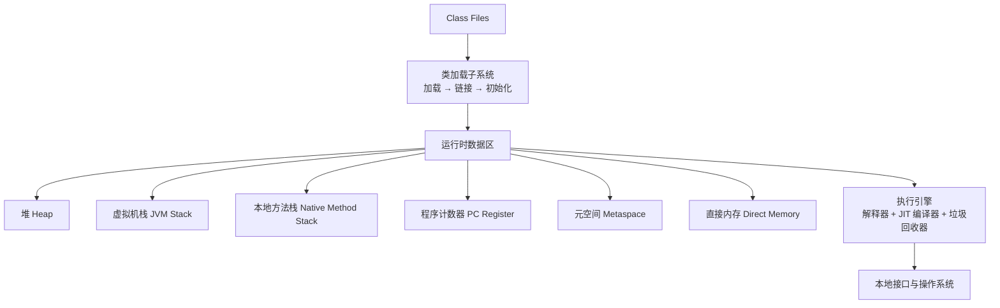
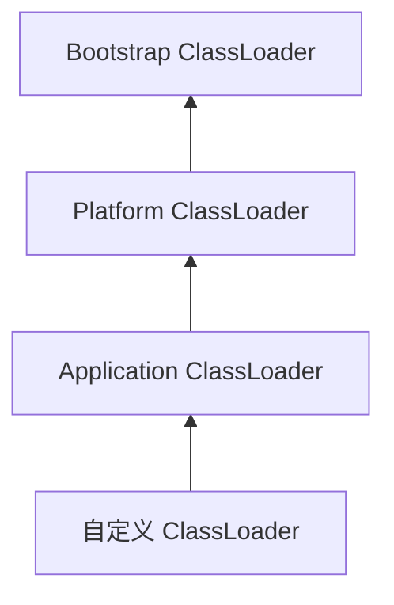
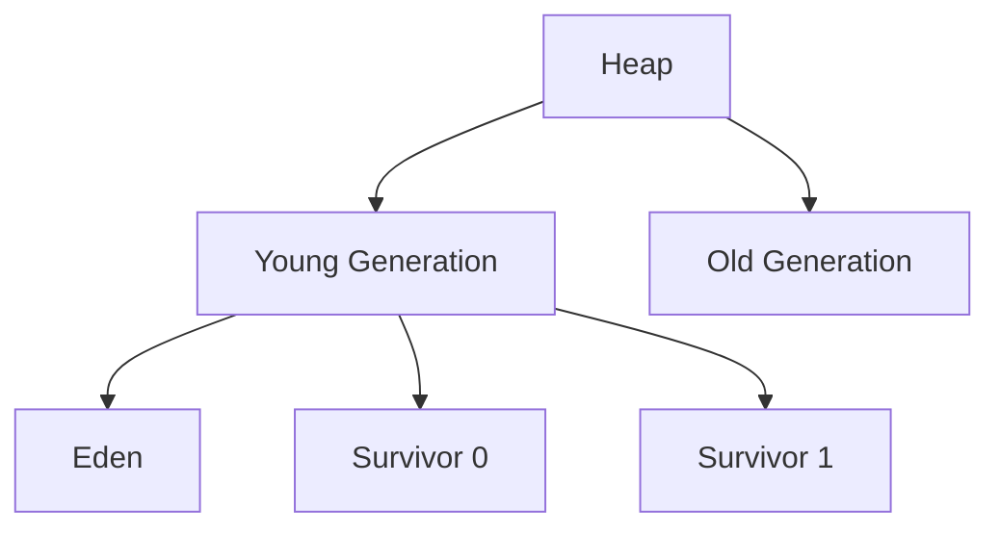

# JVM

> 理解 JVM，不是为了背参数，而是为了在内存、CPU 和延迟出现问题时，知道该看哪里。

## 本章目标

学完本章，你应该能够：

- 解释类加载、运行时数据区和执行引擎。
- 理解 GC 分代、常见收集器和停顿。
- 使用 JVM 工具排查内存和性能问题。
- 判断什么时候需要调优，什么时候不该调。

## JVM 是什么

JVM（Java Virtual Machine）是 Java 字节码的运行环境。它负责：

- 加载和验证类。
- 管理堆、栈、元空间等运行时内存。
- 解释执行字节码，并把热点代码编译成本地机器码。
- 自动回收不再使用的对象。
- 提供线程、锁、异常、反射等运行时能力。
- 通过 JVMTI、JFR、JMX 等接口支持监控和诊断。

JVM 让 Java 实现了“一次编译，到处运行”，但也意味着同一个程序在不同 JDK 版本、不同垃圾回收器和不同参数下，行为可能不同。

## JVM 的整体结构



## 类加载

### 类的生命周期

一个类从字节码到可使用，通常会经历：

1. **加载**：读取 `.class` 文件，生成 `Class` 对象。
2. **验证**：检查字节码格式、语义和安全性。
3. **准备**：为静态变量分配内存并设置零值。
4. **解析**：把符号引用转换为直接引用。
5. **初始化**：执行静态初始化块和静态变量赋值。
6. **使用**。
7. **卸载**：当类加载器、类和实例都不可达时，类元数据可能被回收。

### 双亲委派

ClassLoader 在加载类时，通常先把请求交给父加载器，父加载器无法完成时才由自己加载：



双亲委派的作用：

- 避免核心类被自定义类覆盖。
- 保证同一个类在同一个加载器层级中只被加载一次。
- 让类加载关系更可预测。

但双亲委派不是绝对规则。SPI、容器隔离、热部署和插件系统可能通过自定义 ClassLoader 打破它。

### 类初始化的触发时机

常见触发条件：

- `new` 创建实例。
- 访问或修改静态字段（非编译期常量）。
- 调用静态方法。
- 反射调用。
- 初始化子类时先初始化父类。
- 启动类包含 `main` 方法。

注意：通过子类访问父类静态字段，通常只会初始化父类；编译期常量不会触发类初始化。

## 类文件与字节码

JVM 执行的不是 Java 源码，而是 `.class` 文件中的字节码。一个类文件通常包含：

- 魔数 `0xCAFEBABE` 和版本号。
- 常量池。
- 访问标志、类名、父类和接口。
- 字段表和方法表。
- 属性，例如 `Code`、`Exceptions`、`Signature`、`StackMapTable`。

查看字节码：

::: details 展开：javap 与简单字节码示例
```bash
javap -c -v target/classes/com/example/User.class
```

一个简单方法：

```java
public int add(int left, int right) {
    return left + right;
}
```

对应的字节码大致是：

```text
iload_1
iload_2
iadd
ireturn
```
:::

### 字节码能告诉我们什么

- 方法是如何被调用的。
- 字符串拼接是否使用了 `invokedynamic`。
- Lambda 是否被编译成私有方法或动态调用点。
- 自动装箱和拆箱发生在哪里。
- 循环、异常和同步块的真实结构。

### 泛型擦除在字节码中的体现

```java
List<String> names = new ArrayList<>();
```

运行时只看到 `List` 和 `ArrayList`，看不到 `String`。泛型信息主要保存在 `Signature` 属性中，供编译器和反射读取。

### 受检异常不是字节码强制

`throws` 和受检异常检查主要发生在编译期。字节码中可以通过 `Exceptions` 属性记录声明，但 JVM 不会像 Java 编译器那样强制每个调用点处理。

这也是为什么反射、字节码生成和跨语言调用可能绕过 Java 源码层面的异常检查。

### `invokedynamic`

Java 8 的 Lambda、Java 9 之后的字符串拼接、部分动态语言支持都会使用 `invokedynamic`。它把方法链接推迟到运行时，由 `MethodHandle` 和引导方法决定最终调用目标。

理解 `invokedynamic` 不需要手写字节码，但它能解释：

- Lambda 为什么不是匿名内部类。
- 字符串拼接为什么在循环中仍需谨慎。
- 动态语言和框架如何实现运行时绑定。

## 运行时数据区

### 堆

堆是所有线程共享的内存区域，主要存放对象实例和数组。

现代 JVM 通常把堆划分为：



大多数对象在 Eden 中分配，经历多次 Young GC 后仍存活的对象会晋升到老年代。具体划分取决于垃圾回收器，G1 和 ZGC 并不完全使用传统的连续分代结构。

相关参数：

```bash
-Xms2g                 # 初始堆大小
-Xmx2g                 # 最大堆大小
-Xmn1g                 # 年轻代大小（部分收集器）
-XX:SurvivorRatio=8    # Eden 与 Survivor 比例
```

生产环境通常建议把 `-Xms` 和 `-Xmx` 设为相同值，减少运行时堆扩展带来的抖动。但最终应以实际内存预算和 GC 指标为准。

### 虚拟机栈

每个线程都有自己的虚拟机栈。栈帧用于保存：

- 局部变量表。
- 操作数栈。
- 动态链接。
- 方法返回地址。

栈是线程私有的，不需要垃圾回收，但可能溢出：

```java
public static void recurse() {
    recurse();
}
```

无限递归会抛出 `StackOverflowError`。栈大小可通过 `-Xss` 调整，但大多数情况下应先检查递归终止条件和调用链。

### 元空间

JDK 8 之后，方法区的主要实现是 Metaspace：

- 存放类元数据、方法元数据、常量池等。
- 使用本地内存，不再受 `-Xmx` 直接限制。
- 通过 `-XX:MaxMetaspaceSize` 限制上限。

类加载器泄漏是元空间 OOM 的常见原因。大量动态生成类、热部署或自定义类加载器如果没有正确释放，会导致类元数据持续增长。

### 程序计数器

每个线程都有独立的程序计数器，记录当前正在执行的字节码指令地址。它是 JVM 中唯一不会抛出 `OutOfMemoryError` 的运行时区域。

### 直接内存

通过 NIO 的 `ByteBuffer.allocateDirect` 或某些网络库分配的堆外内存：

- 不受 Java 堆大小直接限制。
- 分配和释放成本较高。
- 可能抛出 `OutOfMemoryError: Direct buffer memory`。

可通过 `-XX:MaxDirectMemorySize` 限制。堆外内存泄漏通常需要结合 NMT（Native Memory Tracking）、`pmap`、`jcmd` 和业务代码共同分析。

## 对象在内存中的布局

以 HotSpot 为例，对象通常包含：


- **Mark Word**：哈希码、GC 年龄、锁状态等信息。
- **Klass Pointer**：指向对象所属类的元数据。
- **实例字段**：对象实际保存的数据。
- **对齐填充**：满足内存对齐要求。

JVM 可能使用压缩指针（Compressed Oops）减少 64 位对象引用占用。对象大小还受字段排列、继承关系和 JVM 实现影响。

### 逃逸分析

JIT 可能通过逃逸分析判断对象是否逃出方法或线程：

- 不逃逸的对象可能被标量替换，从而避免分配完整对象。
- 锁只被单个线程获取时，可能被锁消除。

这也是“对象一定分配在堆上”这一说法在现代 JVM 中不再绝对准确的原因。但不要依赖这些优化做设计，仍应以清晰的代码和可测量的性能为准。

## 垃圾回收

### 如何判断对象可以回收

JVM 主要使用可达性分析，从 GC Roots 出发标记可达对象。常见 GC Roots：

- 虚拟机栈中引用的对象。
- 静态字段引用的对象。
- 常量引用的对象。
- 本地方法栈中 JNI 引用的对象。
- 活跃线程、锁、JVM 内部结构等。

不可达对象才可能被回收。引用计数不是 HotSpot 的主要判断方式，因为它难以处理循环引用。

### 常见回收算法

| 算法 | 思路 | 特点 |
| --- | --- | --- |
| 标记-清除 | 标记存活对象，清除未标记对象 | 实现简单，容易产生内存碎片 |
| 复制 | 把存活对象复制到另一块区域 | 无碎片，但需要额外空间 |
| 标记-整理 | 标记存活对象并整理到一端 | 无碎片，但移动对象有成本 |
| 分代收集 | 按对象生命周期分区回收 | 符合大多数对象“朝生夕死”的规律 |

### 常见垃圾回收器

| 收集器 | 特点 | 适用场景 |
| --- | --- | --- |
| Serial | 单线程，简单 | 小内存、客户端、测试环境 |
| Parallel | 多线程，吞吐优先 | 批处理、离线任务 |
| G1 | 分区、可预测停顿、JDK 9 起默认 | 大多数服务端应用 |
| ZGC | 超低停顿、并发回收 | 大堆、低延迟服务 |
| Shenandoah | 低停顿、并发整理 | 对停顿敏感的服务 |

> CMS 已在 JDK 14 中移除。新项目不应再选择 CMS。

### G1 的基本思路

G1 把堆划分为多个 Region，根据回收收益选择收集区域：

- Young GC：回收年轻代 Region。
- Mixed GC：同时回收部分老年代 Region。
- Full GC：在极端情况下回退到全局回收，通常应尽量避免。

常用参数：

```bash
-XX:+UseG1GC
-XX:MaxGCPauseMillis=200
-XX:G1HeapRegionSize=4m
```

`MaxGCPauseMillis` 是目标，不是保证。设置过小可能导致回收更频繁，反而降低吞吐。

### ZGC

ZGC 的目标是把 GC 停顿控制在极低水平，适合大堆和低延迟场景：

```bash
-XX:+UseZGC
```

Java 21 开始支持分代 ZGC。ZGC 的停顿通常很短，但会消耗更多 CPU 和内存，需要结合吞吐目标评估。

## GC 日志

现代 JDK 使用统一日志：

```bash
-Xlog:gc*:file=gc.log:time,uptime,level,tags
```

重点观察：

- GC 频率和停顿时间。
- 年轻代和老年代的变化。
- 晋升速率。
- 是否出现 Full GC。
- 堆占用是否在每次 GC 后持续上升。

如果 Full GC 后老年代仍然很高，可能存在内存泄漏或堆容量不足。

## JIT 编译

JVM 执行字节码时通常采用分层编译：

1. 解释器先执行，快速启动。
2. C1 编译器编译热点代码，优化编译速度。
3. C2 编译器进一步做激进优化，提升峰值性能。

常见优化：

- 方法内联。
- 逃逸分析。
- 锁消除。
- 常量折叠。
- 死代码消除。

JIT 优化建立在运行时假设上。如果假设失效，JVM 会进行反优化（Deoptimization），回到解释执行或较低优化级别。

这也解释了一个现象：同一段代码在预热前后性能可能差异很大。做基准测试时必须考虑 JVM 预热，使用 JMH 而不是简单的 `System.currentTimeMillis()`。

## 常用诊断工具

### jps

列出当前用户的 Java 进程：

```bash
jps -lv
```

### jcmd

现代 JDK 推荐的统一诊断入口：

```bash
jcmd <pid> VM.version
jcmd <pid> GC.heap_info
jcmd <pid> Thread.print
jcmd <pid> GC.heap_dump /tmp/heap.hprof
jcmd <pid> JFR.start duration=60s filename=recording.jfr
```

### jstat

观察 GC 统计：

```bash
jstat -gcutil <pid> 1000 10
```

### jstack

查看线程栈：

```bash
jstack <pid>
```

适合排查：

- 死锁。
- 线程池耗尽。
- 大量线程阻塞在同一个锁上。
- 请求处理线程卡在外部调用。

### jmap

查看堆直方图或导出堆转储：

```bash
jmap -histo:live <pid> | head -n 30
jmap -dump:live,format=b,file=/tmp/heap.hprof <pid>
```

堆转储可以使用 Eclipse MAT、VisualVM 或 JProfiler 分析。

### JFR

Java Flight Recorder 是低开销的运行时事件记录工具：

```bash
java -XX:StartFlightRecording=duration=60s,filename=app.jfr -jar app.jar
```

JFR 可以记录 GC、线程、锁、I/O、异常、方法采样等事件，适合线上问题定位。

## 容器化与 JVM

在容器中运行 Java 应用时，JVM 看到的资源不一定等于宿主机资源。现代 JDK 会读取 cgroup 限制，但仍应显式配置关键参数：

```bash
java \
  -XX:MaxRAMPercentage=75 \
  -XX:InitialRAMPercentage=50 \
  -XX:MaxMetaspaceSize=256m \
  -XX:MaxDirectMemorySize=256m \
  -XX:+HeapDumpOnOutOfMemoryError \
  -XX:HeapDumpPath=/tmp/heap.hprof \
  -jar app.jar
```

需要关注的资源：

- Java 堆。
- Metaspace。
- 直接内存。
- 线程栈。
- JIT 代码缓存。
- JVM 自身和本地库。

容器内存限制是总预算，不只是 `-Xmx`。如果堆、元空间、直接内存和线程栈之和超过限制，进程可能被操作系统杀死，表现为退出码 `137` 或 `OOMKilled`。

### CPU 限制

`Runtime.availableProcessors()` 在容器中可能受 CPU quota 影响。线程池、并行流和 GC 线程数都可能随之变化。不要假设容器一定能看到宿主机全部核心。

### 优雅停机

容器编排平台发送终止信号后，应用需要：

1. 停止接收新请求。
2. 等待正在处理的请求完成。
3. 关闭线程池和连接池。
4. 在超时前退出。

停机时间应小于编排平台设置的宽限期，否则进程会被强制终止。

## 常见内存问题

::: warning 先区分 OOM 类型
`Java heap space`、`Metaspace`、`Direct buffer memory` 和 `Unable to create native thread` 的原因完全不同。先看异常类型，再决定是查堆、查类加载器、查堆外内存还是查线程数。
:::

### Java heap space

```text
java.lang.OutOfMemoryError: Java heap space
```

可能原因：

- 一次查询加载过多数据。
- 集合无限增长。
- 缓存没有上限。
- 内存泄漏。
- 堆容量确实不足。

处理顺序：

1. 确认堆大小和 GC 情况。
2. 导出堆转储。
3. 找出占用最大的对象和引用链。
4. 判断是泄漏还是容量不足。

### Metaspace

```text
java.lang.OutOfMemoryError: Metaspace
```

常见原因：

- 动态生成大量类。
- 类加载器泄漏。
- 热部署或插件系统未释放旧类。

### Direct buffer memory

```text
java.lang.OutOfMemoryError: Direct buffer memory
```

常见原因：

- 大量直接 `ByteBuffer` 未释放。
- 网络框架的堆外缓冲区配置不合理。
- 只关注 `-Xmx`，忽略了堆外内存。

### Unable to create native thread

常见原因：

- 线程数量过多。
- 操作系统进程/线程限制。
- 每个线程的栈空间过大。
- 容器内存限制与 JVM 参数不匹配。

### 一个简单的内存泄漏示例

```java
public final class SessionRegistry {
    private static final Map<String, Session> SESSIONS = new HashMap<>();

    public static void register(Session session) {
        SESSIONS.put(session.id(), session);
    }

    // 没有对应的移除逻辑
}
```

静态集合会持有对象引用，使对象始终可达。解决方式不是简单“加个 `clear()`”，而是设计明确的生命周期：

- 会话结束时移除。
- 使用有容量上限和过期策略的缓存。
- 通过监控观察集合大小。
- 用弱引用或专门的缓存库处理可回收数据。

## 一次线上故障的排查路径

线上问题通常表现为几类信号：CPU 高、内存高、延迟升高、线程池耗尽、请求错误率上升。不要一上来就改 JVM 参数，先确定问题层次。

### CPU 持续很高

```bash
top -Hp <pid>
printf '%x\n' <thread-id>
jstack <pid> > threads.txt
```

在 `jstack` 输出中搜索十六进制线程 ID，观察线程正在执行的栈。常见原因：

- 死循环或忙等待。
- 正则表达式回溯。
- 频繁 GC。
- 大量锁自旋。
- 序列化或加密计算。

如果多个线程都在做同一类计算，问题通常在应用代码；如果 GC 线程占比很高，转向内存和分配速率分析。

### 内存持续上涨

1. 观察 GC 后老年代是否回落。
2. 导出堆转储。
3. 用 MAT 查找 dominator tree 和引用链。
4. 判断是泄漏、缓存无上限，还是堆容量不足。

```bash
jcmd <pid> GC.heap_info
jcmd <pid> GC.heap_dump /tmp/heap.hprof
```

### 延迟升高但 CPU 不高

可能原因：

- 线程池队列积压。
- 数据库连接池耗尽。
- 外部服务超时。
- 锁竞争。
- GC 停顿。
- 容器 CPU throttling。

检查：

```bash
jcmd <pid> Thread.print
jcmd <pid> GC.heap_info
jstat -gcutil <pid> 1000 10
```

同时查看应用指标：请求排队时间、连接池活跃数、下游 P99、线程池队列长度。

### 线程池耗尽

典型现象：

- 请求一直等待。
- 任务队列持续增长。
- 拒绝任务数上升。
- 大量线程处于 `WAITING` 或 `TIMED_WAITING`。

处理顺序：

1. 找到阻塞位置：数据库、HTTP、文件还是锁。
2. 确认线程池是否与下游容量匹配。
3. 设置合理超时和队列上限。
4. 对慢依赖做隔离、限流和熔断。
5. 不要只把线程数调大，否则可能把压力转移给下游。

## JVM 调优的正确顺序

调优不是先改参数，而是先建立问题定义：

1. **确认目标**：降低延迟、提高吞吐、减少内存，还是避免 OOM？
2. **建立基线**：记录 GC、CPU、内存、线程和业务指标。
3. **定位瓶颈**：GC、数据库、锁、外部服务还是 CPU？
4. **做一个改变**：一次只改一个变量。
5. **验证效果**：在相同负载下比较指标。
6. **保留回滚方案**。

常见误区：

- 没有基线就调参数。
- 把所有问题都归因于 GC。
- 盲目调大堆，导致单次 GC 停顿更长。
- 在生产环境直接使用未经验证的预览特性。
- 只看平均值，不看 P95、P99 和错误率。

## 常见错误

::: tip 调优前先确认目标
降低延迟、提高吞吐、减少内存和避免 OOM 是不同目标。没有基线和业务指标时，不要先改 JVM 参数。
:::

| 错误认知 | 实际情况 |
| --- | --- |
| 对象一定分配在堆上 | JIT 可能通过标量替换消除完整对象分配 |
| 调大 `-Xmx` 一定能解决 OOM | 可能只是延后问题，甚至加重 GC 停顿 |
| `System.gc()` 可以可靠回收内存 | 只是建议，生产环境通常不应主动调用 |
| 没有 Full GC 就没有问题 | 可能仍有高延迟、内存增长或线程问题 |
| 堆内存没满就不会 OOM | 还可能是元空间、直接内存或本地线程不足 |
| GC 停顿只由堆大小决定 | 收集器、对象存活率、分配速率和 CPU 都会影响 |

## 练习

1. 用 `jps`、`jcmd` 和 `jstat` 观察一个正在运行的 Java 程序，记录堆和 GC 指标。
2. 制造一次 `StackOverflowError`，再用 `jstack` 查看调用栈。
3. 写一个静态集合持续添加对象的程序，导出堆转储并用 MAT 查找引用链。
4. 比较 G1 和 ZGC 在相同堆大小下的停顿和吞吐差异。
5. 用 JFR 录制一次程序运行，找出耗时最多的方法和线程状态。
6. 解释 `-Xms`、`-Xmx`、`-Xss`、`-XX:MaxMetaspaceSize` 和 `-XX:MaxDirectMemorySize` 分别限制什么。
## 总结
学完本章，你应该已经掌握：
.
- 解释类加载、运行时数据区和执行引擎。
- 理解 GC 分代、常见收集器和停顿。
- 使用 JVM 工具排查内存和性能问题。
如果只能记住一件事：先看指标和日志，再调 JVM 参数。

## 相关阅读

- [Java 总览](/programming-language/java/)
- [Java 并发](/programming-language/java/concurrency)
- [Java 新特性](/programming-language/java/new-features)
- [可观测性](/software-engineering/observability)
