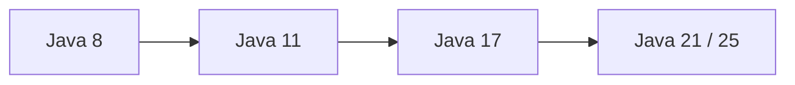

# Java 新特性

> 新特性不是“版本越新越好”，而是“在当前项目约束下，用更清晰的表达解决真实问题”。

## 本章目标

学完本章，你应该能够：

- 理解 Java 的版本节奏和 LTS。
- 使用 records、sealed、模式匹配等现代语法。
- 判断虚拟线程和并发新特性的适用场景。
- 规划从旧版本迁移的路径。

## Java 的版本节奏

Java 从 Java 9 开始采用每六个月一个版本的发布节奏，每两年左右发布一个长期支持版本（LTS）：

| 版本 | 发布时间 | 定位 | 重要变化 |
| --- | --- | --- | --- |
| Java 8 | 2014 | LTS | Lambda、Stream、Optional、新日期时间 API |
| Java 11 | 2018 | LTS | `HttpClient`、`var`、单文件源码运行 |
| Java 17 | 2021 | LTS | 密封类、`record`、模式匹配、强封装 JDK 内部 API |
| Java 21 | 2023 | LTS | 虚拟线程、记录模式、`switch` 模式匹配、分代 ZGC |
| Java 25 | 2025 | LTS | 紧凑源文件、实例 `main`、模块导入、作用域值 |

非 LTS 版本适合尝鲜和验证，但生产系统通常应以 LTS 为基线。升级时不要只看语言特性，还要评估：

- 依赖库和框架是否支持目标 JDK。
- 构建工具、CI 镜像和运行时镜像是否匹配。
- GC 行为和默认参数是否变化。
- 反射、模块系统和已移除 API 是否影响现有代码。
- 团队是否具备排查新问题的能力。

## 版本特性速查

下表按版本列出最值得关注的变化。标注“预览”的特性尚未成为正式标准，不应默认用于生产。

::: details 展开：Java 9—25 版本特性速查
| 版本 | 关键变化 |
| --- | --- |
| Java 9 | 模块系统、JShell、集合工厂方法、私有接口方法、`try-with-resources` 支持 effectively final 变量 |
| Java 10 | 局部变量类型推断 `var`、G1 并行 Full GC、应用类数据共享 |
| Java 11 | 标准 `HttpClient`、单文件源码运行、`String` / `Files` 增强、ZGC 实验性引入 |
| Java 12 | switch 表达式预览、Shenandoah 实验性引入 |
| Java 13 | 文本块预览、switch 表达式第二次预览、动态 CDS |
| Java 14 | switch 表达式正式、`record` 预览、文本块第二次预览、更有用的 NPE 信息 |
| Java 15 | 文本块正式、密封类预览、ZGC / Shenandoah 转为生产可用、隐藏类 |
| Java 16 | `record` 正式、`instanceof` 模式匹配正式、强封装 JDK 内部 API |
| Java 17 | 密封类正式、switch 模式匹配预览、强封装默认生效 |
| Java 18 | 默认 UTF-8、简易 HTTP 文件服务器、Javadoc 代码片段 |
| Java 19 | 虚拟线程预览、记录模式预览、switch 模式匹配第三次预览、外部函数与内存 API 预览 |
| Java 20 | 虚拟线程第二次预览、记录模式第二次预览、作用域值孵化 |
| Java 21 | 虚拟线程正式、记录模式正式、switch 模式匹配正式、SequencedCollection、分代 ZGC |
| Java 22 | 未命名变量和模式正式、外部函数与内存 API 正式、多文件源码启动、字符串模板第二次预览 |
| Java 23 | 模块导入预览、原始类型模式匹配预览、Markdown 文档注释、分代 ZGC 成为默认模式 |
| Java 24 | Stream Gatherers 正式、Class-File API 正式、虚拟线程不再因 `synchronized` 钉住载体线程 |
| Java 25 | 模块导入正式、紧凑源文件和实例 `main` 正式、灵活构造器正式、作用域值正式 |
:::

> 预览特性可能在不同版本中改名、改 API 甚至被移除。升级前应查看对应 JDK 的 release notes 和 JEP 状态。

## Java 8：从面向对象走向函数式表达

Java 8 是使用最广的版本之一，也是很多代码库的历史基线。

### Lambda 与函数式接口

```java
List<String> names = List.of("alice", "bob", "carol");

names.sort((left, right) -> left.compareToIgnoreCase(right));
names.forEach(name -> System.out.println(name));
```

Lambda 让行为可以作为参数传递，减少了匿名内部类的样板代码。常见的函数式接口包括：

- `Function<T, R>`：转换。
- `Predicate<T>`：判断。
- `Consumer<T>`：消费。
- `Supplier<T>`：提供。
- `BiFunction<T, U, R>`：双参数转换。

### Stream API

```java
List<String> paidCustomerNames = orders.stream()
    .filter(Order::isPaid)
    .map(Order::customerName)
    .distinct()
    .sorted()
    .toList();
```

Stream 适合表达数据转换和聚合，但不应把所有循环都改写成 Stream。涉及复杂副作用、受检异常、调试或性能敏感的场景，普通循环可能更清晰。

### Optional

```java
Optional<User> user = userRepository.findByUsername(username);

String displayName = user
    .map(User::displayName)
    .orElse("unknown");
```

`Optional` 主要用于表达“返回值可能不存在”，不适合：

- 作为字段类型。
- 作为方法参数。
- 替代所有 `null` 检查。
- 包装集合；空集合本身就能表达“没有元素”。

### 新日期时间 API

```java
LocalDate today = LocalDate.now();
LocalDateTime createdAt = LocalDateTime.now(ZoneOffset.UTC);
Duration duration = Duration.between(start, end);
```

`java.time` 解决了旧 `Date` / `Calendar` 可变、时区混乱和格式化线程不安全等问题。新代码应优先使用 `LocalDate`、`LocalDateTime`、`Instant`、`Duration` 和 `DateTimeFormatter`。

## Java 9—11：模块化与工程化补强

### Java 9：模块系统

JPMS（Java Platform Module System）通过 `module-info.java` 描述模块依赖和导出：

```java
module com.example.order {
    requires java.sql;
    exports com.example.order.api;
}
```

模块系统对大型应用和 JDK 自身封装很重要，但普通业务项目不一定需要立即模块化。升级到 Java 9+ 时，更常见的问题是 JDK 内部 API 被强封装，而不是必须编写 `module-info.java`。

### 集合工厂方法

```java
List<String> names = List.of("alice", "bob");
Set<Integer> ids = Set.of(1, 2, 3);
Map<String, Integer> scores = Map.of("alice", 90, "bob", 85);
```

这些集合是不可变的，且不允许 `null`。注意：`List.of` 不是 `Arrays.asList` 的简单替代，前者不可变，后者是固定长度但允许 `set`。

### Java 10：局部变量类型推断

```java
var users = new ArrayList<User>();
var total = orders.stream().mapToLong(Order::amount).sum();
```

`var` 只能用于局部变量，并且必须在声明时初始化。它不是动态类型，编译器仍然知道真实类型。

适合：

- 右侧类型已经很明显。
- 泛型嵌套很长，写全类型反而降低可读性。

不适合：

- 右侧是方法调用，类型不明显。
- 变量含义需要靠类型表达。
- 为了少写几个字符而牺牲可读性。

### Java 11：标准库补强

Java 11 增加了：

- 标准 `HttpClient`。
- `String.isBlank`、`strip`、`repeat`、`lines`。
- `Files.readString` / `writeString`。
- `Optional.isEmpty`。
- 单文件源码直接运行：

```bash
java Hello.java
```

`HttpClient` 示例：

```java
HttpClient client = HttpClient.newHttpClient();
HttpRequest request = HttpRequest.newBuilder()
    .uri(URI.create("https://example.com/api/orders"))
    .GET()
    .build();

HttpResponse<String> response = client.send(
    request,
    HttpResponse.BodyHandlers.ofString()
);
```

## Java 14—17：表达力与数据建模

### switch 表达式

传统 `switch` 容易漏写 `break`，也难作为表达式返回值。Java 14 正式引入 switch 表达式：

```java
String level = switch (score) {
    case 90, 100 -> "excellent";
    case 60, 70, 80 -> "pass";
    default -> "fail";
};
```

Java 17 之后，switch 还可以配合模式匹配使用。

### 文本块

```java
String json = """
    {
      "name": "alice",
      "age": 18
    }
    """;
```

文本块适合多行 SQL、JSON、HTML 和测试数据。注意缩进会被统一处理，不要用它拼接不可控的用户输入。

### record

`record` 用于声明不可变数据载体：

```java
public record Money(BigDecimal amount, String currency) {
    public Money {
        if (amount.signum() < 0) {
            throw new IllegalArgumentException("amount must not be negative");
        }
    }
}
```

编译器会自动生成：

- 私有 final 字段。
- 全参构造器。
- 访问器方法。
- `equals`、`hashCode`、`toString`。

适合：

- DTO、值对象、查询结果。
- 方法返回多个值。
- 事件、命令和消息载体。

不适合：

- 需要可变状态的对象。
- 依赖无参构造器的 JPA 实体。
- 需要继承体系表达的业务对象。

### 密封类

密封类限制哪些类型可以继承或实现它：

```java
public sealed interface PaymentResult
    permits PaymentSuccess, PaymentFailed, PaymentPending {
}

public record PaymentSuccess(String transactionId) implements PaymentResult {
}

public record PaymentFailed(String code, String message) implements PaymentResult {
}

public record PaymentPending(String transactionId) implements PaymentResult {
}
```

它适合表达有限的状态集合，让编译器帮助检查分支是否完整。

### instanceof 模式匹配

```java
if (value instanceof String text && !text.isBlank()) {
    System.out.println(text.strip());
}
```

不再需要先判断类型再强制转换，减少样板代码和类型错误。

## Java 21：并发与模式匹配的成熟

### 虚拟线程

Java 21 正式引入虚拟线程：

```java
try (var executor = Executors.newVirtualThreadPerTaskExecutor()) {
    Future<String> future = executor.submit(() -> remoteService.call());
    System.out.println(future.get());
}
```

虚拟线程的适用场景：

- 大量阻塞式 I/O。
- 每个请求一个任务的模型。
- 需要简化异步编程，但不希望创建大量平台线程。

不适用：

- CPU 密集型计算。
- 需要池化昂贵资源（数据库连接）的场景。
- 以为虚拟线程可以突破下游连接数限制的场景。

### 记录模式

```java
record Point(int x, int y) {
}

static String describe(Object value) {
    return switch (value) {
        case Point(int x, int y) when x == 0 && y == 0 -> "origin";
        case Point(int x, int y) -> "point(" + x + ", " + y + ")";
        default -> "unknown";
    };
}
```

记录模式可以解构 record，配合 `switch` 和守卫条件使用。

### switch 模式匹配

```java
static String format(PaymentResult result) {
    return switch (result) {
        case PaymentSuccess success -> "success: " + success.transactionId();
        case PaymentFailed failed -> "failed: " + failed.message();
        case PaymentPending pending -> "pending: " + pending.transactionId();
    };
}
```

当输入是密封类型时，编译器可以检查分支是否覆盖所有子类型。

### SequencedCollection

Java 21 为有序集合增加了统一的顺序访问 API：

```java
List<String> names = new ArrayList<>(List.of("a", "b", "c"));
System.out.println(names.getFirst());
System.out.println(names.getLast());
```

这改善了 `List`、`Deque`、`LinkedHashSet` 等集合在首尾访问上的 API 一致性。

## Java 25：更简洁的语言入口

Java 25 是当前 LTS，重点包括紧凑源文件、实例 `main`、模块导入、灵活构造器、作用域值等。

### 紧凑源文件与实例 main

初学者可以先写一个不包含类声明的源文件：

```java
void main() {
    System.out.println("Hello, Java 25");
}
```

这适合教学、脚本和小工具。真实项目仍然需要包结构、类设计和模块边界。

### 模块导入声明

```java
import module java.base;

void main() {
    System.out.println(List.of("a", "b"));
}
```

模块导入可以一次性导入模块导出的包，减少大量重复 import。它不会改变模块的依赖关系，只是简化源码中的导入声明。

### 灵活构造器

Java 25 允许在显式 `super(...)` 或 `this(...)` 之前执行不引用当前对象的语句：

```java
class User extends Person {
    User(String name) {
        if (name == null || name.isBlank()) {
            throw new IllegalArgumentException("name must not be blank");
        }
        super(name);
    }
}
```

这样可以在调用父构造器前完成参数校验和必要计算。

### 作用域值

`ScopedValue` 提供一种在线程和虚拟线程之间安全共享不可变上下文的方式：

```java
private static final ScopedValue<User> CURRENT_USER = ScopedValue.newInstance();

void handleRequest(User user) {
    ScopedValue.where(CURRENT_USER, user).run(() -> {
        System.out.println(CURRENT_USER.get().name());
    });
}
```

与 `ThreadLocal` 相比，作用域值有明确的生命周期，更适合结构化并发和虚拟线程。

### 仍处于预览或孵化的特性

::: warning 预览特性不是稳定 API
预览特性可能改名、改语义甚至被移除，并且通常要求运行时使用相同 JDK 版本和 `--enable-preview`。生产项目默认不应依赖。
:::

Java 25 仍包含预览特性，例如：

- 原始类型模式匹配（Primitive Types in Patterns）。
- 结构化并发（Structured Concurrency）。
- 稳定值（Stable Values）。
- 向量 API（Vector API，仍为孵化器）。

预览特性需要显式开启，例如：

```bash
javac --enable-preview --release 25 Example.java
```

生产项目通常不应依赖预览 API，除非团队明确接受其可能变化的成本。

## 版本选择建议

### 新项目

- 优先选择当前 LTS，例如 Java 21 或 Java 25。
- 确认 Spring Boot、构建工具、数据库驱动、监控 Agent 和容器镜像支持目标版本。
- 不需要为了“最新”而关闭稳定性。

### 老项目

常见升级路线：



不必一次跨太多版本。每跨一个 LTS，都应该有独立的验证和回归测试。

升级检查清单：

- 依赖库是否有兼容版本。
- 是否使用了 JDK 内部 API 或反射访问。
- 是否依赖已移除的 GC 或 JVM 参数。
- 是否使用旧的日期、XML、加密或 HTTP API。
- 编译、单元测试、集成测试是否全部通过。
- 容器基础镜像和 JVM 参数是否更新。
- 生产监控是否能识别新版本指标。

## 从 Java 8 升级到 Java 21：一次可执行的迁移

升级不是把 `pom.xml` 里的版本号改掉。可以按下面顺序推进：

### 1. 建立兼容性基线

- 确认构建、测试和运行时都能使用目标 JDK。
- 记录当前 GC、延迟、吞吐和内存指标。
- 列出所有直接依赖和关键传递依赖。
- 为升级建立单独分支，不要和业务重构混在一起。

### 2. 先解决编译问题

使用 `--release` 明确目标版本：

```bash
find src/main/java -name '*.java' > sources.txt
javac --release 17 -d out @sources.txt
```

Maven 示例：

```xml
<properties>
    <maven.compiler.release>17</maven.compiler.release>
</properties>
```

这一步可以发现：

- 已移除的 API。
- 不再允许的反射访问。
- 依赖库使用了不兼容的字节码版本。
- 编译器对类型推断和重载解析的变化。

### 3. 处理框架和依赖

Java 17 常伴随：

- Spring Boot 3.x。
- Jakarta EE 命名空间，`javax.*` 变为 `jakarta.*`。
- 新版本 Hibernate、Jackson、Netty 和数据库驱动。

不要只升级 JDK 而保留旧框架。先确认官方兼容矩阵，再逐层升级。

### 4. 处理模块和反射问题

Java 17 对 JDK 内部 API 的强封装更严格。常见错误：

```text
InaccessibleObjectException
IllegalAccessError
```

优先替换不再公开的 API，而不是无脑添加：

```bash
--add-opens java.base/java.lang=ALL-UNNAMED
```

`--add-opens` 可以作为迁移期临时手段，但应记录原因和退出计划。

### 5. 验证 GC 和运行时行为

Java 17/21 的默认 GC、容器资源识别和 JIT 行为可能与 Java 8 不同。至少验证：

- 启动时间和内存占用。
- GC 停顿和吞吐。
- 线程池和连接池行为。
- 反射、序列化和字节码增强框架。
- 容器中的 CPU、内存限制。

### 6. 分阶段发布

1. 在 CI 中运行完整测试。
2. 在预发环境做压力测试。
3. 小流量灰度。
4. 对比错误率、P95/P99、GC 和 CPU。
5. 确认回滚路径后逐步放量。

## 预览特性的使用策略

预览特性可以用于：

- 学习和实验。
- 内部工具。
- 为未来迁移做技术验证。

不建议默认用于：

- 核心交易链路。
- 需要长期维护的公共库。
- 无法快速升级 JDK 的产品。

原因是预览特性的 API 和语义可能变化，而且开启预览的类文件通常要求运行时使用相同的 JDK 版本和 `--enable-preview`。

## 常见误区

::: tip 版本选择先看约束
团队、框架、依赖、容器镜像和运维能力，比“是不是最新版本”更重要。新项目优先 LTS，老项目按 LTS 逐级升级。
:::

| 误区 | 问题 | 建议 |
| --- | --- | --- |
| 新版本一定更快 | 性能取决于场景和收集器 | 用真实负载做基准测试 |
| `record` 可以替代所有 DTO | JPA 实体、可变对象等场景不适合 | 按语义选择 |
| 虚拟线程能提升 CPU 计算 | CPU 任务仍受核心数限制 | I/O 密集任务优先 |
| `var` 会让 Java 变成动态语言 | 编译器仍静态推断类型 | 类型不明显时写全类型 |
| 预览特性可以直接上生产 | API 可能变化 | 明确风险评估和隔离 |
| 升级 JDK 只是换编译版本 | 运行时、GC、依赖行为都可能变化 | 做完整回归和灰度 |

## 练习

1. 用 Java 8 的匿名内部类和 Java 8 的 Lambda 分别实现一个排序器，比较可读性。
2. 用 `record` 和密封接口建模一个支付结果，并用 `switch` 模式匹配输出结果。
3. 写一个使用 `Optional` 的查询方法，避免返回 `null`，并说明它不应出现在哪些位置。
4. 使用虚拟线程并发调用 100 个模拟 I/O 任务，比较平台线程实现的线程数量。
5. 把一个旧式 `switch` 改写成 switch 表达式，并处理所有枚举分支。
6. 用 Java 25 的紧凑源文件写一个命令行小工具，再把它改造成标准类结构。
7. 为一个 Java 11 项目设计升级到 Java 21 的检查清单。
## 总结
学完本章，你应该已经掌握：
.
- records、sealed、模式匹配等现代语法。
- 虚拟线程和并发 API 的新特性。
- 从旧版本迁移的兼容性要点。
如果只能记住一件事：新特性解决旧痛点，不解决架构问题。

## 相关阅读

- [Java 总览](/programming-language/java/)
- [Java 集合](/programming-language/java/collections)
- [Java 并发](/programming-language/java/concurrency)
- [JVM](/programming-language/java/jvm)
- [JDK 25 官方特性列表](https://openjdk.org/projects/jdk/25/)
