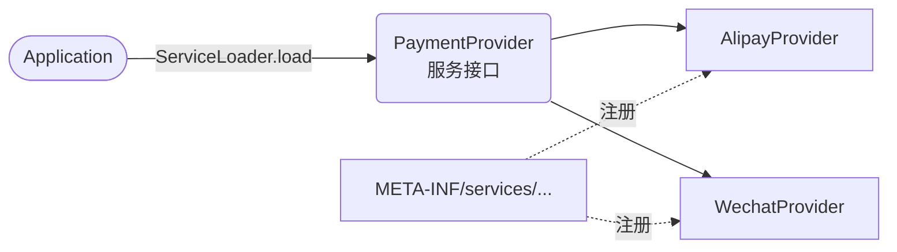

# SPI 与服务发现

支付系统最初只接入了支付宝。后来要增加微信、银联，最直接的写法是在业务代码里加一个 `if/else`，或者用工厂方法 `new` 出具体实现。每增加一个渠道，调用方都要重新编译、重新发布，依赖也会越来越重。

『SPI』（Service Provider Interface）解决的正是这类问题：宿主只依赖一个稳定的服务接口，具体实现由运行时发现。Java 标准库提供的发现机制是 `java.util.ServiceLoader`。它不是依赖注入容器，也不负责管理 provider 的生命周期；它只做一件事：找到注册过的实现，并按需创建对象。



这张图里，接口是稳定契约，配置文件负责登记，`ServiceLoader` 负责发现和实例化。理解这三者的分工，比记住某个配置文件名更重要。

## 本章目标

学完本章，你应该能够：

- 区分 API 与 SPI，判断什么时候需要 SPI。
- 写出服务接口、provider 和 `META-INF/services` 注册文件。
- 使用 `ServiceLoader` 加载、筛选和校验 provider。
- 在 JPMS 中使用 `uses` 和 `provides ... with ...`。
- 处理无实现、重复实现、顺序不确定和类加载器问题。

## SPI 不是 API

API 主要面向调用方，SPI 主要面向实现方。API 告诉你“可以调用什么”，SPI 告诉你“如何接入一个新的实现”。以支付为例，业务代码依赖 `PaymentProvider` 这个接口；支付宝、微信和银联各自提供实现。业务代码不需要知道实现类的全限定名，也不需要在编译期依赖具体 SDK。

| 维度 | API | SPI |
| --- | --- | --- |
| 主要读者 | 应用程序调用者 | 扩展实现者 |
| 依赖方向 | 应用依赖库 | 宿主发现实现 |
| 目标 | 暴露能力 | 允许替换和扩展 |
| 常见例子 | 集合接口、HTTP 客户端 | JDBC Driver、日志实现、插件 |

SPI 适合“实现由依赖或部署决定”的场景，不适合用来替代普通的接口多态。如果所有实现都在同一个代码库、同一个发布单元里，接口加构造器注入或工厂通常更简单。SPI 的价值在于解耦“谁提供实现”，而不是把每一个接口都做成可发现扩展点。

::: tip SPI 不是依赖注入
`ServiceLoader` 只负责发现和实例化 provider。它不会自动注入构造器参数，不会管理单例，也不会替你处理销毁和生命周期。需要这些能力时，应该由依赖注入容器、框架或你自己定义的初始化协议来负责。
:::

## 最小实现

一个完整的 Java SPI 由四部分组成：服务接口、provider 实现、注册文件和消费者。下面以支付渠道为例。

先定义服务接口：

```java
package com.example.pay;

import java.math.BigDecimal;

public interface PaymentProvider {
    String name();

    PaymentResult pay(PaymentCommand command);
}

record PaymentCommand(String orderId, BigDecimal amount) {
}

record PaymentResult(String provider, boolean success) {
}
```

provider 实现接口，并提供一个可访问的无参构造器：

```java
package com.example.pay.alipay;

public final class AlipayProvider implements PaymentProvider {
    public AlipayProvider() {
    }

    @Override
    public String name() {
        return "alipay";
    }

    @Override
    public PaymentResult pay(PaymentCommand command) {
        // 这里调用支付宝 SDK，并把渠道异常转换成本项目的统一结果。
        return new PaymentResult(name(), true);
    }
}
```

然后在 provider 模块的资源目录中登记实现类。文件名必须是服务接口的全限定二进制名：

```text
src/main/resources/META-INF/services/com.example.pay.PaymentProvider
```

文件内容是一行一个 provider 类名：

```text
com.example.pay.alipay.AlipayProvider
com.example.pay.wechat.WechatProvider
```

消费者只依赖服务接口：

```java
ServiceLoader<PaymentProvider> loader =
    ServiceLoader.load(PaymentProvider.class);

PaymentProvider provider = loader.stream()
    .map(ServiceLoader.Provider::get)
    .filter(candidate -> candidate.name().equals("alipay"))
    .findFirst()
    .orElseThrow(() -> new IllegalStateException(
        "未找到支付渠道: alipay"
    ));
```

这里的 `.stream()` 先拿到 provider 的描述，再通过 `get()` 实例化。也可以直接用 `for (PaymentProvider provider : loader)` 遍历，但显式筛选更适合有多个实现的场景。不要用“第一个 provider”表示默认实现；如果业务需要默认渠道，把默认规则写进配置或显式的选择逻辑。

## 加载规则

`ServiceLoader` 的行为有几个关键点，很多线上问题都来自忽略它们。

| 项目 | 规则 | 设计含义 |
| --- | --- | --- |
| 配置位置 | `META-INF/services/<服务全限定名>` | 打包时确认资源文件进入了 JAR |
| 文件格式 | UTF-8；一行一个类名；空行和 `#` 注释会被忽略 | 不要把类名写错或写成简名 |
| 实例化 | 类路径 provider 需要可访问的无参构造器 | provider 不应依赖构造器注入 |
| 模块化 | provider 模块用 `provides`，消费模块用 `uses` | 模块路径和类路径的规则不同 |
| 顺序 | 不要依赖多个来源之间的全局顺序 | 需要优先级时显式排序 |
| 失败 | 配置错误或无法实例化时抛出 `ServiceConfigurationError` | 启动时校验，带上 provider 名称 |
| 缓存 | 已加载的 provider 会被缓存 | 动态替换实现时调用 `reload()` |
| 并发 | `ServiceLoader` 实例不适合多线程共享遍历 | 每个使用点创建独立 loader，或在外层同步 |

provider 必须对负责加载它的类加载器可见。框架和插件系统经常使用自定义类加载器，如果出现“配置文件找到了，但类加载不到”，优先检查文件和 provider 是否来自同一个类加载器范围。`ServiceLoader.load(Service.class)` 使用当前线程的上下文类加载器，也可以使用带 `ClassLoader` 参数的重载显式指定。

::: warning 顺序不是配置契约
某个配置文件里写了两个 provider，不代表在所有运行环境中它们都会以同样顺序出现。需要“优先使用某个实现”时，应该根据 `name()`、能力声明或显式配置做选择，而不是依赖遍历顺序。
:::

## 模块化与类加载器

Java 9 之后，命名模块可以用模块描述符声明服务关系。消费方声明 `uses`，提供方声明 `provides ... with ...`：

```java
module com.example.pay.api {
    exports com.example.pay;
}

module com.example.pay.app {
    requires com.example.pay.api;
    uses com.example.pay.PaymentProvider;
}

module com.example.pay.alipay {
    requires com.example.pay.api;

    provides com.example.pay.PaymentProvider
        with com.example.pay.alipay.AlipayProvider;
}
```

模块化 provider 可以由模块系统实例化，也可以使用 public static 无参 `provider()` 方法作为工厂。具体采用哪种方式，取决于 provider 的构造方式和模块声明。模块路径上的 provider 还必须位于消费方能够发现的范围；只把 JAR 放进普通 classpath，并不等于它会被模块层发现。

类加载器问题通常比配置更难排查。插件框架、应用服务器和热部署环境可能同时存在多个同名接口或多个版本的 provider。症状可能是 `ClassCastException`、`ServiceConfigurationError`，也可能是同一个接口被两个类加载器加载后互不认可。排查时先确认接口、配置文件和 provider 是否在同一个可见范围内，再检查依赖树里是否出现了重复版本。

## 真实场景

JDBC 是最常见的例子：驱动 JAR 通过 `META-INF/services/java.sql.Driver` 注册驱动，应用通常只依赖 `java.sql.Driver` 和 JDBC API。日志门面和序列化框架也经常用类似机制加载绑定或扩展模块。它们的共同点是：宿主代码只依赖稳定接口，具体实现由依赖、部署环境或插件决定。

| 场景 | 服务接口 | provider 的作用 |
| --- | --- | --- |
| JDBC | `java.sql.Driver` | 连接具体数据库 |
| 日志门面 | 日志 provider 接口 | 绑定具体日志实现 |
| 框架扩展 | 框架定义的扩展点 | 增加序列化、校验或处理能力 |

SPI 的边界也很清楚：它解决“发现”，不解决“选择策略”和“运行治理”。多个支付渠道中应该选哪个、失败后是否降级、provider 是否需要健康检查，这些都属于业务或框架层，不应塞给 `ServiceLoader`。

## 常见坑与建议

最常见的问题是注册文件没打进 JAR，或者文件路径和接口名不一致。第二种常见问题是 provider 没有可访问的无参构造器，导致本地 IDE 能运行、打包后启动失败。还有人把 `ServiceLoader` 当成依赖注入容器，结果 provider 拿不到数据库连接、配置或其他服务，只能在内部到处查找全局状态。

| 问题 | 典型表现 | 处理方式 |
| --- | --- | --- |
| 注册文件缺失 | 运行时不报错，但找不到 provider | 检查构建产物中的 `META-INF/services` |
| 类名或接口名写错 | `ServiceConfigurationError` | 用全限定名，并在启动测试中加载一次 |
| provider 无法实例化 | 构造器缺失、不可访问或抛异常 | 提供无参构造器，或改用模块 provider 工厂 |
| 依赖版本冲突 | 同一接口出现多个版本或重复 provider | 检查依赖树，隔离类加载器 |
| 依赖遍历顺序 | 不同环境选中了不同实现 | 根据名称或显式配置选择 |
| provider 有共享状态 | 并发请求互相影响 | provider 保持无状态，或明确生命周期 |
| 启动时才暴露问题 | 线上第一次调用才失败 | 在应用启动阶段做一次发现和校验 |

如果业务需要稳定的扩展机制，建议把 provider 的 `name()`、版本、能力和初始化结果记录下来，在启动阶段统一校验。这样配置错误会在发布前暴露，而不是等到用户触发某个支付渠道时才出现。

## 总结

Java SPI 的核心是“接口稳定、实现可替换、运行时发现”：

- SPI 是给实现方的扩展契约，`ServiceLoader` 是标准发现工具，不是依赖注入容器。
- 类路径使用 `META-INF/services`，模块化项目使用 `uses` 与 `provides`。
- provider 必须可见、可实例化；不要依赖遍历顺序，也不要把生命周期管理交给 `ServiceLoader`。
- 在启动阶段校验实现，在业务层显式选择 provider，并保留清晰的失败信息。

如果只能记住一件事：SPI 解决的是“如何找到实现”，不是“如何管理实现”。

## 参考与出处

1. `ServiceLoader` Java API Documentation（Oracle）
2. 《Effective Java》 Joshua Bloch

## 相关阅读

- [反射、注解与代理](/programming-language/java/reflection)
- [Java 工程实践](/programming-language/java/engineering)
- [设计模式](/software-engineering/design-patterns)
- [Spring](/backend/spring)
