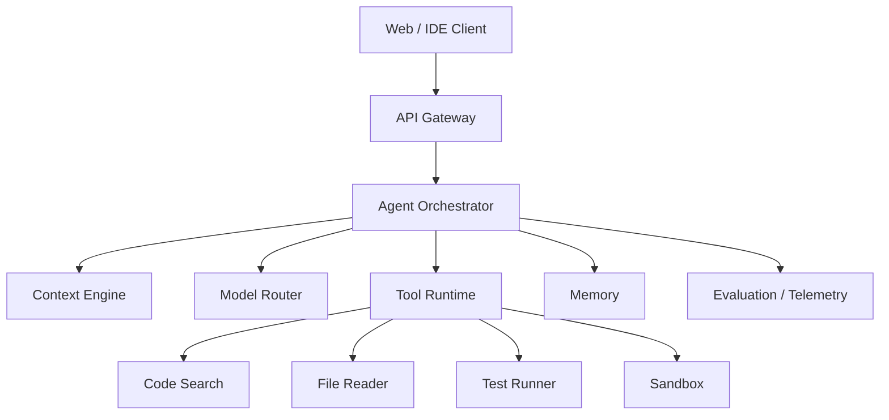
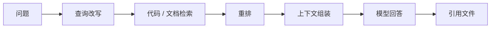
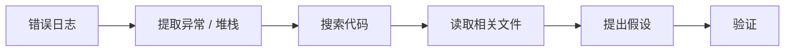
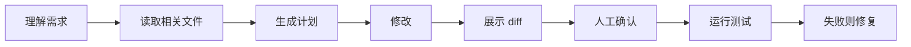
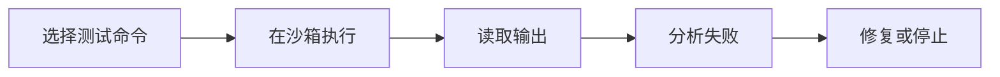

# AI Agent

> 本文以一个“研发助手 Agent”为案例：它能理解代码库、回答技术问题、定位问题、生成补丁并运行测试。

## 本章目标

学完本章，你应该能够：

- 拆解研发助手 Agent 的能力和边界。
- 设计上下文、工具、沙箱和记忆。
- 处理补丁、测试、人工确认和回滚。
- 用评估、trace 和成本指标衡量效果。

## 一、背景与目标

研发团队常见问题：

- 代码库大，新人上手慢。
- 文档分散，找不到准确答案。
- 重复问题消耗资深工程师时间。
- 修改代码后忘记跑测试。
- AI 生成的代码看似合理，但缺少验证。

目标：

- 基于代码库和文档回答问题。
- 能定位相关文件和符号。
- 能生成小范围补丁。
- 能运行测试并读取结果。
- 所有操作可审计、可回滚。

## 二、需求

### 功能需求

- 对话问答。
- 代码检索。
- 文档检索。
- 多文件阅读。
- 生成补丁。
- 运行测试。
- 查看错误日志。
- 会话历史。
- 人工确认和回滚。

### 非功能需求

| 指标 | 目标 |
| --- | --- |
| 准确性 | 回答有引用，不编造 |
| 延迟 | 问答可接受，Agent 任务可控 |
| 安全 | 默认只读，写操作需确认 |
| 可观测 | 每次工具调用可追踪 |
| 成本 | 有预算和模型路由 |
| 可评估 | 有回归集和失败分析 |

## 三、高层架构



### 组件

| 组件 | 职责 |
| --- | --- |
| Gateway | 鉴权、限流、会话 |
| Orchestrator | 计划、循环、停止条件 |
| Context Engine | 代码/文档检索、上下文组装 |
| Model Router | 按任务选模型 |
| Tool Runtime | 工具执行、权限、审计 |
| Sandbox | 隔离代码执行 |
| Memory | 会话和任务状态 |
| Eval | 离线评估和回归 |

## 四、数据模型

```text
conversation
  id, user_id, title, created_at

message
  id, conversation_id, role, content, created_at

agent_run
  id, conversation_id, goal, status, steps, cost, started_at, ended_at

tool_call
  id, run_id, tool_name, arguments, result, status, latency

artifact
  id, run_id, type, path, diff, created_at

eval_case
  id, input, expected, tags, last_result
```

## 五、核心流程

### 1. 代码问答



要求：

- 引用文件和行号。
- 找不到时明确说不知道。
- 不把整仓库塞进上下文。

### 2. 问题定位



工具：

- 日志搜索。
- 代码搜索。
- 文件读取。
- 依赖分析。

### 3. 生成补丁



要求：

- 小步修改。
- 不修改无关文件。
- 每步展示 diff。
- 测试失败不能宣称完成。

### 4. 运行测试



安全：

- 限制命令白名单。
- 限制网络。
- 限制文件系统。
- 设置超时和资源上限。

## 六、关键决策

### 决策 1：Workflow 还是 Agent

问题：研发任务步骤不确定。

方案：

- 外层用 Workflow 管住权限、预算和产物。
- 内层用 Agent 处理探索和修复。

结果：

- 保留灵活性。
- 关键节点可控。

### 决策 2：默认只读

问题：Agent 误改代码或执行危险命令。

方案：

- 默认只读。
- 写文件在独立 worktree。
- 终端命令白名单。
- 危险操作人工确认。

### 决策 3：上下文分层

问题：代码库太大，不能全塞。

方案：

- 当前选区。
- 打开文件。
- 检索结果。
- repo map。
- 诊断和日志。

### 决策 4：模型路由

问题：所有任务用大模型成本高、延迟大。

方案：

- 简单问答用小模型。
- 复杂重构用强模型。
- 工具调用看稳定性和成本。

### 决策 5：评估驱动

问题：改 Prompt 或换模型后无法判断效果。

方案：

- 建立研发任务评估集。
- 记录成功率、测试通过率、延迟、成本。
- 失败案例回流。

## 七、安全边界

- 默认只读。
- 最小权限。
- 沙箱执行。
- 命令白名单。
- 网络限制。
- 文件路径限制。
- 写操作 diff + 确认。
- 敏感信息脱敏。
- 审计每次工具调用。
- 防止仓库内容提示注入。

## 八、可观测性

记录：

- 用户问题。
- 上下文来源。
- 模型和版本。
- Prompt 版本。
- 工具调用和参数摘要。
- 耗时、token、成本。
- 测试结果。
- 失败原因。

指标：

- 任务成功率。
- 首次回答正确率。
- 补丁测试通过率。
- 平均步骤数。
- P95 延迟。
- 单任务成本。
- 人工接管率。

## 九、评估

评估集：

- 代码问答。
- 跨文件定位。
- 小型 bug 修复。
- 测试失败修复。
- 权限不足。
- 危险命令。
- 信息缺失。

指标：

- 回答忠实度。
- 引用准确率。
- 补丁可编译率。
- 测试通过率。
- 无关文件修改率。
- 成本。

## 十、常见失败模式

- 上下文不足，答非所问。
- 检索到无关文件。
- 编造不存在的 API。
- 修改范围过大。
- 不运行测试。
- 测试失败仍宣称完成。
- 无限循环。
- 工具权限过大。
- 成本失控。
- 没有评估集。

## 十一、扩展与演进

| 阶段 | 能力 |
| --- | --- |
| MVP | 代码问答 + 引用 |
| 第二阶段 | 多文件读取 + 问题定位 |
| 第三阶段 | 生成补丁 + 测试验证 |
| 第四阶段 | 多任务并行 + 团队知识库 |
| 第五阶段 | 自定义工具 + 企业权限 |

## 十二、取舍

- 自主性 vs 可控性。
- 上下文大小 vs 延迟和成本。
- 云端模型 vs 本地模型。
- 通用 Agent vs 专用 Workflow。
- 多 Agent vs 单 Agent。

## 十三、项目复盘

做对了什么：

- 先做只读问答，再做写操作。
- 工具有权限和审计。
- 补丁必须经过测试。
- 有评估集。

如果重来：

- 更早建立评估集。
- 更早限制上下文预算。
- 更早把危险命令做成白名单。
- 更早记录每次工具调用。

## AI Agent Review 矩阵

| 维度 | 必须回答 | 不满足时怎么办 |
| --- | --- | --- |
| 必要性 | 任务是否真的需要 Agent？ | 能画流程图就先做 Workflow |
| 停止 | 是否有停止条件和预算？ | 加最大步骤、token 和成本 |
| 上下文 | 上下文来源是否可追溯？ | 记录检索结果和来源 |
| 工具 | 是否最小权限、幂等、可审计？ | 加校验、确认和审计 |
| 修改 | 写操作是否 diff + 确认？ | 加确认 UI 和回滚 |
| 执行 | 是否在沙箱运行？ | 限制命令、网络和路径 |
| 验证 | 是否有测试验证？ | 补测试和失败处理 |
| 观测 | 是否记录模型、Prompt、工具、成本？ | 接入 trace 和指标 |
| 评估 | 是否有评估集和回归？ | 建任务集，失败回流 |
| 恢复 | 是否有回滚和人工接管？ | 加检查点和人工入口 |

## 总结

研发助手 Agent 的核心，是让 AI 的自主性落在可验证的边界里：

- 先做只读问答，再做写操作；写操作必须有 diff、确认和回滚。
- 工具权限、沙箱和审计，决定它能不能进入团队流程。
- 评估集和成本指标，决定它能不能持续优化。

如果只能记住一件事：Agent 的价值不是“能做多复杂的任务”，而是“每个动作都可验证、可回滚、可解释”。

## 相关阅读

- [AI 工程](/ai-engineering/)
- [Agent](/ai-engineering/agent)
- [Tool Calling](/ai-engineering/tool-calling)
- [RAG](/ai-engineering/rag)
- [Evaluation](/ai-engineering/evaluation)
