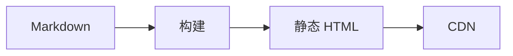
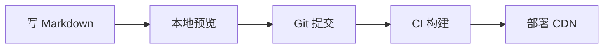
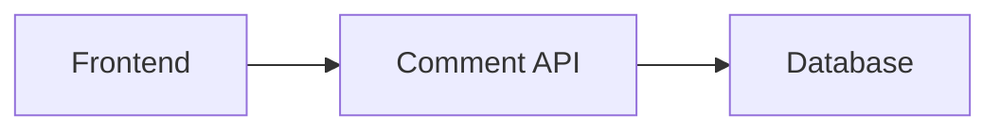
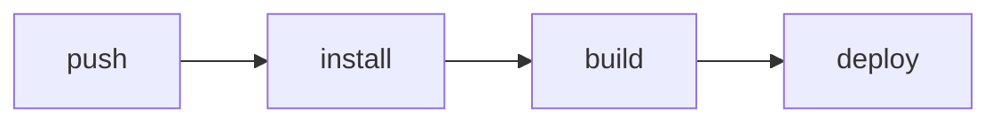

# 博客

> 博客项目的重点不是“做一个网站”，而是“建立一套低成本、可持续的内容生产与发布系统”。

博客项目的真正难点不是页面，而是“内容流水线”：写作要简单，发布要可重复，搜索和评论要低成本，SEO 要可持续，部署要可回滚。很多博客项目最后死于“技术太多、内容太少”，因为一开始就做了复杂后台。

个人博客优先静态站。需要评论、搜索时，用外部服务或轻量 API 补足。

## 本章目标

学完本章，你应该能够：

- 判断博客该用静态站还是动态站。
- 设计 Markdown 内容流水线和发布流程。
- 处理搜索、评论、SEO 和性能。
- 设计部署、安全和回滚。

## 需求

功能需求包括 Markdown 写作、文章分类/标签/归档、全文搜索、代码高亮、RSS/sitemap、评论、阅读统计和后台发布。非功能需求看速度、可用性、成本、SEO、写作体验和安全。

| 指标 | 目标 |
| --- | --- |
| 访问速度 | 首屏快，静态资源可缓存 |
| 可用性 | 静态站高可用 |
| 成本 | 低，最好接近免费 |
| SEO | 可被搜索引擎抓取 |
| 写作体验 | 简单、版本可控 |
| 安全 | 防 XSS、垃圾评论 |

## 架构选择

静态站是 Markdown → 构建 → 静态 HTML → CDN。它快、便宜、安全面小、容易部署、内容可用 Git 管理；代价是评论、搜索、统计需要额外服务，构建时间随内容增长，动态能力弱。



动态站是 Browser → Web Server → Database。它动态能力强，后台、评论、搜索一体化；代价是需要运维，性能和安全的成本更高。

::: tip 先静态，后动态
个人博客的内容频率和交互需求通常撑不起一个动态后台。先用静态站把内容跑起来，再按真实需求补搜索、评论或后台，不要一开始就做复杂系统。
:::

## 内容流水线与数据模型

内容流水线是写 Markdown → 本地预览 → Git 提交 → CI 构建 → 部署 CDN。原则是内容即代码：每篇文章有 frontmatter，草稿和发布分离，构建失败不发布，保留历史版本。



```yaml
---
title: 如何设计缓存
description: 从缓存模式到穿透、击穿和雪崩。
date: 2026-11-09
tags: [cache, system-design]
draft: false
---
```

即使是静态站，也可以设计内容模型：Post、Tag、Comment、PageView 各自的字段和状态。数据模型清楚，后面接评论、搜索和统计时才不会乱。

| 实体 | 字段 |
| --- | --- |
| Post | id、title、slug、description、content、date、tags、draft |
| Tag | name、slug |
| Comment | id、postId、author、content、createdAt、status |
| PageView | postId、date、count |

## 搜索、评论与 SEO

静态搜索在构建时生成索引，浏览器端加载并搜索，无后端、快，但索引体积大、中文分词弱。外部搜索（Algolia、Meilisearch、Elasticsearch）适合内容多、需要中文分词、拼写纠错和相关性调优的场景。

评论可以用 Giscus、Disqus、Utterances 这类第三方服务，省事但依赖第三方、样式和隐私受限；自建评论需要处理垃圾评论、XSS、限流、审核和通知。



SEO 要覆盖每页的 title、description、canonical，生成 sitemap 和 RSS，语义化 HTML，Open Graph/Twitter Card，结构化数据，友好 URL，内链和图片 alt。

::: warning 评论是博客最大的安全面
评论内容要转义、限流、审核，Markdown 渲染要防 XSS；不要在前端暴露密钥，依赖定期更新。评论系统比文章本身更容易出安全问题。
:::

## 性能、部署与安全

性能手段包括静态生成、CDN、图片压缩（WebP/AVIF）、懒加载、代码分割、字体优化、缓存头和避免第三方脚本阻塞。

部署常见方案是 GitHub Pages、Cloudflare Pages、Vercel、Netlify 或对象存储 + CDN。CI 流程是 push → install → build → deploy。要注意构建产物可复现、环境变量和密钥安全、部署失败可回滚、自定义域名和 HTTPS。



安全要覆盖 Markdown 渲染防 XSS、评论转义、限流和审核、不暴露前端密钥、依赖更新、内容备份。博客内容本身也要有备份和版本管理，不能只依赖托管平台。

## Blog Review 矩阵

| 维度 | 必须回答 | 不满足时怎么办 |
| --- | --- | --- |
| 写作 | 发布流程是否简单可重复？ | 简化 frontmatter 和 CI |
| 构建 | 构建是否可复现、失败是否拦截？ | 固定版本，构建失败不发布 |
| SEO | 是否有 sitemap、RSS、canonical？ | 补 SEO 基础件 |
| 性能 | 图片、脚本、缓存是否优化？ | 加压缩、懒加载和缓存头 |
| 搜索 | 方案是否匹配内容规模？ | 先本地索引，规模大再外部搜索 |
| 评论 | 是否防 XSS、限流、审核？ | 补安全和审核流程 |
| 部署 | 是否可回滚、有 404 和 HTTPS？ | 加回滚和域名配置 |
| 备份 | 内容是否有版本和备份？ | Git 管理 + 异地备份 |

## 总结

博客项目的核心，是可持续的内容生产与发布：

- 静态站优先，动态能力按真实需求补。
- 内容即代码：frontmatter、草稿分离、构建失败不发布。
- 搜索、评论、SEO 和性能，都按规模逐步演进。

如果只能记住一件事：博客项目的上限不是技术，而是“写作是否可持续”。

## 相关阅读

- [系统设计](/system-design/)
- [缓存](/system-design/cache)
- [CI/CD](/software-engineering/ci-cd)
- [代码规范与工程实践](/software-engineering/code-quality)
