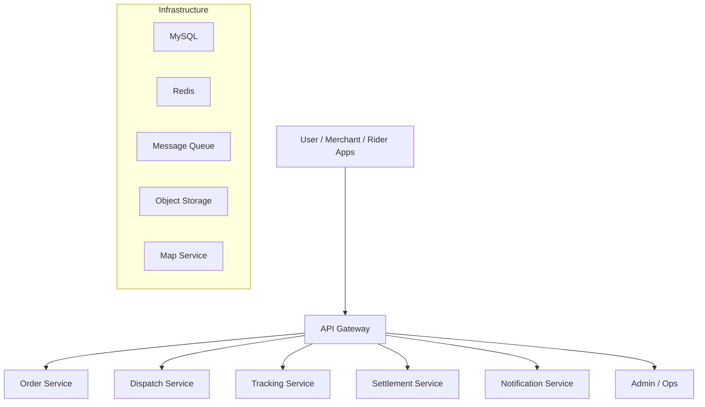
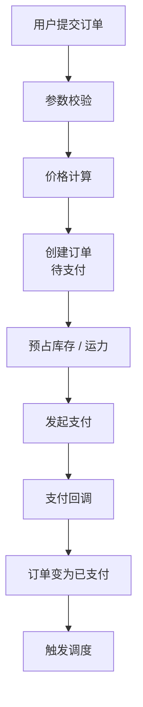

# Delper

> 本文把 Delper 作为“配送/履约平台”的项目代号来复盘。若你的实际项目定位不同，可以把业务模块映射成对应的订单、任务和结算领域。

## 本章目标

学完本章，你应该能够：

- 拆解配送/履约平台的角色和需求。
- 设计订单、调度、轨迹和结算流程。
- 处理支付回调、派单和状态更新的幂等。
- 识别热点商家、轨迹写入和结算对账的瓶颈。

## 一、背景与目标

Delper 的目标是连接用户、商家、骑手和运营：

- 用户下单。
- 商家接单/出餐。
- 平台调度骑手。
- 骑手取货、配送。
- 用户查看轨迹。
- 平台结算。

核心目标：

- 订单不丢、不重。
- 调度公平且高效。
- 轨迹可追踪。
- 结算准确。
- 异常可处理。

## 二、需求

### 角色

| 角色 | 核心能力 |
| --- | --- |
| 用户 | 下单、支付、查看进度、取消、评价 |
| 商家 | 接单、出餐、异常处理 |
| 骑手 | 接单、取货、送达、上报异常 |
| 运营 | 调度、监控、干预、结算 |

### 非功能需求

| 指标 | 目标 |
| --- | --- |
| 可用性 | 下单和配送状态高可用 |
| 延迟 | 下单、状态更新低延迟 |
| 一致性 | 订单/支付/结算强一致或可对账 |
| 吞吐 | 支持峰值订单和轨迹上报 |
| 可追踪 | 全链路 traceId |
| 安全 | 权限、隐私、防刷 |

## 三、高层架构



### 服务职责

| 服务 | 职责 |
| --- | --- |
| Order | 订单创建、状态机、取消、查询 |
| Dispatch | 骑手匹配、派单、改派 |
| Tracking | 位置上报、轨迹查询、电子围栏 |
| Settlement | 计费、结算、对账 |
| Notification | 推送、短信、站内信 |
| Admin | 运营干预、监控、配置 |

## 四、数据模型

### 订单

```text
order
  id
  user_id
  merchant_id
  status
  total_amount
  delivery_fee
  created_at
  paid_at
  delivered_at
  version
```

### 配送任务

```text
delivery_task
  id
  order_id
  rider_id
  status
  assigned_at
  picked_up_at
  delivered_at
  version
```

### 轨迹点

```text
rider_location
  rider_id
  latitude
  longitude
  reported_at
```

轨迹数据量大，适合按时间分区或写入时序/列式存储；实时位置可以放 Redis。

### 结算单

```text
settlement
  id
  order_id
  rider_id
  amount
  status
  created_at
```

## 五、核心流程

### 1. 下单



关键：

- 创建订单幂等。
- 支付回调幂等。
- 价格计算可追溯。
- 状态机只允许合法转换。

### 2. 调度


评分考虑：

- 距离。
- 当前负载。
- 方向。
- 历史准时率。
- 公平性。

### 3. 配送


每次状态变更：

- 校验当前状态。
- 记录时间。
- 发领域事件。
- 通知相关方。

### 4. 轨迹

- 骑手端定期上报位置。
- 服务端写实时位置和轨迹。
- 用户查询最新位置或历史轨迹。
- 电子围栏判断到达/异常。

### 5. 结算

- 订单完成后生成结算单。
- 计算配送费、补贴、罚款。
- 对账。
- 打款。
- 异常人工处理。

## 六、关键决策

### 决策 1：订单状态机

问题：订单状态多，容易被并发更新写乱。

方案：

- 枚举状态。
- 只允许合法转换。
- 乐观锁版本号。
- 状态变更记录事件。

结果：

- 避免“已取消又被支付”等非法状态。
- 便于审计和排查。

### 决策 2：支付回调幂等

问题：支付平台可能重复回调。

方案：

- 支付流水号唯一约束。
- 回调处理幂等表。
- 订单状态机。
- 重复回调直接返回成功。

### 决策 3：调度异步化

问题：下单主流程不应等待骑手匹配。

方案：

- 支付成功后发消息。
- Dispatch 消费消息并派单。
- 失败重试和死信。

代价：

- 最终一致。
- 需要监控派单延迟。

### 决策 4：轨迹与订单分离

问题：高频位置上报不能拖垮订单库。

方案：

- 实时位置放 Redis。
- 历史轨迹写对象存储/时序库。
- 订单库只存关键节点。

## 七、一致性与幂等

| 场景 | 方案 |
| --- | --- |
| 创建订单 | 请求 ID 幂等 |
| 支付回调 | 流水号唯一 + 状态机 |
| 派单 | 任务 ID 幂等 + 骑手接单锁 |
| 状态更新 | 版本号 / CAS |
| 结算 | 唯一结算单 + 对账 |
| 消息消费 | 消费幂等表 |

## 八、扩展与瓶颈

| 瓶颈 | 方案 |
| --- | --- |
| 订单写入 | 分库分表、按用户/商家分片 |
| 派单计算 | 异步、缓存候选骑手、地理索引 |
| 轨迹写入 | 批量、分区、冷热分离 |
| 通知风暴 | 消息队列、批量、限流 |
| 结算 | 离线批处理、对账 |
| 热点商家 | 限流、排队、动态运力 |

## 九、监控

- 下单成功率。
- 支付成功率。
- 派单时长。
- 骑手接单率。
- 配送超时率。
- 轨迹上报延迟。
- 结算差异。
- 消息积压。

## 十、故障复盘

假设一次故障：

> 支付回调重复投递，导致订单重复进入派单。

根因：

- 回调没有幂等。
- 派单消费没有去重。

修复：

- 支付流水号唯一约束。
- 回调幂等表。
- 派单任务唯一键。
- 消费幂等。

改进：

- 补充重复回调测试。
- 监控重复派单。
- 对账任务。

## 十一、取舍

- 下单主流程优先可用和低延迟，派单异步化。
- 订单状态强一致，通知和轨迹最终一致。
- 实时位置用 Redis，历史轨迹用低成本存储。
- 调度算法先简单可解释，再逐步优化。
- 结算优先准确，允许 T+1 对账。

## 十二、常见错误

- 支付回调不幂等。
- 订单状态没有状态机。
- 派单和订单强耦合。
- 轨迹写进订单库。
- 结算没有对账。
- 消息消费不幂等。
- 不做热点商家治理。
- 监控只看机器指标，不看业务指标。

## Delper Review 矩阵

| 维度 | 必须回答 | 不满足时怎么办 |
| --- | --- | --- |
| 订单 | 状态机是否完整、转换是否受控？ | 用枚举状态 + 版本号 |
| 支付 | 回调是否幂等、重复如何处理？ | 加流水号唯一约束和幂等表 |
| 派单 | 是否异步、可重试、可改派？ | 用 MQ + 任务状态 + 超时改派 |
| 状态 | 更新是否防并发覆盖？ | 用 CAS/版本号 |
| 轨迹 | 是否与订单存储分离？ | 实时 Redis + 历史冷存储 |
| 结算 | 是否唯一、可对账？ | 加唯一结算单和对账任务 |
| 消息 | 消费是否幂等？ | 加消费幂等表 |
| 热点 | 热点商家/骑手如何治理？ | 限流、排队、动态运力 |
| 观测 | 是否监控业务指标？ | 下单成功率、派单时长、超时率 |
| 恢复 | 是否有故障演练和回滚？ | 写 runbook，定期演练 |

## 总结

Delper 的核心，是把履约链路做成“不丢、不重、可追踪、可结算”：

- 订单状态用状态机管理，支付回调、派单和消息消费全部幂等。
- 轨迹与订单存储分离，结算用唯一约束和对账兜底。
- 调度先简单可解释，再逐步优化；热点和异常要有治理。

如果只能记住一件事：配送平台的稳定性，不靠某个智能算法，而靠状态机、幂等和对账这三件朴素的事。

## 相关阅读

- [系统设计](/system-design/)
- [消息队列](/system-design/message-queue)
- [一致性](/system-design/consistency)
- [数据库设计](/system-design/database-design)
