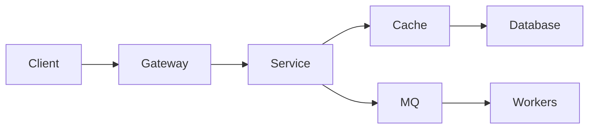

# 项目深度解析

> 项目经历的价值不在于“用了什么技术”，而在于“在什么约束下做了什么决策，结果如何”。

很多人写项目时只列技术栈：“使用 Spring Boot、Redis、MySQL、RabbitMQ 实现了订单系统。”这不能说明能力。更好的写法是：“订单峰值 QPS 是 3000，原方案在支付回调重复投递时会产生重复扣款。我们通过幂等键、状态机和唯一约束解决，最终把重复扣款降到 0，同时把支付回调处理延迟控制在 200ms 以内。”

前者证明参与过，后者证明工程判断。

## 本章目标

学完本章，你应该能够：

- 用背景、约束、方案、取舍和指标复盘项目。
- 区分“做了什么”“怎么做的”和“为什么这样做”。
- 把项目写成面试和简历可用的证据。
- 识别只堆技术栈的项目表达。

## 项目展示的三个层次

| 层次 | 内容 | 价值 |
| --- | --- | --- |
| 做了什么 | 功能、技术栈 | 只能证明参与过 |
| 怎么做的 | 架构、流程、关键代码 | 证明实现能力 |
| 为什么这样做 | 约束、取舍、指标、复盘 | 证明工程判断 |

面试和简历更应该展示第三层。同一件事，换个叙述方式，价值完全不同：

> “我用 Redis 缓存商品详情。”
>
> “商品详情读多写少，热点 SKU 缓存命中率 92%，但更新时出现旧值回写。最终采用先写数据库再删缓存、CDC 失效兜底，P95 从 480ms 降到 90ms。”

## 一个可复用的复盘模板

复盘不是写故事，而是回答一组问题：

| 部分 | 要回答的问题 |
| --- | --- |
| 背景与目标 | 业务背景、用户、核心痛点、成功标准 |
| 约束 | 时间、团队、技术栈、预算、合规、现有系统 |
| 需求 | 功能路径、非功能指标（可用性、延迟、一致性、安全、成本） |
| 架构 | 模块边界、依赖方向、数据流、关键组件 |
| 核心流程 | 登录/下单/支付/搜索等关键路径，正常和失败路径 |
| 关键决策 | 问题、选项、选择、理由、代价、结果 |
| 指标 | QPS/延迟/错误率、成本、转化率、故障恢复时间 |
| 故障复盘 | 出过什么问题、根因、修复、如何防止再次发生 |
| 如果重来 | 哪些决策会改变、哪些复杂度可以删掉 |

架构和核心流程可以用 Mermaid 表达：

图之后要说明关键路径：请求如何进入系统、失败如何重试、一致性如何保证。不要只丢一张图。

## 常见错误与取舍

常见错误包括：只列技术栈不讲问题；只讲成功不讲失败和取舍；指标缺失，无法证明效果；把团队成果全部写成个人成果；架构图很复杂，但说不清核心流程；过度设计，无法解释为什么需要；不说明约束，方案看起来“理所当然”；不复盘，重复踩坑。

取舍是项目复盘的核心。要说明一致性 vs 可用性、延迟 vs 成本、简单 vs 灵活、自建 vs 托管、同步 vs 异步。没有取舍的方案，通常只是还没想到代价。

::: tip 项目复盘要包含“如果重来”
“如果重来会怎么改”是最能体现判断力的部分：哪些决策会变，哪些复杂度可以删掉，哪些应该更早做。它证明你从项目中学到了东西，而不是只是完成了任务。
:::

## 本项目章节

- [博客](/projects/blog)：内容系统、SEO、搜索、评论、部署。
- [Delper](/projects/delper)：配送/履约平台的订单、调度、轨迹和结算。
- [AI Agent](/projects/ai-agent)：工具、记忆、RAG、Workflow、评估与安全。

## 怎么读这些案例

1. 先自己画一版架构。
2. 再对照案例，找出差异。
3. 问自己：如果规模扩大 10 倍，哪里先坏？
4. 问自己：如果要求强一致，方案怎么改？
5. 问自己：如果预算减半，哪些组件可以删？

## Projects Review 矩阵

| 维度 | 必须回答 | 不满足时怎么办 |
| --- | --- | --- |
| 背景 | 项目解决什么真实问题？ | 回到业务目标，不写功能清单 |
| 约束 | 时间、团队、技术栈、预算是什么？ | 说明边界，否则方案像理所当然 |
| 决策 | 关键决策是否有选项和代价？ | 补“考虑过什么、放弃了什么” |
| 指标 | 是否有可量化结果？ | 补延迟、错误率、成本或业务指标 |
| 失败 | 是否复盘故障和返工？ | 写根因和改进，不只讲成功 |
| 贡献 | 个人贡献是否清楚？ | 区分“我做了”和“团队做了” |
| 演示 | 是否有 README、架构图和 Demo？ | 先补材料，再谈项目 |

## 总结

项目复盘的核心，是让技术决策可解释：

- 先说问题和约束，再说方案和取舍。
- 用指标证明结果，用失败复盘证明学习。
- 展示“为什么这样做”，而不只是“做了什么”。

如果只能记住一件事：面试官不是在听你介绍技术栈，而是在判断你能不能把一个复杂问题做对、讲清、复盘。

## 相关阅读

- [系统设计](/system-design/)
- [代码规范与工程实践](/software-engineering/code-quality)
- [架构](/software-engineering/architecture)
- [AI 工程](/ai-engineering/)
