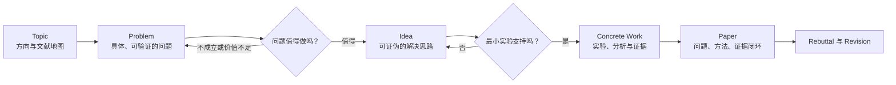

# 科研

> 科研不是从写论文开始，而是从找到一个值得回答、能够被证据检验的问题开始。

刚进入课题组时，常见的工作方式是：拿到几篇论文，从头读到尾；看到一个方向有空白，就急着想新方法；实验跑出结果后，再回头补动机。这样也能写出代码，但很难形成一篇有说服力的工作，因为问题、方法和证据没有连成一条线。

这篇总览把科研拆成一条可以回退的流程：先建立『Topic』，把宽泛方向收窄成『Problem』，再提出可证伪的『Idea』，用最小实验验证，最后把证据组织成论文。每一步都可能回到上一步。真正的研究进展，往往来自这种回退，而不是一次向前走完。

## 本章目标

学完本章，你应该能够：

- 用 TPIC 描述一项研究从方向到论文的完整路径。
- 判断一个研究问题是否具体、重要并且可以被证据检验。
- 区分文献综述、方法创新和实验验证各自要解决的问题。
- 识别科研中最常见的失败模式，并知道应该回到哪一步修正。
- 选择适合自己的下一章，开始推进一个真实研究任务。

## 科研的完整回路

AI 领域的科研通常可以概括为 TPIC：`Topic -> Problem -> Idea -> Concrete Work`，之后再进入论文写作、投稿和 Rebuttal。不过它不是一条只向前的流水线。问题不值得做，要回到 Topic；最小实验不支持 Idea，要回到 Idea；实验无法回答论文声称的问题，要重新设计证据。

看这张图时，重点不是记住箭头，而是看三个回退点。它们决定了研究是在积累证据，还是在不断给一个尚未成立的假设补理由。

| 阶段 | 主要任务 | 阶段产物 | 进入下一阶段的条件 |
| --- | --- | --- | --- |
| Topic | 建立领域地图，理解主流问题和常用方法 | 文献列表、代表工作、Benchmark 与代码 | 能说清这个方向在解决什么，以及哪些问题仍未解决 |
| Problem | 把宽泛方向收窄成具体问题 | 问题陈述、反例、评价方式 | 问题真实存在，且能用实验或理论结果判断是否解决 |
| Idea | 提出可能解决问题的机制 | 可证伪的假设、方法草案 | 能说明为什么它可能有效，以及什么结果会推翻它 |
| Concrete Work | 设计并运行验证实验 | 主结果、消融、分析、失败案例 | 证据足以支撑论文的核心 claim |
| Paper | 把研究组织成可审阅的论证 | 图表、正文、引用与回复 | 读者能沿着问题、方法、证据复述你的贡献 |

## 一个研究问题要满足什么

『研究问题』不是一句宽泛的愿望，例如“让大模型更可靠”或“提升 Agent 的能力”。这些问题可以作为方向，但不能直接指导实验。一个可执行的问题需要说明：在什么场景下，现有方法为什么不够，解决后用什么指标判断。

可以用四个维度检查问题：

| 维度 | 必须回答 | 不满足时怎么办 |
| --- | --- | --- |
| 真实性 | 这个问题在真实数据、任务或系统中存在吗？ | 找失败案例、复现实验，不要只根据论文里的空白推断 |
| 重要性 | 解决它会影响性能、成本、可靠性或理解中的哪一项？ | 回到领域瓶颈和真实应用，不要为了发论文制造问题 |
| 可检验性 | 什么结果能证明问题被解决，什么结果会推翻你的判断？ | 先定义指标和对照实验，再改方法 |
| 边界 | 方法在哪些假设下成立，在哪些场景下不成立？ | 补失败案例和限制分析，不要只展示最好结果 |

问题越具体，越容易做出扎实的工作。把一个大问题做成一个完整的小问题，通常比把一个宏观问题做成浅尝辄止的方案更有价值。

## 各阶段真正交付什么

读了很多论文，不等于已经有了研究进展。每个阶段都应该留下能被别人检查的产物：Topic 阶段是一张文献地图；Problem 阶段是一段带反例的问题陈述；Idea 阶段是一个可以被推翻的假设；Concrete Work 阶段是一组能支撑结论的实验；论文阶段是一条没有断点的论证。

这也解释了为什么“先做实验，最后再补故事”通常效果不好。论文不是实验结果的包装，而是研究问题的证据组织。实验开始前没有想清楚要证明什么，最后很容易得到很多数字，却不知道哪一个数字能支撑核心贡献。

::: tip 先写一页研究备忘录
开始实验前，用一页纸写清四件事：要解决的问题、现有方法的失败原因、你的核心假设、什么结果会让你放弃当前 Idea。实验过程中可以改，但每次改动都要说明为什么改。
:::

## 常见失败模式

- 用方法找问题：先决定要用某个模型或技巧，再为它寻找应用场景。这样容易做出增量式拼接，却说不清为什么这个问题值得解决。
- 把读论文当成研究：持续增加阅读量，却没有形成问题、假设和可检验的判断。
- 只追 SOTA：主结果提高了，但没有解释提升来自哪个机制，也没有说明在哪些情况下会失败。
- 证据和 claim 脱节：论文声称解决稳健性，实验却只报告平均准确率；论文声称降低成本，却没有延迟、显存或吞吐数据。
- 最后才组织故事：研究过程中没有持续记录动机和证据，写作时只能把实验结果拼成一篇说明文。

## 建议阅读顺序

如果你刚开始做科研，先读文献和精读方法，再进入问题与实验：

1. [文献检索与精读](/research/literature)：建立领域地图，把论文读成可复用的判断。
2. [问题、Idea 与实验](/research/idea-and-experiment)：从失败案例和矛盾中找问题，用最小实验验证假设。
3. [学术汇报与 Meeting](/research/communication)：把进展整理成可讨论的材料，及时暴露问题。
4. [从结果到论文](/research/writing)：把问题、方法、证据组织成完整论证。
5. [Rebuttal](/research/rebuttal)：在有限篇幅内回应质疑，修正论文中的真实问题。
6. [论文阅读](/papers/)：结合具体论文做精读笔记。

## 总结

科研的主线可以压缩成四句话：

- Topic 提供地图，Problem 决定研究是否值得做，Idea 提出可证伪的解法，Concrete Work 提供证据。
- 问题、方法和实验必须互相回答，而不是各自独立地追求“新”和“高”。
- 每个阶段都要留下可检查的产物，否则很容易把忙碌误认为进展。
- 论文写作不是研究的最后包装，而是对整条论证链的最后一次检查。

如果只能记住一件事：先找到能用证据回答的问题，再决定用什么方法。

## 相关阅读

- [文献检索与精读](/research/literature)
- [问题、Idea 与实验](/research/idea-and-experiment)
- [从结果到论文](/research/writing)
- [原始科研仓库](https://github.com/Siborne/how-to-research)
