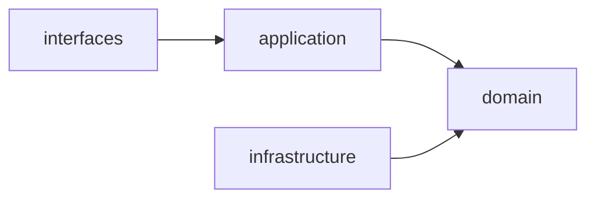

# 架构

> 架构不是画出来的框图，而是那些“以后很难改”的决策。

架构讨论最容易变成技术选型会：用 Spring Cloud 还是单体，用 Kafka 还是 RabbitMQ，用微服务还是模块化单体。但真正难改的往往不是产品名，而是边界：哪些模块必须一起发布，哪些数据必须强一致，哪些团队要独立交付，哪些依赖方向不能反过来。

架构的价值，是让系统在变化时仍然可控。好的架构不是组件最多，而是边界清楚、依赖稳定、失败可隔离、演进有路径。

## 本章目标

学完本章，你应该能够：

- 识别架构中真正难改的决策。
- 用质量属性和约束驱动架构设计。
- 判断模块边界、依赖方向和分布式单体风险。
- 用 ADR 记录关键取舍。

## 架构到底在决定什么

架构关注系统由哪些模块组成、模块之间如何依赖和通信、数据如何流动和存储，以及系统如何满足性能、可用性、安全性、可维护性等质量属性。它还决定团队如何分工、如何独立交付。

做架构决策前，先明确驱动因素：功能需求、质量属性、约束、变化方向和团队边界。没有质量属性的架构讨论，最后很容易变成“哪个技术更时髦”。

| 驱动因素 | 要回答的问题 |
| --- | --- |
| 功能需求 | 系统必须提供哪些能力？ |
| 质量属性 | 性能、可用性、一致性、安全、成本，哪个最重要？ |
| 约束 | 团队规模、交付时间、既有技术栈、合规要求 |
| 变化方向 | 哪些部分最可能变化？哪些必须稳定？ |
| 团队边界 | 哪些团队可以独立开发、部署和运维？ |

## 模块化与依赖方向

高内聚是模块内部围绕同一个职责变化；低耦合是模块之间尽量少知道对方细节。判断标准很实际：修改一个业务规则，是否主要集中在一个模块？修改 A 模块，是否经常需要改 B 模块？模块之间是否直接依赖对方的数据库表或内部类？

依赖应该指向更稳定的抽象，而不是易变的基础设施。常见分层是 interfaces → application → domain，infrastructure 实现 domain 定义的端口；领域层不依赖数据库、HTTP、消息队列和第三方 SDK。

六边形架构（端口与适配器）把业务放在中心：端口是业务需要的接口，适配器是 MySQL、支付宝客户端、HTTP Controller 等技术实现。好处是业务逻辑可以脱离框架测试，替换外部依赖时不需要改领域模型。

## 单体、模块化单体与微服务

| 形态 | 优点 | 代价 | 适用场景 |
| --- | --- | --- | --- |
| 单体 | 简单、事务清晰、部署容易 | 模块边界容易腐化，团队协作受限 | 早期产品、小团队 |
| 模块化单体 | 保留单体部署简单性，同时强调模块边界 | 需要纪律和架构约束 | 大多数业务系统的默认选择 |
| 微服务 | 独立部署、独立扩展、团队自治 | 分布式复杂度、运维成本、数据一致性 | 多团队、大规模、独立演进 |

不要因为“微服务流行”就直接上微服务。优先考虑模块化单体，等边界和团队真正需要时再拆。

分布式单体是最糟糕的组合：服务拆开了，但数据库共享；每次发布必须多个服务一起上线；服务之间强同步调用，形成长链路；一个服务故障导致全链路不可用。判断方法很直接：如果这些“微服务”必须一起部署、一起回滚、共享数据库，那它们实际上还是一个单体。

::: warning 分布式单体比单体更难维护
它同时拥有单体的耦合和微服务的运维成本。拆服务之前，先确认数据边界、团队边界和发布边界是否真的独立；否则只是把单体拆成了多个进程。
:::

## 通信、数据与演进

同步通信适合需要立即结果、调用链较短的场景，但必须考虑超时、重试、幂等、熔断、降级和追踪。异步通信适合解耦、削峰和最终一致，但必须考虑消息丢失、重复消费、顺序、死信和 outbox。同步和异步不是“先进/落后”，而是不同的失败模型。

数据架构要明确：单库单表适合早期系统；服务独立数据库降低耦合，但带来分布式事务和查询复杂度；共享数据库通常意味着隐式耦合；跨服务查询优先考虑 API 组合、读模型或数据同步，而不是直接 join 别人的库。

API 要明确契约、错误码、分页、幂等和版本演进。对外接口要有鉴权、限流和审计；内部接口要有超时、重试和契约测试。

架构不是一次性设计完的，而是持续演进。常用手段包括绞丝者模式、功能开关、并行运行、防腐层和 ADR。ADR 记录背景、选项、决策和后果，让后来的人知道“为什么当时这样选”，而不是只看到结果。

::: details 小问题：ADR 需要写多长？
不需要写成论文。至少写清背景、考虑过的选项、最终决策、后果和风险。重点是让未来的人能理解取舍，而不是复述代码。
:::

## Architecture Review 矩阵

| 维度 | 必须回答 | 不满足时怎么办 |
| --- | --- | --- |
| 边界 | 模块职责和依赖方向是否清晰？ | 重画边界，消除循环依赖 |
| 质量 | 最重要的质量属性是什么？ | 先定义指标，再选方案 |
| 部署 | 是否存在分布式单体？ | 合并发布或拆数据边界 |
| 通信 | 同步/异步的失败模型是否明确？ | 加超时、重试、幂等和降级 |
| 数据 | 一致性方案是否明确？ | 选事务、Saga 或 outbox |
| 演进 | 是否支持灰度和回滚？ | 加开关、并行运行和 ADR |
| 运维 | 是否有可观测性和故障预案？ | 加日志、指标、追踪和演练 |

## 总结

架构的核心，是管理难改的决策：

- 先明确质量属性和约束，再选组件和形态。
- 优先模块化单体，边界和团队真正独立后再拆服务。
- 依赖指向稳定抽象，演进要有灰度和回滚。

如果只能记住一件事：架构不是组件图，而是边界、依赖和变化方向的长期选择。

## 参考与出处

1. 《架构整洁之道》 Robert C. Martin
2. 《代码大全》 Steve McConnell

## 相关阅读

- [DDD](/software-engineering/ddd)
- [设计模式](/software-engineering/design-patterns)
- [系统设计](/system-design/)
- [工程实践](/software-engineering/engineering-practice)
