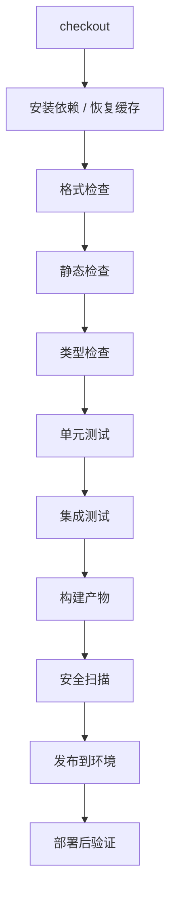

# CI/CD

> CI/CD 的目标不是“自动化部署”，而是让每次变更都能快速、可重复、可回滚地到达用户。

很多团队把 CI/CD 理解成“提交后自动跑一下脚本”，但流水线经常红着、测试不稳定、产物每个环境重新构建、发布只能靠某个人手动操作。这样的自动化只是把手工步骤搬到了脚本里，没有降低风险。

真正的 CI/CD 要回答：这次变更能不能快速验证，产物是不是同一个，发布失败能不能回滚，数据库变更会不会破坏旧版本。它是一条从提交到生产的可重复路径，而不是一个部署按钮。

## 本章目标

学完本章，你应该能够：

- 设计一条从提交到部署的可重复流水线。
- 区分持续集成、持续交付和持续部署。
- 设置质量门禁、产物管理和回滚策略。
- 识别流水线中的常见反模式。

## CI、持续交付与持续部署

| 概念 | 含义 | 关键问题 |
| --- | --- | --- |
| CI（持续集成） | 频繁合并代码，并自动构建、检查和测试 | 变更能否快速验证？ |
| CD（持续交付） | 每次变更都处于可发布状态，但由人决定何时发布 | 发布是否随时可做？ |
| CD（持续部署） | 通过所有门禁后自动发布到生产 | 是否具备足够的自动验证和回滚能力？ |

持续交付不等于每次提交都上线；它意味着“想上线时，随时可以安全上线”。持续部署要求更高的自动验证和回滚能力，不适合所有团队。

## 流水线设计

原则是越便宜、越快的检查越靠前；失败就停止；每一步有清晰日志；产物只构建一次，后续环境复用同一个产物。

流水线慢会直接导致团队绕过它。优化顺序是并行化、缓存、测试分层、测试分片、只跑受影响范围和失败快。如果 CI 经常超过 15 分钟，团队就会开始“先合并再说”，质量门禁会失效。

::: tip 先用缓存和并行，再考虑减少检查
流水线慢时，不要第一反应删测试或跳过检查。先看依赖缓存、构建缓存、测试分片和并行任务；大多数慢流水线是重复下载、重复构建和串行执行造成的。
:::

## 产物、环境与部署策略

同一个构建产物应该依次经过测试、预发和生产，而不是在每个环境重新构建。产物要不可变，有唯一版本号；配置通过环境变量或配置中心注入，不打进产物；生产发布的产物必须与测试过的产物一致。

| 环境 | 目的 | 数据 |
| --- | --- | --- |
| 本地 | 快速开发 | 本地数据或容器 |
| CI | 自动验证 | 临时数据库、隔离资源 |
| 预发 | 接近生产的验证 | 脱敏数据 |
| 生产 | 真实用户 | 真实数据 |

部署策略包括滚动发布、蓝绿发布、金丝雀发布和功能开关。滚动发布资源利用率高，但新旧版本可能短暂共存；蓝绿回滚快，但资源成本高；金丝雀风险可控，但需要流量控制和监控；功能开关把发布和启用解耦，但开关需要清理。

无论哪种策略，都要有健康检查、部署后验证、错误率和延迟监控，以及明确的回滚条件。

## 数据库迁移、回滚与验证

数据库变更通常比代码发布更难回滚。推荐 expand-contract：新增字段或表，保持旧代码兼容；双写或后台迁移数据；切换读路径；确认旧代码不再使用后删除旧字段。不要在一次发布中同时删除字段和修改代码。

迁移脚本要可重复执行或有版本记录；大表变更要评估锁表和耗时；生产迁移前在接近真实数据量的环境验证；发布前确认上一个版本仍兼容当前数据库结构。

回滚不是失败，而是工程能力。代码回滚、配置回滚、数据补偿和功能开关关闭，都要有明确步骤和验证方式。发布后观察错误率、延迟、饱和度和业务指标，确认恢复，而不是只看告警消失。

::: warning CI 长期红灯，门禁就失效了
团队一旦习惯“红了也合并”，流水线就不再是质量门禁，只是背景噪音。失败要么立即修，要么明确豁免并限期处理；不能长期挂着。
:::

::: details 小问题：为什么要在发布前确认旧版本兼容新数据库？
因为回滚时需要旧代码连接新数据库。如果新版本已经删除了旧字段，旧代码回滚后会直接报错。expand-contract 的核心就是让新旧版本在过渡期共存。
:::

## CI/CD Review 矩阵

| 维度 | 必须回答 | 不满足时怎么办 |
| --- | --- | --- |
| 流水线 | 提交后是否自动验证？ | 加构建、测试和检查 |
| 反馈 | 是否足够快、失败是否清晰？ | 缓存、并行、分片 |
| 产物 | 是否一次构建、多环境复用？ | 固定版本和不可变产物 |
| 配置 | 是否与代码分离、密钥安全？ | 用配置中心和密钥管理 |
| 部署 | 是否有灰度、健康检查和验证？ | 加灰度、探针和指标 |
| 迁移 | 是否 expand-contract、可回滚？ | 拆分迁移和发布 |
| 回滚 | 是否有明确步骤和演练？ | 写 runbook，定期演练 |
| 门禁 | 红灯是否会被忽略？ | 修失败或限期豁免 |

## 总结

CI/CD 的核心，是让变更快速、可重复、可回滚：

- 一次构建、多环境复用，避免产物不一致。
- 质量门禁要快、要稳定，失败不能长期挂着。
- 数据库迁移和回滚要提前设计，不要等发布时再想。

如果只能记住一件事：CI/CD 不是“自动部署”，而是“让每次发布都变成可验证、可回滚的常规操作”。

## 相关阅读

- [测试](/software-engineering/testing)
- [Code Review](/software-engineering/code-review)
- [工程实践](/software-engineering/engineering-practice)
- [可观测性](/software-engineering/observability)
