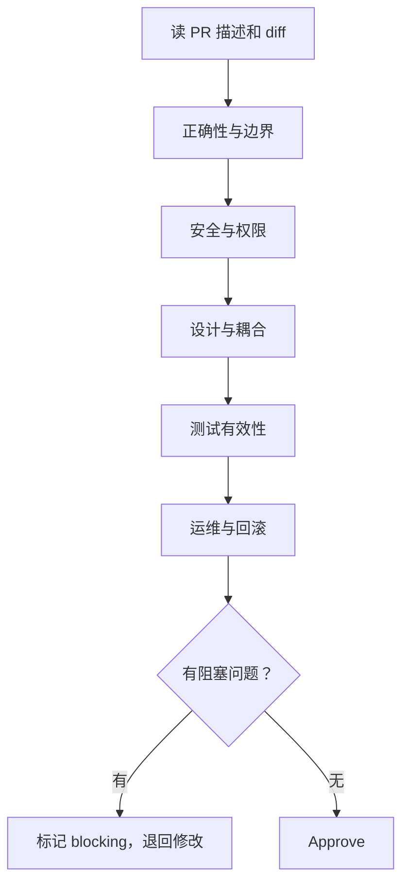

# Code Review

> Code Review 的目的不是证明谁更聪明，而是让变更在合并前获得一次低成本的质量反馈。

很多 Code Review 看起来在发生，实际上没有产生多少质量收益：大家都在看 diff，但注意力集中在命名、空格和 import 顺序上，真正影响合并决策的问题——事务边界、幂等、异常路径、权限和数据一致性——反而被淹没了。另一种极端是“橡皮图章”：PR 太大、上下文太少，reviewer 只能扫一眼然后点通过。

『Code Review』要解决的，正是合并前这段不确定期。它不是个人品味的投票，也不是资深开发者对新人的单向审判，而是团队用最低成本检查一件事：这次变更进入主干之后，我们是否愿意为它的长期行为负责。

## 本章目标

学完本章，你应该能够：

- 判断一次变更能否合并，而不是只挑格式问题。
- 按正确性、安全、设计、测试和运维的顺序审查。
- 写出可执行的 review 评论，并区分阻塞与建议。
- 识别 AI 生成代码的额外风险。

## 审查目标与顺序

Code Review 的第一价值是发现缺陷，但不止于此。它让团队在代码进入主干前讨论设计边界，让知识从作者流向 reviewer，也让新人通过具体代码和具体建议完成学习。一个健康的 review 流程还会降低 bus factor：至少有两个人的脑子接触过这段逻辑，而不是只有作者知道它为什么这样写。

反过来，如果 review 只关注格式，或者只在发版前做形式主义盖章，它就会变成流程负担。格式、命名、导入顺序这类问题应该尽量交给 formatter 和 linter；人的注意力应该留给机器不擅长判断的部分。

::: tip 审查顺序
先看这次变更想解决什么问题，再看它是否正确地解决了问题；先看整体设计，再看具体实现；先看正确性、安全、测试和运维，再看可读性和风格。顺序反了，容易在细节里迷路。
:::

### 先看整体，再看细节

一个可复用的审查顺序是：读 PR 描述和相关 issue，理解意图；读测试，确认期望行为；读核心实现，检查边界、异常、并发和事务；最后看可运维性，包括日志、指标、配置、迁移和回滚。这个顺序不是教条，但它能防止 reviewer 一上来就扎进某个函数，最后只记住了变量名。



正确性永远是第一优先级。代码是否符合需求，空值、空集合、超时、重试和并发是否处理，事务边界是否正确，是否存在资源泄漏，这些问题一旦漏掉，后面的可读性讨论都没有意义。安全性紧随其后：用户输入是否校验，权限判断是否完整，是否存在注入风险，敏感信息是否进入日志或代码。

设计问题通常更难判断，也更值得在合并前讨论。职责是否清晰，是否引入了不必要的耦合，抽象是过度还是不足，是否便于测试和后续扩展，这些问题的修复成本会随着代码进入主干迅速上升。测试则决定这次变更能不能被安全地修改：测试是否覆盖核心行为和边界，是否验证行为而不是实现细节，是否依赖外部状态或执行顺序。

最后才是可读性和风格。命名是否表达意图，函数是否过长，注释是否解释“为什么”，新代码是否和项目现有风格一致。这些问题重要，但不应该占据 review 的主要注意力，更不应该被当成阻塞问题。

::: details 小问题：应该先看测试还是先看实现？
通常先看 PR 描述，再看测试，最后看实现。测试能说明作者期望的行为，也能暴露“测试是否真的验证了行为”。修 bug 时，先看有没有复现测试；重构时，先确认测试是否覆盖了原有行为。只有测试看起来很弱时，才需要更早地读实现来判断风险。
:::

## 变更大小与 PR 描述

小 PR 的 review 质量明显更高。不是因为 reviewer 更认真，而是因为人的工作记忆有限：一次看几百行还可以勉强保持上下文，一次看几千行就只能看个大概。变更越大，越容易漏掉边界、异常和跨模块影响。

| 变更规模 | 建议 |
| --- | --- |
| 少于 200 行 | 理想，通常可以在一次 review 中完成 |
| 200–400 行 | 可接受，但需要清晰描述和测试证据 |
| 超过 400 行 | 尽量拆分；机械重命名或格式化单独提交 |
| 混合重构与功能 | 拆成两个 PR：先重构，再加功能 |

拆分时按“重构 / 功能 / 测试 / 文档”拆，或者按“基础设施 / 业务逻辑 / 接口”拆。stacked PR 也可以，但每个 PR 都要有清晰的依赖关系，而不是把一坨变更切成几段互不了解的代码。

作者在提交 review 前应该先自我 review 一遍，并写清楚三件事：这个 PR 解决什么问题，为什么这样设计，哪些地方最不确定。再加上测试命令、关键用例或日志，reviewer 就不需要从 diff 里反推意图。

```markdown
## 做了什么
为订单结算增加 VIP 折扣，并补充边界测试。

## 为什么
VIP 用户应享受 9 折，但原逻辑只在展示层计算，导致支付金额不一致。

## 重点 review
- PricingService 的折扣计算
- 金额精度处理
- 退款场景是否受影响

## 测试
- `./gradlew test`
- 新增 6 个单元测试，覆盖普通用户、VIP、零金额和负数金额
```

## 评论方式：区分阻塞与建议

评论的价值不在于“说得多”，而在于“说得可执行”。一条好的评论应该让作者知道：问题是什么，为什么是问题，建议怎么改，以及这是必须改还是可以商榷。团队可以约定评论前缀，减少语气误判。

| 前缀 | 含义 | 是否阻塞合并 |
| --- | --- | --- |
| `[blocking]` | 必须修复，否则不能合并 | 是 |
| `[question]` | 需要作者解释或确认 | 通常是 |
| `[suggestion]` | 建议改进，作者可以判断 | 否 |
| `[nit]` | 细枝末节，不要求修改 | 否 |
| `[praise]` | 明确肯定做得好的地方 | 否 |

```text
[blocking] 这里在事务提交前发送了消息。如果事务回滚，用户会收到一条不存在的订单通知。建议改为事务提交后发送，或使用 outbox 模式。

[suggestion] 这个函数同时做了校验和持久化，拆成 validate 和 save 两步会更容易测试。当前只有两个调用方，也可以先保留。

[nit] `usr` 可以改成 `user`，不过不影响合并。
```

评论要对事不对人，解释原因而不是只给结论，给出可执行的替代方案。不确定时用提问，而不是断言。作者回应时也假设对方是善意的，补充上下文，接受合理建议；不同意就用数据、约束或需求说明理由，而不是防御性回复。

## AI 生成代码的额外检查

AI 生成的代码通常“看起来很合理”，这正是风险所在。它可能调用不存在的 API，使用已经废弃的依赖，忽略边界、异常和并发，或者生成能通过测试、但测试本身没有验证行为的代码。更隐蔽的情况是：它在安全、权限、事务和数据处理上给出看似正确、实际危险的实现。

审查 AI 代码时，除了正常 review，还要额外确认 API 和版本是否真实存在，错误处理是否完整，测试是否真的验证了行为，是否泄露敏感信息，是否引入了不必要的复杂度，以及这段代码是否符合项目现有架构。最后一句话始终应该是：我是否愿意为这段代码的长期维护负责。

::: warning AI 可以生成代码，但不能替你承担责任
AI 可以让 diff 变长，也可以让“完成”看起来更快，但它不会替你在生产环境值班，也不会替你在事故复盘时解释设计。Review 的最后一道判断必须由人来做。
:::

## 常见反模式与度量

最常见的反模式是橡皮图章、风格警察、评论重写和巨型 PR。橡皮图章让 review 变成形式；风格警察把个人偏好当成阻塞问题；评论重写用完整实现替代了思路交流；巨型 PR 则让 reviewer 只能看个大概。还有一种更隐蔽的反模式：只看主代码，不看测试是否有效，最后得到一种“有测试”的错觉。

度量 Code Review 时，不要用评论数量衡量 reviewer 的贡献。更有意义的指标是 PR 从提交到首次 review 的时间、从提交到合并的时间、平均规模、变更失败率、缺陷逃逸率和 review 后的返工率。评论数量会鼓励无效评论，而不是提高质量。

::: info 迟到 review 也是一种成本
代码已经上线才提出设计问题，修复成本会远高于合并前。review 的价值随时间快速衰减；及时响应不仅是礼貌，也是降低返工成本的工程手段。
:::

## Review 矩阵

这份矩阵用来回答“这次变更能不能合并”，而不是“能不能挑出更多问题”。

| 维度 | 必须回答 | 阻塞条件 |
| --- | --- | --- |
| 正确性 | 是否覆盖需求分支、边界、异常、并发和事务？ | 存在会导致错误数据或错误行为的缺陷 |
| 安全 | 输入、权限、注入、敏感信息是否处理？ | 存在越权、泄露或可利用的注入风险 |
| 设计 | 职责、耦合、抽象是否符合项目现状？ | 引入难以维护的结构或破坏既有边界 |
| 测试 | 是否验证行为，是否覆盖关键路径？ | 关键行为没有测试，或测试无法失败 |
| 运维 | 日志、指标、配置、迁移和回滚是否完备？ | 发布后无法观察、无法回滚或会破坏兼容性 |
| 范围 | diff 是否只包含本次任务需要的改动？ | 混入无关重构、格式化或大范围重命名 |

## 总结

Code Review 的质量，取决于团队是否把注意力放在正确的问题上：

- 先看意图和整体，再看实现细节；先看正确性、安全、测试和运维，再看风格。
- 小 PR、清晰描述、可执行评论，比“看得仔细”更能提高 review 质量。
- AI 可以生成代码，但人必须检查 API、边界、测试和长期维护责任。

如果只能记住一件事：Review 的目标不是找茬，而是让这次变更在进入主干之前，变得可以被理解、被验证、被回滚。

## 参考与出处

1. Google Engineering Practices
2. 《代码整洁之道》 Robert C. Martin

## 相关阅读

- [代码规范与工程实践](/software-engineering/code-quality)
- [重构技巧](/software-engineering/refactoring)
- [测试](/software-engineering/testing)
- [工程实践](/software-engineering/engineering-practice)
- [Google Engineering Practices](https://google.github.io/eng-practices/)
