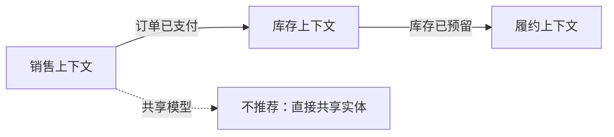

# DDD

> 用领域语言组织复杂业务，用边界控制模型复杂度。

DDD 最容易被误用成“多写几层接口和工厂”。如果业务本身是简单 CRUD，强行套 DDD 只会得到一堆没有价值的抽象；如果业务规则复杂、同一个词在不同团队含义不同，DDD 的边界和语言又能显著降低沟通成本。

DDD 不是一套代码模板，而是一套处理复杂业务的方法：先用限界上下文划清边界，再用通用语言、聚合和领域事件组织模型。

## 本章目标

学完本章，你应该能够：

- 判断业务是否适合领域驱动设计。
- 划分限界上下文并建立通用语言。
- 设计聚合、实体、值对象和领域事件。
- 避免贫血模型、过大聚合和 DDD 套 CRUD。

## DDD 解决什么问题

DDD 适合业务规则多、经常变化、多个系统或团队需要协作、同一个词在不同上下文含义不同的场景。它不适合简单增删改查后台、一次性脚本、报表工具，或者业务规则很少、主要是数据搬运的系统。

战略设计关注系统边界、团队协作和业务语言；战术设计关注单个上下文内部如何建模。先做战略设计，再做战术设计；边界没划清，代码里的聚合和实体再精致也没有意义。

| 层次 | 关注点 | 核心工具 |
| --- | --- | --- |
| 战略设计 | 系统边界、团队协作、业务语言 | 限界上下文、通用语言、上下文地图 |
| 战术设计 | 单个上下文内部如何建模 | 实体、值对象、聚合、领域服务、领域事件、仓储 |

## 限界上下文与通用语言

通用语言是团队、领域专家和代码共同使用的词汇。同一个词在同一个上下文里只能有一个含义；代码中的类名、方法名、事件名应该使用业务语言；发现语言歧义时，先澄清概念，再写代码。

限界上下文是模型生效的边界。边界内，术语有明确含义；边界外，不假设同一个词含义相同。例如“商品”在销售上下文里是可售 SKU、价格和促销，在库存上下文里是库存数量和库位，在履约上下文里是包裹中的物品。

上下文之间需要协作，但不应共享同一个模型。常见关系包括合作关系、客户/供应商、遵奉者、防腐层、共享内核和发布语言。大多数跨上下文集成，优先考虑防腐层，而不是直接共享实体类。



## 实体、值对象与聚合

实体有身份标识，即使属性变化，仍然是同一个对象。判断标准是：即使两个对象的所有属性都相同，它们是否仍然代表不同的事物？如果是，就是实体。

值对象没有独立身份，相等性由属性决定，通常不可变。金额、数量、区间、地址、邮箱、手机号、订单号、用户 ID 都适合做成值对象；任何“用基本类型表达会丢失约束”的概念，都值得考虑值对象。

```java
public record Money(BigDecimal amount, Currency currency) {
    public Money add(Money other) {
        if (!currency.equals(other.currency)) {
            throw new IllegalArgumentException("币种不一致");
        }
        return new Money(amount.add(other.amount), currency);
    }
}
```

聚合是一组具有一致性边界的数据和行为的集合，聚合根是外部访问的唯一入口。规则是：一个事务只修改一个聚合；外部只能持有聚合根引用；聚合之间通过 ID 引用；聚合要尽量小；聚合根负责维护不变量。

::: warning 聚合不是越大越好
如果两个对象不需要在同一个事务里强一致，就应该拆成两个聚合，通过领域事件或最终一致性协作。过大的聚合会带来锁竞争、加载慢和并发冲突。
:::

## 领域服务、事件与仓储

领域服务用于表达不属于任何实体或值对象的业务操作，通常无状态，不直接处理事务、HTTP、消息队列等基础设施细节。应用服务负责编排用例：接收请求、鉴权、加载聚合、调用领域行为、保存聚合、发布事件或返回结果。

仓储为聚合根提供类似集合的访问接口，只为聚合根定义仓储，不要把仓储做成通用查询构造器。复杂查询可以使用专门的读模型，而不是把领域模型撑大。

领域事件表示“领域中已经发生的事情”，通常用过去式命名：`OrderPlaced`、`PaymentSucceeded`、`InventoryReserved`。它解耦聚合之间的直接依赖，支持最终一致，也为审计、通知和统计提供扩展点。事件发布要考虑事务边界，常用 outbox 模式保证业务数据和事件一致。

## 分层与依赖方向

典型分层是 interfaces → application → domain，infrastructure → domain。领域层不依赖框架、数据库和外部 SDK；基础设施实现领域层定义的端口。这就是六边形架构的核心：业务在中心，外部技术通过适配器接入。

::: details 小问题：贫血模型为什么是问题？
贫血模型里实体只有 getter/setter，业务逻辑全在 service。它看起来分层清晰，实际上领域规则散落在多个 service，难以保证不变量，也难以测试。DDD 不是禁止 service，而是让业务规则尽量靠近它保护的数据。
:::

## DDD Review 矩阵

| 维度 | 必须回答 | 不满足时怎么办 |
| --- | --- | --- |
| 适用性 | 业务是否真的复杂到需要 DDD？ | 简单 CRUD 不要套 DDD |
| 上下文 | 边界和通用语言是否清晰？ | 先做战略设计 |
| 模型 | 实体和值对象是否区分正确？ | 用身份/相等性重新判断 |
| 聚合 | 聚合是否足够小、边界清晰？ | 拆聚合，用 ID 引用 |
| 规则 | 业务规则是否在领域模型中？ | 从 service 搬回实体/值对象 |
| 事件 | 事件是否考虑事务和幂等？ | 用 outbox，消费端幂等 |
| 依赖 | 领域层是否依赖基础设施？ | 端口/适配器隔离 |

## 总结

DDD 的核心，是用边界和语言控制复杂业务：

- 先做战略设计，划清限界上下文，再设计聚合和实体。
- 聚合要小，业务规则要靠近数据，领域层不依赖基础设施。
- 领域事件和仓储是协作工具，不是越多越好。

如果只能记住一件事：DDD 的成本在建模和沟通，只有复杂业务值得付这个成本。

## 相关阅读

- [架构](/software-engineering/architecture)
- [设计模式](/software-engineering/design-patterns)
- [系统设计](/system-design/)
