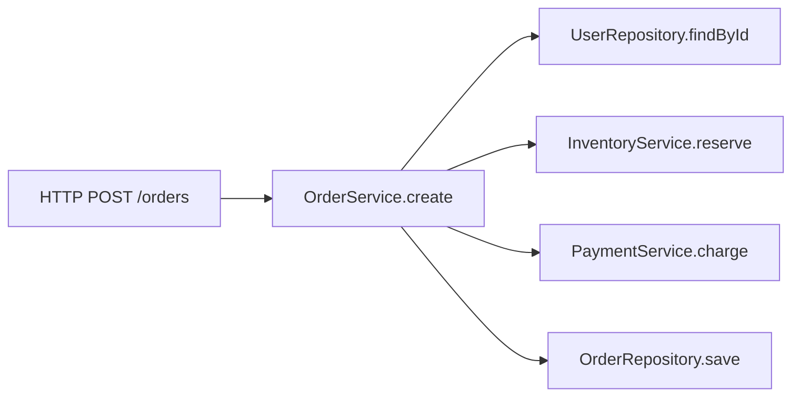

# 可观测性

> 可观测性不是“多打日志”，而是让你在没预料到的问题出现时，仍然能通过外部数据推断系统内部发生了什么。

线上问题最难的阶段，往往不是修复，而是定位：用户说“很慢”，但哪个接口慢、哪个依赖慢、哪个版本开始慢？日志里只有一句 error，指标里只有 CPU 不高，追踪里没有 traceId，团队只能靠猜。

可观测性解决的就是这个“未知问题调查”能力。监控告诉你“系统是否在预期范围内”，可观测性帮助你回答“为什么不在”。

## 本章目标

学完本章，你应该能够：

- 区分监控与可观测性。
- 设计结构化日志、指标和追踪。
- 定义 SLI / SLO 和可行动的告警。
- 用外部数据定位线上问题。

## 监控与可观测性

| 概念 | 关注点 | 回答的问题 |
| --- | --- | --- |
| 监控 | 已知指标是否正常 | 系统是否在预期范围内运行？ |
| 可观测性 | 未知问题的调查能力 | 为什么用户请求变慢了？ |

监控告诉你“出了问题”，可观测性帮助你回答“问题出在哪里、为什么、影响了谁”。

## 日志、指标与追踪

| 支柱 | 作用 | 典型问题 |
| --- | --- | --- |
| 日志 | 记录离散事件和上下文 | 这个请求为什么失败？ |
| 指标 | 聚合数值，观察趋势和告警 | 错误率、延迟、吞吐量是否异常？ |
| 追踪 | 记录请求在服务间的完整路径 | 慢在哪一个服务、哪一段代码？ |

日志要结构化，输出 JSON 或键值对，包含时间、级别、服务、traceId、关键业务 ID 和错误信息。错误日志要有堆栈和上下文，但不要记录密码、Token、身份证号等敏感信息；避免在循环里打印大量重复日志。

指标常用 Counter、Gauge 和 Histogram。请求驱动的服务看 RED：Rate、Errors、Duration；资源看 USE：Utilization、Saturation、Errors；黄金信号是延迟、流量、错误和饱和度。

追踪由多个 span 组成，span 表示一次操作：

使用 W3C Trace Context 或 OpenTelemetry 传播 traceId，跨服务、跨消息队列都传递上下文；日志里打印 traceId，方便关联；高流量系统要采样；span 名称要稳定、可聚合，不要把用户 ID 放进 span 名称。

## SLI、SLO 与告警

SLI 是服务质量指标，例如“99% 的请求在 300ms 内完成”；SLO 是目标，例如“99.9% 的请求成功”；错误预算是允许的失败额度。预算消耗过快时，优先修稳定性，而不是继续加功能。

告警优先对用户可感知的症状，而不是对每个内部原因；告警必须可行动，不能行动的告警就是噪音；使用多窗口燃烧率减少短暂抖动造成的误报；每个告警都要有 runbook：怎么判断、怎么缓解、怎么升级。

告警应该链接到仪表盘、相关日志查询、runbook 和最近发布记录。一个好的仪表盘按“从症状到原因”组织：用户是否受影响 -> 哪个服务 -> 哪个依赖 -> 哪个实例/版本。

::: info 命中率和错误率不是孤立的
指标要结合业务目标看。错误率低但延迟高，用户仍然可能完不成任务；CPU 不高但队列积压，系统仍然可能在恶化。可观测性要看用户可感知的结果。
:::

## 事故响应与反模式

事故处理的第一目标是恢复服务，不是立刻找到完美根因。先发现、分级、缓解（回滚、关闭功能、扩容、降级、限流），再恢复和复盘。确认核心指标恢复，而不是只看告警消失。

常见反模式包括：只打日志，没有指标和追踪；日志没有上下文；记录敏感信息；指标基数爆炸，把用户 ID、订单 ID 当标签；对每个异常都告警；告警没有 runbook；仪表盘很多，但没有一个能回答“用户是否受影响”；只监控基础设施，不监控业务结果。

::: warning 告警不是越多越好
每个异常都告警，最后团队会全部忽略。告警应该对应可行动的症状，并有明确的处理步骤；不能行动的告警应该删除或降级为看板。
:::

## Observability Review 矩阵

| 维度 | 必须回答 | 不满足时怎么办 |
| --- | --- | --- |
| 日志 | 是否结构化并带 traceId？ | 统一日志格式和上下文 |
| 指标 | 是否覆盖延迟、错误和吞吐？ | 加 RED/黄金信号 |
| 追踪 | 跨服务调用是否可串联？ | 接入 OpenTelemetry |
| SLO | 是否有 SLI/SLO 和错误预算？ | 从核心接口开始定义 |
| 告警 | 是否可行动、是否有 runbook？ | 删除噪音，补处理步骤 |
| 仪表盘 | 能否从症状下钻到原因？ | 按用户影响重新组织 |
| 安全 | 是否避免敏感信息和基数爆炸？ | 脱敏，控制标签维度 |

## 总结

可观测性的核心，是让系统在未知问题面前仍然可解释：

- 日志、指标、追踪三者互补，不能只靠一种。
- SLI/SLO 和可行动告警，比堆更多仪表盘更重要。
- 事故先止血，再定位，最后复盘。

如果只能记住一件事：可观测性不是“记录更多”，而是“出问题时能回答为什么”。

## 相关阅读

- [工程实践](/software-engineering/engineering-practice)
- [CI/CD](/software-engineering/ci-cd)
- [架构](/software-engineering/architecture)
