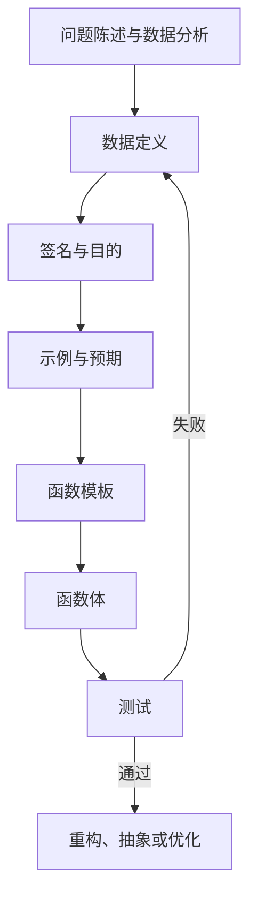

# 程序设计方法

> 先把数据说清楚，再决定函数怎么写。

一段代码能跑通两个示例，不代表它理解了业务。输入为空、状态未知、字段组合非法时，临时代码往往才开始暴露问题：空值同时表示“没有”“不知道”和“失败”，分支散落在多个函数里，新增一种类型要改十几处判断。这些缺陷通常不是某一行写错，而是数据定义从一开始就没有想清楚。

*How to Design Programs, Second Edition*（HtDP）把程序设计拆成一条可重复的路径：先描述程序处理的信息和数据，再从数据形状得到函数模板，用示例和测试约束行为，最后在重复出现时抽象。它用 Racket 的教学语言讲这套方法，但核心并不依赖 Racket；类型、接口、测试、状态机和 AI 协作都能使用同一套判断。

本页是原创中文归纳，不逐段翻译原书。英文原文只作为本地核对素材，不随站点发布；正式站点只保留经过工程化整理的内容。

## 本章目标

学完本章，你应该能够：

- 用数据定义说明输入、输出、合法状态和数据含义。
- 按设计配方从问题陈述走到实现与测试。
- 识别原子、枚举、区间、联合、结构和自引用数据。
- 区分结构递归与生成递归，并给出终止论证。
- 在重复出现后做抽象，在上下文丢失时引入累积器。
- 把设计配方映射到类型、测试、review 和 AI 协作流程。

## 为什么先设计数据

程序的输入不是一个“随便传进来的对象”，而是对现实信息的表示。HtDP 区分『信息』和『数据』：信息是程序领域里的事实，例如订单是否允许退款、课程是否有先修要求；数据是程序内部用来表示这些事实的值，例如枚举、记录、列表或树。数据定义的任务，是说明哪些值合法、每个值代表什么，以及不同种类的值如何区分。

一个可用的数据定义至少回答四件事：

| 问题 | 例子 |
| --- | --- |
| 表示什么信息 | 订单状态表示订单在业务流程中的位置 |
| 哪些值合法 | `PENDING`、`PAID`、`SHIPPED`、`CANCELLED` |
| 每种值是什么意思 | 只有 `PAID` 才能进入发货流程 |
| 非法输入怎么办 | 拒绝未知状态，而不是落到默认分支 |

数据定义决定了函数的形状。列表通常需要“空列表”和“非空列表”两个分支；联合类型通常需要为每个变体准备一个分支；树通常需要一个叶节点分支和两个以上子节点分支。分支不是写完函数后临时补出来的，而是数据定义已经规定了程序必须处理哪些情况。

现代语言提供了更直接的工具。Java 可以用 `sealed interface` 和 `record` 表达“只能是这几种状态”，用 `switch` 模式匹配穷举变体；数据库可以用约束和枚举限制非法值；API 可以用 schema 说明字段组合。工具不同，判断相同：不要用 `null`、空字符串和魔法值同时承担多种语义。

::: tip 数据定义是设计工具
数据定义不是注释负担。它先帮你发现“不存在的状态”，再让函数、测试和 review 围绕同一组概念讨论。一个概念只用一个名字表示，后续代码才有机会保持稳定。
:::

## 设计配方的七个步骤

设计配方把“想清楚”变成一组有产出的步骤。HtDP 第 3 章从函数设计开始介绍这套方法，后续章节再扩展到条件、结构、自引用数据和算法。工程上可以整理为七步：



每一步都应该留下可检查的产物，而不是只在脑中过一遍：

| 步骤 | 产物 | 判断标准 |
| --- | --- | --- |
| 问题陈述与数据分析 | 输入、输出、领域规则、边界 | 能说清楚哪些信息相关，哪些可以忽略 |
| 数据定义 | 类型、合法值、含义、非法状态 | 新增一个值或变体时，知道哪些代码必须检查 |
| 签名与目的 | 参数、返回值、前提、承诺 | 调用方不读实现也知道函数做什么 |
| 示例与预期 | 正常、边界、错误输入和预期结果 | 示例能解释规则，而不是只覆盖一条快乐路径 |
| 函数模板 | 分支数量、递归位置、辅助数据 | 模板来自数据形状，不来自个人习惯 |
| 函数体 | 最小实现 | 每个分支都对应数据定义中的一种情况 |
| 测试 | 可执行断言 | 实现被改坏时，测试会失败 |

下面是一个不依赖原书例题的最小示例，用 Racket 表达运费规则：

```racket
;; A ShippingSpeed is one of:
;; - "standard"
;; - "express"
;; - "same-day"

;; ShippingSpeed Natural -> Natural
;; 计算给定重量和配送方式对应的运费。
(check-expect (shipping-cost "standard" 0) 0)
(check-expect (shipping-cost "express" 2) 28)
(check-expect (shipping-cost "same-day" 1) 58)

(define (shipping-cost speed weight)
  (cond
    [(string=? speed "standard") (* 2 weight)]
    [(string=? speed "express") (+ 20 (* 4 weight))]
    [(string=? speed "same-day") (+ 50 (* 8 weight))]))
```

示例先暴露了两个决定：重量为 0 时是否仍收基础费，以及“快”是否同时意味着固定成本和变动成本。签名说明输入输出，目的说明函数承诺，测试把承诺固定下来。实现反而应该最后写，否则很容易被“先写一个能跑的版本”带着走。

::: warning 配方不是仪式
七个步骤不是为了产出七份文档。小函数可以把几步写在一起，但数据定义、示例和测试不能凭空消失。真正要保留的是证据：为什么这些分支存在，为什么这些结果是正确的。
:::

## 从数据形状得到模板

函数模板是数据定义和函数实现之间的桥。它先写出处理每种数据情况所需的骨架，再填入具体计算。常见数据形状对应的模板判断如下：

| 数据形状 | 典型表示 | 模板关注点 |
| --- | --- | --- |
| 原子数据 | 数字、字符串、布尔值 | 是否需要输入校验 |
| 枚举 | 固定几个标签 | 每个标签一个分支，拒绝未知值 |
| 区间 | 数值范围 | 边界值、开闭区间和越界处理 |
| 联合 / itemization | 多种互斥情况 | 用判别条件分出变体，避免分支重叠 |
| 结构 / product | 多字段记录 | 构造器、选择器和字段不变量 |
| 自引用数据 | 列表、树、表达式 | 基准情况和递归情况 |
| 相互引用数据 | 树与森林、表达式与语句 | 多个模板协同，避免漏掉环形关系 |

列表是最常见的自引用数据。下面的例子把“列表”与“元素”分开定义，再让递归只处理直接子结构：

```racket
;; An Item is (make-item String Natural)
(define-struct item [name price])

;; A List-of-Item is one of:
;; - '()
;; - (cons Item List-of-Item)

;; List-of-Item -> Natural
;; 计算列表中所有商品的价格之和。
(check-expect (total-price '()) 0)
(check-expect
 (total-price (list (make-item "pen" 3) (make-item "book" 42)))
 45)

(define (total-price items)
  (cond
    [(empty? items) 0]
    [else (+ (item-price (first items))
             (total-price (rest items)))]))
```

这段代码的重点不是 `cond`，而是模板与数据定义的一一对应：空列表返回基准值，非空列表处理第一个元素，并对剩余列表递归。只要数据定义不变，新增字段或新增元素类型时，遗漏分支的风险就能被看见。

Java 里可以用 `sealed interface`、`record` 和模式匹配表达同类结构：

```java
sealed interface Shape permits Circle, Rectangle {}

record Circle(double radius) implements Shape {}
record Rectangle(double width, double height) implements Shape {}

static double area(Shape shape) {
    return switch (shape) {
        case Circle circle -> Math.PI * circle.radius() * circle.radius();
        case Rectangle rectangle -> rectangle.width() * rectangle.height();
    };
}
```

编译器能检查变体是否穷举，但不能替你决定字段是否合法。`Circle` 的半径是否允许负数、`Rectangle` 的长宽是否可以为 0，仍然要写进数据定义和测试。类型系统缩小了非法状态的空间，不会自动给出业务语义。

## 结构递归、生成递归与终止

『结构递归』沿着数据的直接子结构前进。列表的递归调用处理 `rest`，树的递归调用处理左右子树，表达式的递归调用处理子表达式。只要每次调用都在更小的有限结构上发生，并且没有别的递归路径，终止性就由数据定义保证。

『生成递归』不沿着原数据的直接子结构前进，而是生成一个新的、更接近目标的问题。快速排序把列表划分成两个新列表，欧几里得算法把 `(a, b)` 变成 `(b, a mod b)`，二分查找把搜索区间折半。它们都可能终止，但不能仅凭“数据有限”得到结论，必须额外说明度量值在下降。

| 维度 | 结构递归 | 生成递归 |
| --- | --- | --- |
| 递归对象 | 直接子结构 | 新生成的问题 |
| 终止依据 | 数据定义的有限结构 | 度量、变体或良基关系 |
| 典型例子 | 列表求和、树遍历 | 快速排序、GCD、二分查找、回溯 |
| 主要风险 | 漏掉基准情况 | 循环、度量不下降、重复访问 |

生成递归的终止论证要具体。欧几里得算法可以说明余数严格小于除数；二分查找可以说明区间长度每轮缩小；图搜索则不能只说“图有限”，还要用 `visited` 集合阻止环上的重复访问。没有终止论证的递归，只是把风险推迟到运行时。

::: warning 递归不等于“调用自己”
递归设计的核心，是把问题变成同一类更小的问题。写不出“小在哪里”，就还没有设计出递归，只是在重复调用。生成递归尤其要把终止条件、度量变化和重复状态写出来。
:::

## 抽象与累积器

当两个函数只有局部操作不同，数据形状和递归骨架相同时，才值得抽象。HtDP 第 14—17 章从相似函数、相似数据定义和高阶函数逐步引出抽象：先把变化的部分变成参数，再用 `map`、`filter`、`fold`、`lambda` 或局部定义复用骨架。抽象太早会把尚未理解的差异硬塞进一个接口，最后得到的不是复用，而是条件分支的搬家。

累积器解决另一类问题：结构递归在向下走时丢掉了上下文。反转列表需要记住已经处理过的前缀，树遍历需要携带路径，图搜索需要携带已访问集合，解释器需要维护环境。把这些信息作为额外参数传入，就是『累积器风格』。它的关键不是“尾递归”四个字，而是不变量：每一层调用中，累积器代表什么，函数返回时它应该满足什么条件。

| 信号 | 可能的做法 | 要补的验证 |
| --- | --- | --- |
| 多个函数骨架几乎相同 | 提取高阶函数或公共模板 | 变化点是否真的只有一处 |
| 同一子问题被反复计算 | 记忆化、动态规划或改数据结构 | 缓存键、失效条件和空间成本 |
| 向下递归后还需要上文 | 增加累积器参数 | 累积器不变量和初始值 |
| 递归深度可能很大 | 累积器风格或显式栈 | 语言是否真的做尾调用优化 |
| 状态转换分散在多个函数 | 状态机或显式状态类型 | 非法转换是否被拒绝 |

不要把所有递归都改成累积器。结构递归更贴近数据定义，通常也更容易读；只有在上下文丢失、重复计算或栈深度成为真实问题时，才引入额外参数。引入后要同时写清楚初始值、更新规则和返回条件，否则累积器会变成另一个难以追踪的隐式状态。

## 与现代工程实践连接

设计配方可以直接映射到日常工程：

| 设计配方 | 工程实践 |
| --- | --- |
| 数据定义 | 领域类型、数据库约束、API schema、ADT |
| 签名与目的 | 接口契约、错误码、Javadoc、ADR |
| 示例 | 表驱动测试、边界用例、验收标准 |
| 模板 | 代码结构、分支覆盖、review 检查项 |
| 测试 | 单元测试、属性测试、回归测试 |
| 抽象 | 消除重复，但保留语义边界 |
| 生成递归与终止 | 算法设计、复杂度分析、循环不变量 |
| 累积器 | 状态机、遍历上下文、尾递归或显式栈 |

这套方法对 AI 协作也有用。让 AI 写代码时，只给一句“实现订单折扣”通常不够；给出数据定义、合法状态、示例、边界和禁止行为，生成结果才有可验证的约束。review 时先看它有没有偷偷扩大输入范围、把非法状态塞进默认分支，或者用一个 `if` 掩盖数据建模问题。AI 可以提高生成速度，但数据定义和验收标准仍然要由人确认。

## Program Design Review 矩阵

| 维度 | 上线前必须回答 | 不满足时怎么办 |
| --- | --- | --- |
| 数据定义 | 输入、输出和合法状态是否说清楚？ | 先补类型、枚举、约束和含义 |
| 非法状态 | 未知值、空值和非法组合是否会静默通过？ | 拒绝并给出明确错误 |
| 示例 | 是否覆盖正常、边界和错误路径？ | 补示例和验收条件 |
| 模板覆盖 | 每个数据变体是否都有对应分支？ | 用穷举或模式匹配补齐 |
| 递归终止 | 结构递归或生成递归为什么一定结束？ | 写度量、基准情况和循环防护 |
| 抽象时机 | 相似性是已证实，还是猜测？ | 先保留重复，等变化点稳定 |
| 累积器 | 初始值、更新规则和返回条件是否明确？ | 写不变量并补状态测试 |
| AI 生成代码 | 是否遵守数据定义，而不是只迎合示例？ | 补边界测试，人工 review 设计 |

## 总结

程序设计方法可以压缩成四句话：

- 数据定义决定函数形状；先处理合法状态，再写分支。
- 设计配方用示例、模板和测试留下可验证的证据。
- 结构递归依靠数据变小，生成递归必须单独证明终止。
- 抽象在重复被证实后发生，累积器在上下文丢失时引入。

如果只能记住一件事：不要先问“代码怎么写”，先问“数据是什么、哪些值合法、什么结果算对”。

## 参考与出处

1. [How to Design Programs, Second Edition](https://htdp.org/2026-5-28/Book/index.html)，Matthias Felleisen、Robert Bruce Findler、Matthew Flatt、Shriram Krishnamurthi，MIT Press。原文采用 [CC BY-NC-ND 2.0](https://creativecommons.org/licenses/by-nc-nd/2.0/) 许可。
2. [Prologue: How to Program](https://htdp.org/2026-5-28/Book/part_prologue.html)
3. [Chapter 3: How to Design Programs](https://htdp.org/2026-5-28/Book/part_one.html#%28part._ch~3ahtdp%29)
4. [Chapter 9: Designing with Self-Referential Data Definitions](https://htdp.org/2026-5-28/Book/part_two.html#%28part._ch~3adesign-lists%29)
5. [Chapter 14: Similarities Everywhere](https://htdp.org/2026-5-28/Book/part_three.html#%28part._ch~3add-similarities%29)
6. [Chapter 26: Designing Algorithms](https://htdp.org/2026-5-28/Book/part_five.html#%28part._ch~3adesign-algo%29)
7. [Chapter 31: The Loss of Knowledge](https://htdp.org/2026-5-28/Book/part_six.html#%28part._ch~3aaccumulator-samples%29)

本页为原创中文归纳，不复制原书正文。英文原文仅作为本地非商业学习素材。若权利人认为本项目使用方式不妥，请通过 [GitHub Issues](https://github.com/Siborne/software-engineering-handbook/issues) 联系，我们会核实后及时删除。

## 相关阅读

- [测试](/software-engineering/testing)
- [代码规范与工程实践](/software-engineering/code-quality)
- [重构技巧](/software-engineering/refactoring)
- [泛型与类型系统](/programming-language/java/generics)
- [函数式与 Stream](/programming-language/java/functional)
