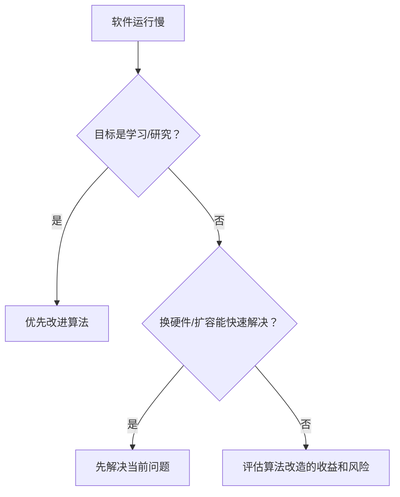

# 软件开发常识与思考

> 工程判断的价值，不在于知道多少技巧，而在于知道什么时候不该用技巧。

软件开发有很多“看起来正确”的常识：用最新的语言、写最巧的代码、买最好的设备、加更多的人、再小心一点。单独看都没错，放进真实项目里却经常变形。技术判断一旦脱离约束，就会从解决问题变成制造问题。

这一章讨论几个常见但容易走偏的问题：有没有最好的语言，编程是不是艺术，技巧该不该多用，性能问题该换机器还是换算法，错误该不该分级，以及那些听起来很合理、实际上会误导项目的观念。

## 本章目标

学完本章，你应该能够：

- 根据问题、团队和生态选择语言，而不是争论优劣。
- 区分工程规范与个人“艺术”。
- 判断一个技巧是解决问题，还是增加维护成本。
- 在性能、进度和风险之间做现实取舍。
- 理解缺陷分级的技术局限。
- 识别“加人、买设备、小心点”这类错误观念。

## 有最好的编程语言吗

没有。程序员初学 BASIC、Fortran、Pascal、C、C++ 时，常会觉得一门比一门强；到了 Visual Basic、Delphi、Visual C++、Java 的时代，又各有擅长。语言在变化，问题也在变化，很难给出一个脱离场景的“最好”。

能很好地解决问题的语言，就是当前的好语言。选型时看的是：问题类型、生态和库、团队熟悉度、招聘和维护成本、性能要求、平台约束。业界推荐和自己的擅长同样重要，因为一个团队写不顺手的“先进语言”，未必比一个写得很稳的“普通语言”质量更高。

::: tip 语言是工具，不是信仰
编程是一件自由且快乐的事，不要发誓忠于某门语言。语言争论通常不能解决问题，选一个团队能维护、生态能支撑、性能够用的方案，然后把问题解决掉。
:::

## 编程是一门艺术吗

水平高到一定程度，做什么都能感受到“艺术”，编程也不例外。但在商业软件里，如果把编程完全当成随心所欲、不可把握的艺术，团队协作和质量控制就会失去基础。

大部分人开发软件是为了满足客户需求，不是为自己享受。规范化编程——命名、结构、测试、评审、文档——能提高质量和效率，虽然它会在一定程度上压抑个人表达。编程艺术可以是高水平创作带来的感受，但它不能成为公司的主要指导方针。

::: warning 不要用“艺术”逃避规范
“这是我的风格”不是跳过命名、测试和评审的理由。个人风格应该建立在可读、可维护、可协作的基础上，而不是让别人猜你的意图。
:::

## 编程时应该多使用技巧吗

技巧的优点是能另辟蹊径地解决问题；缺点是别人不熟悉，甚至几个月后的你也不熟悉。程序里技巧太多，会留下错误隐患，也会让维护者难以理解。一个局部的小聪明，对整个系统可能微不足道；一个由它引入的错误，却可能影响整个系统。

更稳的做法是用自然的方式编程。技巧应该在需要时自然产生，而不是为了展示而存在。“熟能生巧”说的是长期练习后的自然结果，不是把复杂当高级。

::: details 小问题：怎么判断是技巧还是伎俩？
问三个问题：它解决了什么真实问题？别人能不能在合理时间内看懂？如果出问题，能不能快速定位和回退？三个问题答不上来，就先别用。
:::

## 换更快的计算机还是更快的算法

软件运行慢时，技术人员的本能是优化算法，商业团队的本能是换机器。两者都可能对，关键看目的和阶段。

如果目的是学习或研究，设计更快的算法很有价值；如果软件已经用于商业，换一台更快的机器或扩容能快速解决问题，往往是最省时的方案。改进算法可以从根本上提高性能，但可能引入错误、延误进度，还需要重新验证。

| 场景 | 优先考虑 |
| --- | --- |
| 学习、研究、长期性能瓶颈 | 改进算法和数据结构 |
| 商业项目、短期瓶颈、硬件可解决 | 先扩容或换机器 |
| 成本敏感、规模会持续增长 | 评估算法改造的长期收益 |
| 高风险核心路径 | 先测量，再小步优化，保留回退 |

技术狂容易把“任何可以优化的机会”都当成必须抓住；商业团队则更关心交付和成本。好的决策不是选边站，而是把性能问题放回业务约束里。

## 错误是否应该分等级

微软的一些开发小组曾把错误分成四级：

| 等级 | 定义 |
| --- | --- |
| 一级严重 | 错误导致软件崩溃 |
| 二级严重 | 一个特性不能运行，且没有替代方案 |
| 三级严重 | 一个特性不能运行，但有替代方案 |
| 四级严重 | 错误是表面化的或微小的 |

分级便于统计和排期，但这种分类带有较强的技术倾向，并不普遍适用。一个财务软件里，崩溃可能只是一级严重，工资算错却可能让老板或员工遭受经济损失；航空软件的操作手册写错，按技术分类可能只是四级，但后果可能是机毁人亡。

所以，缺陷可以分级处理，但不能因为“等级低”就轻视。开发人员应该意识到：所有错误都值得认真对待，不存在真正微不足道的错误。分级是为了决定处理顺序，不是为了给错误找借口。

::: info 严重性 = 技术影响 × 业务后果
技术等级只看“系统坏了多少”，业务严重性还要看“谁受影响、损失多大、是否可恢复”。排期可以分级，质量态度不能分级。
:::

## 一些常见的错误观念

| 错误观念 | 为什么不对 | 更好的做法 |
| --- | --- | --- |
| 有一套书就能解决所有问题 | 现实条件千差万别，规范常常无法直接套用；技术也在变化 | 把书当参考，结合项目和反馈判断 |
| 资源和设备够好，就一定能做出好软件 | 好环境是必要条件，不是充分条件；人和协作同样关键 | 关注团队能力、目标和工程流程 |
| 进度落后就加程序员 | 新手会产生新错误，老手要花时间解释和协作 | 精确计划，控制范围，先解决瓶颈 |
| 只要干活小心，质量就会提高 | 质量需要理解质量属性，并内建于需求、设计、编码和测试 | 建立规范、评审、测试和反馈闭环 |

这些观念的共性是：把复杂问题简化成一个单点手段。书、设备、人力、细心都重要，但它们不能替代对问题的理解和系统性的工程方法。

## 这些判断怎么用

遇到一个“看起来正确”的技术主张时，先问四个问题：

1. 它解决的具体问题是什么？
2. 当前约束是什么：时间、团队、成本、风险？
3. 收益是局部的还是系统的？代价由谁承担？
4. 如果判断错了，能不能回退？

技术判断不是寻找绝对答案，而是在约束下做可解释的选择。

## Wisdom Review 矩阵

| 维度 | 必须回答 | 不满足时怎么办 |
| --- | --- | --- |
| 语言 | 选型是否匹配问题、团队和生态？ | 回到实际约束，不争“最好” |
| 规范 | 是否把个人风格和团队规范分开？ | 以可读、可测、可协作为底线 |
| 技巧 | 技巧是否解决真实问题、别人能懂？ | 用自然写法替换小聪明 |
| 性能 | 是否先测量，再决定换机器还是改算法？ | 补基线、压测和回退方案 |
| 缺陷 | 是否同时看技术影响和业务后果？ | 分级排期，但不轻视任何错误 |
| 资源 | 是否把工具、人和流程一起考虑？ | 补能力、协作和反馈机制 |

## 总结

这些常识可以压缩成三句话：

- 没有最好的语言，只有适合当前问题和团队的语言。
- 规范是协作的基础，技巧要在可读、可维护的前提下使用。
- 质量、性能和进度都要放回约束里判断，不能靠单点手段解决系统问题。

如果只能记住一件事：技术判断的成熟，不是知道更多“正确答案”，而是知道答案依赖什么条件。

## 相关阅读

- [软件质量](/software-engineering/quality)
- [代码规范与工程实践](/software-engineering/code-quality)
- [工程实践](/software-engineering/engineering-practice)
- [架构](/software-engineering/architecture)
