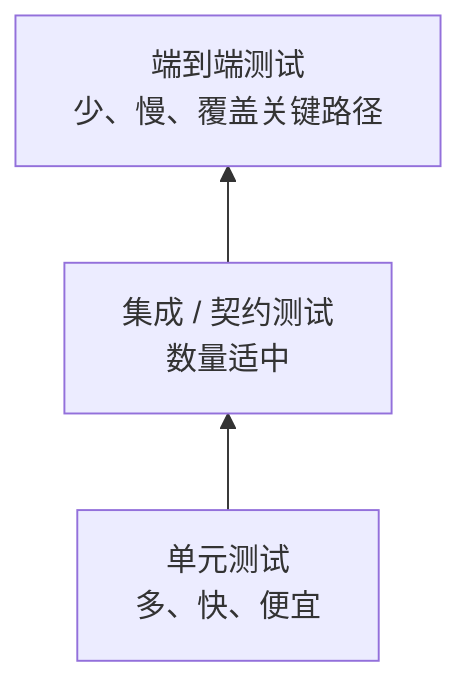

# 测试

> 测试不是为了证明代码正确，而是为了在修改代码时，快速知道哪里坏了。

测试最容易被误解成“写完代码之后的补充工作”。真正进入维护期之后你会发现，测试的价值不在开发顺利的时候，而在你准备改一个三年前写的函数、却不确定它依赖了哪些隐含行为的时候。没有测试，重构只能靠记忆和运气；有测试，至少有一个可以反复执行的反馈回路。

测试也不是越多越好。一个只验证 getter/setter、或者绑定私有方法调用顺序的测试，会增加维护成本，却在关键时刻保护不了行为。好的测试应该像一份可执行的规格：它说明系统在什么场景下应该产生什么结果，而不是复述实现步骤。

## 本章目标

学完本章，你应该能够：

- 设计覆盖正常、边界和异常路径的测试。
- 用行为而不是实现细节写断言。
- 选择合适的测试层级和测试替身。
- 用 Review 矩阵判断测试是否真的能保护行为。

## 测试到底在保护什么

测试首先保护行为。它让“什么算正确”从口头约定变成可执行断言，也让重构有一个明确的边界：结构可以改，行为不能变。其次，测试缩短反馈环。本地或 CI 里发现的问题，修复成本远低于线上；一个能在几秒内失败的测试，比一次线上事故更有价值。

测试还会暴露设计问题。难以测试的代码，往往意味着耦合过高、职责不清，或者依赖了无法控制的外部状态。最后，好的测试名称和用例本身就是文档，后来的人可以通过测试理解业务规则，而不必从实现里反推。

测试通常分成几层：

| 层级 | 范围 | 速度 | 数量 | 典型工具 |
| --- | --- | --- | --- | --- |
| 单元测试 | 一个类、一个函数或一小段纯逻辑 | 毫秒级 | 多 | JUnit、TestNG、Vitest、pytest |
| 集成测试 | 数据库、消息队列、HTTP、文件系统等真实依赖 | 秒级 | 适中 | Testcontainers、Spring Boot Test |
| 契约测试 | 服务之间的接口约定 | 秒级 | 按接口数量 | Pact、Spring Cloud Contract |
| 端到端测试 | 用户视角的完整流程 | 秒到分钟级 | 少而关键 | Playwright、Cypress、Selenium |



金字塔不是铁律。不同系统的比例取决于业务风险、外部依赖和反馈速度；核心是用尽量低的成本获得足够的信心，而不是机械追求某一层的数量。

## 一个测试应该验证什么

测试应该验证可观察行为，而不是内部实现。下面这种断言绑定的是“调用了哪个方法”，重构时很容易失效：

```java
verify(userRepository).save(any(User.class));
```

更有意义的做法是验证保存之后外部能观察到的结果：

```java
User savedUser = userRepository.findByUsername("alice").orElseThrow();
assertEquals("alice", savedUser.getUsername());
```

一个测试只验证一个概念。一个测试里塞进十几个断言，失败时很难判断到底是哪条业务规则坏了。结构上可以用 Arrange / Act / Assert，也可以用 Given / When / Then；名字不同，目的相同：把准备、执行和验证分开。

```java
@Test
void shouldRejectBlankUsername() {
    // Arrange
    UserCreateRequest request = new UserCreateRequest("", "password");

    // Act & Assert
    assertThrows(
        IllegalArgumentException.class,
        () -> userService.createUser(request)
    );
}
```

测试名称应该说明“在什么场景下，期望什么结果”。`test1()` 和 `testCreateUser()` 只是把方法名重复了一遍；`shouldRejectBlankUsername()`、`shouldApplyVipDiscountWhenUserIsVip()` 才能让失败信息自己解释问题。

::: tip 测试名称是失败时的第一条线索
当 CI 红了一片，你最先看到的是测试名称。一个好的名字应该让读者不打开代码就知道哪条业务规则坏了；如果只能写出 `testError()`，通常说明你还没想清楚这个测试到底在保护什么。
:::

## 用例设计：正常、边界、异常

测试用例不应该只覆盖 happy path。以 `withdraw(BigDecimal amount)` 为例，正常路径、边界值和异常路径都要有代表：

| 场景 | 输入 | 预期 |
| --- | --- | --- |
| 余额充足 | `100.00` | 成功，余额减少 |
| 恰好等于余额 | 当前余额 | 成功，余额为 0 |
| 余额不足 | 大于余额 | 抛出 `InsufficientBalanceException` |
| 金额为 0 | `0.00` | 拒绝，抛出参数异常 |
| 金额为负数 | `-1.00` | 拒绝，抛出参数异常 |
| 金额为 null | `null` | 拒绝，抛出参数异常 |

边界值往往比正常值更容易暴露问题：0、1、最大值、空集合、空字符串、恰好等于阈值，以及“刚好超过阈值”。异常路径同样重要：非法参数、权限不足、依赖失败、超时和重试，都应该有明确的预期。对于状态变化明显的对象，还要验证调用前后的状态是否符合业务规则。

## 测试替身与测试层级

测试替身不是越多越好。Dummy 只是为了满足参数列表；Stub 返回预设结果；Spy 记录调用信息；Mock 预设期望并验证交互；Fake 则用简化实现替代真实依赖，例如内存版仓储或内存队列。

| 类型 | 作用 | 典型场景 |
| --- | --- | --- |
| Dummy | 只为满足参数列表，不会被使用 | 传入一个无关依赖 |
| Stub | 返回预设结果 | 让仓储查询返回固定用户 |
| Spy | 记录调用信息 | 验证是否发送了通知 |
| Mock | 预设期望并验证交互 | 验证外部服务是否被调用 |
| Fake | 用简化实现替代真实依赖 | 内存版仓储、内存队列 |

单元测试适合纯计算、状态转换和规则判断，不应该依赖数据库、网络或文件系统。集成测试则适合 SQL、事务、索引、数据库约束、序列化、消息队列、缓存、Spring 容器和第三方适配层；这类测试优先使用真实依赖的轻量替代，例如 Testcontainers 启动真实数据库，而不是 mock 掉整个持久层。

::: details 小问题：单元测试要不要 mock 数据库？
通常不要。需要验证 SQL、事务、索引或数据库约束时，应该写集成测试；单元测试更适合验证不依赖数据库的业务规则。一个测试如果 mock 了五六个依赖，往往说明被测对象职责太多，或者测试层级选错了。
:::

## TDD、覆盖率与可维护性

TDD 的节奏是红、绿、重构：先写一个失败测试，明确期望行为；用最简单的方式让测试通过；再在测试保护下改善结构。它的价值不只是“测试先行”，更是迫使你在写实现前想清楚接口和行为边界。TDD 是设计工具，不是宗教；探索性代码、UI 原型和一次性脚本不一定适合严格 TDD，核心业务逻辑通常适合。

覆盖率是信号，不是目标。高覆盖率不代表测试有效，可能只是执行了代码而没有断言；低覆盖率也不一定有问题，但核心业务路径必须有覆盖。优先级应该是金额计算、权限判断、状态机、边界条件和错误处理，而不是把每一行都染成绿色。比行覆盖率更强的信号是变异测试，例如 PIT。

可维护的测试通常有几个共同点：独立、确定、快速、清晰、行为导向，失败信息足够定位问题。它们不依赖其他测试的执行顺序，不使用不可复现的随机数据，也不用 `Thread.sleep()` 等待异步结果。测试之间共享可变状态、过度 mock、为了覆盖率写没有断言的测试，都是常见反模式。

::: warning 覆盖率不是目标
为了覆盖率写没有断言的测试，和没有测试没有本质区别。真正要问的是：如果这段逻辑被改坏，哪个测试会失败？如果答不上来，覆盖率再高也只是数字。
:::

## 测试 Review 矩阵

测试 review 不应该只问“有没有测试”，而要问“这个测试能不能在关键时刻失败”。

| 维度 | 必须回答 | 不满足时怎么办 |
| --- | --- | --- |
| 行为 | 测试验证的是行为还是实现细节？ | 改成从外部可观察结果断言 |
| 场景 | 正常、边界、异常是否覆盖？ | 补边界和失败用例 |
| 独立性 | 是否依赖执行顺序或共享状态？ | 隔离数据，改用独立 fixture |
| 确定性 | 是否依赖时间、随机数或网络？ | 注入时钟、固定随机种子、使用 fake |
| 速度 | 是否能在本地和 CI 快速反馈？ | 下沉为单元测试，或拆分慢测试 |
| 失败信息 | 失败时能否快速定位？ | 改测试名称和断言信息 |
| Mock 用量 | 是否 mock 过多？ | 改用真实对象、fake 或更高层测试 |

## 总结

测试的价值，不是证明代码今天是对的，而是让明天的修改有安全感：

- 测行为，不测实现；一个测试只验证一个概念。
- 正常路径之外，边界和异常才是事故高发区。
- 覆盖率是信号，能失败的测试才是保护。

如果只能记住一件事：每写一个核心逻辑，就问自己“它坏掉时，哪个测试会红”。如果答不上来，这段逻辑还没有真正的测试。

## 参考与出处

本章的测试原则、分层和边界设计参考并整理了：

- Kent Beck，《测试驱动开发》。
- Robert C. Martin，《代码整洁之道》。
- Martin Fowler，《重构：改善既有代码的设计》。
- Google Engineering Practices。

示例结合了当前 Java/JUnit 实践做了改写，不是原文摘录。

## 相关阅读

- [代码规范与工程实践](/software-engineering/code-quality)
- [重构技巧](/software-engineering/refactoring)
- [Code Review](/software-engineering/code-review)
- [CI/CD](/software-engineering/ci-cd)
- [工程实践](/software-engineering/engineering-practice)
