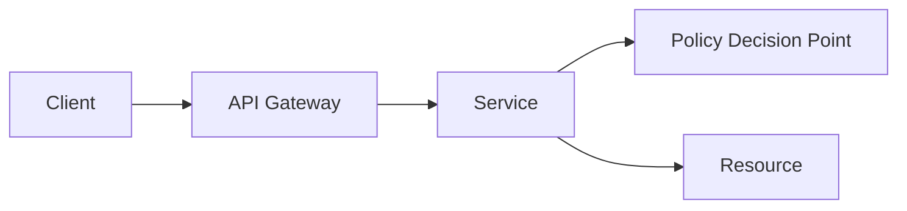

# 权限系统

> 认证回答“你是谁”，授权回答“你能做什么”。两者不能混在一起。

权限系统最常见的事故，不是“用户登不进来”，而是“用户看到了不该看的数据”。前端隐藏按钮、接口只校验登录态、查询漏掉租户条件、缓存了越权结果，都会让系统看起来有权限控制，实际上没有。

认证解决身份，授权解决资源访问。一个用户登录成功，不代表他能访问所有订单、所有文档或所有租户的数据。权限系统要把“谁、对什么资源、执行什么操作、在什么环境下”拆开判断。

## 本章目标

学完本章，你应该能够：

- 区分认证与授权。
- 选择 RBAC、ABAC 或 ReBAC。
- 设计策略执行点和多租户隔离。
- 用最小权限和审计保护高危操作。

## 认证与授权到底在分什么

| 概念 | 问题 | 例子 |
| --- | --- | --- |
| 认证（Authentication） | 你是谁？ | 登录、MFA、SSO |
| 授权（Authorization） | 你能做什么？ | 角色、权限、资源访问 |

认证的产物是身份和会话，授权的产物是允许或拒绝。授权判断至少要有主体、动作、资源、环境和策略五个元素。只在前端隐藏按钮，不是授权；只在网关校验登录态，也不是完整的资源授权。

## 权限模型

RBAC 用“用户 → 角色 → 权限”组织访问控制，适合权限相对稳定、角色数量可控的企业内部系统。它的弱点是角色爆炸，也难以表达“只能看自己部门的数据”。

ABAC 根据属性判断，例如用户部门、资源密级、时间和 IP。它适合细粒度、动态规则，但规则复杂、调试困难、性能开销更高。ReBAC 根据关系图判断，例如“alice 是 team:backend 成员，team:backend 拥有 repo:handbook”，适合文档、代码仓库、社交和层级权限。

| 模型 | 核心 | 适合 | 主要代价 |
| --- | --- | --- | --- |
| RBAC | 用户 → 角色 → 权限 | 权限稳定、角色可控 | 角色爆炸，难表达数据范围 |
| ABAC | 属性 + 规则 | 细粒度、动态条件 | 规则复杂、难调试 |
| ReBAC | 关系图 | 文档、仓库、层级继承 | 关系维护和查询复杂 |

::: details 小问题：RBAC 什么时候会角色爆炸？
当团队试图用角色表达所有资源范围时，角色会迅速组合爆炸，例如“华东区-财务-只读”“华东区-财务-可导出”。这通常说明需要把“角色”和“数据范围/属性”分开，或者引入 ABAC/ReBAC，而不是继续造角色。
:::

## 策略执行点与多租户

权限判断需要一个执行点。简单系统可以在服务内判断；复杂系统可以抽成统一权限服务。PEP 负责执行决策，PDP 负责计算是否允许，PIP 提供属性。无论放在哪里，后端都必须强制校验，不能依赖前端隐藏。

多租户隔离要贯穿认证、授权、数据、缓存、消息和日志：每个请求都有租户上下文；查询强制带 `tenant_id`；缓存 key 包含租户；权限判断包含租户；日志和审计不跨租户；删除租户时清理所有数据。租户隔离不是“加一个 where 条件”这么简单。

::: warning 前端隐藏不是授权
前端隐藏按钮只是体验优化，不是安全边界。用户可以直接调用接口。任何资源访问都必须由后端根据身份、资源和动作重新判断。
:::

## 最小权限、Token 与审计

最小权限意味着默认拒绝，只授予完成工作所需的最小权限；读写分开；高危操作单独授权；定期清理不再使用的权限；服务账号也要最小权限。知道一个 API key，不等于拥有完整授权。

API 授权要区分用户 Token 和服务 Token，使用 scope 限制访问范围，audience 限制目标服务，设置过期时间并支持撤销。Token 不应该永久有效，也不应该携带不必要的敏感信息。

审计要记录谁、何时、对什么资源、执行什么操作、是否允许、拒绝原因、来源 IP/设备/traceId。审计日志要防篡改并保留足够时间，尤其是权限变更、导出、删除和审批操作。

## Auth System Review 矩阵

| 维度 | 必须回答 | 不满足时怎么办 |
| --- | --- | --- |
| 认证 | 登录和会话是否安全？ | 加 MFA、限流和安全 Cookie |
| 授权 | 后端是否对每个资源强制校验？ | 把判断收口到 PEP/PDP |
| 模型 | RBAC/ABAC/ReBAC 是否匹配业务？ | 拆分角色、属性和关系 |
| 租户 | 查询、缓存、消息是否隔离？ | 强制 tenant 条件和缓存 key |
| 权限 | 是否默认拒绝、最小授权？ | 清理过期权限，收紧服务账号 |
| 高危 | 删除、导出、审批是否确认和审计？ | 加二次确认和审计日志 |
| 测试 | 是否有越权测试？ | 加跨用户/跨租户用例 |

## 总结

权限系统的核心，是把身份和资源访问分开：

- 认证解决“你是谁”，授权解决“你能对什么做什么”。
- RBAC/ABAC/ReBAC 各有代价，按业务复杂度选择。
- 后端强制校验、多租户隔离和审计，是权限系统的基本边界。

如果只能记住一件事：前端隐藏不构成授权，真正的权限判断必须在后端、在资源访问的那一刻发生。

## 相关阅读

- [登录系统](/system-design/login-system)
- [如果让我设计 GitHub](/system-design/if-i-were-github)
- [架构](/software-engineering/architecture)
- [Code Review](/software-engineering/code-review)
