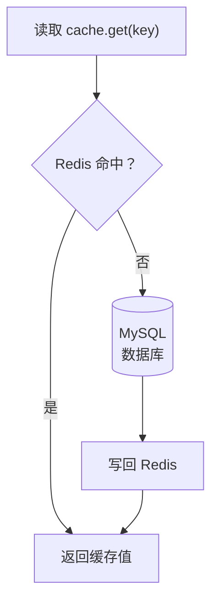
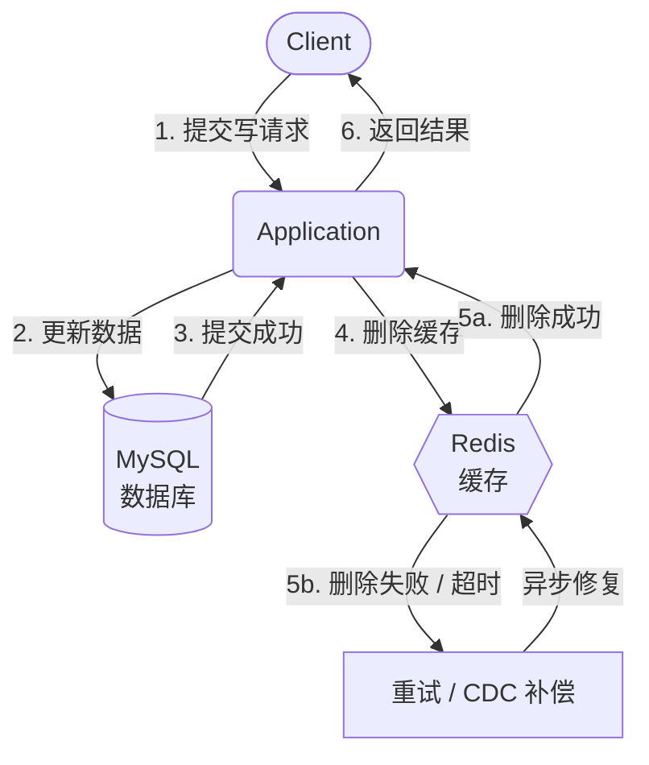
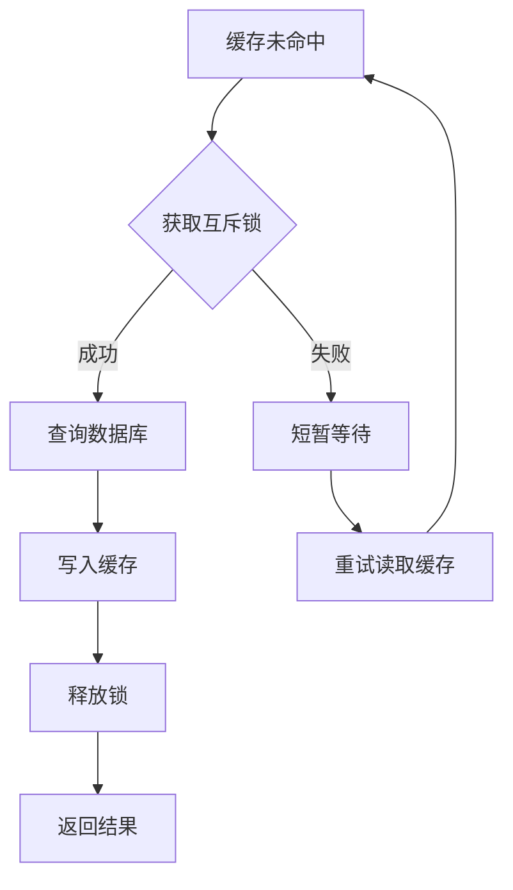
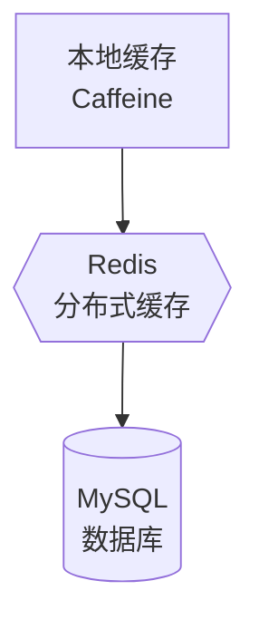

# 缓存

> 缓存不是“把数据放 Redis”，而是用可控的过期和失效换取延迟与吞吐。

『缓存』最容易被误解的地方，是把它当成一个更快的数据库。实际上它只是一份副本：数据仍然以数据库为准，缓存只是在某一段时间里替数据库承担读流量。这个“某一段时间”决定了缓存的全部价值，也决定了它的全部风险。

本文讨论的是通用缓存设计，但示例和工程细节会以 Redis 作为典型实现；涉及进程内缓存时，会以 Caffeine 为例。换成本地缓存、Memcached 或其他分布式缓存，原则基本一致，只是失效、集群和观测手段不同。

引入缓存之后，接口会变快，数据库压力会下降，热点流量也更容易被吸收。但系统同时多出了一层需要维护的状态：副本可能过期，更新可能失败，热点可能集中，缓存集群本身也可能成为新的单点。缓存设计的大部分工作，不是把数据放进 Redis，而是决定什么时候放、放多久、什么时候删，以及删失败之后怎么办。

## 本章目标

学完本章，你应该能够：

- 判断一个场景是否真的需要缓存。
- 选择合适的读写模式和失效策略。
- 识别并治理穿透、击穿、雪崩、热点 key 和大 key。
- 用 Review 矩阵检查缓存上线风险。

## 缓存到底在换取什么

缓存用“数据新鲜度”和“系统复杂度”换取“延迟”和“吞吐”。这个交易在大多数读多写少的业务里是划算的，但它不是免费的。只要缓存存在，系统就多了一条可能返回旧数据的路径，也多了一个可能失效的依赖。

因此，缓存设计不应该从“选 Redis 还是 Caffeine”开始，而应该先回答三个问题：这份数据允许多旧，旧数据会造成什么后果，以及缓存不可用时系统还能不能工作。三个问题没有答案，缓存就只是一个看起来很快、但没人能解释其边界的黑盒。

::: tip 判断缓存是否值得
在引入『缓存』前，先回答：

1. 这份数据的读取频率是否明显高于写入频率？
2. 业务能否接受一段时间内的旧数据？
3. 缓存失效时，数据库是否有足够的保护，读路径是否能降级？

如果第三个问题答不上来，先不要加缓存。缓存故障时把数据库打垮，往往比没有缓存更危险。
:::

## 先决定读写路径

最常见的做法是『Cache-Aside』，也就是应用自己管理缓存。读请求先查缓存，命中就返回；未命中时查询数据库，再把结果写回缓存。写请求通常先更新数据库，再删除缓存。这个模式足够简单，也足够灵活，因此大多数业务系统都从它开始。

『Cache-Aside』的关键不在“先查缓存”这一步，而在『回源』和写回之间的并发窗口。多个请求同时未命中时，可能一起查询数据库；回源结果写回缓存时，也可能覆盖掉更新的值。这些问题不会因为用了 Redis 就消失，反而会因为缓存层多了一次状态变更而变得更隐蔽。

其他模式的区别，主要在于“谁负责回源”和“写入时是否同步更新缓存”。『Read-Through』把回源逻辑交给缓存层，应用只和缓存打交道；『Write-Through』在写请求时同时写缓存和数据库，缓存通常比较新，但写延迟更高；『Write-Behind』先写缓存，再异步批量写数据库，写吞吐高，却要面对缓存故障导致数据丢失的风险；『Refresh-Ahead』则在过期前异步刷新，适合热点数据，但要求业务能接受短暂旧值。

| 模式 | 谁负责回源或写入 | 主要收益 | 主要代价 |
| --- | --- | --- | --- |
| Cache-Aside | 应用 | 简单、灵活、可控 | 业务代码需要处理缓存逻辑 |
| Read-Through | 缓存层 | 回源逻辑统一 | 依赖缓存组件能力 |
| Write-Through | 应用或缓存层 | 缓存较新 | 写延迟增加 |
| Write-Behind | 缓存层 | 写吞吐高 | 可能丢数据，实现复杂 |
| Refresh-Ahead | 缓存层 | 避免过期瞬间回源 | 可能读到短暂旧值 |

模式没有绝对优劣。读多写少、更新不频繁的业务，Cache-Aside 通常已经够用；写入吞吐极高、又能接受最终一致的场景，才值得考虑 Write-Behind。真正需要先回答的问题是：这份数据允许旧多久，以及旧数据会造成什么后果。

::: details 小问题：Read-Through 和 Cache-Aside 的本质区别是什么？
『Cache-Aside』由应用决定“什么时候查缓存、什么时候回源、什么时候写回”；『Read-Through』把回源动作收进了缓存层，应用只表达“我要这个 key”。前者控制力更强，后者回源逻辑更统一。两者都可能读到旧数据，区别主要在职责边界，而不是一致性强度。
:::

## 写请求之后，缓存怎么处理

写请求处理完之后，常见做法是删除缓存，而不是直接把新值写进缓存。原因并不复杂：并发更新时，两个请求的完成顺序和写缓存顺序可能不一致，后写入缓存的值未必是最新值；而删除会让下一次读自然『回源』，至少不会主动制造一份错误的副本。

但『删除缓存』本身也不是一个瞬间完成的动作。它可能失败、超时，也可能在数据库事务提交前后发生，所以真正的工程问题不是“删不删”，而是“删除失败怎么办”。下面的时序图把这条路径展开：

这张图里最重要的一点是：数据库提交成功之后，缓存删除失败不应该让主流程直接失败，但也不能被忽略。常见做法是记录删除任务并异步重试，或者通过 binlog/CDC 触发失效；如果业务完全不能接受旧缓存，读路径就必须在缓存不可信时绕过缓存，而不是继续相信它。

“先写数据库还是先删缓存”也有并发窗口。先删缓存再写数据库，可能在写数据库之前有读请求回源旧值并写回缓存；先写数据库再删缓存，则可能因为删除失败或延迟，让缓存短时间仍是旧值。工程上通常选择后者，并为删除失败准备重试或补偿。

| 顺序 | 主要风险 |
| --- | --- |
| 先删缓存，再写数据库 | 写数据库前有读请求回源旧值并写回缓存 |
| 先写数据库，再删缓存 | 删除失败或延迟时，缓存短时间仍是旧值 |

『延迟双删』可以降低旧值回写的概率：先删缓存，写数据库，延迟一段时间后再删一次。但它不是『强一致』方案，延迟时间也很难精确，因为取决于真实读写耗时。

::: warning 注意：延迟双删不是强一致
延迟双删只是降低“旧值回写”的概率，不能消除并发窗口。延迟时间太短，旧请求可能还没完成；太长，又会拉长不一致时间。它适合作为工程补丁，不适合作为一致性保证。
:::

## 一致性：先定义可接受的旧数据

『缓存一致性』不应该从“如何做到强一致”开始，而应该先回答三个问题：业务允许读到多旧的数据，旧数据会持续多久，以及读到旧数据时最坏会发生什么。大多数业务需要的并不是『强一致』，而是“可接受的旧数据 + 明确的失效机制”。

| 一致性等级 | 常见做法 | 适用场景 |
| --- | --- | --- |
| 最终一致 | TTL + 删除缓存 + 重试 | 大多数读多写少业务 |
| 近实时一致 | binlog/CDC 失效 | 对新鲜度要求较高 |
| 强一致 | 缓存与数据库同事务或分布式事务 | 很少，成本和复杂度高 |

把缓存当成数据库的唯一读路径，通常意味着一致性要求被低估了。更稳妥的做法是：关键读路径允许绕过缓存，缓存失效时能回源，缓存故障时能降级。这样缓存才是加速器，而不是系统正确性的前提。

::: tip 关键读路径要能绕过缓存
支付状态、库存、权限这类数据，读路径应该能在缓存不可信时直接回源，或者在缓存故障时明确拒绝，而不是继续返回可能过期的值。能不能绕过缓存，比缓存命中率更能说明系统的安全边界。
:::

## 穿透、击穿与雪崩

缓存故障有很多种，但最常见的三类问题可以放在一起理解：它们都表现为“请求落到了数据库”，区别在于请求为什么来、来了多少，以及是否集中。

### 缓存穿透

『缓存穿透』发生在查询对象根本不存在的时候。请求既不会命中缓存，也不会在数据库里查到结果，于是每次都会穿透到数据库。如果这个不存在的 key 被高频请求，缓存层就完全失去了保护作用。

解决穿透要分层看：

- 『空值缓存』适合处理“已经确认不存在”的重复查询，代价是占用少量缓存空间，并且 TTL 要短。
- 『布隆过滤器』适合在入口处快速拦截大概率不存在的 key，代价是存在误判，且删除和更新更复杂。
- 参数校验只能挡住明显非法的输入，不能替代前两者。
- 对异常高频查询做限流，则是最后的保护措施。

它们不是互相替代，而是分别守在不同层。

::: details 小问题：布隆过滤器能删除元素吗？
标准布隆过滤器不支持删除。它通过多个哈希位判断“可能存在”或“一定不存在”，但一个位可能被多个元素共享，直接置零会误伤其他元素。需要删除能力时，可以考虑计数布隆过滤器、布谷鸟过滤器，或者定期重建索引。
:::

::: warning 注意：空值缓存的 TTL 不能太长
空值缓存解决的是重复查询不存在数据的问题，不是长期保存“不存在”这个事实。TTL 太长，数据后来被创建了，读请求仍会持续拿到空值。空值缓存应该短、可主动清理，并且不能替代参数校验。
:::

### 缓存击穿

『缓存击穿』和『缓存穿透』不同。击穿针对的是一个真实存在的『热点 key』：它在过期瞬间失效，大量请求同时回源，数据库在短时间内承受成倍压力。问题不在于数据不存在，而在于同一个热点数据被同时重新加载。

最直接的治理方式是『互斥锁』，只允许一个请求回源，其他请求短暂等待并重试缓存。『逻辑过期』则让缓存值保留一个“逻辑过期时间”，后台异步刷新，读请求先返回旧值；热点 key 也可以选择不过期或使用更长 TTL，再配合预热。选择哪种方式，取决于业务能否接受短暂旧值，以及回源失败时是否还有兜底。

互斥锁不是越多越好。锁的粒度太粗，会把不同 key 的回源也串行化；锁等待没有上限，会让请求堆积；锁超时太短，又可能让多个请求同时回源。真正要控制的是“同一个热点 key 的并发回源”，而不是把所有读请求都锁住。

### 缓存雪崩

『缓存雪崩』通常有两种来源：大量 key 在同一时间过期，或者缓存集群整体故障。前者会让回源流量在某个时间点集中爆发，后者则会让所有请求同时失去缓存保护。两者都会把压力直接转移到数据库。

治理雪崩的关键是“削峰”和“兜底”：

- 『TTL 抖动』可以打散过期时间。
- 『多级缓存』和缓存集群高可用可以降低整体失效概率。
- 回源限流、熔断和数据库连接池保护可以避免数据库被瞬间打垮。
- 核心数据预热可以让系统在启动或故障恢复时更快进入稳定状态。

只做其中一项通常不够，因为雪崩本身就是多个保护同时失效的结果。

这三种故障经常被混在一起，但治理手段并不相同：

| 故障 | 触发条件 | 典型现象 | 首选治理 | 主要代价 |
| --- | --- | --- | --- | --- |
| 穿透 | 查询不存在的数据 | 缓存不命中，数据库反复查空 | 空值缓存、布隆过滤器、参数校验 | 空间、误判、维护成本 |
| 击穿 | 热点 key 过期 | 同一 key 大量回源 | 互斥锁、逻辑过期、预热 | 等待、旧值、实现复杂度 |
| 雪崩 | 大量 key 同时过期或缓存集群故障 | 回源量整体暴涨 | TTL 抖动、多级缓存、限流熔断 | 容量、成本、复杂度 |

## 热点 key、大 key 与多级缓存

『热点 key』是另一个维度的问题。单个 key 的访问量过高时，压力会集中到 Redis 的某个分片，甚至某个线程上。此时即使缓存没有失效，也可能因为单点过载而变慢。常见做法包括本地缓存、key 分片、读写分离、热点探测和请求合并。key 分片要把同一个逻辑 key 拆成多个副本，例如 `hot:item:1:0` 到 `hot:item:1:9`，读请求按某种规则分散到不同副本；本地缓存则把热点数据放到应用进程内，进一步降低 Redis 压力，但也要面对多实例之间短暂不一致的问题。

『大 key』则是“单个对象太大”的问题。它不仅占用更多内存，还会在读取、删除、序列化和网络传输时阻塞 Redis。判断大 key 不能只看 value 的字节数，还要看集合元素数量、访问频率和删除成本。治理方式通常是拆分、压缩、异步删除，以及在业务层避免一次性读取整个集合。

『多级缓存』通常按“本地缓存 → 分布式缓存 → 数据库”组织。本地缓存延迟最低，Redis 负责跨实例共享，数据库仍然是最终数据源。这个结构的收益很直接，代价也同样明显：本地缓存的更新和失效更复杂，多实例可能读到不同版本，本地缓存穿透到 Redis 时也可能形成新的雪崩。因此多级缓存不适合一开始就上，只有在热点明确、收益可量化时才值得引入。

::: details 小问题：本地缓存和 Redis 应该谁先更新？
通常先更新数据库，再让 Redis 失效，最后通过消息、版本号或短 TTL 让本地缓存失效。不要试图让本地缓存和 Redis 同时强一致；多实例下这几乎不可能。更现实的做法是接受短暂旧值，并用版本号、广播失效或短 TTL 控制不一致窗口。
:::

## Key、TTL 与 Redis 使用

『Key 设计』决定了缓存是否容易维护。好的 key 应该有清晰的命名空间，例如 `order:detail:{orderId}`，并且包含必要的租户或业务维度，避免不同业务之间冲突。不要把用户输入直接拼进 key，也不要把 key 设计得过长；如果希望支持批量失效，前缀或标签应该提前规划好。

『TTL』不应该是一个拍脑袋的数字。它取决于数据变化频率、业务能接受多旧的数据，以及回源成本。热点数据可以使用更长 TTL，冷数据可以更短；大量 key 同时过期时，需要加随机抖动；重要数据不能只依赖 TTL，还要有主动失效。空值缓存的 TTL 尤其要短，否则一个不存在的对象可能长期占据缓存空间。

Redis 的使用也有一些边界：

- 选择合适的数据结构，而不是把所有东西都存成 JSON 字符串。
- 大 key 会阻塞命令执行并增加网络开销，需要拆分。
- 热 key 要单独治理，不能只靠增加 Redis 分片。
- 要设置 `maxmemory` 和合适的淘汰策略，避免内存无界增长。
- 持久化策略要符合数据重要性，不能默认所有缓存都可以丢。
- 集群模式下要注意多 key 操作和事务限制。
- Lua 脚本要短小、无阻塞，避免把慢逻辑塞进 Redis。

这些规则看起来零散，但背后是同一个原则：不要让单个操作或单个 key 影响整个实例。

::: warning 生产环境不要使用 KEYS *
`KEYS` 会遍历整个 keyspace，在数据量大时可能阻塞 Redis 数秒甚至更久。需要按模式查找时，优先使用 `SCAN`，并且控制每次返回的数量；如果只是为了删除一批 key，应该用业务前缀、异步任务和限流来处理。
:::

## 监控：缓存是否真的在工作

『缓存上线』之后，最重要的不是“有没有命中”，而是“命中得是否有效”。『缓存命中率』、平均延迟和 P99、回源 QPS、内存使用率、淘汰数量、大 key 和热 key、连接数、错误率和超时，这些指标要一起看。命中率很高但回源 QPS 仍然很高，可能说明缓存的是低价值数据；命中率下降但延迟没变，可能只是流量结构变化；淘汰数量突然上升，则往往意味着内存已经不够。

缓存监控还要覆盖故障路径。缓存集群不可用时，系统是否降级、回源是否被限流、数据库连接池是否会被打满，这些问题不能等到故障发生时才回答。缓存的价值在正常路径上体现，系统的可靠性却往往在故障路径上决定。

::: info 命中率高不等于缓存有效
如果缓存里放的是大量很少变化、也很少被访问的数据，命中率可能不低，但对数据库压力的改善有限。更有意义的指标是“回源 QPS 下降了多少”“P99 延迟改善了多少”“数据库连接池压力是否下降”，而不是单一命中率。
:::

## 常见误区

把缓存当数据库，是最根本的一类错误。它会让系统在缓存故障时失去读路径，也会让一致性要求被低估。只设 TTL、没有主动失效，则是另一种常见问题：数据看起来会过期，但在过期之前，错误值可能已经影响了业务。

更新逻辑和数据库事务脱节，也很容易制造脏数据。缓存删除失败没有重试，或者业务代码在事务提交前就删了缓存，都会让“短暂不一致”变成“长期不一致”。缓存故障没有降级和限流，则会让一次缓存事故迅速升级为数据库事故。

最后是对热点和大 key 的忽视。热点 key 会让单个分片过载，大 key 会阻塞 Redis，二者都不是“加机器”能直接解决的问题，需要在 key 设计、分片、本地缓存和请求合并层面处理。

## 上线前 Review 矩阵

这份清单不追求“打勾越多越好”，而是要求每个维度都有明确答案。没有答案的地方，就是上线后的风险点。

| 维度 | 上线前必须回答 | 不满足时怎么办 |
| --- | --- | --- |
| 目标 | 缓存具体降低了什么压力，指标是什么？ | 先补监控和基线，不要凭感觉上线 |
| 读写路径 | 谁回源、谁写缓存、未命中如何处理？ | 画清楚时序，明确并发窗口 |
| 失效策略 | TTL 多长，删除失败如何重试？ | 加补偿任务或 CDC 失效 |
| 一致性 | 允许多旧，旧数据最坏影响是什么？ | 关键读路径保留绕过缓存的开关 |
| 穿透 | 不存在的数据如何处理？ | 空值缓存、布隆过滤器或参数校验 |
| 击穿 | 热点 key 过期时如何回源？ | 互斥锁、逻辑过期或预热 |
| 雪崩 | 大量 key 过期或缓存集群故障怎么办？ | TTL 抖动、多级缓存、限流熔断 |
| 热点与大 key | 如何发现、拆分和治理？ | 加探测、分片、异步删除 |
| 容量与成本 | 内存、QPS、回源量、成本是否可接受？ | 压测后调整容量和淘汰策略 |
| 观测与回滚 | 看哪些指标，如何关闭缓存？ | 上线前补齐监控和降级开关 |

缓存设计的最终目标，不是让所有请求都命中，而是让系统在“命中、未命中、缓存故障”三种状态下都有可解释的行为。能做到这一点，缓存才是架构的一部分，而不是一层碰运气的加速器。

## 总结

缓存设计可以压缩成三句话：

- 缓存是副本，不是数据源；先定义“允许多旧”，再决定怎么放。
- 失效策略比写入策略更重要；删除失败、并发回源和热点过期才是事故高发区。
- 缓存故障时的降级能力，决定它是加速器还是风险放大器。

如果只能记住一件事：先保证缓存不可用时系统还能工作，再追求更高的命中率。

## 相关阅读

- [一致性](/system-design/consistency)
- [数据库设计](/system-design/database-design)
- [限流](/system-design/rate-limiting)
- [如果让我设计微信](/system-design/if-i-were-wechat)
