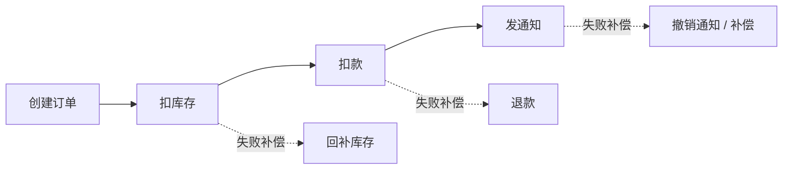

# 一致性

> 一致性不是“有没有 bug”，而是“在并发、复制和故障下，系统允许你看到什么状态”。

单机数据库里，事务可以帮你挡住很多问题；一旦系统变成多副本、多服务、多数据库，再加上缓存和消息队列，事情就变了。写入可能只成功了一半，读请求可能落到落后的从库，重复消息可能让同一笔操作执行两次，网络分区时你必须在“继续服务”和“保持强一致”之间做选择。

一致性设计要回答的不是“能不能做到绝对正确”，而是“在故障和并发下，允许出现哪些中间状态，以及这些状态如何收敛”。

## 本章目标

学完本章，你应该能够：

- 区分强一致、最终一致和读己之写。
- 用 CAP / PACELC 分析故障下的取舍。
- 选择 2PC、TCC、Saga 或 outbox。
- 用幂等、补偿和对账收敛不一致。

## 一致性到底在约束什么

ACID 描述的是单数据库事务：原子性、一致性、隔离性和持久性。它保证一组操作要么全部成功，要么全部失败，并发事务之间互不干扰，提交后的数据不会丢。但跨服务、跨数据库时，ACID 不再自动成立。

CAP 说的是网络分区下的取舍：分区不可避免，所以系统通常要在一致性（C）和可用性（A）之间选择。PACELC 更进一步：分区时在 C 和 A 之间取舍，正常时在延迟（L）和一致性（C）之间取舍。

实际业务里，一致性有很多级别：

| 级别 | 含义 | 例子 |
| --- | --- | --- |
| 强一致 | 写入后所有读都能立即看到 | 银行余额、库存扣减 |
| 线性一致 | 所有操作像在单机上按顺序执行 | 分布式锁、配置中心 |
| 因果一致 | 有因果关系的操作保持顺序 | 评论和回复 |
| 读己之写 | 用户能立即看到自己的写入 | 发帖后立即看到自己的帖子 |
| 最终一致 | 一段时间后所有副本收敛 | 点赞数、搜索索引 |

::: tip 先定义“允许多旧”
一致性不是越高越好。先问业务允许读到多旧的数据、旧数据会持续多久、读到旧数据时最坏会发生什么。大多数业务需要的是“可接受的旧数据 + 明确的失效机制”，而不是强一致。
:::

## 复制延迟与读一致性

主从复制最常见的问题，是写主库后立即读从库，却读不到刚写的数据。复制延迟可能来自从库回放慢、大事务、无主键/无索引更新，或者从库负载过高。

解决方式包括：关键读走主库、写后短时间内强制读主库、会话粘滞、使用 GTID/LSN 等待复制追上，或者对延迟敏感的读做降级。读己之写和单调读是两种常见的一致性保证：前者保证用户能看到自己的写入，后者保证不会读到比之前更旧的数据。

Quorum 是另一个工具：N 个副本中，写成功需要 W 个确认，读需要 R 个响应。当 `W + R > N`，读写集合有交集，可以读到最新写入；代价是写更慢或读更慢。`W + R <= N` 延迟更低，但可能读到旧数据。

## 分布式事务

2PC 是最经典的强一致方案：Prepare 阶段所有参与者锁定资源，Commit 阶段统一提交。它保证强一致，但会阻塞、依赖协调者、故障恢复复杂、性能差。TCC 把事务拆成 Try / Confirm / Cancel，适合金额、库存等需要明确预留的业务，但每个操作都要实现三个方法，并处理空回滚、悬挂和幂等。

Saga 把长事务拆成多个本地事务，失败时执行补偿：创建订单 → 扣库存 → 扣款 → 发通知，失败时反向补偿。它适合长流程和可以接受中间状态的业务，但没有隔离性，中间状态对外可见，补偿必须幂等，还需要状态机和重试。

Outbox 解决的是“数据库提交了，消息没发出去”或“消息发出去了，数据库回滚了”。业务事务同时写业务表和 outbox 表，后台任务读取 outbox 发送消息，发送成功后标记已发送。它通常比 2PC 更轻，但仍然是最终一致，消费端必须幂等。

::: details 小问题：Saga 和 TCC 的区别是什么？
Saga 是“执行本地事务，失败后补偿”，没有预留资源；TCC 是“先预留，再确认或取消”，隔离性更强但业务侵入更大。Saga 适合长流程和可接受中间状态的业务，TCC 适合金额、库存等需要明确预留的资源。
:::

## 幂等、补偿与对账

分布式系统里，重试和重复投递是常态。幂等是最终一致的基础：业务唯一键 + 唯一索引、幂等表、状态机、版本号/CAS、请求 ID，都是常见方案。支付回调、创建订单、退款、发送通知这些操作尤其需要幂等。

补偿不是回滚，而是用新的业务操作抵消之前的影响：扣款成功后退款，扣库存成功后回补，发券成功后作废。补偿要幂等、可重试、有状态记录、有最大重试和人工介入。

最终一致系统必须有对账：定时比对两边数据，找出差异，自动修复或人工处理，并记录差异原因。没有对账的最终一致，只是“希望最终一致”。

## 冲突处理

多副本并发写时，需要决定冲突怎么处理。Last Write Wins 简单，但可能丢数据；版本号/CAS 适合冲突不高的场景；向量时钟能检测并发版本，但实现复杂；CRDT 能自动合并，但适用类型有限；人工合并适合高价值、低频率的冲突。

::: warning 不要把所有场景都做成强一致
强一致通常意味着更高的延迟、更低的可用性和更复杂的故障处理。先判断业务是否真的不能接受旧数据；如果只是“看起来更安心”，最终一致加对账往往更合适。
:::

## Consistency Review 矩阵

| 维度 | 必须回答 | 不满足时怎么办 |
| --- | --- | --- |
| 业务 | 哪些操作必须强一致？ | 只对关键路径加事务 |
| 读 | 允许读到多旧的数据？ | 定义读己之写/单调读策略 |
| 事务 | 跨服务事务用什么方案？ | 2PC、TCC、Saga 或 outbox |
| 幂等 | 所有写操作是否幂等？ | 加请求 ID、唯一约束和状态机 |
| 补偿 | 失败时如何补偿？ | 设计补偿操作和重试 |
| 对账 | 是否有定时对账和修复？ | 加对账任务和差异告警 |
| 冲突 | 多副本写入如何合并？ | 版本号、CAS 或 CRDT |

## 总结

一致性设计的核心，是在业务可接受的范围内收敛不一致：

- 先定义允许的旧数据，再选择强一致或最终一致。
- 跨服务事务优先考虑 Saga/outbox，而不是硬套 2PC。
- 幂等、补偿和对账，是最终一致系统的基本配套。

如果只能记住一件事：一致性不是“有没有 bug”，而是“系统在故障时允许你看到什么，以及多久能收敛”。

## 相关阅读

- [消息队列](/system-design/message-queue)
- [缓存](/system-design/cache)
- [数据库设计](/system-design/database-design)
- [分布式锁](/system-design/distributed-lock)
