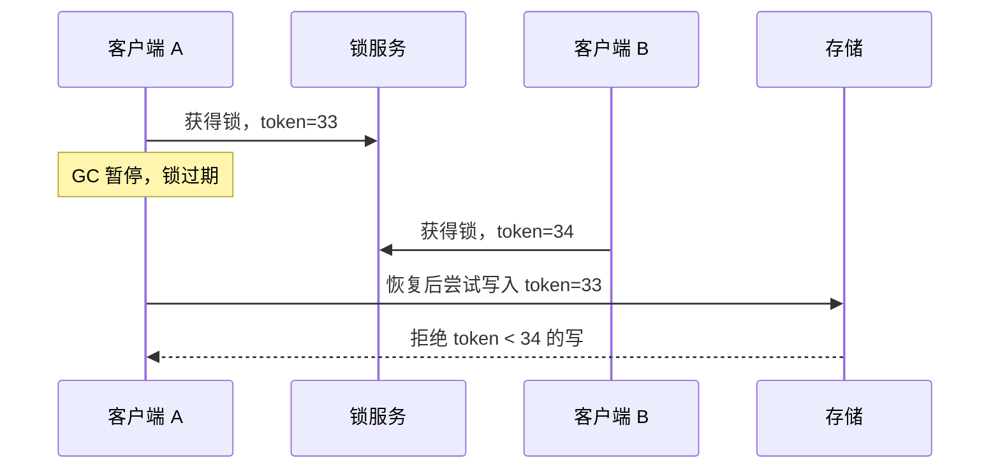

# 分布式锁

> 分布式锁的本质是“在不可靠的网络里，尽量保证同一时刻只有一个执行者”。

单机锁只能保护一个进程。多实例部署之后，定时任务可能同时执行，两个请求可能同时修改同一订单，缓存重建可能同时回源。分布式锁看起来是一个直接答案，但它也是系统里最容易“以为自己安全”的组件之一：锁过期、网络分区、GC 暂停和续期失败，都可能让两个执行者同时认为自己持有锁。

所以先问“能不能不用锁”，再问“用哪种锁”。很多场景其实可以用数据库唯一约束、乐观锁、状态机或幂等设计解决，比引入一个分布式锁服务更简单。

## 本章目标

学完本章，你应该能够：

- 判断一个场景是否真的需要分布式锁。
- 设计带唯一值、TTL 和续期的 Redis 锁。
- 用 fencing token 防止过期持有者写入。
- 比较 Redis、ZooKeeper、etcd 和数据库锁。

## 什么时候真的需要锁

锁适合跨进程互斥，但很多业务不需要它。数据库唯一约束能解决重复插入；乐观锁/版本号能解决并发更新；状态机能解决非法状态转换；幂等设计能解决重复请求；分布式任务调度可以用租约和选举，而不是手写锁。

锁的基本要求是互斥、无死锁、可重入（可选）、高可用、安全释放和可续期。先明确这些要求，再选实现；只写一个 `SETNX` 不叫分布式锁，它只是“一个可能过期的互斥标记”。

## Redis 锁的正确姿势

加锁要使用 `SET lock:order:123 <unique_value> NX PX 30000`：`NX` 保证不存在才设置，`PX` 给出 30 秒租约，`unique_value` 是每次加锁生成的唯一值。释放时必须判断 value 是不是自己的，再用 Lua 原子删除；直接 `DEL` 可能删掉别人续期后的锁。

```lua
if redis.call('GET', KEYS[1]) == ARGV[1] then
  return redis.call('DEL', KEYS[1])
else
  return 0
end
```

长任务需要 watchdog 定期检查锁是否仍属于自己，属于自己才延长 TTL，续期失败要停止任务。续期不是万能的：进程卡死、网络分区或 GC 停顿，锁仍可能过期。

## 租约、fencing 与共识系统

Redlock 试图在多个独立 Redis 节点上获取多数锁，但它对时钟、网络和故障模型有假设，在极端情况下不能提供绝对安全。对正确性要求高的场景，不要把 Redlock 当成“绝对正确的分布式互斥”。

Fencing token 是更可靠的补充：锁服务每次授予锁时返回一个单调递增的 token，资源端拒绝比当前 token 更小的写。即使旧持有者在 GC 暂停后恢复，它的写也会被存储拒绝。关键不是只有锁，而是资源端也校验 token。



ZooKeeper 用临时顺序节点和 Watch 实现锁，etcd 用 Lease + 事务和 revision 实现租约。它们有共识协议，故障语义更清晰，适合对正确性要求高的协调场景，但运维更复杂、性能通常不如 Redis。

::: warning 只有锁，没有 fencing，仍然可能写坏数据
锁过期后，旧持有者可能恢复并继续写存储。资源端必须校验 fencing token，或者用条件更新/版本号拒绝过期写入。否则“锁”只保护了执行者，没有保护数据。
:::

## 锁的粒度、失败与常见误区

锁的粒度越小，并发越高；但锁内不要做远程调用、IO 和大计算。长任务不要一直持有锁，考虑分段、状态机或任务租约。TTL 要大于正常执行时间，但不要无限长；没有 TTL，进程崩溃后会死锁；TTL 太短，业务没执行完锁就过期。

常见错误包括：直接 `DEL` 不校验 value、没有 TTL、没有续期、续期失败还继续执行、网络分区时以为锁一定安全、锁内做慢操作、把分布式锁当事务、没有 fencing token、锁服务单点故障没有预案。

::: details 小问题：ZK/etcd 锁一定比 Redis 锁安全吗？
不一定。共识系统提供更清晰的故障语义，但仍然有租约、会话和网络分区问题。正确性最终取决于资源端是否校验 fencing token 或版本号。工具不能替代边界设计。
:::

## Distributed Lock Review 矩阵

| 维度 | 必须回答 | 不满足时怎么办 |
| --- | --- | --- |
| 必要性 | 真的需要分布式锁吗？ | 先用唯一约束、乐观锁或状态机 |
| 加锁 | 是否原子、带唯一值？ | 用 `SET NX PX`，不要分两步 |
| 释放 | 是否校验持有者？ | 用 Lua 比较 value 后删除 |
| 租约 | TTL 是否合理？是否需要续期？ | 加 watchdog，续期失败停止 |
| 安全 | 资源端是否校验 fencing token？ | 加单调 token 和条件写 |
| 失败 | 网络分区/GC 停顿如何处理？ | 缩小锁范围，加超时和回滚 |
| 运维 | 锁服务故障时行为可预期吗？ | 做降级、告警和演练 |

## 总结

分布式锁不是“加一个 Redis key”：

- 先判断能不能不用锁；唯一约束、乐观锁和幂等往往更简单。
- Redis 锁要有唯一值、TTL、Lua 释放和续期。
- 对正确性要求高的场景，资源端必须校验 fencing token。

如果只能记住一件事：锁只能降低并发概率，不能单独保证数据正确；真正的安全边界在资源端的条件写入。

## 相关阅读

- [一致性](/system-design/consistency)
- [缓存](/system-design/cache)
- [限流](/system-design/rate-limiting)
- [数据库设计](/system-design/database-design)
