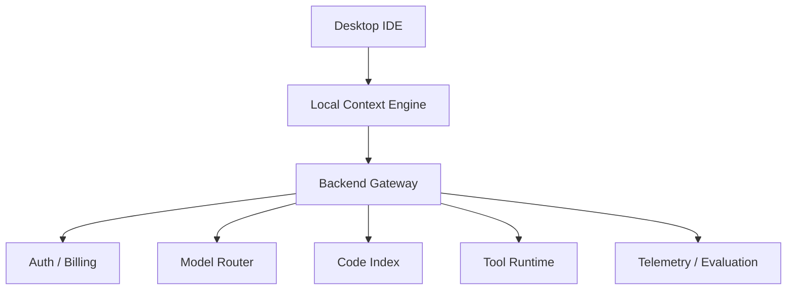

# 如果让我设计 Cursor

> AI 编程产品的核心竞争力不是“接一个模型”，而是“在正确时刻，把正确的代码上下文交给模型，并安全地执行修改”。

一个 AI 编程 IDE 看起来只是一个聊天框加补全，实际要同时处理代码索引、上下文组装、模型路由、流式输出、diff、文件修改、终端执行、测试反馈、隐私和成本。模型只是其中一层，真正决定体验的是上下文和验证。

如果只做一个“能回答代码问题”的聊天框，很容易；难的是让它理解跨文件调用链、在正确位置生成最小 diff、运行测试、失败后继续修，并且不把敏感代码发到不该去的地方。

## 本章目标

学完本章，你应该能够：

- 拆解 AI 编程 IDE 的核心需求。
- 设计代码索引、上下文组装和模型路由。
- 处理补全、行内编辑和 Agent 的延迟与安全。
- 评估质量、成本、隐私和回滚能力。

## 需求与规模

核心功能包括代码补全、行内编辑、代码库问答、多文件修改、Agent 模式、代码索引、多模型选择和团队协作。非功能需求里，补全和行内编辑要接近实时，修改要能编译和通过测试，上下文要能理解跨文件模块，隐私要支持企业策略，成本要可控，用户要能审查、接受或拒绝修改。

容量估算要关注活跃用户、并发请求、代码库大小、索引更新频率、模型 token 成本和峰值延迟。AI 编程产品的成本结构通常不是“存储很贵”，而是“模型调用和索引维护很贵”。

## 架构与代码索引

代码索引通常包含文件路径、语言、符号、import/依赖、代码块 embedding、仓库结构、测试和文档。索引方式有三种：本地索引隐私好、延迟低，但受机器性能限制；云端索引可扩展、跨设备，但有隐私和传输成本；混合方案把敏感数据留在本地，把语义检索放云端。

索引要支持增量更新：文件保存时更新，git diff 触发重索引，删除文件同步删除索引，大仓库限制范围，并支持 `.gitignore` 和企业忽略规则。索引不是越全越好，生成代码、vendor 和构建产物进入索引只会增加噪音。

::: details 小问题：代码索引应该全量还是增量？
生产环境通常以增量为主、全量为辅。日常保存和 git diff 触发增量更新；仓库初始化、索引损坏或 schema 升级时才做全量重建。全量索引成本高，也会影响用户机器和云端资源。
:::

## 上下文、模型路由与延迟

上下文来源包括当前文件和选区、打开的文件、相关符号和引用、诊断和错误、终端输出、git diff、检索到的代码块，以及项目规则和 README。原则是相关性优先，保留文件路径和行号，对长文件做摘要或片段，把用户指令和代码数据分开，并控制 token 预算。

不同任务用不同模型：行内补全优先低延迟小模型；代码问答用中等能力、带上下文的模型；多文件重构用强推理、大上下文；Agent 需要工具调用能力和稳定性。路由要考虑延迟、成本、上下文长度、代码能力、可用性和限流。

延迟优化包括流式输出、本地缓存和增量索引、预测性预取、只发送必要上下文、小模型处理简单任务、并行检索和模型调用，以及失败快速降级。

::: tip 补全的延迟比“聪明”更重要
行内补全如果慢半秒，用户就会关掉它。补全场景宁可先用小模型快速给出候选，也不要用大模型思考三秒。复杂任务再交给 Chat 或 Agent。
:::

## 补全、行内编辑与 Agent

行内补全的路径是：光标上下文 → 本地过滤 → 远端模型 → 流式返回 → 编辑器渲染。它要求极低延迟、不打断输入、只返回短补全，失败时静默降级。

行内编辑是：选中代码 + 指令 + 相关上下文 → 模型 → diff → 用户接受/拒绝。它要求保留原有格式、只改必要部分、展示清晰 diff、支持撤销。

代码库问答是：问题 → 检索相关文件/符号 → 组装上下文 → 模型回答 → 引用文件。它要求引用准确、不编造不存在的文件或 API、找不到时明确说不知道。

Agent 模式是：任务 → 计划 → 搜索代码 → 编辑 → 运行测试 → 看结果 → 修复 → 总结。它要求每步可观察、修改可回滚、危险命令需确认、有最大步骤和成本限制。

## 隐私、安全与评估

隐私要明确代码是否上传、保存多久，企业版支持本地部署或私有索引，不把密钥、`.env` 和敏感文件发送到模型，支持忽略规则、传输和存储加密、权限与仓库访问一致、审计模型调用和文件访问，并防止仓库中的提示注入影响 Agent。

Agent 安全包括：文件修改在可回滚的工作区，终端命令白名单或确认，禁止直接操作生产环境，限制网络和可修改路径，每次修改展示 diff，测试失败时不要宣称完成。

::: warning 代码隐私不是“加个开关”就结束
企业客户关心的是数据去了哪里、保存多久、谁能访问、如何删除。隐私设计要覆盖索引、模型调用、日志、缓存、遥测和第三方依赖，而不是只在设置页放一个开关。
:::

评估要看补全接受率、补全延迟、代码问答引用准确率、多文件任务成功率、测试通过率、用户撤销/回退率、单任务成本和安全拦截率。评估集要覆盖单文件任务、跨文件重构、陌生库、错误日志修复、测试失败修复、权限不足和危险命令。

## Cursor Review 矩阵

| 维度 | 必须回答 | 不满足时怎么办 |
| --- | --- | --- |
| 索引 | 是否增量、可控、排除敏感文件？ | 限制范围，加忽略规则 |
| 上下文 | 是否在正确时机提供正确代码？ | 改进检索、repo map 和预算 |
| 延迟 | 补全和编辑是否接近实时？ | 小模型、流式、缓存、预取 |
| 模型 | 是否按任务路由？ | 按延迟/成本/能力分层 |
| 修改 | 是否展示 diff 并可回滚？ | 加 diff、撤销和工作区隔离 |
| 安全 | 是否限制命令、网络和生产操作？ | 沙箱、白名单和人工确认 |
| 隐私 | 是否明确数据流向和保留策略？ | 本地/私有索引，脱敏和审计 |
| 评估 | 是否覆盖真实编程任务？ | 建任务集和回归指标 |

## 总结

AI 编程 IDE 的竞争力，来自上下文和执行边界：

- 代码索引决定能不能找到，上下文组装决定模型看到什么。
- 补全要快，编辑要小，Agent 要可观察、可回滚。
- 隐私、安全和评估不是附属功能，而是产品能否进入团队的前提。

如果只能记住一件事：AI 编程产品不是“把模型接进编辑器”，而是“把代码上下文、修改和验证组织成一条可控链路”。

## 相关阅读

- [Context Engineering](/ai-engineering/context-engineering)
- [Agent](/ai-engineering/agent)
- [Tool Calling](/ai-engineering/tool-calling)
- [AI Coding](/ai-engineering/ai-coding)
