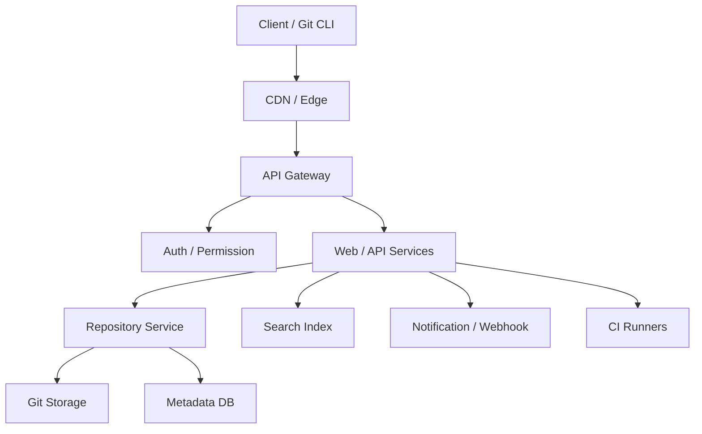

# 如果让我设计 GitHub

> 代码托管平台的核心不是“网页”，而是“可靠地存储和分发 Git 对象，并在其上构建协作能力”。

GitHub 看起来像一个网页应用，实际上底层是一个代码存储和分发系统：clone/fetch 流量巨大，仓库大小差异极大，refs 更新必须可靠，搜索和通知可以最终一致，PR、Issue、Actions 又都建立在 Git 之上。

设计它时，最危险的做法是把 Git 对象当成普通关系表数据，或者让 push、CI、通知共享同一条强耦合的同步链路。代码存储要优先持久性和吞吐，协作能力要允许异步和最终一致。

## 本章目标

学完本章，你应该能够：

- 拆解代码托管平台的核心需求。
- 设计 Git 存储、refs 更新和 clone/push 路径。
- 设计 PR、搜索、通知和权限模型。
- 识别大仓库、热点和多区域扩展的瓶颈。

## 需求与规模

核心功能包括用户和组织、创建仓库、Git push/pull/clone、浏览代码和提交历史、Pull Request、Issue、代码搜索、通知、Webhook、CI/CD 和权限审计。

非功能需求里，代码读写要高可用，Git refs 要强一致，搜索和通知可以最终一致，代码不能丢，权限和供应链安全要可审计。容量估算要关注仓库数量、平均大小和增长、每日 clone/fetch/push 次数、峰值并发连接、搜索索引大小和通知/Webhook 事件量。

Git 流量通常读多写少，clone/fetch 占大头，适合缓存和 CDN 化；仓库大小分布通常很不均匀，少数大仓库会消耗大量存储和带宽。

## Git 存储与读写路径

每个仓库可以对应一个 bare repository，Git 对象按内容寻址，用 packfile 压缩存储；大仓库可以拆分或使用 alternates；对象存储保存冷数据和大 packfile；元数据数据库保存仓库、refs、权限和默认分支。

clone/fetch 的路径是：客户端请求仓库，仓库服务定位 Git 存储，返回 packfile，CDN 缓存可缓存的部分。push 的路径是：客户端发送 pack，仓库服务校验并写入对象，再更新 refs，最后触发 hooks/CI。对象可以先落盘，refs 更新要保证并发安全，避免两个 push 互相覆盖。

::: warning refs 更新必须强一致
代码对象可以先写、后更新 ref，但 ref 更新不能出现两个 push 同时成功覆盖。搜索、通知和 CI 可以最终一致；refs 不行，否则用户会看到“代码已推送但分支指向错误提交”。
:::

## PR、搜索与权限

PR 的核心数据是源分支、目标分支、base commit、head commit、diff、review 评论、检查状态和合并状态。流程是创建 PR → 计算 diff → 触发 CI → review → 解决评论 → 更新分支 → 合并。合并要考虑 merge commit、squash、rebase，以及合并队列，避免并发合并破坏目标分支。

代码搜索要支持增量索引、按仓库/语言/路径/权限过滤、符号搜索、正则和全文搜索。索引可以最终一致，但要在结果里标注延迟；权限过滤必须在查询阶段完成，不能等生成后再删。

权限层级是组织 → 团队 → 仓库 → 分支/路径，支持 read、write、maintain、admin，以及组织成员、团队继承、外部协作者、分支保护规则和审计日志。权限模型越灵活，查询和缓存越复杂，越需要统一收口。

## 通知、CI 与扩展

通知和 Webhook 应该由事件驱动：事件写入消息队列，通知服务消费，站内信、邮件、Webhook 分别处理，失败重试和死信。Webhook 要签名、超时、重试、防 SSRF；通知要能去重、限流和配置订阅规则。

CI 由事件触发 workflow，调度器分配 runner，runner 隔离执行，日志流式传输，产物存储，支持超时、取消、重试和密钥隔离。CI runner 不能和生产环境共享权限，否则一次恶意 PR 就可能拿到内部凭证。

| 瓶颈 | 方案 |
| --- | --- |
| 大仓库 clone 慢 | packfile 优化、CDN、浅克隆、部分克隆 |
| 热点仓库 | 缓存、分区、专用存储 |
| 代码搜索延迟 | 增量索引、分片、异步 |
| 通知风暴 | 批量、去重、限流 |
| CI 资源 | 弹性 runner、队列、优先级 |
| 多区域 | 读副本、区域缓存、异步复制 |

::: details 小问题：为什么大仓库 clone 慢？
因为 clone 要传输大量 Git 对象和历史。优化方向不是“加机器”这么简单，而是减少传输量：浅克隆、部分克隆、packfile 优化、CDN、对象去重和合理的仓库拆分。大仓库还需要限制单文件大小和历史膨胀。
:::

## GitHub Review 矩阵

| 维度 | 必须回答 | 不满足时怎么办 |
| --- | --- | --- |
| 存储 | Git 对象和 refs 是否分离、可靠？ | 对象存储 + 元数据 DB，refs 强一致 |
| 读写 | clone/push 路径是否清晰？ | 画清对象写入和 ref 更新顺序 |
| PR | 合并是否有并发控制？ | 加合并队列和检查门禁 |
| 搜索 | 是否增量索引并做权限过滤？ | 索引分片，查询带权限条件 |
| 权限 | 组织/团队/仓库层级是否统一？ | 收口到权限服务，加审计 |
| 通知 | Webhook 是否签名、重试、防 SSRF？ | 加签名、超时和重试 |
| CI | runner 是否隔离、最小权限？ | 隔离环境，限制密钥 |
| 扩展 | 大仓库/热点/多区域是否有方案？ | 缓存、分区、浅克隆、复制 |

## 总结

GitHub 的设计可以压缩成两层：

- 底层是可靠的 Git 对象存储和 refs 更新，优先持久性、吞吐和一致性。
- 上层是 PR、搜索、通知、权限和 CI，可以异步、最终一致，但要可审计、可回滚。

如果只能记住一件事：代码托管平台先把 Git 存对、传稳，再谈网页和协作功能。

## 相关阅读

- [权限系统](/system-design/auth-system)
- [消息队列](/system-design/message-queue)
- [缓存](/system-design/cache)
- [一致性](/system-design/consistency)
