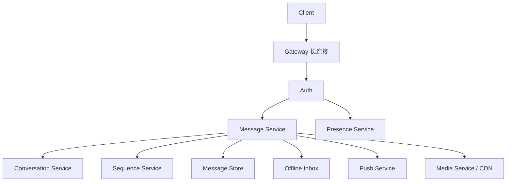
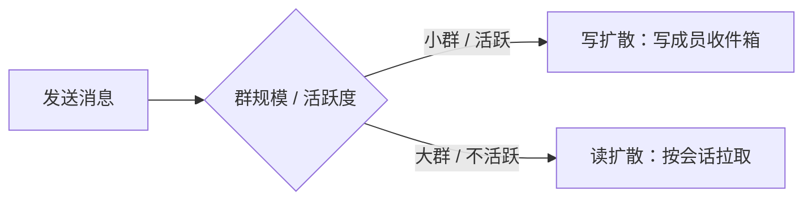

# 如果让我设计微信

> IM 系统的难点不是“发一条消息”，而是“在弱网、离线、多设备、群聊和高并发下，仍然保证消息可送达、可同步、可去重”。

发送一条文本消息，看起来只是“客户端 → 服务端 → 接收方”。但真实 IM 要处理长连接、心跳、消息序号、离线消息、多设备同步、群聊写放大、媒体文件、推送、撤回和在线状态。任何一个环节没有兜底，用户就会看到“消息发了但对方没收到”“换了手机聊天记录对不上”“群里顺序乱了”。

IM 的核心不是聊天界面，而是可靠的消息存储、同步和投递。

## 本章目标

学完本章，你应该能够：

- 拆解 IM 的核心需求和容量指标。
- 设计长连接、消息持久化和投递流程。
- 处理会话顺序、离线同步和群聊扇出。
- 设计媒体、推送、在线状态和撤回。

## 需求与规模

核心功能包括单聊、群聊、文本/图片/语音/视频/文件、已读/未读、离线消息、多设备同步、在线状态、消息撤回、朋友圈（可选）和推送。非功能需求里，消息收发要高可用、在线消息低延迟、不丢消息、单会话有序、读状态可异步、支撑海量连接和消息，并保证隐私、加密和反垃圾。

容量估算要关注 DAU、同时在线连接数、人均消息数、群聊消息占比、消息平均大小、媒体大小和保留周期、离线消息保留时间和推送量。群聊的写放大会显著影响存储和投递成本。

## 架构与消息发送

消息发送的路径是：客户端通过长连接发送消息，Gateway 校验连接、用户和限流，Message Service 校验会话和权限，Sequence Service 分配会话内序号，消息持久化，返回发送方 ack，再投递给在线接收方，离线接收方写入离线索引/收件箱，需要时触发推送。

::: warning 先持久化，再 ack
如果先 ack 再持久化，服务端崩溃时发送方会以为消息成功，接收方却永远收不到。正确顺序是先落库、再 ack；发送方超时重试时，用 message_id 去重。
:::

## 顺序、投递与离线同步

IM 只保证单会话内顺序，不保证全局顺序：`conversation_id -> sequence`。客户端按 sequence 排序，发现缺口时拉取缺失消息，重复消息按 message_id 去重；服务端要保证同一会话的序号分配原子，群聊要保证同一群内顺序。

可靠投递采用“至少一次 + 客户端幂等”：发送方超时重试，服务端按 message_id 去重，接收方收到后 ack，未 ack 的消息可以重投，离线消息按 sequence 拉取，客户端维护已读/已同步游标。消息状态可以是 SENT → DELIVERED → READ，状态更新可以异步，允许短暂不一致。

离线消息要为每个用户维护收件箱或会话游标，上线后按游标拉取，大量消息分页，设置保留期限。多设备要为每个设备维护同步游标，按会话 sequence 同步，已读状态单独同步；设备之间不要求强一致。

## 群聊、媒体与在线状态

群聊有两种思路：写扩散在发送时给每个成员写一份收件箱，读取简单但大群写放大严重；读扩散只存一份，成员读取时按会话拉取，存储省但读取和同步复杂。实际系统通常混合：小群写扩散，大群读扩散，活跃成员优先推送，非活跃成员按需拉取。

媒体消息的路径是：客户端上传 → 对象存储 → 生成缩略图/转码 → 返回 media_id/url → 发送消息引用 media_id。图片、视频、文件分开处理，上传限流和大小限制，CDN 分发，访问权限校验，缩略图和转码异步，存储生命周期和冷热分层。

在线状态用长连接心跳维护，Presence 服务保存在线设备、最后活跃时间；状态可以最终一致，不要为每次状态变化写数据库，大量状态变更要批量/采样。推送只做提醒，不作为唯一消息通道；在线走长连接，离线走厂商推送，推送要限流、去重、可关闭。

::: details 小问题：群聊应该写扩散还是读扩散？
看群规模和活跃度。小群、活跃群写扩散读取快；大群写扩散会产生巨大写放大，应该读扩散或混合。很多系统不是二选一，而是按群规模、成员活跃度和消息类型动态选择。
:::

## 扩展与取舍

瓶颈通常出现在长连接数、消息写入、群聊扇出、离线消息、媒体存储、推送风暴和热点群。对应方案是 Gateway 分片、按会话分片、写扩散/读扩散混合、游标分页和过期清理、对象存储 + CDN、推送聚合限流、热点群单独分区和降级。

取舍也很明确：强顺序只保证会话内，换取扩展性；至少一次投递 + 幂等，换取可靠性；在线状态最终一致，换取低成本；群聊写扩散/读扩散按规模和活跃度取舍；推送只做提醒，避免依赖厂商推送保证消息不丢。

## WeChat Review 矩阵

| 维度 | 必须回答 | 不满足时怎么办 |
| --- | --- | --- |
| 连接 | 长连接、心跳和重连是否可靠？ | Gateway 分片，心跳和退避重连 |
| 持久化 | 是否先持久化再 ack？ | 调整发送顺序，加去重 |
| 顺序 | 会话内 sequence 是否原子？ | 单会话序列服务/分区顺序 |
| 投递 | 是否至少一次 + 客户端幂等？ | 加 ack、重投和 message_id 去重 |
| 离线 | 游标和多设备同步是否完整？ | 收件箱/游标分页和过期清理 |
| 群聊 | 写扩散还是读扩散？ | 按规模和活跃度混合 |
| 媒体 | 上传、转码、CDN 和权限是否完整？ | 对象存储 + 异步转码 + 鉴权 |
| 推送 | 是否只做提醒并可限流？ | 长连接优先，推送聚合去重 |

## 总结

IM 系统的核心，是可靠地保存、排序和同步消息：

- 先持久化再 ack，至少一次投递 + 客户端幂等。
- 只保证会话内顺序，用 sequence 和游标做同步。
- 群聊按规模和活跃度选择写扩散/读扩散，媒体和推送单独治理。

如果只能记住一件事：IM 的难点不是“发出去”，而是“离线、换设备、群聊和高并发时仍然能对上”。

## 相关阅读

- [消息队列](/system-design/message-queue)
- [一致性](/system-design/consistency)
- [缓存](/system-design/cache)
- [如果让我设计 GitHub](/system-design/if-i-were-github)
